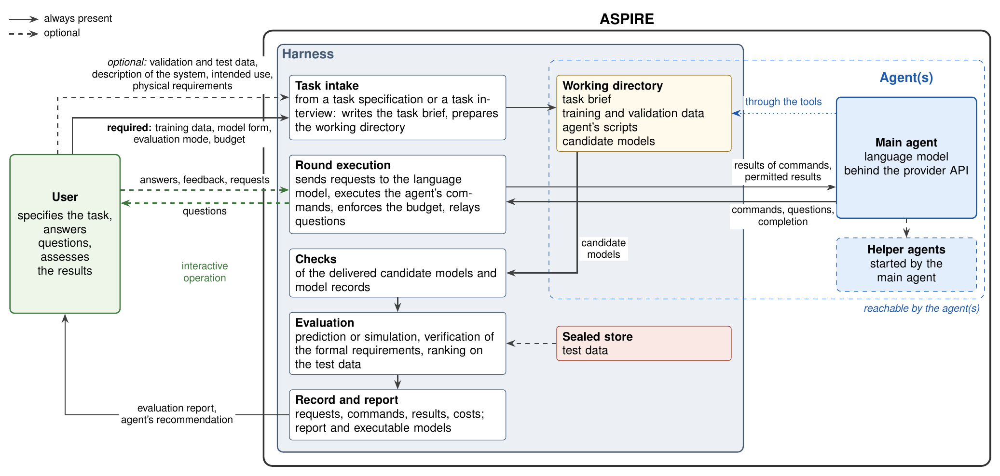

# ASPIRE

**Agentic System-identification Platform for Iterative Reasoning and Exploration**

ASPIRE identifies closed-form models of dynamic and static systems from measured data with a
language-model agent. The user supplies a data table, and may add a description of the system,
the intended use of the model and physical requirements, stated formally or in natural language.
The agent analyses the data, proposes model structures from several model families, estimates
their parameters with scripts of its own and delivers a pool of candidate models. Each candidate
comes with a model record: a parameter table, an estimation record and a discussion of the
model. The software evaluates every candidate on test data that the agent cannot reach, verifies
the formal requirements and records every step of the run. A human assesses the result.

This repository contains the software, the tasks and the complete records of the experiments
reported in the accompanying paper by Erik Derner, Jiří Kubalík and Robert Babuška. A link to the
preprint and a citation entry will be added here when the preprint is available.

## How it works

ASPIRE consists of two parts:

- The **harness** is the software in this repository (Python package `aspire_sysid`, console
  script `aspire`). It writes the task brief, prepares the working directory of the agent, sends
  the requests to the language model, executes the agent's tools, enforces the budget, checks the
  delivered model files, evaluates the candidates and writes the records and the reports.
- The **agent** is the language model that carries out the identification. It reads and writes
  files and runs commands in its working directory, can access the web, install Python packages
  and start helper agents, and may ask the user questions.

The main properties of the method:

- **Closed-form models.** Every candidate is an expression over the operators and functions
  permitted by the task: a static map, a continuous-time or discrete-time state-space model, or a
  NARX model. Black-box models may be used by the agent as tools, but are never delivered.
- **Sealed evaluation.** The test data are held by the harness outside the working directory of
  the agent. The harness alone computes the predictions or simulations of the candidates and
  their errors on the test data.
- **Physical requirements.** A formal requirement (for example an equation, a sign, a
  monotonicity or a value condition over a domain) is verified symbolically and on sampled
  points, and a candidate with a demonstrated violation is excluded. A requirement in natural
  language is passed to the agent and assessed by the human.
- **Recommendation separated from oracle selection.** The agent may recommend one candidate on
  the basis of the training and validation data, before any test result is shown. The ranking of
  the pool by the test error is reported separately as an oracle-based selection.
- **Complete records.** Every request to the language model, every response, every tool call,
  the agent's scripts, the delivered models, the evaluation, the token counts and the cost are
  stored, and `aspire record verify` recomputes the evaluation of a run offline.
- **Autonomous or interactive operation.** An experiment repeats a task several times without a
  user. An interactive session, on the terminal or in the browser, lets the user answer the
  agent's questions, request analyses and start further rounds; it can start from data files
  alone, with a task interview led by the agent.

## Installation

Requirements: Python 3.11 or later and an API key of OpenAI whose account has access to the
model `gpt-6.1-sol`, the model of the experiments and the default of the harness. On Linux or
macOS:

    git clone https://github.com/erik-derner/aspire-sysid.git
    cd aspire-sysid
    python3 -m venv .venv
    .venv/bin/python -m pip install -e "aspire[runner]"
    .venv/bin/aspire --version

The agent runs its scripts in a separate Python environment with the packages for system
identification (NumPy, SciPy, SymPy, pandas, Matplotlib, scikit-learn, gplearn, PySINDy), which
the harness creates once:

    .venv/bin/aspire experiment agent-env ~/.local/share/aspire/agent-env

The API key is read from the environment or from a file `.env` in the repository root with the
line `OPENAI_API_KEY=...`. [QUICKSTART.md](QUICKSTART.md) gives every step for Windows, Linux and
macOS, and [aspire/README.md](aspire/README.md) documents all commands, file formats and records.

## Usage

Interactive operation in the browser (the web app runs on `127.0.0.1` only):

    aspire web

Interactive operation on the terminal, from a task folder or from data files:

    aspire session tasks/turtlebot
    aspire session --train train.csv --val val.csv --test test.csv

With data files, the agent interviews the user about the system and writes the task
specification `task.yaml`, which the user confirms before the identification starts. A task can
also be written by hand from the guide [tasks/GUIDE.md](tasks/GUIDE.md) and the two commented
examples `tasks/example-static` and `tasks/example-dynamic`.

Autonomous experiments (one task, repeated runs with identical settings):

    aspire experiment run experiments/paper-turtlebot --dry-run
    aspire experiment run experiments/paper-turtlebot
    aspire experiment aggregate experiments/paper-turtlebot
    aspire experiment report experiments/paper-turtlebot

Each run has a cost limit (10 US dollars by default) and limits on turns and time. The responses
of a language model are not reproducible, so a new run gives different models.

## Repository contents

| Path | Content |
|---|---|
| `QUICKSTART.md` | installation and first start of the web app on Windows, Linux and macOS |
| `aspire/` | the harness: Python package `aspire_sysid`, console script `aspire`, configuration files; `aspire/README.md` documents the commands, the file formats, the evaluation and the records |
| `tasks/` | the task specifications with their data (`tasks/README.md`), the guide for defining a task (`tasks/GUIDE.md`) and two example tasks with synthetic data |
| `experiments/paper-*/` | the six experiments of the paper, five runs each, with all run records |
| `experiments/references/` | the models of PySINDy and PySR with their scripts and evaluations |
| `experiments/paper/` | the script that computes the numbers, tables and figures of the paper from the records, its results, and the assessment of the model records |
| `docs/` | the overview figure |

## Experiments of the paper

Three systems with measured data, each posed as a **described task** (description, units,
intended use and, for two systems, physical requirements) and as a **blind task** (the same data
and evaluation settings under neutral column names, without description, units and
requirements; `tasks/BLIND_MAPPING.md`). Each experiment consists of five runs with the language
model `gpt-6.1-sol` (runs of 2026-10-07 to 2026-10-09).

The data of the mobile robot and of the friction system were recorded by the authors. The
fermenter and its data are described in H. J. L. van Can et al., "Design and real time testing of a
neural model predictive controller for a nonlinear system", *Chemical Engineering Science* 50(15),
2419–2430, 1995, [doi:10.1016/0009-2509(95)00083-H](https://doi.org/10.1016/0009-2509(95)00083-H);
please cite it when you use these data.

| System | Described task | Experiment | Blind task | Experiment |
|---|---|---|---|---|
| mobile robot (TurtleBot 2) | `tasks/turtlebot` | `experiments/paper-turtlebot` | `tasks/task-kt5o` | `experiments/paper-turtlebot-blind` |
| rotational motion under dry friction | `tasks/friction-driven` | `experiments/paper-friction-driven` | `tasks/task-jdhj` | `experiments/paper-friction-driven-blind` |
| fermenter (headspace pressure) | `tasks/fermenter-pressure` | `experiments/paper-fermenter-pressure` | `tasks/task-qtqm` | `experiments/paper-fermenter-pressure-blind` |

Test score S of the model recommended by the agent: root-mean-square error of the simulated
output on the test data, mean ± sample standard deviation over five runs
(`experiments/paper/results.md`).

| System | Output | S, described task | S, blind task |
|---|---|---|---|
| mobile robot | position x (m) | 0.0430 ± 0.0010 | 0.0401 ± 0.0015 |
| rotational motion under dry friction | angle θ (rad) | 0.0417 ± 0.0070 | 0.0408 ± 0.0079 |
| fermenter | pressure p (bar) | 0.02324 ± 0.00059 | 0.02247 ± 0.00098 |

All 30 runs delivered a pool, and all 126 candidates passed the checks of the harness. The 30
runs cost 61.10 US dollars in total, 0.96 to 3.38 US dollars per run. The paper reports the
comparison with PySINDy and PySR, the verification of the physical requirements and the
assessment of the model records.

An experiment folder contains:

- `experiment.yaml`: the settings;
- `runs/r01` to `runs/r05`: per run, the run record (`run_record.json`), the transcript of every
  request to the language model, every response and every tool call (`transcript.jsonl`), the
  final working directory of the agent with its scripts (`workspace/`), the delivered model files
  (`pools/`), the evaluation on training, validation and test data with plots (`evaluation/`) and
  the delivered models as a Python module (`export/python/`);
- `aggregate.json`, `aggregate.md`: mean and sample standard deviation over the runs;
- `report/index.html`: a report of the experiment for reading in a browser, with one page per run.

The test data of a task are in its folder `test/`. During a run the harness keeps them outside
the working directory of the agent; they are not withheld from readers.

## Checking the reported numbers

The following commands call no language model and need no API key (on Windows the programs are
in `.venv\Scripts\`):

    .venv/bin/aspire task validate tasks/turtlebot
    .venv/bin/aspire record verify experiments/paper-turtlebot/runs/r01
    .venv/bin/aspire experiment aggregate experiments/paper-turtlebot
    .venv/bin/python experiments/paper/collect_results.py

`aspire record verify` evaluates the delivered models of a run again on the data of the task,
including the test data, and compares the result with the stored evaluation. `aspire experiment
aggregate` computes the statistics of an experiment from its run records. `collect_results.py`
writes every number, table and figure of the results of the paper from the aggregations, the run
records and the evaluations of the reference models (`experiments/paper/results.json`,
`results.md`, `tables.tex`, and the figures in `paper/figures/`).

## Notes on the records

The run records are the files that the harness and the agent wrote during the runs, with the
following edits for publication: user names and the computer name in file paths and fields were
replaced, the identifiers of the source-code revision were removed, and the copies of the harness
module `check_submission.py` in the working directories and the texts that the harness wrote into
the records agree with the published code. Where an edited file is named by a SHA-256 digest in a
record, the digest was updated, so that `aspire record verify` works on this copy. The method is
described in the paper; the data files of the tasks are complete.

## Authors

- **Erik Derner**, Czech Institute of Informatics, Robotics and Cybernetics, Czech Technical
  University in Prague
- **Jiří Kubalík**, Czech Institute of Informatics, Robotics and Cybernetics, Czech Technical
  University in Prague
- **Robert Babuška**, Czech Institute of Informatics, Robotics and Cybernetics, Czech Technical
  University in Prague, and Department of Cognitive Robotics, Delft University of Technology

Contact: Erik Derner, erik.derner@cvut.cz.

## Acknowledgements

This work was co-funded by the European Union under the project ROBOPROX (reg. no.
CZ.02.01.01/00/22_008/0004590). This work has also received funding from the European Union's
Horizon Europe research and innovation programme under grant agreement No 101070254 (CoreSense).
This work was also supported by the European Union's Horizon Europe research and innovation
programme under grant agreement No 101214398 (ELLIOT). Funded by
the European Union. Views and opinions expressed are however those of the authors only and do not
necessarily reflect those of the European Union or the European Commission. Neither the European
Union nor the European Commission can be held responsible for them.

## Licence

The contents of this repository, including the software, the data of the tasks and the records
of the experiments, are licensed under the Creative Commons Attribution 4.0 International
licence (CC BY 4.0); see [LICENSE](LICENSE).
