# Evaluation report: task task-qtqm

Terms. The harness is the software of ASPIRE that checks and evaluates the candidate models; a candidate is one proposed model; the pool is the set of candidates of one round. Sealed data (test data, reference expression) are inaccessible to the agent. This report contains results on sealed data and is not shown to the agent.

Evaluation mode: simulation (initialized once per trajectory from the measured state at sample 0; classical fourth-order Runge-Kutta integration with 1 step(s) per sampling period T_s = 5 s and zero-order hold of the input; the model output is h(x[k], u[k])).
Error measures: for one trajectory with scoring interval I of N samples, measured output y[k] (y, not supplied) and model output ŷ[k], SSE = Σ_(k∈I) (ŷ[k] − y[k])²; RMSE = sqrt(SSE/N), in not supplied; NRMSE = RMSE/σ, with μ and σ the mean and the population standard deviation of y on I; R² = 1 − SSE / Σ_(k∈I) (y[k] − μ)²; NRMSE and R² are not applicable when σ = 0. The pooled RMSE over several trajectories is S = sqrt(ΣSSE / ΣN); on the test data it is the ranking score.
Numerical failure limits: y in [-100, 100] not supplied; evaluation time limit 60 s per candidate and data group; symbolic time limit 10 s per verification.
Discontinuous expressions: expressions with jumps (Piecewise, sign) are evaluated pointwise at the sample instants and Runge-Kutta stages; no event detection or step refinement is applied at a jump.
Harness version 0.1.0.dev0; NumPy 2.5.1; SymPy 1.14.0.

## Pool

| category | count |
|---|---|
| candidates proposed | 4 |
| accepted by the file and expression checks | 4 |
| outside the pool limit of 10 (not evaluated) | 0 |
| evaluated | 4 |
| excluded by physical requirements | 0 |
| failed numerically on training or validation data | 0 |
| failed numerically on test data | 0 |
| eligible for ranking | 4 |

Note: the categories overlap: the candidates accepted by the checks include those outside the pool limit, and a candidate can be both excluded by requirements and failed numerically; the counts need not sum to the pool size.

Distinct structures: 4 among 4 evaluated candidates; groups: Cubic; GaussianRBF; LogInteraction; Rational. Convention: ties resolved, fixed values kept, given constants kept, fitted parameters renamed P1..Pn in order of first occurrence; equal when a one-to-one renaming of the fitted parameters makes every expression identical in SymPy's canonical form.

### Recommendation of the agent

Recommended candidate: Cubic. The agent's reason: Recommend `Cubic` for its compact, transparent vector field and direct reproducible estimation. Validation free-running RMSE is `0.0365253` in unknown state units versus `0.0359194` for `GaussianRBF`; the small radial-basis gain after a larger validation search does not convincingly justify its much larger representation. `LogInteraction` and `Rational` provide structurally different alternatives with validation errors `0.0379691` and `0.0383590` in unknown state units. All comparisons use classical RK4 with `T_s = 5` s, held inputs, and no measured-state resets; first samples are excluded. No test data or results were accessed.
- Test score S of the recommended candidate (practical selection): 0.0232308 not supplied; eligible: True; rank in the oracle-based selection: 2.

## Oracle-based selection on test data

Label: oracle-based selection on test data. Candidates considered: 4 eligible of 4 evaluated. Criterion: pooled test RMSE S, increasing, the pooled RMSE over the test trajectories test-1 (1209 scored samples). Tie rule: |S_a - S_b| <= 1e-12 * max(S_a, S_b) for consecutive candidates; tied candidates share a rank. This ranking selects on the test data. It measures whether the pool contains an accurate model, not whether the agent can recognize that model without test data. A rank is not evidence of physical admissibility: each entry carries its unresolved requirements and any violation allowed by the user.

| rank | candidate | S (not supplied) | unresolved requirements | violations allowed by the user |
|---|---|---|---|---|
| 1 | LogInteraction | 0.0228632 | none | none |
| 2 | Cubic | 0.0232308 | none | none |
| 3 | GaussianRBF | 0.0242012 | none | none |
| 4 | Rational | 0.0268433 | none | none |

## Candidates

### Candidate Cubic

Position in the agent's order: 1. Status: evaluated.
File and expression checks: passed.
- `dy = b0*1 + b1*(y) + b2*(x1/sx) + b3*(x2/sz) + b4*(y)**2 + b5*(y)*(x1/sx) + b6*(y)*(x2/sz) + b7*(x1/sx)**2 + b8*(x1/sx)*(x2/sz) + b9*(x2/sz)**2 + b10*(y)**3 + b11*(y)**2*(x1/sx) + b12*(y)**2*(x2/sz) + b13*(y)*(x1/sx)**2 + b14*(y)*(x1/sx)*(x2/sz) + b15*(y)*(x2/sz)**2 + b16*(x1/sx)**3 + b17*(x1/sx)**2*(x2/sz) + b18*(x1/sx)*(x2/sz)**2 + b19*(x2/sz)**3`
Complexity: 20 fitted, 2 fixed and 0 tied parameters; 0 non-integer numeric literals; 154 expression-tree nodes (SymPy tree, every operator, function, symbol and number counted once).
Structure group 1: `dy = P1 + 0.0001*P10*x1**2 + 3.3333333333333333e-6*P11*x1**2*x2 + 0.033333333333333333*P12*x2*y**2 + 0.033333333333333333*P13*x2*y + 0.0011111111111111111*P14*x2**2*y + 0.01*P15*x1*y**2 + 0.01*P16*x1*y + 0.00033333333333333333*P17*x1*x2 + 1.1111111111111111e-5*P18*x1*x2**2 + 0.0001*P19*x1**2*y + P2*y + 0.00033333333333333333*P20*x1*x2*y + P3*y**3 + P4*y**2 + 1.0e-6*P5*x1**3 + 0.033333333333333333*P6*x2 + 0.0011111111111111111*P7*x2**2 + 3.7037037037037037e-5*P8*x2**3 + 0.01*P9*x1`

Requirements:

| id | type | outcome | status | method | detail |
|---|---|---|---|---|---|

Output errors on the test data (sealed) (pooled RMSE: 0.0232308 not supplied):

| trajectory | scored samples | completed | RMSE (not supplied) | NRMSE | R² | failure |
|---|---|---|---|---|---|---|
| test-1 | 1209 | 1209 | 0.0232308 | 0.166698 | 0.972212 | none |

Output errors on the training data (pooled RMSE: 0.0268363 not supplied):

| trajectory | scored samples | completed | RMSE (not supplied) | NRMSE | R² | failure |
|---|---|---|---|---|---|---|
| train | 1451 | 1451 | 0.0268363 | 0.102917 | 0.989408 | none |

Output errors on the validation data (pooled RMSE: 0.0365253 not supplied):

| trajectory | scored samples | completed | RMSE (not supplied) | NRMSE | R² | failure |
|---|---|---|---|---|---|---|
| val | 1453 | 1453 | 0.0365253 | 0.139127 | 0.980644 | none |

Sensitivity rank test (diagnostic; never excludes): targets dy on the train, val data (2906 rows, 0 dropped); analytic derivatives (SymPy), ties differentiated through their equations; scaling: rows of each target divided by the standard deviation of its measured column; columns divided by their Euclidean norm; rank threshold s_i / s_1 > 1e-08; singular values 4.3, 0.897, 0.646, 0.46, 0.162, 0.117, 0.0846, 0.0539, 0.0319, 0.0252, 0.0228, 0.0149, 0.0109, 0.00663, 0.00396, 0.00205, 0.0019, 0.00119, 0.000942, 0.000881; rank 20 of 20.
Reference comparison: not applicable (the task has no reference expression).
Eligible for ranking: True.

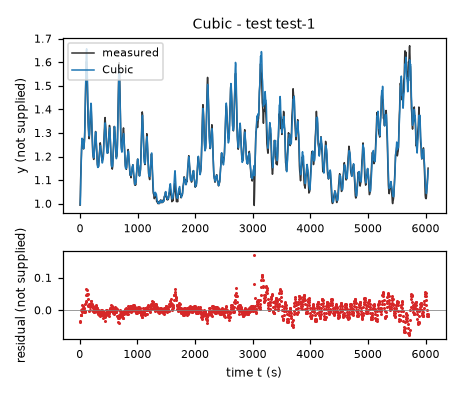

*Candidate Cubic, test data (sealed), trajectories test-1. Upper axes: measured output y (not supplied) and model output of Cubic; lower axes: residual (model output minus measured output, not supplied). Evaluation mode: simulation (initialized once per trajectory from the measured state at sample 0; classical fourth-order Runge-Kutta integration with 1 step(s) per sampling period T_s = 5 s and zero-order hold of the input; the model output is h(x[k], u[k])). Initialization: the first 1 sample(s) of each trajectory initialize the model and are excluded from the errors. Errors are computed on the samples test-1: 1 to 1209 (0-based sample indices). No numerical failure occurred.*

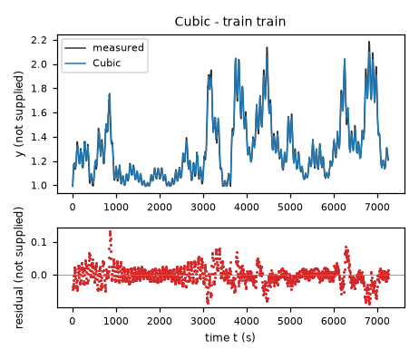

*Candidate Cubic, training data, trajectories train. Upper axes: measured output y (not supplied) and model output of Cubic; lower axes: residual (model output minus measured output, not supplied). Evaluation mode: simulation (initialized once per trajectory from the measured state at sample 0; classical fourth-order Runge-Kutta integration with 1 step(s) per sampling period T_s = 5 s and zero-order hold of the input; the model output is h(x[k], u[k])). Initialization: the first 1 sample(s) of each trajectory initialize the model and are excluded from the errors. Errors are computed on the samples train: 1 to 1451 (0-based sample indices). No numerical failure occurred.*

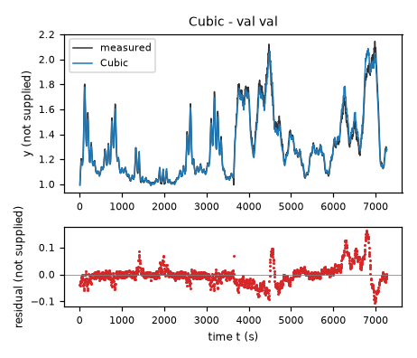

*Candidate Cubic, validation data, trajectories val. Upper axes: measured output y (not supplied) and model output of Cubic; lower axes: residual (model output minus measured output, not supplied). Evaluation mode: simulation (initialized once per trajectory from the measured state at sample 0; classical fourth-order Runge-Kutta integration with 1 step(s) per sampling period T_s = 5 s and zero-order hold of the input; the model output is h(x[k], u[k])). Initialization: the first 1 sample(s) of each trajectory initialize the model and are excluded from the errors. Errors are computed on the samples val: 1 to 1453 (0-based sample indices). No numerical failure occurred.*

### Candidate GaussianRBF

Position in the agent's order: 2. Status: evaluated.
File and expression checks: passed.
- `dy = b0*1 + b1*((y-oy)/sy) + b2*((x1-ox)/sx) + b3*((x2-oz)/sz) + w0*exp(-((((y-oy)/sy)-m0_0)**2 + (((x1-ox)/sx)-m0_1)**2 + (((x2-oz)/sz)-m0_2)**2)/(2*width**2)) + w1*exp(-((((y-oy)/sy)-m1_0)**2 + (((x1-ox)/sx)-m1_1)**2 + (((x2-oz)/sz)-m1_2)**2)/(2*width**2)) + w2*exp(-((((y-oy)/sy)-m2_0)**2 + (((x1-ox)/sx)-m2_1)**2 + (((x2-oz)/sz)-m2_2)**2)/(2*width**2)) + w3*exp(-((((y-oy)/sy)-m3_0)**2 + (((x1-ox)/sx)-m3_1)**2 + (((x2-oz)/sz)-m3_2)**2)/(2*width**2)) + w4*exp(-((((y-oy)/sy)-m4_0)**2 + (((x1-ox)/sx)-m4_1)**2 + (((x2-oz)/sz)-m4_2)**2)/(2*width**2)) + w5*exp(-((((y-oy)/sy)-m5_0)**2 + (((x1-ox)/sx)-m5_1)**2 + (((x2-oz)/sz)-m5_2)**2)/(2*width**2)) + w6*exp(-((((y-oy)/sy)-m6_0)**2 + (((x1-ox)/sx)-m6_1)**2 + (((x2-oz)/sz)-m6_2)**2)/(2*width**2)) + w7*exp(-((((y-oy)/sy)-m7_0)**2 + (((x1-ox)/sx)-m7_1)**2 + (((x2-oz)/sz)-m7_2)**2)/(2*width**2)) + w8*exp(-((((y-oy)/sy)-m8_0)**2 + (((x1-ox)/sx)-m8_1)**2 + (((x2-oz)/sz)-m8_2)**2)/(2*width**2)) + w9*exp(-((((y-oy)/sy)-m9_0)**2 + (((x1-ox)/sx)-m9_1)**2 + (((x2-oz)/sz)-m9_2)**2)/(2*width**2)) + w10*exp(-((((y-oy)/sy)-m10_0)**2 + (((x1-ox)/sx)-m10_1)**2 + (((x2-oz)/sz)-m10_2)**2)/(2*width**2)) + w11*exp(-((((y-oy)/sy)-m11_0)**2 + (((x1-ox)/sx)-m11_1)**2 + (((x2-oz)/sz)-m11_2)**2)/(2*width**2)) + w12*exp(-((((y-oy)/sy)-m12_0)**2 + (((x1-ox)/sx)-m12_1)**2 + (((x2-oz)/sz)-m12_2)**2)/(2*width**2)) + w13*exp(-((((y-oy)/sy)-m13_0)**2 + (((x1-ox)/sx)-m13_1)**2 + (((x2-oz)/sz)-m13_2)**2)/(2*width**2)) + w14*exp(-((((y-oy)/sy)-m14_0)**2 + (((x1-ox)/sx)-m14_1)**2 + (((x2-oz)/sz)-m14_2)**2)/(2*width**2)) + w15*exp(-((((y-oy)/sy)-m15_0)**2 + (((x1-ox)/sx)-m15_1)**2 + (((x2-oz)/sz)-m15_2)**2)/(2*width**2)) + w16*exp(-((((y-oy)/sy)-m16_0)**2 + (((x1-ox)/sx)-m16_1)**2 + (((x2-oz)/sz)-m16_2)**2)/(2*width**2)) + w17*exp(-((((y-oy)/sy)-m17_0)**2 + (((x1-ox)/sx)-m17_1)**2 + (((x2-oz)/sz)-m17_2)**2)/(2*width**2)) + w18*exp(-((((y-oy)/sy)-m18_0)**2 + (((x1-ox)/sx)-m18_1)**2 + (((x2-oz)/sz)-m18_2)**2)/(2*width**2)) + w19*exp(-((((y-oy)/sy)-m19_0)**2 + (((x1-ox)/sx)-m19_1)**2 + (((x2-oz)/sz)-m19_2)**2)/(2*width**2)) + w20*exp(-((((y-oy)/sy)-m20_0)**2 + (((x1-ox)/sx)-m20_1)**2 + (((x2-oz)/sz)-m20_2)**2)/(2*width**2)) + w21*exp(-((((y-oy)/sy)-m21_0)**2 + (((x1-ox)/sx)-m21_1)**2 + (((x2-oz)/sz)-m21_2)**2)/(2*width**2)) + w22*exp(-((((y-oy)/sy)-m22_0)**2 + (((x1-ox)/sx)-m22_1)**2 + (((x2-oz)/sz)-m22_2)**2)/(2*width**2)) + w23*exp(-((((y-oy)/sy)-m23_0)**2 + (((x1-ox)/sx)-m23_1)**2 + (((x2-oz)/sz)-m23_2)**2)/(2*width**2))`
Complexity: 101 fitted, 6 fixed and 0 tied parameters; 0 non-integer numeric literals; 1472 expression-tree nodes (SymPy tree, every operator, function, symbol and number counted once).
Structure group 2: `dy = P1 + 0.033333333333333333*P100*(x1 - 60.0) + 0.1*P101*(x2 - 18.0) + P11*exp((-(-P12 + 0.033333333333333333*x1 - 2.0)**2 - (-P13 + 2.4999999999999999*y - 2.4999999999999999)**2 - (-P14 + 0.1*x2 - 1.8)**2)/(2*P3**2)) + P15*exp((-(-P16 + 0.033333333333333333*x1 - 2.0)**2 - (-P17 + 2.4999999999999999*y - 2.4999999999999999)**2 - (-P18 + 0.1*x2 - 1.8)**2)/(2*P3**2)) + P19*exp((-(-P20 + 0.033333333333333333*x1 - 2.0)**2 - (-P21 + 2.4999999999999999*y - 2.4999999999999999)**2 - (-P22 + 0.1*x2 - 1.8)**2)/(2*P3**2)) + P2*exp((-(-P4 + 0.033333333333333333*x1 - 2.0)**2 - (-P5 + 2.4999999999999999*y - 2.4999999999999999)**2 - (-P6 + 0.1*x2 - 1.8)**2)/(2*P3**2)) + P23*exp((-(-P24 + 0.033333333333333333*x1 - 2.0)**2 - (-P25 + 2.4999999999999999*y - 2.4999999999999999)**2 - (-P26 + 0.1*x2 - 1.8)**2)/(2*P3**2)) + P27*exp((-(-P28 + 0.033333333333333333*x1 - 2.0)**2 - (-P29 + 2.4999999999999999*y - 2.4999999999999999)**2 - (-P30 + 0.1*x2 - 1.8)**2)/(2*P3**2)) + P31*exp((-(-P32 + 0.033333333333333333*x1 - 2.0)**2 - (-P33 + 2.4999999999999999*y - 2.4999999999999999)**2 - (-P34 + 0.1*x2 - 1.8)**2)/(2*P3**2)) + P35*exp((-(-P36 + 0.033333333333333333*x1 - 2.0)**2 - (-P37 + 2.4999999999999999*y - 2.4999999999999999)**2 - (-P38 + 0.1*x2 - 1.8)**2)/(2*P3**2)) + P39*exp((-(-P40 + 0.033333333333333333*x1 - 2.0)**2 - (-P41 + 2.4999999999999999*y - 2.4999999999999999)**2 - (-P42 + 0.1*x2 - 1.8)**2)/(2*P3**2)) + P43*exp((-(-P44 + 0.033333333333333333*x1 - 2.0)**2 - (-P45 + 2.4999999999999999*y - 2.4999999999999999)**2 - (-P46 + 0.1*x2 - 1.8)**2)/(2*P3**2)) + P47*exp((-(-P48 + 0.033333333333333333*x1 - 2.0)**2 - (-P49 + 2.4999999999999999*y - 2.4999999999999999)**2 - (-P50 + 0.1*x2 - 1.8)**2)/(2*P3**2)) + P51*exp((-(-P52 + 0.033333333333333333*x1 - 2.0)**2 - (-P53 + 2.4999999999999999*y - 2.4999999999999999)**2 - (-P54 + 0.1*x2 - 1.8)**2)/(2*P3**2)) + P55*exp((-(-P56 + 0.033333333333333333*x1 - 2.0)**2 - (-P57 + 2.4999999999999999*y - 2.4999999999999999)**2 - (-P58 + 0.1*x2 - 1.8)**2)/(2*P3**2)) + P59*exp((-(-P60 + 0.033333333333333333*x1 - 2.0)**2 - (-P61 + 2.4999999999999999*y - 2.4999999999999999)**2 - (-P62 + 0.1*x2 - 1.8)**2)/(2*P3**2)) + P63*exp((-(-P64 + 0.033333333333333333*x1 - 2.0)**2 - (-P65 + 2.4999999999999999*y - 2.4999999999999999)**2 - (-P66 + 0.1*x2 - 1.8)**2)/(2*P3**2)) + P67*exp((-(-P68 + 0.033333333333333333*x1 - 2.0)**2 - (-P69 + 2.4999999999999999*y - 2.4999999999999999)**2 - (-P70 + 0.1*x2 - 1.8)**2)/(2*P3**2)) + P7*exp((-(-P10 + 0.1*x2 - 1.8)**2 - (-P8 + 0.033333333333333333*x1 - 2.0)**2 - (-P9 + 2.4999999999999999*y - 2.4999999999999999)**2)/(2*P3**2)) + P71*exp((-(-P72 + 0.033333333333333333*x1 - 2.0)**2 - (-P73 + 2.4999999999999999*y - 2.4999999999999999)**2 - (-P74 + 0.1*x2 - 1.8)**2)/(2*P3**2)) + P75*exp((-(-P76 + 0.033333333333333333*x1 - 2.0)**2 - (-P77 + 2.4999999999999999*y - 2.4999999999999999)**2 - (-P78 + 0.1*x2 - 1.8)**2)/(2*P3**2)) + P79*exp((-(-P80 + 0.033333333333333333*x1 - 2.0)**2 - (-P81 + 2.4999999999999999*y - 2.4999999999999999)**2 - (-P82 + 0.1*x2 - 1.8)**2)/(2*P3**2)) + P83*exp((-(-P84 + 0.033333333333333333*x1 - 2.0)**2 - (-P85 + 2.4999999999999999*y - 2.4999999999999999)**2 - (-P86 + 0.1*x2 - 1.8)**2)/(2*P3**2)) + P87*exp((-(-P88 + 0.033333333333333333*x1 - 2.0)**2 - (-P89 + 2.4999999999999999*y - 2.4999999999999999)**2 - (-P90 + 0.1*x2 - 1.8)**2)/(2*P3**2)) + P91*exp((-(-P92 + 0.033333333333333333*x1 - 2.0)**2 - (-P93 + 2.4999999999999999*y - 2.4999999999999999)**2 - (-P94 + 0.1*x2 - 1.8)**2)/(2*P3**2)) + P95*exp((-(-P96 + 0.033333333333333333*x1 - 2.0)**2 - (-P97 + 2.4999999999999999*y - 2.4999999999999999)**2 - (-P98 + 0.1*x2 - 1.8)**2)/(2*P3**2)) + 2.4999999999999999*P99*(y - 1.0)`

Requirements:

| id | type | outcome | status | method | detail |
|---|---|---|---|---|---|

Output errors on the test data (sealed) (pooled RMSE: 0.0242012 not supplied):

| trajectory | scored samples | completed | RMSE (not supplied) | NRMSE | R² | failure |
|---|---|---|---|---|---|---|
| test-1 | 1209 | 1209 | 0.0242012 | 0.173661 | 0.969842 | none |

Output errors on the training data (pooled RMSE: 0.0290418 not supplied):

| trajectory | scored samples | completed | RMSE (not supplied) | NRMSE | R² | failure |
|---|---|---|---|---|---|---|
| train | 1451 | 1451 | 0.0290418 | 0.111376 | 0.987595 | none |

Output errors on the validation data (pooled RMSE: 0.0359194 not supplied):

| trajectory | scored samples | completed | RMSE (not supplied) | NRMSE | R² | failure |
|---|---|---|---|---|---|---|
| val | 1453 | 1453 | 0.0359194 | 0.136818 | 0.981281 | none |

Sensitivity rank test (diagnostic; never excludes): targets dy on the train, val data (2906 rows, 0 dropped); analytic derivatives (SymPy), ties differentiated through their equations; scaling: rows of each target divided by the standard deviation of its measured column; columns divided by their Euclidean norm; rank threshold s_i / s_1 > 1e-08; singular values 7.45, 4.86, 3.71, 2.17, 1.19, 0.949, 0.704, 0.491, 0.342, 0.284, 0.199, 0.135, 0.131, 0.0996, 0.0912, 0.0723, 0.0372, 0.0313, 0.022, 0.0206, 0.0197, 0.014, 0.0111, 0.00984, 0.00741, 0.0067, 0.00612, 0.00512, 0.0041, 0.0036, 0.00248, 0.00186, 0.00163, 0.0013, 0.00114, 0.000793, 0.000615, 0.000573, 0.000509, 0.000372, 0.000345, 0.000269, 0.000255, 0.000215, 0.000144, 0.000115, 9.45e-05, 6.72e-05, 5.9e-05, 4.49e-05, 4.16e-05, 3.11e-05, 3e-05, 2.09e-05, 1.99e-05, 1.77e-05, 1.4e-05, 9.58e-06, 7.98e-06, 7.55e-06, 6e-06, 5.48e-06, 4.74e-06, 3.43e-06, 2.31e-06, 2.15e-06, 1.88e-06, 1.37e-06, 1.34e-06, 9.68e-07, 7.41e-07, 5.68e-07, 4.59e-07, 3.43e-07, 3.2e-07, 2.77e-07, 2.57e-07, 1.39e-07, 1.16e-07, 9.61e-08, 7.5e-08, 6.35e-08, 5.99e-08, 3.82e-08, 3.25e-08, 2.24e-08, 1.48e-08, 1.1e-08, 6.59e-09, 5.43e-09, 3.81e-09, 3.38e-09, 2.7e-09, 1.89e-09, 1.2e-09, 9.28e-10, 5.35e-10, 3.16e-10, 2.93e-10, 1.28e-10, 2.62e-11; rank 81 of 101.
- Locally indistinguishable combination: m0_0 (+0.157), m0_1 (+0.263), w1 (-0.169), m5_0 (-0.153), m5_2 (-0.295), m7_1 (+0.143), w7 (+0.189), w9 (-0.316), m10_2 (+0.199), w10 (+0.134), w12 (+0.116), w13 (+0.127), m14_0 (+0.121), m14_2 (+0.256), w16 (-0.175), w18 (-0.248), m20_1 (+0.150), m20_2 (-0.156), w21 (+0.113), w23 (+0.417); relative singular value 8.52e-09.
- Locally indistinguishable combination: m0_1 (+0.136), w1 (+0.338), w3 (+0.113), w4 (+0.209), m5_0 (-0.106), m5_2 (-0.272), w6 (-0.161), m7_1 (+0.110), m8_0 (-0.213), m8_1 (-0.227), m8_2 (-0.293), m9_0 (-0.117), m10_1 (+0.200), w12 (+0.136), w13 (-0.306), m14_1 (-0.124), w15 (+0.110), w16 (+0.243), w18 (-0.120), w19 (-0.134), w20 (-0.114), w23 (-0.313); relative singular value 8.03e-09.
- Locally indistinguishable combination: m0_0 (+0.248), m0_1 (+0.363), w0 (-0.110), w1 (-0.161), w3 (+0.104), m5_2 (-0.118), m6_2 (-0.138), m7_2 (+0.155), m8_0 (-0.140), m8_1 (-0.240), m8_2 (+0.156), w8 (-0.110), w9 (+0.250), m10_1 (-0.121), m10_2 (+0.214), w12 (-0.177), m14_1 (+0.127), w15 (-0.243), w18 (+0.459), w20 (-0.102), m21_2 (+0.124), w22 (-0.147), w23 (-0.128); relative singular value 5.13e-09.
- Locally indistinguishable combination: w1 (+0.429), w3 (-0.121), m6_0 (+0.125), m8_0 (+0.142), m8_1 (+0.111), w9 (-0.158), m14_0 (+0.107), m14_2 (+0.268), w15 (-0.331), w16 (-0.131), w17 (+0.139), w18 (+0.243), w19 (-0.337), m20_0 (-0.190), m20_2 (-0.252), w20 (+0.125), m21_0 (-0.137), m21_1 (-0.161), m21_2 (-0.149), w23 (-0.167); relative singular value 4.36e-09.
- Locally indistinguishable combination: w1 (+0.297), w6 (-0.132), m7_2 (+0.123), m8_1 (-0.139), w9 (-0.480), m14_2 (-0.213), w15 (+0.288), w18 (+0.351), w19 (-0.215), m20_2 (+0.235), m21_0 (+0.157), m21_1 (+0.101), m21_2 (+0.133), w23 (+0.324); relative singular value 3e-09.
- Locally indistinguishable combination: w0 (+0.140), w1 (-0.206), w2 (+0.112), w4 (+0.111), w6 (+0.207), m8_1 (-0.141), w8 (+0.143), w10 (-0.118), w11 (+0.196), w12 (+0.230), m14_2 (-0.210), w15 (-0.545), w19 (-0.337), m20_0 (+0.130), m20_2 (+0.203), w20 (+0.113), m21_0 (+0.116), m21_2 (+0.105), w22 (+0.203), w23 (+0.145); relative singular value 1.98e-09.
- Locally indistinguishable combination: m0_2 (+0.118), w1 (-0.262), w3 (+0.114), w4 (-0.168), w6 (-0.173), m8_2 (+0.128), w9 (+0.236), w10 (-0.156), w11 (+0.317), w12 (+0.325), w15 (+0.397), w19 (-0.437), m20_2 (-0.138), w21 (-0.225), m22_2 (+0.110); relative singular value 1.47e-09.
- Locally indistinguishable combination: m0_1 (+0.132), m0_2 (+0.127), w0 (+0.242), w1 (+0.114), w3 (+0.132), w5 (-0.400), w6 (+0.208), w7 (-0.234), w8 (+0.273), m10_2 (+0.204), w10 (-0.172), w12 (-0.304), w18 (-0.107), w19 (+0.188), w20 (+0.110), w21 (-0.289), w22 (+0.349); relative singular value 8.84e-10.
- Locally indistinguishable combination: w1 (+0.248), w2 (-0.277), w3 (+0.115), w4 (-0.149), w5 (-0.241), w6 (+0.182), w8 (-0.108), w9 (-0.147), w11 (+0.258), w12 (+0.571), w15 (-0.206), w19 (+0.382), w20 (-0.122), w21 (-0.101), w22 (-0.193); relative singular value 7.29e-10.
- Locally indistinguishable combination: w3 (+0.520), w4 (-0.408), w6 (+0.153), w10 (+0.115), w11 (-0.548), w12 (+0.215), w13 (-0.184), w14 (+0.158), w19 (-0.153), m22_2 (-0.154); relative singular value 5.11e-10.
- Locally indistinguishable combination: w2 (+0.202), w3 (+0.246), w4 (-0.233), w6 (-0.732), w8 (+0.101), w11 (+0.201), w15 (-0.258), w19 (+0.282), w21 (+0.113), w22 (+0.165); relative singular value 4.53e-10.
- Locally indistinguishable combination: w2 (+0.314), w3 (-0.244), w4 (+0.271), w5 (-0.151), w6 (-0.165), w7 (-0.326), w11 (-0.424), w12 (+0.450), w14 (-0.256), w18 (+0.212), w21 (+0.102), w22 (+0.189); relative singular value 3.63e-10.
- Locally indistinguishable combination: w5 (+0.737), w7 (-0.213), w10 (-0.309), w11 (-0.120), w19 (+0.207), w20 (+0.175), w21 (-0.421); relative singular value 2.54e-10.
- Locally indistinguishable combination: w0 (+0.202), w2 (-0.311), w3 (-0.202), w4 (+0.179), w5 (-0.186), w6 (-0.294), w8 (+0.114), w11 (-0.169), w12 (+0.151), w14 (+0.735), w22 (-0.109); relative singular value 1.61e-10.
- Locally indistinguishable combination: w2 (+0.611), w6 (+0.145), w10 (-0.282), w11 (+0.119), m14_2 (+0.105), w14 (+0.375), w20 (-0.480), w22 (-0.269); relative singular value 1.24e-10.
- Locally indistinguishable combination: w2 (+0.152), w7 (+0.204), w10 (+0.535), m14_2 (-0.113), w14 (-0.142), w20 (-0.349), w21 (-0.667); relative singular value 7.18e-11.
- Locally indistinguishable combination: w0 (+0.125), w5 (-0.147), w7 (+0.741), w10 (-0.534), w11 (-0.169), w14 (-0.168), w21 (-0.124); relative singular value 4.24e-11.
- Locally indistinguishable combination: w0 (+0.143), w2 (-0.395), w5 (+0.248), w8 (+0.277), w10 (-0.187), w20 (-0.666), w21 (+0.214), w22 (+0.341); relative singular value 3.93e-11.
- Locally indistinguishable combination: w0 (+0.647), w7 (-0.123), w8 (+0.286), w10 (+0.123), w14 (-0.305), w21 (+0.172), w22 (-0.575); relative singular value 1.71e-11.
- Locally indistinguishable combination: w0 (+0.559), w8 (-0.788), w22 (+0.226); relative singular value 3.51e-12.
Reference comparison: not applicable (the task has no reference expression).
Eligible for ranking: True.

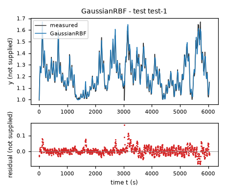

*Candidate GaussianRBF, test data (sealed), trajectories test-1. Upper axes: measured output y (not supplied) and model output of GaussianRBF; lower axes: residual (model output minus measured output, not supplied). Evaluation mode: simulation (initialized once per trajectory from the measured state at sample 0; classical fourth-order Runge-Kutta integration with 1 step(s) per sampling period T_s = 5 s and zero-order hold of the input; the model output is h(x[k], u[k])). Initialization: the first 1 sample(s) of each trajectory initialize the model and are excluded from the errors. Errors are computed on the samples test-1: 1 to 1209 (0-based sample indices). No numerical failure occurred.*

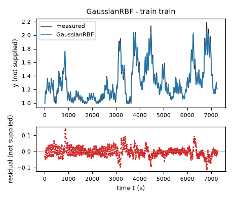

*Candidate GaussianRBF, training data, trajectories train. Upper axes: measured output y (not supplied) and model output of GaussianRBF; lower axes: residual (model output minus measured output, not supplied). Evaluation mode: simulation (initialized once per trajectory from the measured state at sample 0; classical fourth-order Runge-Kutta integration with 1 step(s) per sampling period T_s = 5 s and zero-order hold of the input; the model output is h(x[k], u[k])). Initialization: the first 1 sample(s) of each trajectory initialize the model and are excluded from the errors. Errors are computed on the samples train: 1 to 1451 (0-based sample indices). No numerical failure occurred.*

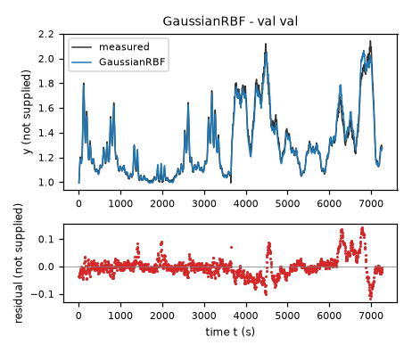

*Candidate GaussianRBF, validation data, trajectories val. Upper axes: measured output y (not supplied) and model output of GaussianRBF; lower axes: residual (model output minus measured output, not supplied). Evaluation mode: simulation (initialized once per trajectory from the measured state at sample 0; classical fourth-order Runge-Kutta integration with 1 step(s) per sampling period T_s = 5 s and zero-order hold of the input; the model output is h(x[k], u[k])). Initialization: the first 1 sample(s) of each trajectory initialize the model and are excluded from the errors. Errors are computed on the samples val: 1 to 1453 (0-based sample indices). No numerical failure occurred.*

### Candidate LogInteraction

Position in the agent's order: 3. Status: evaluated.
File and expression checks: passed.
- `dy = c0*(1) + c1*((x1/sx)) + c2*((x2/sz)) + c3*(log(Max(y-q,eps))) + c4*((x1/sx)*log(Max(y-q,eps))) + c5*((x2/sz)*log(Max(y-q,eps))) + c6*((x1/sx)*(x2/sz)) + c7*((x1/sx)**2)`
Complexity: 9 fitted, 3 fixed and 0 tied parameters; 0 non-integer numeric literals; 70 expression-tree nodes (SymPy tree, every operator, function, symbol and number counted once).
Structure group 3: `dy = P1 + P2*log(Max(9.9999999999999998e-13, -P3 + y)) + 0.033333333333333333*P4*x2 + 0.01*P5*x1 + 0.0001*P6*x1**2 + 0.033333333333333333*P7*x2*log(Max(9.9999999999999998e-13, -P3 + y)) + 0.01*P8*x1*log(Max(9.9999999999999998e-13, -P3 + y)) + 0.00033333333333333333*P9*x1*x2`

Requirements:

| id | type | outcome | status | method | detail |
|---|---|---|---|---|---|

Output errors on the test data (sealed) (pooled RMSE: 0.0228632 not supplied):

| trajectory | scored samples | completed | RMSE (not supplied) | NRMSE | R² | failure |
|---|---|---|---|---|---|---|
| test-1 | 1209 | 1209 | 0.0228632 | 0.16406 | 0.973084 | none |

Output errors on the training data (pooled RMSE: 0.0249076 not supplied):

| trajectory | scored samples | completed | RMSE (not supplied) | NRMSE | R² | failure |
|---|---|---|---|---|---|---|
| train | 1451 | 1451 | 0.0249076 | 0.0955207 | 0.990876 | none |

Output errors on the validation data (pooled RMSE: 0.0379691 not supplied):

| trajectory | scored samples | completed | RMSE (not supplied) | NRMSE | R² | failure |
|---|---|---|---|---|---|---|
| val | 1453 | 1453 | 0.0379691 | 0.144626 | 0.979083 | none |

Sensitivity rank test (diagnostic; never excludes): targets dy on the train, val data (2906 rows, 0 dropped); analytic derivatives (SymPy), ties differentiated through their equations; scaling: rows of each target divided by the standard deviation of its measured column; columns divided by their Euclidean norm; rank threshold s_i / s_1 > 1e-08; singular values 2.7, 1.09, 0.564, 0.416, 0.129, 0.0882, 0.0411, 0.0128, 0.00952; rank 9 of 9.
Reference comparison: not applicable (the task has no reference expression).
Eligible for ranking: True.

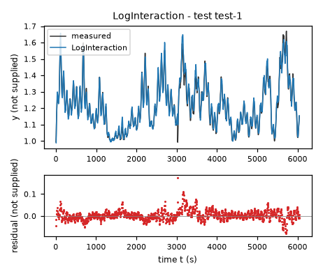

*Candidate LogInteraction, test data (sealed), trajectories test-1. Upper axes: measured output y (not supplied) and model output of LogInteraction; lower axes: residual (model output minus measured output, not supplied). Evaluation mode: simulation (initialized once per trajectory from the measured state at sample 0; classical fourth-order Runge-Kutta integration with 1 step(s) per sampling period T_s = 5 s and zero-order hold of the input; the model output is h(x[k], u[k])). Initialization: the first 1 sample(s) of each trajectory initialize the model and are excluded from the errors. Errors are computed on the samples test-1: 1 to 1209 (0-based sample indices). No numerical failure occurred.*

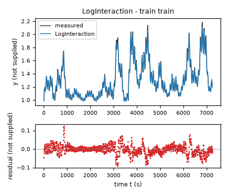

*Candidate LogInteraction, training data, trajectories train. Upper axes: measured output y (not supplied) and model output of LogInteraction; lower axes: residual (model output minus measured output, not supplied). Evaluation mode: simulation (initialized once per trajectory from the measured state at sample 0; classical fourth-order Runge-Kutta integration with 1 step(s) per sampling period T_s = 5 s and zero-order hold of the input; the model output is h(x[k], u[k])). Initialization: the first 1 sample(s) of each trajectory initialize the model and are excluded from the errors. Errors are computed on the samples train: 1 to 1451 (0-based sample indices). No numerical failure occurred.*

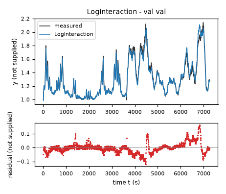

*Candidate LogInteraction, validation data, trajectories val. Upper axes: measured output y (not supplied) and model output of LogInteraction; lower axes: residual (model output minus measured output, not supplied). Evaluation mode: simulation (initialized once per trajectory from the measured state at sample 0; classical fourth-order Runge-Kutta integration with 1 step(s) per sampling period T_s = 5 s and zero-order hold of the input; the model output is h(x[k], u[k])). Initialization: the first 1 sample(s) of each trajectory initialize the model and are excluded from the errors. Errors are computed on the samples val: 1 to 1453 (0-based sample indices). No numerical failure occurred.*

### Candidate Rational

Position in the agent's order: 4. Status: evaluated.
File and expression checks: passed.
- `dy = (a0*(1) + a1*((y-yc)) + a2*((x1/sx)) + a3*((x2/sz)) + a4*((y-yc)**2) + a5*((y-yc)*(x1/sx)) + a6*((y-yc)*(x2/sz)) + a7*((x1/sx)**2) + a8*((x1/sx)*(x2/sz)) + a9*((x2/sz)**2))/(1+d*(y-yc))`
Complexity: 11 fitted, 3 fixed and 0 tied parameters; 0 non-integer numeric literals; 90 expression-tree nodes (SymPy tree, every operator, function, symbol and number counted once).
Structure group 4: `dy = (0.01*P10*x1*(y - 1.0) + 0.00033333333333333333*P11*x1*x2 + P2 + P3*(y - 1.0) + P4*(y - 1.0)**2 + 0.033333333333333333*P5*x2 + 0.0011111111111111111*P6*x2**2 + 0.01*P7*x1 + 0.0001*P8*x1**2 + 0.033333333333333333*P9*x2*(y - 1.0))/(P1*(y - 1.0) + 1)`

Requirements:

| id | type | outcome | status | method | detail |
|---|---|---|---|---|---|

Output errors on the test data (sealed) (pooled RMSE: 0.0268433 not supplied):

| trajectory | scored samples | completed | RMSE (not supplied) | NRMSE | R² | failure |
|---|---|---|---|---|---|---|
| test-1 | 1209 | 1209 | 0.0268433 | 0.19262 | 0.962898 | none |

Output errors on the training data (pooled RMSE: 0.0283616 not supplied):

| trajectory | scored samples | completed | RMSE (not supplied) | NRMSE | R² | failure |
|---|---|---|---|---|---|---|
| train | 1451 | 1451 | 0.0283616 | 0.108767 | 0.98817 | none |

Output errors on the validation data (pooled RMSE: 0.038359 not supplied):

| trajectory | scored samples | completed | RMSE (not supplied) | NRMSE | R² | failure |
|---|---|---|---|---|---|---|
| val | 1453 | 1453 | 0.038359 | 0.146111 | 0.978652 | none |

Sensitivity rank test (diagnostic; never excludes): targets dy on the train, val data (2906 rows, 0 dropped); analytic derivatives (SymPy), ties differentiated through their equations; scaling: rows of each target divided by the standard deviation of its measured column; columns divided by their Euclidean norm; rank threshold s_i / s_1 > 1e-08; singular values 2.9, 1.07, 0.971, 0.59, 0.31, 0.137, 0.103, 0.0975, 0.0408, 0.0331, 0.0106; rank 11 of 11.
Reference comparison: not applicable (the task has no reference expression).
Eligible for ranking: True.

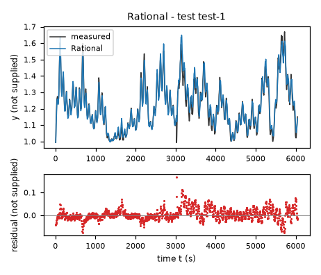

*Candidate Rational, test data (sealed), trajectories test-1. Upper axes: measured output y (not supplied) and model output of Rational; lower axes: residual (model output minus measured output, not supplied). Evaluation mode: simulation (initialized once per trajectory from the measured state at sample 0; classical fourth-order Runge-Kutta integration with 1 step(s) per sampling period T_s = 5 s and zero-order hold of the input; the model output is h(x[k], u[k])). Initialization: the first 1 sample(s) of each trajectory initialize the model and are excluded from the errors. Errors are computed on the samples test-1: 1 to 1209 (0-based sample indices). No numerical failure occurred.*

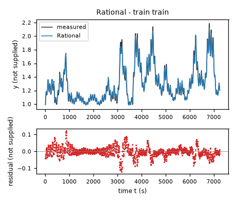

*Candidate Rational, training data, trajectories train. Upper axes: measured output y (not supplied) and model output of Rational; lower axes: residual (model output minus measured output, not supplied). Evaluation mode: simulation (initialized once per trajectory from the measured state at sample 0; classical fourth-order Runge-Kutta integration with 1 step(s) per sampling period T_s = 5 s and zero-order hold of the input; the model output is h(x[k], u[k])). Initialization: the first 1 sample(s) of each trajectory initialize the model and are excluded from the errors. Errors are computed on the samples train: 1 to 1451 (0-based sample indices). No numerical failure occurred.*

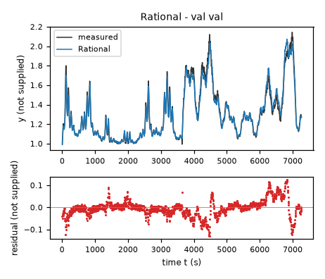

*Candidate Rational, validation data, trajectories val. Upper axes: measured output y (not supplied) and model output of Rational; lower axes: residual (model output minus measured output, not supplied). Evaluation mode: simulation (initialized once per trajectory from the measured state at sample 0; classical fourth-order Runge-Kutta integration with 1 step(s) per sampling period T_s = 5 s and zero-order hold of the input; the model output is h(x[k], u[k])). Initialization: the first 1 sample(s) of each trajectory initialize the model and are excluded from the errors. Errors are computed on the samples val: 1 to 1453 (0-based sample indices). No numerical failure occurred.*
