# Evaluation report: task task-qtqm

Terms. The harness is the software of ASPIRE that checks and evaluates the candidate models; a candidate is one proposed model; the pool is the set of candidates of one round. Sealed data (test data, reference expression) are inaccessible to the agent. This report contains results on sealed data and is not shown to the agent.

Evaluation mode: simulation (initialized once per trajectory from the measured state at sample 0; classical fourth-order Runge-Kutta integration with 1 step(s) per sampling period T_s = 5 s and zero-order hold of the input; the model output is h(x[k], u[k])).
Error measures: for one trajectory with scoring interval I of N samples, measured output y[k] (y, not supplied) and model output ŷ[k], SSE = Σ_(k∈I) (ŷ[k] − y[k])²; RMSE = sqrt(SSE/N), in not supplied; NRMSE = RMSE/σ, with μ and σ the mean and the population standard deviation of y on I; R² = 1 − SSE / Σ_(k∈I) (y[k] − μ)²; NRMSE and R² are not applicable when σ = 0. The pooled RMSE over several trajectories is S = sqrt(ΣSSE / ΣN); on the test data it is the ranking score.
Numerical failure limits: y in [-100, 100] not supplied; evaluation time limit 60 s per candidate and data group; symbolic time limit 10 s per verification.
Discontinuous expressions: expressions with jumps (Piecewise, sign) are evaluated pointwise at the sample instants and Runge-Kutta stages; no event detection or step refinement is applied at a jump.
Harness version 0.1.0.dev0; NumPy 2.5.1; SymPy 1.14.0.

## Pool

| category | count |
|---|---|
| candidates proposed | 6 |
| accepted by the file and expression checks | 6 |
| outside the pool limit of 10 (not evaluated) | 0 |
| evaluated | 6 |
| excluded by physical requirements | 0 |
| failed numerically on training or validation data | 0 |
| failed numerically on test data | 0 |
| eligible for ranking | 6 |

Note: the categories overlap: the candidates accepted by the checks include those outside the pool limit, and a candidate can be both excluded by requirements and failed numerically; the counts need not sum to the pool size.

Distinct structures: 6 among 6 evaluated candidates; groups: CubicSparse; RationalQuadratic; HingeSpline; LogFeedback; BilinearPower; SigmoidRate. Convention: ties resolved, fixed values kept, given constants kept, fitted parameters renamed P1..Pn in order of first occurrence; equal when a one-to-one renaming of the fitted parameters makes every expression identical in SymPy's canonical form.

### Recommendation of the agent

Recommended candidate: CubicSparse. The agent's reason: Recommend the sparse cubic vector field. Its training-only fit achieved validation free-running RK4 RMSE 0.036448609 U_y versus 0.038356466 U_y for the rational quadratic and 0.037679721 U_y for the compact spline. It also had the lowest criterion-selection suffix RMSE among these families, 0.049425261 U_y, although that suffix had already been inspected during exploratory validation. Final coefficients were refitted on both supplied files; their validation RMSE 0.036584843 U_y is consequently in-sample, not an unseen-test estimate. U_y denotes the unspecified native state unit. The pool also retains rational, fixed-knot spline, logarithmic feedback, bilinear-power and positive logistic-rate families as structurally distinct alternatives. Residual temporal correlation and extrapolation uncertainty remain; no physical law or globally valid model is claimed.
- Test score S of the recommended candidate (practical selection): 0.0238058 not supplied; eligible: True; rank in the oracle-based selection: 2.

## Oracle-based selection on test data

Label: oracle-based selection on test data. Candidates considered: 6 eligible of 6 evaluated. Criterion: pooled test RMSE S, increasing, the pooled RMSE over the test trajectories test-1 (1209 scored samples). Tie rule: |S_a - S_b| <= 1e-12 * max(S_a, S_b) for consecutive candidates; tied candidates share a rank. This ranking selects on the test data. It measures whether the pool contains an accurate model, not whether the agent can recognize that model without test data. A rank is not evidence of physical admissibility: each entry carries its unresolved requirements and any violation allowed by the user.

| rank | candidate | S (not supplied) | unresolved requirements | violations allowed by the user |
|---|---|---|---|---|
| 1 | HingeSpline | 0.0232368 | none | none |
| 2 | CubicSparse | 0.0238058 | none | none |
| 3 | RationalQuadratic | 0.0270649 | none | none |
| 4 | LogFeedback | 0.0280533 | none | none |
| 5 | BilinearPower | 0.0291461 | none | none |

## Candidates

### Candidate CubicSparse

Position in the agent's order: 1. Status: evaluated.
File and expression checks: passed.
- `dy = c1 + c2*((y-yref)/ys) + c3*(x1/uone) + c4*((y-yref)/ys)**2 + c5*((y-yref)/ys)*(x1/uone) + c6*((y-yref)/ys)*(x2/utwo) + c7*(x1/uone)**2 + c8*(x1/uone)*(x2/utwo) + c9*(x2/utwo)**2 + c10*((y-yref)/ys)**3 + c11*((y-yref)/ys)*(x1/uone)*(x2/utwo) + c12*(x1/uone)**3 + c13*(x1/uone)**2*(x2/utwo) + c14*(x1/uone)*(x2/utwo)**2 + c15*(x2/utwo)**3`
Complexity: 15 fitted, 4 fixed and 0 tied parameters; 0 non-integer numeric literals; 154 expression-tree nodes (SymPy tree, every operator, function, symbol and number counted once).
Structure group 1: `dy = P1 + 0.00083333333333333333*P10*x1*x2 + 0.016666666666666667*P11*x1*(y - 1.0) + 4.1666666666666667e-5*P12*x1*x2**2 + 0.05*P13*x2*(y - 1.0) + 1.3888888888888889e-5*P14*x1**2*x2 + 0.00083333333333333333*P15*x1*x2*(y - 1.0) + 1.0*P2*(y - 1.0)**3 + 1.0*P3*(y - 1.0) + 1.0*P4*(y - 1.0)**2 + 0.000125*P5*x2**3 + 0.016666666666666667*P6*x1 + 0.00027777777777777778*P7*x1**2 + 4.6296296296296296e-6*P8*x1**3 + 0.0025*P9*x2**2`

Requirements:

| id | type | outcome | status | method | detail |
|---|---|---|---|---|---|

Output errors on the test data (sealed) (pooled RMSE: 0.0238058 not supplied):

| trajectory | scored samples | completed | RMSE (not supplied) | NRMSE | R² | failure |
|---|---|---|---|---|---|---|
| test-1 | 1209 | 1209 | 0.0238058 | 0.170823 | 0.970819 | none |

Output errors on the training data (pooled RMSE: 0.0282878 not supplied):

| trajectory | scored samples | completed | RMSE (not supplied) | NRMSE | R² | failure |
|---|---|---|---|---|---|---|
| train | 1451 | 1451 | 0.0282878 | 0.108484 | 0.988231 | none |

Output errors on the validation data (pooled RMSE: 0.0365848 not supplied):

| trajectory | scored samples | completed | RMSE (not supplied) | NRMSE | R² | failure |
|---|---|---|---|---|---|---|
| val | 1453 | 1453 | 0.0365848 | 0.139353 | 0.980581 | none |

Sensitivity rank test (diagnostic; never excludes): targets dy on the train, val data (2906 rows, 0 dropped); analytic derivatives (SymPy), ties differentiated through their equations; scaling: rows of each target divided by the standard deviation of its measured column; columns divided by their Euclidean norm; rank threshold s_i / s_1 > 1e-08; singular values 3.57, 1.19, 0.749, 0.425, 0.204, 0.15, 0.114, 0.0905, 0.0465, 0.0318, 0.0252, 0.0229, 0.0132, 0.00672, 0.00503; rank 15 of 15.
Reference comparison: not applicable (the task has no reference expression).
Eligible for ranking: True.

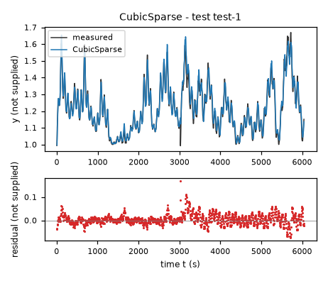

*Candidate CubicSparse, test data (sealed), trajectories test-1. Upper axes: measured output y (not supplied) and model output of CubicSparse; lower axes: residual (model output minus measured output, not supplied). Evaluation mode: simulation (initialized once per trajectory from the measured state at sample 0; classical fourth-order Runge-Kutta integration with 1 step(s) per sampling period T_s = 5 s and zero-order hold of the input; the model output is h(x[k], u[k])). Initialization: the first 1 sample(s) of each trajectory initialize the model and are excluded from the errors. Errors are computed on the samples test-1: 1 to 1209 (0-based sample indices). No numerical failure occurred.*

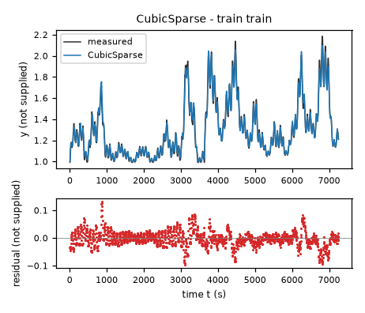

*Candidate CubicSparse, training data, trajectories train. Upper axes: measured output y (not supplied) and model output of CubicSparse; lower axes: residual (model output minus measured output, not supplied). Evaluation mode: simulation (initialized once per trajectory from the measured state at sample 0; classical fourth-order Runge-Kutta integration with 1 step(s) per sampling period T_s = 5 s and zero-order hold of the input; the model output is h(x[k], u[k])). Initialization: the first 1 sample(s) of each trajectory initialize the model and are excluded from the errors. Errors are computed on the samples train: 1 to 1451 (0-based sample indices). No numerical failure occurred.*

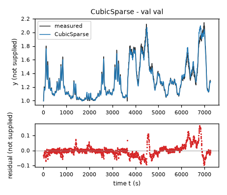

*Candidate CubicSparse, validation data, trajectories val. Upper axes: measured output y (not supplied) and model output of CubicSparse; lower axes: residual (model output minus measured output, not supplied). Evaluation mode: simulation (initialized once per trajectory from the measured state at sample 0; classical fourth-order Runge-Kutta integration with 1 step(s) per sampling period T_s = 5 s and zero-order hold of the input; the model output is h(x[k], u[k])). Initialization: the first 1 sample(s) of each trajectory initialize the model and are excluded from the errors. Errors are computed on the samples val: 1 to 1453 (0-based sample indices). No numerical failure occurred.*

### Candidate RationalQuadratic

Position in the agent's order: 2. Status: evaluated.
File and expression checks: passed.
- `dy = (c1 + c2*((y-yref)/ys) + c3*(x1/uone) + c4*(x2/utwo) + c5*((y-yref)/ys)**2 + c6*((y-yref)/ys)*(x1/uone) + c7*((y-yref)/ys)*(x2/utwo) + c8*(x1/uone)**2 + c9*(x1/uone)*(x2/utwo) + c10*(x2/utwo)**2)/(1+d*Max(((y-yref)/ys),0))`
Complexity: 11 fitted, 4 fixed and 0 tied parameters; 0 non-integer numeric literals; 108 expression-tree nodes (SymPy tree, every operator, function, symbol and number counted once).
Structure group 2: `dy = (0.016666666666666667*P10*x1*(y - 1.0) + 0.05*P11*x2*(y - 1.0) + P2 + 1.0*P3*(y - 1.0) + 1.0*P4*(y - 1.0)**2 + 0.016666666666666667*P5*x1 + 0.00027777777777777778*P6*x1**2 + 0.0025*P7*x2**2 + 0.05*P8*x2 + 0.00083333333333333333*P9*x1*x2)/(P1*Max(0, 1.0*y - 1.0) + 1)`

Requirements:

| id | type | outcome | status | method | detail |
|---|---|---|---|---|---|

Output errors on the test data (sealed) (pooled RMSE: 0.0270649 not supplied):

| trajectory | scored samples | completed | RMSE (not supplied) | NRMSE | R² | failure |
|---|---|---|---|---|---|---|
| test-1 | 1209 | 1209 | 0.0270649 | 0.19421 | 0.962282 | none |

Output errors on the training data (pooled RMSE: 0.0282331 not supplied):

| trajectory | scored samples | completed | RMSE (not supplied) | NRMSE | R² | failure |
|---|---|---|---|---|---|---|
| train | 1451 | 1451 | 0.0282331 | 0.108274 | 0.988277 | none |

Output errors on the validation data (pooled RMSE: 0.0379947 not supplied):

| trajectory | scored samples | completed | RMSE (not supplied) | NRMSE | R² | failure |
|---|---|---|---|---|---|---|
| val | 1453 | 1453 | 0.0379947 | 0.144724 | 0.979055 | none |

Sensitivity rank test (diagnostic; never excludes): targets dy on the train, val data (2906 rows, 0 dropped); analytic derivatives (SymPy), ties differentiated through their equations; scaling: rows of each target divided by the standard deviation of its measured column; columns divided by their Euclidean norm; rank threshold s_i / s_1 > 1e-08; singular values 2.91, 1.05, 0.97, 0.572, 0.3, 0.131, 0.0986, 0.0917, 0.0393, 0.0325, 0.0107; rank 11 of 11.
Reference comparison: not applicable (the task has no reference expression).
Eligible for ranking: True.

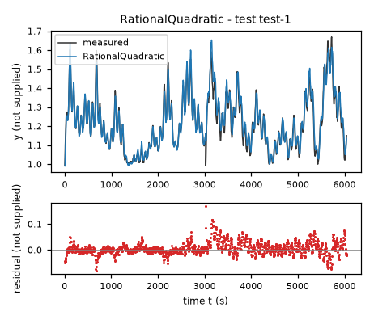

*Candidate RationalQuadratic, test data (sealed), trajectories test-1. Upper axes: measured output y (not supplied) and model output of RationalQuadratic; lower axes: residual (model output minus measured output, not supplied). Evaluation mode: simulation (initialized once per trajectory from the measured state at sample 0; classical fourth-order Runge-Kutta integration with 1 step(s) per sampling period T_s = 5 s and zero-order hold of the input; the model output is h(x[k], u[k])). Initialization: the first 1 sample(s) of each trajectory initialize the model and are excluded from the errors. Errors are computed on the samples test-1: 1 to 1209 (0-based sample indices). No numerical failure occurred.*

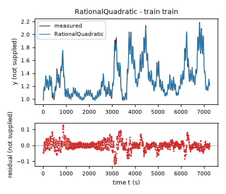

*Candidate RationalQuadratic, training data, trajectories train. Upper axes: measured output y (not supplied) and model output of RationalQuadratic; lower axes: residual (model output minus measured output, not supplied). Evaluation mode: simulation (initialized once per trajectory from the measured state at sample 0; classical fourth-order Runge-Kutta integration with 1 step(s) per sampling period T_s = 5 s and zero-order hold of the input; the model output is h(x[k], u[k])). Initialization: the first 1 sample(s) of each trajectory initialize the model and are excluded from the errors. Errors are computed on the samples train: 1 to 1451 (0-based sample indices). No numerical failure occurred.*

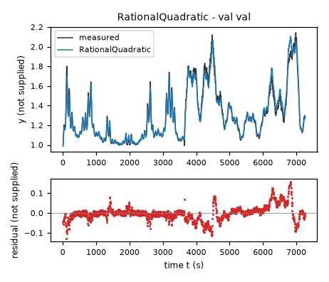

*Candidate RationalQuadratic, validation data, trajectories val. Upper axes: measured output y (not supplied) and model output of RationalQuadratic; lower axes: residual (model output minus measured output, not supplied). Evaluation mode: simulation (initialized once per trajectory from the measured state at sample 0; classical fourth-order Runge-Kutta integration with 1 step(s) per sampling period T_s = 5 s and zero-order hold of the input; the model output is h(x[k], u[k])). Initialization: the first 1 sample(s) of each trajectory initialize the model and are excluded from the errors. Errors are computed on the samples val: 1 to 1453 (0-based sample indices). No numerical failure occurred.*

### Candidate HingeSpline

Position in the agent's order: 3. Status: evaluated.
File and expression checks: passed.
- `dy = c1 + c2*((y-yref)/ys) + c3*(x1/uone) + c4*(x2/utwo) + c5*((y-yref)/ys)*(x1/uone) + c6*((y-yref)/ys)**2 + c7*(x1/uone)**2 + c8*Max((x1/uone)-h1,0)**2 + c9*Max(((y-yref)/ys)-h2,0)**2 + c10*Max(((y-yref)/ys)-h3,0)**2`
Complexity: 10 fitted, 7 fixed and 0 tied parameters; 0 non-integer numeric literals; 111 expression-tree nodes (SymPy tree, every operator, function, symbol and number counted once).
Structure group 3: `dy = P1 + 0.016666666666666667*P10*x1*(y - 1.0) + P2*Max(0, 1.0*y - 1.4270585775375371)**2 + P3*Max(0, 0.016666666666666667*x1 - 1.1575241088867188)**2 + P4*Max(0, 1.0*y - 1.093694686889648)**2 + 1.0*P5*(y - 1.0) + 1.0*P6*(y - 1.0)**2 + 0.016666666666666667*P7*x1 + 0.00027777777777777778*P8*x1**2 + 0.05*P9*x2`

Requirements:

| id | type | outcome | status | method | detail |
|---|---|---|---|---|---|

Output errors on the test data (sealed) (pooled RMSE: 0.0232368 not supplied):

| trajectory | scored samples | completed | RMSE (not supplied) | NRMSE | R² | failure |
|---|---|---|---|---|---|---|
| test-1 | 1209 | 1209 | 0.0232368 | 0.166741 | 0.972197 | none |

Output errors on the training data (pooled RMSE: 0.0281378 not supplied):

| trajectory | scored samples | completed | RMSE (not supplied) | NRMSE | R² | failure |
|---|---|---|---|---|---|---|
| train | 1451 | 1451 | 0.0281378 | 0.107909 | 0.988356 | none |

Output errors on the validation data (pooled RMSE: 0.0383015 not supplied):

| trajectory | scored samples | completed | RMSE (not supplied) | NRMSE | R² | failure |
|---|---|---|---|---|---|---|
| val | 1453 | 1453 | 0.0383015 | 0.145892 | 0.978715 | none |

Sensitivity rank test (diagnostic; never excludes): targets dy on the train, val data (2906 rows, 0 dropped); analytic derivatives (SymPy), ties differentiated through their equations; scaling: rows of each target divided by the standard deviation of its measured column; columns divided by their Euclidean norm; rank threshold s_i / s_1 > 1e-08; singular values 2.76, 1.24, 0.736, 0.371, 0.314, 0.16, 0.0597, 0.0351, 0.0286, 0.00313; rank 10 of 10.
Reference comparison: not applicable (the task has no reference expression).
Eligible for ranking: True.

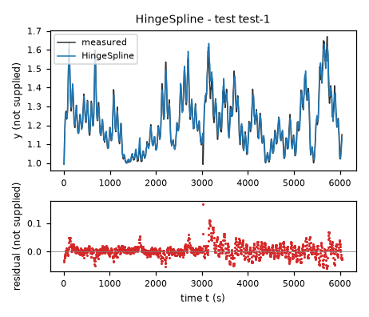

*Candidate HingeSpline, test data (sealed), trajectories test-1. Upper axes: measured output y (not supplied) and model output of HingeSpline; lower axes: residual (model output minus measured output, not supplied). Evaluation mode: simulation (initialized once per trajectory from the measured state at sample 0; classical fourth-order Runge-Kutta integration with 1 step(s) per sampling period T_s = 5 s and zero-order hold of the input; the model output is h(x[k], u[k])). Initialization: the first 1 sample(s) of each trajectory initialize the model and are excluded from the errors. Errors are computed on the samples test-1: 1 to 1209 (0-based sample indices). No numerical failure occurred.*

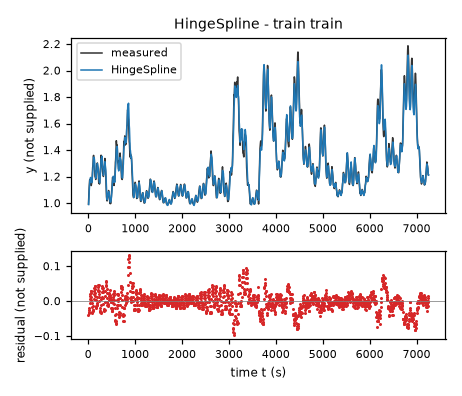

*Candidate HingeSpline, training data, trajectories train. Upper axes: measured output y (not supplied) and model output of HingeSpline; lower axes: residual (model output minus measured output, not supplied). Evaluation mode: simulation (initialized once per trajectory from the measured state at sample 0; classical fourth-order Runge-Kutta integration with 1 step(s) per sampling period T_s = 5 s and zero-order hold of the input; the model output is h(x[k], u[k])). Initialization: the first 1 sample(s) of each trajectory initialize the model and are excluded from the errors. Errors are computed on the samples train: 1 to 1451 (0-based sample indices). No numerical failure occurred.*

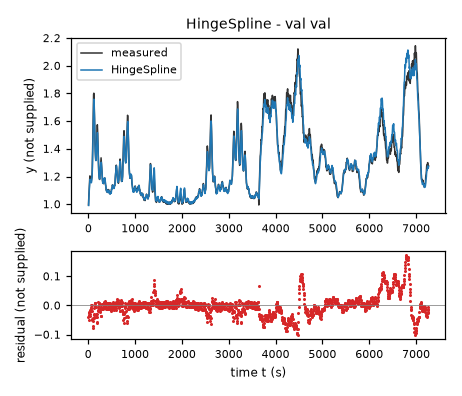

*Candidate HingeSpline, validation data, trajectories val. Upper axes: measured output y (not supplied) and model output of HingeSpline; lower axes: residual (model output minus measured output, not supplied). Evaluation mode: simulation (initialized once per trajectory from the measured state at sample 0; classical fourth-order Runge-Kutta integration with 1 step(s) per sampling period T_s = 5 s and zero-order hold of the input; the model output is h(x[k], u[k])). Initialization: the first 1 sample(s) of each trajectory initialize the model and are excluded from the errors. Errors are computed on the samples val: 1 to 1453 (0-based sample indices). No numerical failure occurred.*

### Candidate LogFeedback

Position in the agent's order: 4. Status: evaluated.
File and expression checks: passed.
- `dy = -k*(1-g*(x1/uone))*log(Max(y/ybase,eps))+source*Max(x2/utwo,0)**n`
Complexity: 5 fitted, 3 fixed and 0 tied parameters; 0 non-integer numeric literals; 32 expression-tree nodes (SymPy tree, every operator, function, symbol and number counted once).
Structure group 4: `dy = P1*Max(0, 0.05*x2)**P2 - P3*(-0.016666666666666667*P4*x1 + 1)*log(Max(1.0e-10, y/P5))`

Requirements:

| id | type | outcome | status | method | detail |
|---|---|---|---|---|---|

Output errors on the test data (sealed) (pooled RMSE: 0.0280533 not supplied):

| trajectory | scored samples | completed | RMSE (not supplied) | NRMSE | R² | failure |
|---|---|---|---|---|---|---|
| test-1 | 1209 | 1209 | 0.0280533 | 0.201303 | 0.959477 | none |

Output errors on the training data (pooled RMSE: 0.0335667 not supplied):

| trajectory | scored samples | completed | RMSE (not supplied) | NRMSE | R² | failure |
|---|---|---|---|---|---|---|
| train | 1451 | 1451 | 0.0335667 | 0.128728 | 0.983429 | none |

Output errors on the validation data (pooled RMSE: 0.0398418 not supplied):

| trajectory | scored samples | completed | RMSE (not supplied) | NRMSE | R² | failure |
|---|---|---|---|---|---|---|
| val | 1453 | 1453 | 0.0398418 | 0.151759 | 0.976969 | none |

Sensitivity rank test (diagnostic; never excludes): targets dy on the train, val data (2906 rows, 0 dropped); analytic derivatives (SymPy), ties differentiated through their equations; scaling: rows of each target divided by the standard deviation of its measured column; columns divided by their Euclidean norm; rank threshold s_i / s_1 > 1e-08; singular values 1.83, 1.03, 0.688, 0.293, 0.194; rank 5 of 5.
Reference comparison: not applicable (the task has no reference expression).
Eligible for ranking: True.

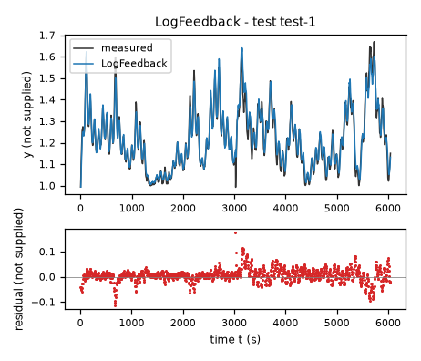

*Candidate LogFeedback, test data (sealed), trajectories test-1. Upper axes: measured output y (not supplied) and model output of LogFeedback; lower axes: residual (model output minus measured output, not supplied). Evaluation mode: simulation (initialized once per trajectory from the measured state at sample 0; classical fourth-order Runge-Kutta integration with 1 step(s) per sampling period T_s = 5 s and zero-order hold of the input; the model output is h(x[k], u[k])). Initialization: the first 1 sample(s) of each trajectory initialize the model and are excluded from the errors. Errors are computed on the samples test-1: 1 to 1209 (0-based sample indices). No numerical failure occurred.*

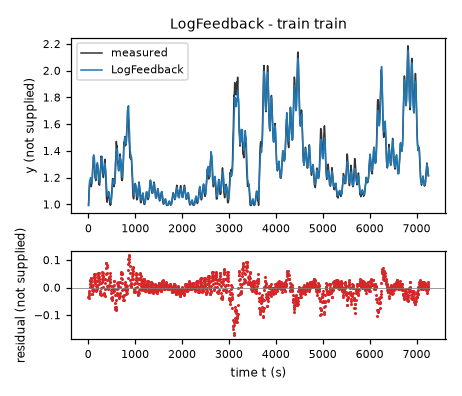

*Candidate LogFeedback, training data, trajectories train. Upper axes: measured output y (not supplied) and model output of LogFeedback; lower axes: residual (model output minus measured output, not supplied). Evaluation mode: simulation (initialized once per trajectory from the measured state at sample 0; classical fourth-order Runge-Kutta integration with 1 step(s) per sampling period T_s = 5 s and zero-order hold of the input; the model output is h(x[k], u[k])). Initialization: the first 1 sample(s) of each trajectory initialize the model and are excluded from the errors. Errors are computed on the samples train: 1 to 1451 (0-based sample indices). No numerical failure occurred.*

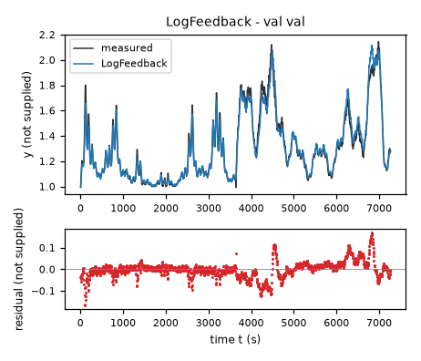

*Candidate LogFeedback, validation data, trajectories val. Upper axes: measured output y (not supplied) and model output of LogFeedback; lower axes: residual (model output minus measured output, not supplied). Evaluation mode: simulation (initialized once per trajectory from the measured state at sample 0; classical fourth-order Runge-Kutta integration with 1 step(s) per sampling period T_s = 5 s and zero-order hold of the input; the model output is h(x[k], u[k])). Initialization: the first 1 sample(s) of each trajectory initialize the model and are excluded from the errors. Errors are computed on the samples val: 1 to 1453 (0-based sample indices). No numerical failure occurred.*

### Candidate BilinearPower

Position in the agent's order: 5. Status: evaluated.
File and expression checks: passed.
- `dy = -k*(1-g*(x1/uone))*(y-ybase)+source*Max(x2/utwo,0)**n`
Complexity: 5 fitted, 2 fixed and 0 tied parameters; 0 non-integer numeric literals; 29 expression-tree nodes (SymPy tree, every operator, function, symbol and number counted once).
Structure group 5: `dy = P1*Max(0, 0.05*x2)**P2 - P3*(-P5 + y)*(-0.016666666666666667*P4*x1 + 1)`

Requirements:

| id | type | outcome | status | method | detail |
|---|---|---|---|---|---|

Output errors on the test data (sealed) (pooled RMSE: 0.0291461 not supplied):

| trajectory | scored samples | completed | RMSE (not supplied) | NRMSE | R² | failure |
|---|---|---|---|---|---|---|
| test-1 | 1209 | 1209 | 0.0291461 | 0.209144 | 0.956259 | none |

Output errors on the training data (pooled RMSE: 0.0329812 not supplied):

| trajectory | scored samples | completed | RMSE (not supplied) | NRMSE | R² | failure |
|---|---|---|---|---|---|---|
| train | 1451 | 1451 | 0.0329812 | 0.126483 | 0.984002 | none |

Output errors on the validation data (pooled RMSE: 0.0410788 not supplied):

| trajectory | scored samples | completed | RMSE (not supplied) | NRMSE | R² | failure |
|---|---|---|---|---|---|---|
| val | 1453 | 1453 | 0.0410788 | 0.156471 | 0.975517 | none |

Sensitivity rank test (diagnostic; never excludes): targets dy on the train, val data (2906 rows, 0 dropped); analytic derivatives (SymPy), ties differentiated through their equations; scaling: rows of each target divided by the standard deviation of its measured column; columns divided by their Euclidean norm; rank threshold s_i / s_1 > 1e-08; singular values 1.82, 1.01, 0.706, 0.318, 0.222; rank 5 of 5.
Reference comparison: not applicable (the task has no reference expression).
Eligible for ranking: True.

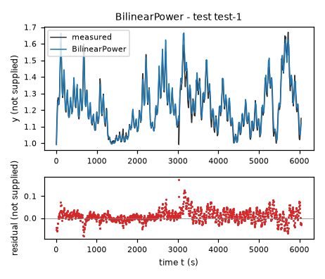

*Candidate BilinearPower, test data (sealed), trajectories test-1. Upper axes: measured output y (not supplied) and model output of BilinearPower; lower axes: residual (model output minus measured output, not supplied). Evaluation mode: simulation (initialized once per trajectory from the measured state at sample 0; classical fourth-order Runge-Kutta integration with 1 step(s) per sampling period T_s = 5 s and zero-order hold of the input; the model output is h(x[k], u[k])). Initialization: the first 1 sample(s) of each trajectory initialize the model and are excluded from the errors. Errors are computed on the samples test-1: 1 to 1209 (0-based sample indices). No numerical failure occurred.*

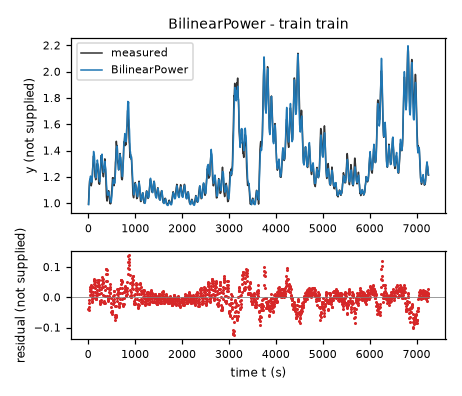

*Candidate BilinearPower, training data, trajectories train. Upper axes: measured output y (not supplied) and model output of BilinearPower; lower axes: residual (model output minus measured output, not supplied). Evaluation mode: simulation (initialized once per trajectory from the measured state at sample 0; classical fourth-order Runge-Kutta integration with 1 step(s) per sampling period T_s = 5 s and zero-order hold of the input; the model output is h(x[k], u[k])). Initialization: the first 1 sample(s) of each trajectory initialize the model and are excluded from the errors. Errors are computed on the samples train: 1 to 1451 (0-based sample indices). No numerical failure occurred.*

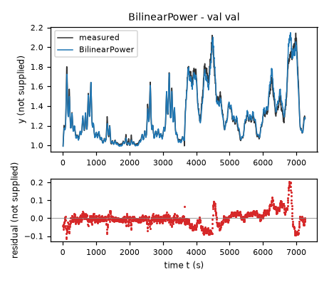

*Candidate BilinearPower, validation data, trajectories val. Upper axes: measured output y (not supplied) and model output of BilinearPower; lower axes: residual (model output minus measured output, not supplied). Evaluation mode: simulation (initialized once per trajectory from the measured state at sample 0; classical fourth-order Runge-Kutta integration with 1 step(s) per sampling period T_s = 5 s and zero-order hold of the input; the model output is h(x[k], u[k])). Initialization: the first 1 sample(s) of each trajectory initialize the model and are excluded from the errors. Errors are computed on the samples val: 1 to 1453 (0-based sample indices). No numerical failure occurred.*

### Candidate SigmoidRate

Position in the agent's order: 6. Status: evaluated.
File and expression checks: passed.
- `dy = -k*(y-ybase)/(1+exp(((x1/uone)-g)/width))+source*Max(x2/utwo,0)**n`
Complexity: 6 fitted, 2 fixed and 0 tied parameters; 0 non-integer numeric literals; 38 expression-tree nodes (SymPy tree, every operator, function, symbol and number counted once).
Structure group 6: `dy = P1*Max(0, 0.05*x2)**P2 - P3*(-P6 + y)/(exp((-P5 + 0.016666666666666667*x1)/P4) + 1)`

Requirements:

| id | type | outcome | status | method | detail |
|---|---|---|---|---|---|

Output errors on the test data (sealed) (pooled RMSE: 0.0346799 not supplied):

| trajectory | scored samples | completed | RMSE (not supplied) | NRMSE | R² | failure |
|---|---|---|---|---|---|---|
| test-1 | 1209 | 1209 | 0.0346799 | 0.248853 | 0.938072 | none |

Output errors on the training data (pooled RMSE: 0.0388349 not supplied):

| trajectory | scored samples | completed | RMSE (not supplied) | NRMSE | R² | failure |
|---|---|---|---|---|---|---|
| train | 1451 | 1451 | 0.0388349 | 0.148932 | 0.977819 | none |

Output errors on the validation data (pooled RMSE: 0.0420766 not supplied):

| trajectory | scored samples | completed | RMSE (not supplied) | NRMSE | R² | failure |
|---|---|---|---|---|---|---|
| val | 1453 | 1453 | 0.0420766 | 0.160272 | 0.974313 | none |

Sensitivity rank test (diagnostic; never excludes): targets dy on the train, val data (2906 rows, 0 dropped); analytic derivatives (SymPy), ties differentiated through their equations; scaling: rows of each target divided by the standard deviation of its measured column; columns divided by their Euclidean norm; rank threshold s_i / s_1 > 1e-08; singular values 1.95, 1.06, 0.902, 0.448, 0.206, 0.128; rank 6 of 6.
Reference comparison: not applicable (the task has no reference expression).
Eligible for ranking: True.

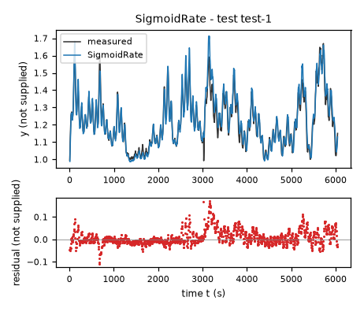

*Candidate SigmoidRate, test data (sealed), trajectories test-1. Upper axes: measured output y (not supplied) and model output of SigmoidRate; lower axes: residual (model output minus measured output, not supplied). Evaluation mode: simulation (initialized once per trajectory from the measured state at sample 0; classical fourth-order Runge-Kutta integration with 1 step(s) per sampling period T_s = 5 s and zero-order hold of the input; the model output is h(x[k], u[k])). Initialization: the first 1 sample(s) of each trajectory initialize the model and are excluded from the errors. Errors are computed on the samples test-1: 1 to 1209 (0-based sample indices). No numerical failure occurred.*

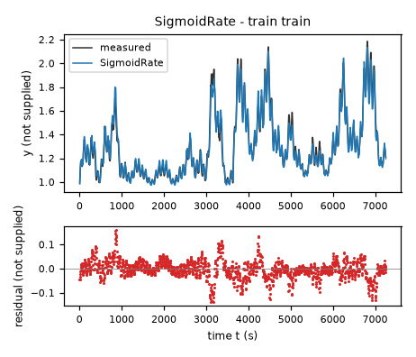

*Candidate SigmoidRate, training data, trajectories train. Upper axes: measured output y (not supplied) and model output of SigmoidRate; lower axes: residual (model output minus measured output, not supplied). Evaluation mode: simulation (initialized once per trajectory from the measured state at sample 0; classical fourth-order Runge-Kutta integration with 1 step(s) per sampling period T_s = 5 s and zero-order hold of the input; the model output is h(x[k], u[k])). Initialization: the first 1 sample(s) of each trajectory initialize the model and are excluded from the errors. Errors are computed on the samples train: 1 to 1451 (0-based sample indices). No numerical failure occurred.*

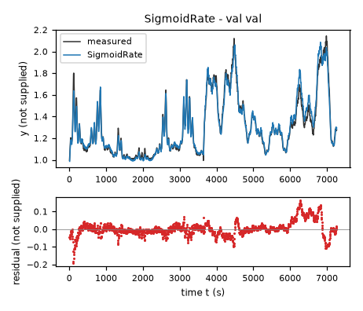

*Candidate SigmoidRate, validation data, trajectories val. Upper axes: measured output y (not supplied) and model output of SigmoidRate; lower axes: residual (model output minus measured output, not supplied). Evaluation mode: simulation (initialized once per trajectory from the measured state at sample 0; classical fourth-order Runge-Kutta integration with 1 step(s) per sampling period T_s = 5 s and zero-order hold of the input; the model output is h(x[k], u[k])). Initialization: the first 1 sample(s) of each trajectory initialize the model and are excluded from the errors. Errors are computed on the samples val: 1 to 1453 (0-based sample indices). No numerical failure occurred.*
