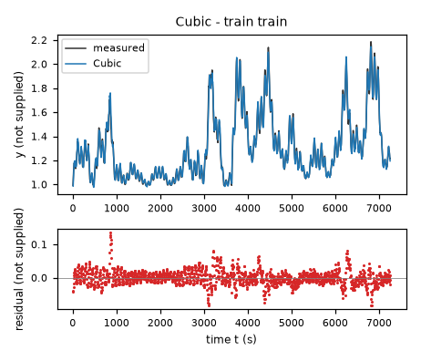
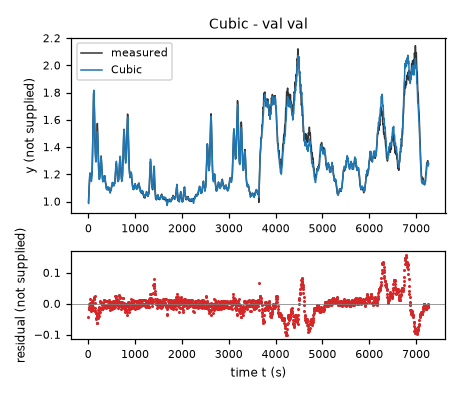
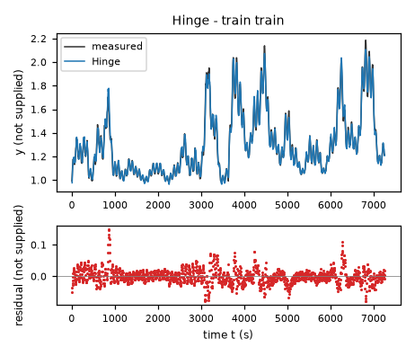
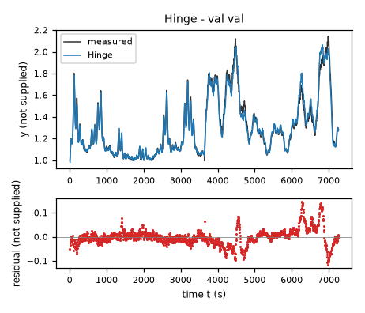
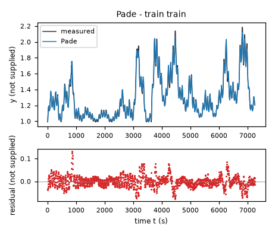
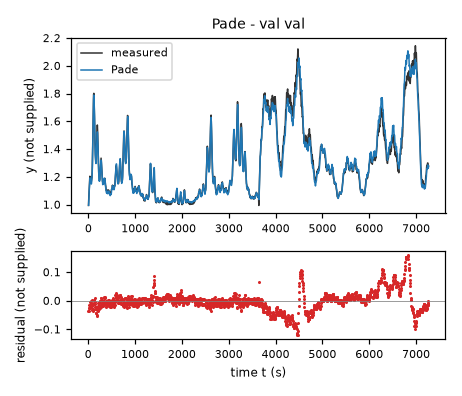
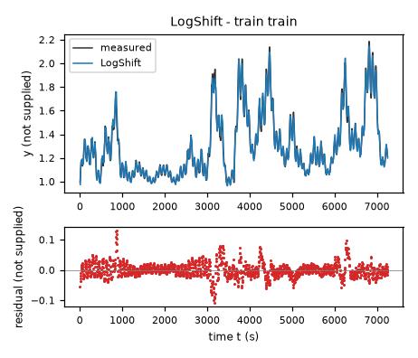
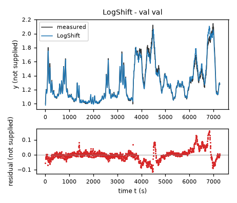
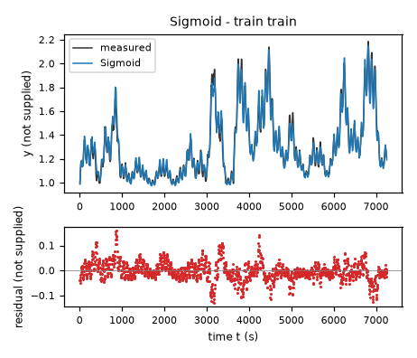
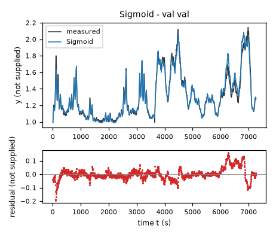

# Evaluation results permitted to the agent: task task-qtqm

Terms. The harness is the software of ASPIRE that checks and evaluates the candidate models; a candidate is one proposed model; the pool is the set of candidates of one round. Sealed data (test data, reference expression) are inaccessible to the agent. This view contains no result derived from sealed data.

Evaluation mode: simulation (initialized once per trajectory from the measured state at sample 0; classical fourth-order Runge-Kutta integration with 1 step(s) per sampling period T_s = 5 s and zero-order hold of the input; the model output is h(x[k], u[k])).
Error measures: for one trajectory with scoring interval I of N samples, measured output y[k] (y, not supplied) and model output ŷ[k], SSE = Σ_(k∈I) (ŷ[k] − y[k])²; RMSE = sqrt(SSE/N), in not supplied; NRMSE = RMSE/σ, with μ and σ the mean and the population standard deviation of y on I; R² = 1 − SSE / Σ_(k∈I) (y[k] − μ)²; NRMSE and R² are not applicable when σ = 0. The pooled RMSE over several trajectories is S = sqrt(ΣSSE / ΣN); on the test data it is the ranking score.
Numerical failure limits: y in [-100, 100] not supplied; evaluation time limit 60 s per candidate and data group; symbolic time limit 10 s per verification.
Discontinuous expressions: expressions with jumps (Piecewise, sign) are evaluated pointwise at the sample instants and Runge-Kutta stages; no event detection or step refinement is applied at a jump.
Harness version 0.1.0.dev0; NumPy 2.5.1; SymPy 1.14.0.

## Pool

| category | count |
|---|---|
| candidates proposed | 5 |
| accepted by the file and expression checks | 5 |
| outside the pool limit of 10 (not evaluated) | 0 |
| evaluated | 5 |
| excluded by physical requirements | 0 |
| failed numerically on training or validation data | 0 |

Note: the categories overlap; the counts need not sum to the pool size.

Distinct structures: 5 among 5 evaluated candidates; groups: Cubic; Hinge; Pade; LogShift; Sigmoid. Convention: ties resolved, fixed values kept, given constants kept, fitted parameters renamed P1..Pn in order of first occurrence; equal when a one-to-one renaming of the fitted parameters makes every expression identical in SymPy's canonical form.

### Recommendation of the agent

Recommended candidate: Cubic. The agent's reason: The cubic polynomial had the lowest training-only derivative-initialized validation simulation RMSE among the retained smooth families: approximately 0.036525 in the unspecified units of `y`, computed on data/val.csv with constant-input 5 s RK4. The final joint simulation-error refit also has the lowest joint state error (training RMSE 0.023325; validation RMSE 0.033375, now in-sample, in the unspecified units of `y`). Its negative highest pure-state cubic term provides better far-state behavior than unconstrained quadratic growth, but neither global RK4 stability nor test accuracy is claimed. The pool includes piecewise, guarded rational, logarithmic and positive-rate alternatives because residual timing structure remains unexplained.

## Candidates

### Candidate Cubic

Position in the agent's order: 1. Status: evaluated.
File and expression checks: passed.
- `dy = p0*1 + p1*((y-yc)/ys) + p2*((x1-uc)/us) + p3*((x2-vc)/vs) + p4*((y-yc)/ys)**2 + p5*((y-yc)/ys)*((x1-uc)/us) + p6*((y-yc)/ys)*((x2-vc)/vs) + p7*((x1-uc)/us)**2 + p8*((x1-uc)/us)*((x2-vc)/vs) + p9*((x2-vc)/vs)**2 + p10*((y-yc)/ys)**3 + p11*((y-yc)/ys)**2*((x1-uc)/us) + p12*((y-yc)/ys)**2*((x2-vc)/vs) + p13*((y-yc)/ys)*((x1-uc)/us)**2 + p14*((y-yc)/ys)*((x1-uc)/us)*((x2-vc)/vs) + p15*((y-yc)/ys)*((x2-vc)/vs)**2 + p16*((x1-uc)/us)**3 + p17*((x1-uc)/us)**2*((x2-vc)/vs) + p18*((x1-uc)/us)*((x2-vc)/vs)**2 + p19*((x2-vc)/vs)**3`
Complexity: 20 fitted, 6 fixed and 0 tied parameters; 0 non-integer numeric literals; 304 expression-tree nodes (SymPy tree, every operator, function, symbol and number counted once).
Structure group 1: `dy = P1 + 3.3333333333333335*P10*(y - 1.3) + 0.0083333333333333337*P11*(x1 - 60.0)**2*(y - 1.3) + 0.0010204081632653061*P12*(x1 - 60.0)*(x2 - 18.0)**2 + 0.00035714285714285714*P13*(x1 - 60.0)**2*(x2 - 18.0) + 0.0071428571428571429*P14*(x1 - 60.0)*(x2 - 18.0) + 0.47619047619047621*P15*(x2 - 18.0)*(y - 1.3) + 0.068027210884353744*P16*(x2 - 18.0)**2*(y - 1.3) + 0.5555555555555556*P17*(x1 - 60.0)*(y - 1.3)**2 + 0.16666666666666667*P18*(x1 - 60.0)*(y - 1.3) + 1.5873015873015874*P19*(x2 - 18.0)*(y - 1.3)**2 + 11.111111111111112*P2*(y - 1.3)**2 + 0.02380952380952381*P20*(x1 - 60.0)*(x2 - 18.0)*(y - 1.3) + 0.000125*P3*(x1 - 60.0)**3 + 0.020408163265306122*P4*(x2 - 18.0)**2 + 0.0029154518950437318*P5*(x2 - 18.0)**3 + 0.14285714285714286*P6*(x2 - 18.0) + 37.037037037037041*P7*(y - 1.3)**3 + 0.0025*P8*(x1 - 60.0)**2 + 0.05*P9*(x1 - 60.0)`

Requirements:

| id | type | outcome | status | method | detail |
|---|---|---|---|---|---|

Output errors on the training data (pooled RMSE: 0.023325 not supplied):

| trajectory | scored samples | completed | RMSE (not supplied) | NRMSE | R² | failure |
|---|---|---|---|---|---|---|
| train | 1451 | 1451 | 0.023325 | 0.0894516 | 0.991998 | none |

Output errors on the validation data (pooled RMSE: 0.0333753 not supplied):

| trajectory | scored samples | completed | RMSE (not supplied) | NRMSE | R² | failure |
|---|---|---|---|---|---|---|
| val | 1453 | 1453 | 0.0333753 | 0.127128 | 0.983838 | none |

Sensitivity rank test (diagnostic; never excludes): targets dy on the train, val data (2906 rows, 0 dropped); analytic derivatives (SymPy), ties differentiated through their equations; scaling: rows of each target divided by the standard deviation of its measured column; columns divided by their Euclidean norm; rank threshold s_i / s_1 > 1e-08; singular values 2.78, 2.23, 1.6, 1.26, 0.931, 0.784, 0.736, 0.552, 0.517, 0.39, 0.341, 0.311, 0.28, 0.21, 0.197, 0.109, 0.0945, 0.0858, 0.0534, 0.0398; rank 20 of 20.

*Candidate Cubic, training data, trajectories train. Upper axes: measured output y (not supplied) and model output of Cubic; lower axes: residual (model output minus measured output, not supplied). Evaluation mode: simulation (initialized once per trajectory from the measured state at sample 0; classical fourth-order Runge-Kutta integration with 1 step(s) per sampling period T_s = 5 s and zero-order hold of the input; the model output is h(x[k], u[k])). Initialization: the first 1 sample(s) of each trajectory initialize the model and are excluded from the errors. Errors are computed on the samples train: 1 to 1451 (0-based sample indices). No numerical failure occurred.*

*Candidate Cubic, validation data, trajectories val. Upper axes: measured output y (not supplied) and model output of Cubic; lower axes: residual (model output minus measured output, not supplied). Evaluation mode: simulation (initialized once per trajectory from the measured state at sample 0; classical fourth-order Runge-Kutta integration with 1 step(s) per sampling period T_s = 5 s and zero-order hold of the input; the model output is h(x[k], u[k])). Initialization: the first 1 sample(s) of each trajectory initialize the model and are excluded from the errors. Errors are computed on the samples val: 1 to 1453 (0-based sample indices). No numerical failure occurred.*

### Candidate Hinge

Position in the agent's order: 2. Status: evaluated.
File and expression checks: passed.
- `dy = p0*1 + p1*((y-yc)/ys) + p2*((x1-uc)/us) + p3*((x2-vc)/vs) + p4*((y-yc)/ys)*((x1-uc)/us) + p5*((x1-uc)/us)**2 + p6*((x2-vc)/vs)**2 + p7*Max(y-kL,0) + p8*Max(y-kM,0) + p9*Max(y-kH,0) + p10*((x1-uc)/us)*Max(y-kL,0) + p11*((x1-uc)/us)*Max(y-kM,0) + p12*((x1-uc)/us)*Max(y-kH,0)`
Complexity: 13 fitted, 9 fixed and 0 tied parameters; 0 non-integer numeric literals; 152 expression-tree nodes (SymPy tree, every operator, function, symbol and number counted once).
Structure group 2: `dy = P1 + 0.16666666666666667*P10*(x1 - 60.0)*(y - 1.3) + 0.05*P11*(x1 - 60.0)*Max(0, y - 1.1000000000000001) + 0.05*P12*(x1 - 60.0)*Max(0, y - 1.3999999999999999) + 0.05*P13*(x1 - 60.0)*Max(0, y - 1.7) + P2*Max(0, y - 1.1000000000000001) + P3*Max(0, y - 1.3999999999999999) + P4*Max(0, y - 1.7) + 0.020408163265306122*P5*(x2 - 18.0)**2 + 0.14285714285714286*P6*(x2 - 18.0) + 0.0025*P7*(x1 - 60.0)**2 + 0.05*P8*(x1 - 60.0) + 3.3333333333333335*P9*(y - 1.3)`

Requirements:

| id | type | outcome | status | method | detail |
|---|---|---|---|---|---|

Output errors on the training data (pooled RMSE: 0.0245972 not supplied):

| trajectory | scored samples | completed | RMSE (not supplied) | NRMSE | R² | failure |
|---|---|---|---|---|---|---|
| train | 1451 | 1451 | 0.0245972 | 0.0943304 | 0.991102 | none |

Output errors on the validation data (pooled RMSE: 0.0350354 not supplied):

| trajectory | scored samples | completed | RMSE (not supplied) | NRMSE | R² | failure |
|---|---|---|---|---|---|---|
| val | 1453 | 1453 | 0.0350354 | 0.133451 | 0.982191 | none |

Sensitivity rank test (diagnostic; never excludes): targets dy on the train, val data (2906 rows, 0 dropped); analytic derivatives (SymPy), ties differentiated through their equations; scaling: rows of each target divided by the standard deviation of its measured column; columns divided by their Euclidean norm; rank threshold s_i / s_1 > 1e-08; singular values 2.7, 1.56, 1.11, 0.977, 0.668, 0.571, 0.392, 0.3, 0.207, 0.126, 0.0571, 0.0412, 0.0225; rank 13 of 13.

*Candidate Hinge, training data, trajectories train. Upper axes: measured output y (not supplied) and model output of Hinge; lower axes: residual (model output minus measured output, not supplied). Evaluation mode: simulation (initialized once per trajectory from the measured state at sample 0; classical fourth-order Runge-Kutta integration with 1 step(s) per sampling period T_s = 5 s and zero-order hold of the input; the model output is h(x[k], u[k])). Initialization: the first 1 sample(s) of each trajectory initialize the model and are excluded from the errors. Errors are computed on the samples train: 1 to 1451 (0-based sample indices). No numerical failure occurred.*

*Candidate Hinge, validation data, trajectories val. Upper axes: measured output y (not supplied) and model output of Hinge; lower axes: residual (model output minus measured output, not supplied). Evaluation mode: simulation (initialized once per trajectory from the measured state at sample 0; classical fourth-order Runge-Kutta integration with 1 step(s) per sampling period T_s = 5 s and zero-order hold of the input; the model output is h(x[k], u[k])). Initialization: the first 1 sample(s) of each trajectory initialize the model and are excluded from the errors. Errors are computed on the samples val: 1 to 1453 (0-based sample indices). No numerical failure occurred.*

### Candidate Pade

Position in the agent's order: 3. Status: evaluated.
File and expression checks: passed.
- `dy = (p0 + p1*((y-yc)/ys) + p2*((x1-uc)/us) + p3*((x2-vc)/vs) + p4*((y-yc)/ys)*((x1-uc)/us) + p5*((x1-uc)/us)**2 + p6*((x2-vc)/vs)**2 + p7*((x1-uc)/us)*((x2-vc)/vs))/Max(1 + p8*((y-yc)/ys) + p9*((x1-uc)/us) + p10*((x2-vc)/vs),dmin)`
Complexity: 11 fitted, 7 fixed and 0 tied parameters; 0 non-integer numeric literals; 129 expression-tree nodes (SymPy tree, every operator, function, symbol and number counted once).
Structure group 3: `dy = (0.0071428571428571429*P10*(x1 - 60.0)*(x2 - 18.0) + 0.16666666666666667*P11*(x1 - 60.0)*(y - 1.3) + P4 + 0.020408163265306122*P5*(x2 - 18.0)**2 + 0.14285714285714286*P6*(x2 - 18.0) + 0.0025*P7*(x1 - 60.0)**2 + 0.05*P8*(x1 - 60.0) + 3.3333333333333335*P9*(y - 1.3))/Max(0.25, 0.14285714285714286*P1*(x2 - 18.0) + 0.05*P2*(x1 - 60.0) + 3.3333333333333335*P3*(y - 1.3) + 1)`

Requirements:

| id | type | outcome | status | method | detail |
|---|---|---|---|---|---|

Output errors on the training data (pooled RMSE: 0.0248647 not supplied):

| trajectory | scored samples | completed | RMSE (not supplied) | NRMSE | R² | failure |
|---|---|---|---|---|---|---|
| train | 1451 | 1451 | 0.0248647 | 0.0953564 | 0.990907 | none |

Output errors on the validation data (pooled RMSE: 0.0371142 not supplied):

| trajectory | scored samples | completed | RMSE (not supplied) | NRMSE | R² | failure |
|---|---|---|---|---|---|---|
| val | 1453 | 1453 | 0.0371142 | 0.14137 | 0.980015 | none |

Sensitivity rank test (diagnostic; never excludes): targets dy on the train, val data (2906 rows, 0 dropped); analytic derivatives (SymPy), ties differentiated through their equations; scaling: rows of each target divided by the standard deviation of its measured column; columns divided by their Euclidean norm; rank threshold s_i / s_1 > 1e-08; singular values 1.78, 1.5, 1.4, 1.13, 0.95, 0.696, 0.661, 0.482, 0.456, 0.318, 0.0965; rank 11 of 11.

*Candidate Pade, training data, trajectories train. Upper axes: measured output y (not supplied) and model output of Pade; lower axes: residual (model output minus measured output, not supplied). Evaluation mode: simulation (initialized once per trajectory from the measured state at sample 0; classical fourth-order Runge-Kutta integration with 1 step(s) per sampling period T_s = 5 s and zero-order hold of the input; the model output is h(x[k], u[k])). Initialization: the first 1 sample(s) of each trajectory initialize the model and are excluded from the errors. Errors are computed on the samples train: 1 to 1451 (0-based sample indices). No numerical failure occurred.*

*Candidate Pade, validation data, trajectories val. Upper axes: measured output y (not supplied) and model output of Pade; lower axes: residual (model output minus measured output, not supplied). Evaluation mode: simulation (initialized once per trajectory from the measured state at sample 0; classical fourth-order Runge-Kutta integration with 1 step(s) per sampling period T_s = 5 s and zero-order hold of the input; the model output is h(x[k], u[k])). Initialization: the first 1 sample(s) of each trajectory initialize the model and are excluded from the errors. Errors are computed on the samples val: 1 to 1453 (0-based sample indices). No numerical failure occurred.*

### Candidate LogShift

Position in the agent's order: 4. Status: evaluated.
File and expression checks: passed.
- `dy = p0*1 + p1*log(Max(y-p7,logfloor)/yref) + p2*((x1-uc)/us) + p3*((x2-vc)/vs) + p4*log(Max(y-p7,logfloor)/yref)*((x1-uc)/us) + p5*((x1-uc)/us)**2 + p6*((x2-vc)/vs)**2`
Complexity: 8 fitted, 6 fixed and 0 tied parameters; 0 non-integer numeric literals; 82 expression-tree nodes (SymPy tree, every operator, function, symbol and number counted once).
Structure group 4: `dy = P1 + P2*log(1.0*Max(0.02, -P3 + y)) + 0.020408163265306122*P4*(x2 - 18.0)**2 + 0.14285714285714286*P5*(x2 - 18.0) + 0.0025*P6*(x1 - 60.0)**2 + 0.05*P7*(x1 - 60.0) + 0.05*P8*(x1 - 60.0)*log(1.0*Max(0.02, -P3 + y))`

Requirements:

| id | type | outcome | status | method | detail |
|---|---|---|---|---|---|

Output errors on the training data (pooled RMSE: 0.0245068 not supplied):

| trajectory | scored samples | completed | RMSE (not supplied) | NRMSE | R² | failure |
|---|---|---|---|---|---|---|
| train | 1451 | 1451 | 0.0245068 | 0.0939837 | 0.991167 | none |

Output errors on the validation data (pooled RMSE: 0.0371523 not supplied):

| trajectory | scored samples | completed | RMSE (not supplied) | NRMSE | R² | failure |
|---|---|---|---|---|---|---|
| val | 1453 | 1453 | 0.0371523 | 0.141515 | 0.979974 | none |

Sensitivity rank test (diagnostic; never excludes): targets dy on the train, val data (2906 rows, 0 dropped); analytic derivatives (SymPy), ties differentiated through their equations; scaling: rows of each target divided by the standard deviation of its measured column; columns divided by their Euclidean norm; rank threshold s_i / s_1 > 1e-08; singular values 2.05, 1.35, 1.05, 0.644, 0.613, 0.259, 0.0984, 0.0221; rank 8 of 8.

*Candidate LogShift, training data, trajectories train. Upper axes: measured output y (not supplied) and model output of LogShift; lower axes: residual (model output minus measured output, not supplied). Evaluation mode: simulation (initialized once per trajectory from the measured state at sample 0; classical fourth-order Runge-Kutta integration with 1 step(s) per sampling period T_s = 5 s and zero-order hold of the input; the model output is h(x[k], u[k])). Initialization: the first 1 sample(s) of each trajectory initialize the model and are excluded from the errors. Errors are computed on the samples train: 1 to 1451 (0-based sample indices). No numerical failure occurred.*

*Candidate LogShift, validation data, trajectories val. Upper axes: measured output y (not supplied) and model output of LogShift; lower axes: residual (model output minus measured output, not supplied). Evaluation mode: simulation (initialized once per trajectory from the measured state at sample 0; classical fourth-order Runge-Kutta integration with 1 step(s) per sampling period T_s = 5 s and zero-order hold of the input; the model output is h(x[k], u[k])). Initialization: the first 1 sample(s) of each trajectory initialize the model and are excluded from the errors. Errors are computed on the samples val: 1 to 1453 (0-based sample indices). No numerical failure occurred.*

### Candidate Sigmoid

Position in the agent's order: 5. Status: evaluated.
File and expression checks: passed.
- `dy = p0 + p1*(x2/vscale) + p2*(x2/vscale)**2 - (p3 + p4/(1+exp(p5*(x1/uscale-p6))))*(y-p7)`
Complexity: 8 fitted, 2 fixed and 0 tied parameters; 0 non-integer numeric literals; 43 expression-tree nodes (SymPy tree, every operator, function, symbol and number counted once).
Structure group 5: `dy = P1 + 0.0030864197530864198*P7*x2**2 + 0.055555555555555556*P8*x2 - (P2 + P3/(exp(P4*(-P5 + 0.016666666666666667*x1)) + 1))*(-P6 + y)`

Requirements:

| id | type | outcome | status | method | detail |
|---|---|---|---|---|---|

Output errors on the training data (pooled RMSE: 0.0380085 not supplied):

| trajectory | scored samples | completed | RMSE (not supplied) | NRMSE | R² | failure |
|---|---|---|---|---|---|---|
| train | 1451 | 1451 | 0.0380085 | 0.145763 | 0.978753 | none |

Output errors on the validation data (pooled RMSE: 0.0419428 not supplied):

| trajectory | scored samples | completed | RMSE (not supplied) | NRMSE | R² | failure |
|---|---|---|---|---|---|---|
| val | 1453 | 1453 | 0.0419428 | 0.159762 | 0.974476 | none |

Sensitivity rank test (diagnostic; never excludes): targets dy on the train, val data (2906 rows, 0 dropped); analytic derivatives (SymPy), ties differentiated through their equations; scaling: rows of each target divided by the standard deviation of its measured column; columns divided by their Euclidean norm; rank threshold s_i / s_1 > 1e-08; singular values 2.5, 1.12, 0.555, 0.369, 0.223, 0.131, 0.0762, 0.0526; rank 8 of 8.

*Candidate Sigmoid, training data, trajectories train. Upper axes: measured output y (not supplied) and model output of Sigmoid; lower axes: residual (model output minus measured output, not supplied). Evaluation mode: simulation (initialized once per trajectory from the measured state at sample 0; classical fourth-order Runge-Kutta integration with 1 step(s) per sampling period T_s = 5 s and zero-order hold of the input; the model output is h(x[k], u[k])). Initialization: the first 1 sample(s) of each trajectory initialize the model and are excluded from the errors. Errors are computed on the samples train: 1 to 1451 (0-based sample indices). No numerical failure occurred.*

*Candidate Sigmoid, validation data, trajectories val. Upper axes: measured output y (not supplied) and model output of Sigmoid; lower axes: residual (model output minus measured output, not supplied). Evaluation mode: simulation (initialized once per trajectory from the measured state at sample 0; classical fourth-order Runge-Kutta integration with 1 step(s) per sampling period T_s = 5 s and zero-order hold of the input; the model output is h(x[k], u[k])). Initialization: the first 1 sample(s) of each trajectory initialize the model and are excluded from the errors. Errors are computed on the samples val: 1 to 1453 (0-based sample indices). No numerical failure occurred.*
