# Evaluation report: task task-qtqm

Terms. The harness is the software of ASPIRE that checks and evaluates the candidate models; a candidate is one proposed model; the pool is the set of candidates of one round. Sealed data (test data, reference expression) are inaccessible to the agent. This report contains results on sealed data and is not shown to the agent.

Evaluation mode: simulation (initialized once per trajectory from the measured state at sample 0; classical fourth-order Runge-Kutta integration with 1 step(s) per sampling period T_s = 5 s and zero-order hold of the input; the model output is h(x[k], u[k])).
Error measures: for one trajectory with scoring interval I of N samples, measured output y[k] (y, not supplied) and model output ŷ[k], SSE = Σ_(k∈I) (ŷ[k] − y[k])²; RMSE = sqrt(SSE/N), in not supplied; NRMSE = RMSE/σ, with μ and σ the mean and the population standard deviation of y on I; R² = 1 − SSE / Σ_(k∈I) (y[k] − μ)²; NRMSE and R² are not applicable when σ = 0. The pooled RMSE over several trajectories is S = sqrt(ΣSSE / ΣN); on the test data it is the ranking score.
Numerical failure limits: y in [-100, 100] not supplied; evaluation time limit 60 s per candidate and data group; symbolic time limit 10 s per verification.
Discontinuous expressions: expressions with jumps (Piecewise, sign) are evaluated pointwise at the sample instants and Runge-Kutta stages; no event detection or step refinement is applied at a jump.
Harness version 0.1.0.dev0; NumPy 2.5.1; SymPy 1.14.0.

## Pool

| category | count |
|---|---|
| candidates proposed | 5 |
| accepted by the file and expression checks | 5 |
| outside the pool limit of 10 (not evaluated) | 0 |
| evaluated | 5 |
| excluded by physical requirements | 0 |
| failed numerically on training or validation data | 0 |
| failed numerically on test data | 0 |
| eligible for ranking | 5 |

Note: the categories overlap: the candidates accepted by the checks include those outside the pool limit, and a candidate can be both excluded by requirements and failed numerically; the counts need not sum to the pool size.

Distinct structures: 5 among 5 evaluated candidates; groups: CubicPolynomial; RationalGain; PowerFeedback; ExponentialFeedback; SaturatingFeedback. Convention: ties resolved, fixed values kept, given constants kept, fitted parameters renamed P1..Pn in order of first occurrence; equal when a one-to-one renaming of the fitted parameters makes every expression identical in SymPy's canonical form.

### Recommendation of the agent

Recommended candidate: CubicPolynomial. The agent's reason: The complete cubic polynomial had the best validation free-running error among the derivative-fitted polynomial screens, approximately 0.0365 state-unit, without the singularity risks seen in higher degrees. Final output-error refitting on both files gives approximately 0.0233 state-unit training and 0.0334 state-unit validation RMSE, better than the other retained final fits. Those final figures are fitting diagnostics, not independent validation. Its interactions are explicit and it avoids fitted fractional-power branch thresholds. RationalGain is a lower-complexity alternative. Test performance remains unknown.
- Test score S of the recommended candidate (practical selection): 0.0217669 not supplied; eligible: True; rank in the oracle-based selection: 1.

## Oracle-based selection on test data

Label: oracle-based selection on test data. Candidates considered: 5 eligible of 5 evaluated. Criterion: pooled test RMSE S, increasing, the pooled RMSE over the test trajectories test-1 (1209 scored samples). Tie rule: |S_a - S_b| <= 1e-12 * max(S_a, S_b) for consecutive candidates; tied candidates share a rank. This ranking selects on the test data. It measures whether the pool contains an accurate model, not whether the agent can recognize that model without test data. A rank is not evidence of physical admissibility: each entry carries its unresolved requirements and any violation allowed by the user.

| rank | candidate | S (not supplied) | unresolved requirements | violations allowed by the user |
|---|---|---|---|---|
| 1 | CubicPolynomial | 0.0217669 | none | none |
| 2 | PowerFeedback | 0.0222849 | none | none |
| 3 | ExponentialFeedback | 0.0223706 | none | none |
| 4 | SaturatingFeedback | 0.0227855 | none | none |
| 5 | RationalGain | 0.0252553 | none | none |

## Candidates

### Candidate CubicPolynomial

Position in the agent's order: 1. Status: evaluated.
File and expression checks: passed.
- `dy = c0*1 + c1*((y-yc)/ys) + c2*(x1/n1) + c3*(x2/n2) + c4*((y-yc)/ys)**2 + c5*((y-yc)/ys)*(x1/n1) + c6*((y-yc)/ys)*(x2/n2) + c7*(x1/n1)**2 + c8*(x1/n1)*(x2/n2) + c9*(x2/n2)**2 + c10*((y-yc)/ys)**3 + c11*((y-yc)/ys)**2*(x1/n1) + c12*((y-yc)/ys)**2*(x2/n2) + c13*((y-yc)/ys)*(x1/n1)**2 + c14*((y-yc)/ys)*(x1/n1)*(x2/n2) + c15*((y-yc)/ys)*(x2/n2)**2 + c16*(x1/n1)**3 + c17*(x1/n1)**2*(x2/n2) + c18*(x1/n1)*(x2/n2)**2 + c19*(x2/n2)**3`
Complexity: 20 fitted, 4 fixed and 0 tied parameters; 0 non-integer numeric literals; 224 expression-tree nodes (SymPy tree, every operator, function, symbol and number counted once).
Structure group 1: `dy = P1 + 0.014285714285714286*P10*x1 + 0.0083333333333333337*P11*x2**2*(y - 1.3) + 3.5714285714285714e-5*P12*x1*x2**2 + 0.5555555555555556*P13*x2*(y - 1.3)**2 + 0.15873015873015874*P14*x1*(y - 1.3)**2 + 0.16666666666666667*P15*x2*(y - 1.3) + 1.0204081632653061e-5*P16*x1**2*x2 + 0.00068027210884353744*P17*x1**2*(y - 1.3) + 0.00071428571428571429*P18*x1*x2 + 0.047619047619047621*P19*x1*(y - 1.3) + 11.111111111111112*P2*(y - 1.3)**2 + 0.002380952380952381*P20*x1*x2*(y - 1.3) + 0.000125*P3*x2**3 + 0.00020408163265306122*P4*x1**2 + 2.9154518950437318e-6*P5*x1**3 + 37.037037037037041*P6*(y - 1.3)**3 + 0.0025*P7*x2**2 + 0.05*P8*x2 + 3.3333333333333335*P9*(y - 1.3)`

Requirements:

| id | type | outcome | status | method | detail |
|---|---|---|---|---|---|

Output errors on the test data (sealed) (pooled RMSE: 0.0217669 not supplied):

| trajectory | scored samples | completed | RMSE (not supplied) | NRMSE | R² | failure |
|---|---|---|---|---|---|---|
| test-1 | 1209 | 1209 | 0.0217669 | 0.156193 | 0.975604 | none |

Output errors on the training data (pooled RMSE: 0.0233252 not supplied):

| trajectory | scored samples | completed | RMSE (not supplied) | NRMSE | R² | failure |
|---|---|---|---|---|---|---|
| train | 1451 | 1451 | 0.0233252 | 0.0894522 | 0.991998 | none |

Output errors on the validation data (pooled RMSE: 0.0333752 not supplied):

| trajectory | scored samples | completed | RMSE (not supplied) | NRMSE | R² | failure |
|---|---|---|---|---|---|---|
| val | 1453 | 1453 | 0.0333752 | 0.127128 | 0.983839 | none |

Sensitivity rank test (diagnostic; never excludes): targets dy on the train, val data (2906 rows, 0 dropped); analytic derivatives (SymPy), ties differentiated through their equations; scaling: rows of each target divided by the standard deviation of its measured column; columns divided by their Euclidean norm; rank threshold s_i / s_1 > 1e-08; singular values 3.69, 2.15, 0.929, 0.748, 0.377, 0.353, 0.174, 0.155, 0.123, 0.103, 0.0607, 0.0447, 0.0304, 0.0235, 0.018, 0.0159, 0.00809, 0.00659, 0.00348, 0.00163; rank 20 of 20.
Reference comparison: not applicable (the task has no reference expression).
Eligible for ranking: True.

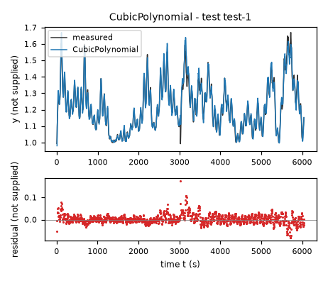

*Candidate CubicPolynomial, test data (sealed), trajectories test-1. Upper axes: measured output y (not supplied) and model output of CubicPolynomial; lower axes: residual (model output minus measured output, not supplied). Evaluation mode: simulation (initialized once per trajectory from the measured state at sample 0; classical fourth-order Runge-Kutta integration with 1 step(s) per sampling period T_s = 5 s and zero-order hold of the input; the model output is h(x[k], u[k])). Initialization: the first 1 sample(s) of each trajectory initialize the model and are excluded from the errors. Errors are computed on the samples test-1: 1 to 1209 (0-based sample indices). No numerical failure occurred.*

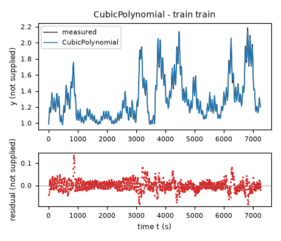

*Candidate CubicPolynomial, training data, trajectories train. Upper axes: measured output y (not supplied) and model output of CubicPolynomial; lower axes: residual (model output minus measured output, not supplied). Evaluation mode: simulation (initialized once per trajectory from the measured state at sample 0; classical fourth-order Runge-Kutta integration with 1 step(s) per sampling period T_s = 5 s and zero-order hold of the input; the model output is h(x[k], u[k])). Initialization: the first 1 sample(s) of each trajectory initialize the model and are excluded from the errors. Errors are computed on the samples train: 1 to 1451 (0-based sample indices). No numerical failure occurred.*

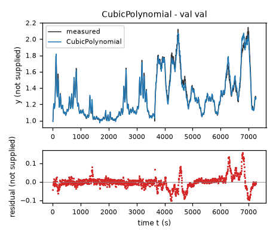

*Candidate CubicPolynomial, validation data, trajectories val. Upper axes: measured output y (not supplied) and model output of CubicPolynomial; lower axes: residual (model output minus measured output, not supplied). Evaluation mode: simulation (initialized once per trajectory from the measured state at sample 0; classical fourth-order Runge-Kutta integration with 1 step(s) per sampling period T_s = 5 s and zero-order hold of the input; the model output is h(x[k], u[k])). Initialization: the first 1 sample(s) of each trajectory initialize the model and are excluded from the errors. Errors are computed on the samples val: 1 to 1453 (0-based sample indices). No numerical failure occurred.*

### Candidate RationalGain

Position in the agent's order: 2. Status: evaluated.
File and expression checks: passed.
- `dy = (c0*1 + c1*((y-yc)/ys) + c2*(x1/n1) + c3*(x2/n2) + c4*((y-yc)/ys)**2 + c5*((y-yc)/ys)*(x1/n1) + c6*((y-yc)/ys)*(x2/n2) + c7*(x1/n1)**2 + c8*(x1/n1)*(x2/n2) + c9*(x2/n2)**2)/(1+d*((y-yc)/ys)**2)`
Complexity: 11 fitted, 4 fixed and 0 tied parameters; 0 non-integer numeric literals; 107 expression-tree nodes (SymPy tree, every operator, function, symbol and number counted once).
Structure group 2: `dy = (0.00071428571428571429*P10*x1*x2 + 0.047619047619047621*P11*x1*(y - 1.3) + P2 + 11.111111111111112*P3*(y - 1.3)**2 + 0.00020408163265306122*P4*x1**2 + 0.0025*P5*x2**2 + 0.05*P6*x2 + 3.3333333333333335*P7*(y - 1.3) + 0.014285714285714286*P8*x1 + 0.16666666666666667*P9*x2*(y - 1.3))/(11.111111111111112*P1*(y - 1.3)**2 + 1)`

Requirements:

| id | type | outcome | status | method | detail |
|---|---|---|---|---|---|

Output errors on the test data (sealed) (pooled RMSE: 0.0252553 not supplied):

| trajectory | scored samples | completed | RMSE (not supplied) | NRMSE | R² | failure |
|---|---|---|---|---|---|---|
| test-1 | 1209 | 1209 | 0.0252553 | 0.181225 | 0.967157 | none |

Output errors on the training data (pooled RMSE: 0.0265419 not supplied):

| trajectory | scored samples | completed | RMSE (not supplied) | NRMSE | R² | failure |
|---|---|---|---|---|---|---|
| train | 1451 | 1451 | 0.0265419 | 0.101788 | 0.989639 | none |

Output errors on the validation data (pooled RMSE: 0.0369683 not supplied):

| trajectory | scored samples | completed | RMSE (not supplied) | NRMSE | R² | failure |
|---|---|---|---|---|---|---|
| val | 1453 | 1453 | 0.0369683 | 0.140814 | 0.980171 | none |

Sensitivity rank test (diagnostic; never excludes): targets dy on the train, val data (2906 rows, 0 dropped); analytic derivatives (SymPy), ties differentiated through their equations; scaling: rows of each target divided by the standard deviation of its measured column; columns divided by their Euclidean norm; rank threshold s_i / s_1 > 1e-08; singular values 2.47, 1.72, 1, 0.746, 0.547, 0.232, 0.16, 0.0864, 0.0689, 0.0298, 0.0114; rank 11 of 11.
Reference comparison: not applicable (the task has no reference expression).
Eligible for ranking: True.

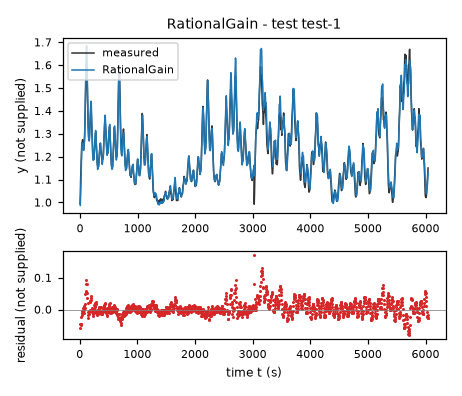

*Candidate RationalGain, test data (sealed), trajectories test-1. Upper axes: measured output y (not supplied) and model output of RationalGain; lower axes: residual (model output minus measured output, not supplied). Evaluation mode: simulation (initialized once per trajectory from the measured state at sample 0; classical fourth-order Runge-Kutta integration with 1 step(s) per sampling period T_s = 5 s and zero-order hold of the input; the model output is h(x[k], u[k])). Initialization: the first 1 sample(s) of each trajectory initialize the model and are excluded from the errors. Errors are computed on the samples test-1: 1 to 1209 (0-based sample indices). No numerical failure occurred.*

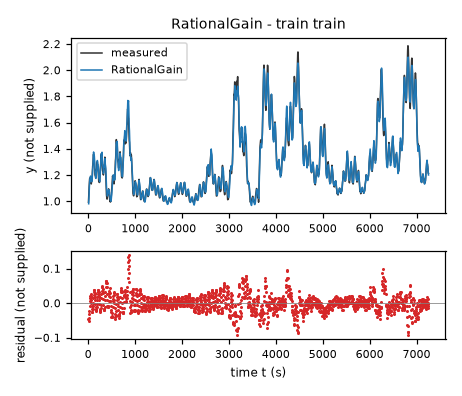

*Candidate RationalGain, training data, trajectories train. Upper axes: measured output y (not supplied) and model output of RationalGain; lower axes: residual (model output minus measured output, not supplied). Evaluation mode: simulation (initialized once per trajectory from the measured state at sample 0; classical fourth-order Runge-Kutta integration with 1 step(s) per sampling period T_s = 5 s and zero-order hold of the input; the model output is h(x[k], u[k])). Initialization: the first 1 sample(s) of each trajectory initialize the model and are excluded from the errors. Errors are computed on the samples train: 1 to 1451 (0-based sample indices). No numerical failure occurred.*

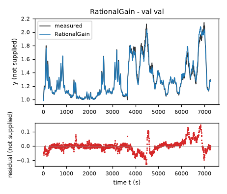

*Candidate RationalGain, validation data, trajectories val. Upper axes: measured output y (not supplied) and model output of RationalGain; lower axes: residual (model output minus measured output, not supplied). Evaluation mode: simulation (initialized once per trajectory from the measured state at sample 0; classical fourth-order Runge-Kutta integration with 1 step(s) per sampling period T_s = 5 s and zero-order hold of the input; the model output is h(x[k], u[k])). Initialization: the first 1 sample(s) of each trajectory initialize the model and are excluded from the errors. Errors are computed on the samples val: 1 to 1453 (0-based sample indices). No numerical failure occurred.*

### Candidate PowerFeedback

Position in the agent's order: 3. Status: evaluated.
File and expression checks: passed.
- `dy = c0 + c1*(Max(y-h,epsy)**b) + c2*(Max(x1/n1,epsu)**a*Max(x2/n2,epsu)**d) + c3*(Max(x2/n2,epsu)**e) + c4*(Max(x1/n1,epsu)**a*Max(x2/n2,epsu)**d)*(Max(y-h,epsy)**b) + c5*(Max(x2/n2,epsu)**e)*(Max(y-h,epsy)**b)`
Complexity: 11 fitted, 4 fixed and 0 tied parameters; 0 non-integer numeric literals; 93 expression-tree nodes (SymPy tree, every operator, function, symbol and number counted once).
Structure group 3: `dy = P1 + P10*Max(9.9999999999999995e-7, 0.05*x2)**P6*Max(9.9999999999999995e-7, -P3 + y)**P4 + P11*Max(9.9999999999999995e-7, 0.014285714285714286*x1)**P9*Max(9.9999999999999995e-7, 0.05*x2)**P8*Max(9.9999999999999995e-7, -P3 + y)**P4 + P2*Max(9.9999999999999995e-7, -P3 + y)**P4 + P5*Max(9.9999999999999995e-7, 0.05*x2)**P6 + P7*Max(9.9999999999999995e-7, 0.014285714285714286*x1)**P9*Max(9.9999999999999995e-7, 0.05*x2)**P8`

Requirements:

| id | type | outcome | status | method | detail |
|---|---|---|---|---|---|

Output errors on the test data (sealed) (pooled RMSE: 0.0222849 not supplied):

| trajectory | scored samples | completed | RMSE (not supplied) | NRMSE | R² | failure |
|---|---|---|---|---|---|---|
| test-1 | 1209 | 1209 | 0.0222849 | 0.15991 | 0.974429 | none |

Output errors on the training data (pooled RMSE: 0.0237433 not supplied):

| trajectory | scored samples | completed | RMSE (not supplied) | NRMSE | R² | failure |
|---|---|---|---|---|---|---|
| train | 1451 | 1451 | 0.0237433 | 0.0910556 | 0.991709 | none |

Output errors on the validation data (pooled RMSE: 0.0368253 not supplied):

| trajectory | scored samples | completed | RMSE (not supplied) | NRMSE | R² | failure |
|---|---|---|---|---|---|---|
| val | 1453 | 1453 | 0.0368253 | 0.140269 | 0.980325 | none |

Sensitivity rank test (diagnostic; never excludes): targets dy on the train, val data (2906 rows, 0 dropped); analytic derivatives (SymPy), ties differentiated through their equations; scaling: rows of each target divided by the standard deviation of its measured column; columns divided by their Euclidean norm; rank threshold s_i / s_1 > 1e-08; singular values 2.54, 1.45, 1.12, 0.908, 0.488, 0.317, 0.169, 0.0754, 0.0363, 0.0294, 0.0162; rank 11 of 11.
Reference comparison: not applicable (the task has no reference expression).
Eligible for ranking: True.

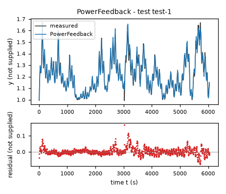

*Candidate PowerFeedback, test data (sealed), trajectories test-1. Upper axes: measured output y (not supplied) and model output of PowerFeedback; lower axes: residual (model output minus measured output, not supplied). Evaluation mode: simulation (initialized once per trajectory from the measured state at sample 0; classical fourth-order Runge-Kutta integration with 1 step(s) per sampling period T_s = 5 s and zero-order hold of the input; the model output is h(x[k], u[k])). Initialization: the first 1 sample(s) of each trajectory initialize the model and are excluded from the errors. Errors are computed on the samples test-1: 1 to 1209 (0-based sample indices). No numerical failure occurred.*

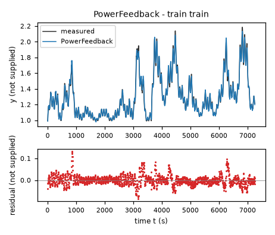

*Candidate PowerFeedback, training data, trajectories train. Upper axes: measured output y (not supplied) and model output of PowerFeedback; lower axes: residual (model output minus measured output, not supplied). Evaluation mode: simulation (initialized once per trajectory from the measured state at sample 0; classical fourth-order Runge-Kutta integration with 1 step(s) per sampling period T_s = 5 s and zero-order hold of the input; the model output is h(x[k], u[k])). Initialization: the first 1 sample(s) of each trajectory initialize the model and are excluded from the errors. Errors are computed on the samples train: 1 to 1451 (0-based sample indices). No numerical failure occurred.*

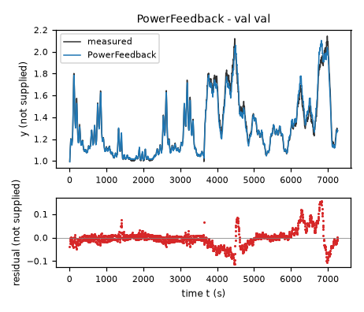

*Candidate PowerFeedback, validation data, trajectories val. Upper axes: measured output y (not supplied) and model output of PowerFeedback; lower axes: residual (model output minus measured output, not supplied). Evaluation mode: simulation (initialized once per trajectory from the measured state at sample 0; classical fourth-order Runge-Kutta integration with 1 step(s) per sampling period T_s = 5 s and zero-order hold of the input; the model output is h(x[k], u[k])). Initialization: the first 1 sample(s) of each trajectory initialize the model and are excluded from the errors. Errors are computed on the samples val: 1 to 1453 (0-based sample indices). No numerical failure occurred.*

### Candidate ExponentialFeedback

Position in the agent's order: 4. Status: evaluated.
File and expression checks: passed.
- `dy = c0 + c1*sqrt(Max(y-h,epsy)) + c2*exp(a*(x1/n1-1)) + c3*(x2/n2) + c4*exp(a*(x1/n1-1))*sqrt(Max(y-h,epsy))`
Complexity: 7 fitted, 3 fixed and 0 tied parameters; 0 non-integer numeric literals; 52 expression-tree nodes (SymPy tree, every operator, function, symbol and number counted once).
Structure group 4: `dy = P1 + P2*sqrt(Max(9.9999999999999995e-7, -P3 + y)) + P4*exp(P5*(0.014285714285714286*x1 - 1)) + 0.05*P6*x2 + P7*exp(P5*(0.014285714285714286*x1 - 1))*sqrt(Max(9.9999999999999995e-7, -P3 + y))`

Requirements:

| id | type | outcome | status | method | detail |
|---|---|---|---|---|---|

Output errors on the test data (sealed) (pooled RMSE: 0.0223706 not supplied):

| trajectory | scored samples | completed | RMSE (not supplied) | NRMSE | R² | failure |
|---|---|---|---|---|---|---|
| test-1 | 1209 | 1209 | 0.0223706 | 0.160525 | 0.974232 | none |

Output errors on the training data (pooled RMSE: 0.0238667 not supplied):

| trajectory | scored samples | completed | RMSE (not supplied) | NRMSE | R² | failure |
|---|---|---|---|---|---|---|
| train | 1451 | 1451 | 0.0238667 | 0.0915288 | 0.991622 | none |

Output errors on the validation data (pooled RMSE: 0.0374113 not supplied):

| trajectory | scored samples | completed | RMSE (not supplied) | NRMSE | R² | failure |
|---|---|---|---|---|---|---|
| val | 1453 | 1453 | 0.0374113 | 0.142501 | 0.979693 | none |

Sensitivity rank test (diagnostic; never excludes): targets dy on the train, val data (2906 rows, 0 dropped); analytic derivatives (SymPy), ties differentiated through their equations; scaling: rows of each target divided by the standard deviation of its measured column; columns divided by their Euclidean norm; rank threshold s_i / s_1 > 1e-08; singular values 2.26, 1.11, 0.73, 0.283, 0.174, 0.101, 0.0163; rank 7 of 7.
Reference comparison: not applicable (the task has no reference expression).
Eligible for ranking: True.

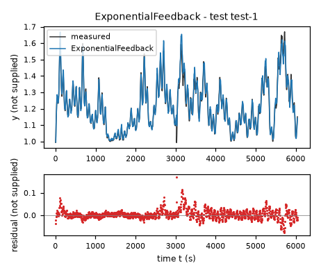

*Candidate ExponentialFeedback, test data (sealed), trajectories test-1. Upper axes: measured output y (not supplied) and model output of ExponentialFeedback; lower axes: residual (model output minus measured output, not supplied). Evaluation mode: simulation (initialized once per trajectory from the measured state at sample 0; classical fourth-order Runge-Kutta integration with 1 step(s) per sampling period T_s = 5 s and zero-order hold of the input; the model output is h(x[k], u[k])). Initialization: the first 1 sample(s) of each trajectory initialize the model and are excluded from the errors. Errors are computed on the samples test-1: 1 to 1209 (0-based sample indices). No numerical failure occurred.*

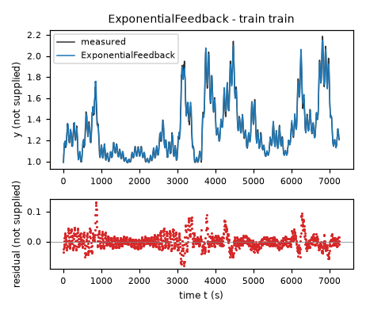

*Candidate ExponentialFeedback, training data, trajectories train. Upper axes: measured output y (not supplied) and model output of ExponentialFeedback; lower axes: residual (model output minus measured output, not supplied). Evaluation mode: simulation (initialized once per trajectory from the measured state at sample 0; classical fourth-order Runge-Kutta integration with 1 step(s) per sampling period T_s = 5 s and zero-order hold of the input; the model output is h(x[k], u[k])). Initialization: the first 1 sample(s) of each trajectory initialize the model and are excluded from the errors. Errors are computed on the samples train: 1 to 1451 (0-based sample indices). No numerical failure occurred.*

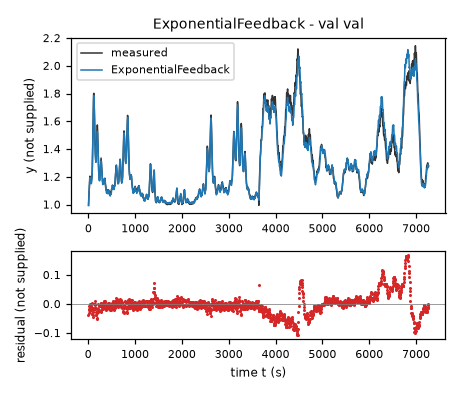

*Candidate ExponentialFeedback, validation data, trajectories val. Upper axes: measured output y (not supplied) and model output of ExponentialFeedback; lower axes: residual (model output minus measured output, not supplied). Evaluation mode: simulation (initialized once per trajectory from the measured state at sample 0; classical fourth-order Runge-Kutta integration with 1 step(s) per sampling period T_s = 5 s and zero-order hold of the input; the model output is h(x[k], u[k])). Initialization: the first 1 sample(s) of each trajectory initialize the model and are excluded from the errors. Errors are computed on the samples val: 1 to 1453 (0-based sample indices). No numerical failure occurred.*

### Candidate SaturatingFeedback

Position in the agent's order: 5. Status: evaluated.
File and expression checks: passed.
- `dy = c0 + c1*sqrt(Max(y-h,epsy)) + c2*tanh(a*(x1/n1-u0)) + c3*tanh(b*(x2/n2-w0)) + c4*tanh(a*(x1/n1-u0))*sqrt(Max(y-h,epsy)) + c5*tanh(b*(x2/n2-w0))*sqrt(Max(y-h,epsy))`
Complexity: 11 fitted, 3 fixed and 0 tied parameters; 0 non-integer numeric literals; 87 expression-tree nodes (SymPy tree, every operator, function, symbol and number counted once).
Structure group 5: `dy = P1 + P10*tanh(P5*(-P6 + 0.014285714285714286*x1))*sqrt(Max(9.9999999999999995e-7, -P3 + y)) + P11*tanh(P8*(-P9 + 0.05*x2))*sqrt(Max(9.9999999999999995e-7, -P3 + y)) + P2*sqrt(Max(9.9999999999999995e-7, -P3 + y)) + P4*tanh(P5*(-P6 + 0.014285714285714286*x1)) + P7*tanh(P8*(-P9 + 0.05*x2))`

Requirements:

| id | type | outcome | status | method | detail |
|---|---|---|---|---|---|

Output errors on the test data (sealed) (pooled RMSE: 0.0227855 not supplied):

| trajectory | scored samples | completed | RMSE (not supplied) | NRMSE | R² | failure |
|---|---|---|---|---|---|---|
| test-1 | 1209 | 1209 | 0.0227855 | 0.163502 | 0.973267 | none |

Output errors on the training data (pooled RMSE: 0.0237509 not supplied):

| trajectory | scored samples | completed | RMSE (not supplied) | NRMSE | R² | failure |
|---|---|---|---|---|---|---|
| train | 1451 | 1451 | 0.0237509 | 0.091085 | 0.991704 | none |

Output errors on the validation data (pooled RMSE: 0.0370243 not supplied):

| trajectory | scored samples | completed | RMSE (not supplied) | NRMSE | R² | failure |
|---|---|---|---|---|---|---|
| val | 1453 | 1453 | 0.0370243 | 0.141027 | 0.980111 | none |

Sensitivity rank test (diagnostic; never excludes): targets dy on the train, val data (2906 rows, 0 dropped); analytic derivatives (SymPy), ties differentiated through their equations; scaling: rows of each target divided by the standard deviation of its measured column; columns divided by their Euclidean norm; rank threshold s_i / s_1 > 1e-08; singular values 3, 1.11, 0.621, 0.497, 0.329, 0.175, 0.121, 0.0605, 0.00974, 0.000361, 8.37e-05; rank 11 of 11.
Reference comparison: not applicable (the task has no reference expression).
Eligible for ranking: True.

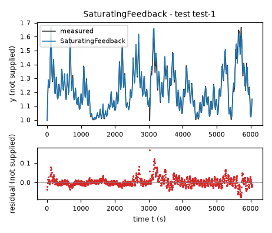

*Candidate SaturatingFeedback, test data (sealed), trajectories test-1. Upper axes: measured output y (not supplied) and model output of SaturatingFeedback; lower axes: residual (model output minus measured output, not supplied). Evaluation mode: simulation (initialized once per trajectory from the measured state at sample 0; classical fourth-order Runge-Kutta integration with 1 step(s) per sampling period T_s = 5 s and zero-order hold of the input; the model output is h(x[k], u[k])). Initialization: the first 1 sample(s) of each trajectory initialize the model and are excluded from the errors. Errors are computed on the samples test-1: 1 to 1209 (0-based sample indices). No numerical failure occurred.*

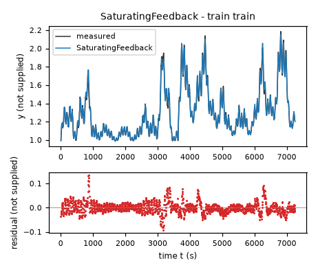

*Candidate SaturatingFeedback, training data, trajectories train. Upper axes: measured output y (not supplied) and model output of SaturatingFeedback; lower axes: residual (model output minus measured output, not supplied). Evaluation mode: simulation (initialized once per trajectory from the measured state at sample 0; classical fourth-order Runge-Kutta integration with 1 step(s) per sampling period T_s = 5 s and zero-order hold of the input; the model output is h(x[k], u[k])). Initialization: the first 1 sample(s) of each trajectory initialize the model and are excluded from the errors. Errors are computed on the samples train: 1 to 1451 (0-based sample indices). No numerical failure occurred.*

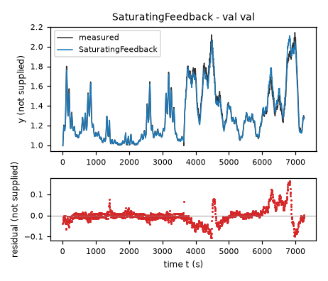

*Candidate SaturatingFeedback, validation data, trajectories val. Upper axes: measured output y (not supplied) and model output of SaturatingFeedback; lower axes: residual (model output minus measured output, not supplied). Evaluation mode: simulation (initialized once per trajectory from the measured state at sample 0; classical fourth-order Runge-Kutta integration with 1 step(s) per sampling period T_s = 5 s and zero-order hold of the input; the model output is h(x[k], u[k])). Initialization: the first 1 sample(s) of each trajectory initialize the model and are excluded from the errors. Errors are computed on the samples val: 1 to 1453 (0-based sample indices). No numerical failure occurred.*
