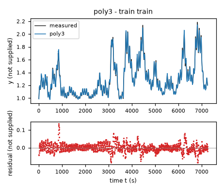
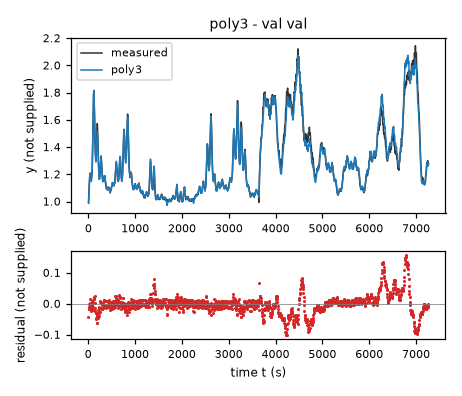
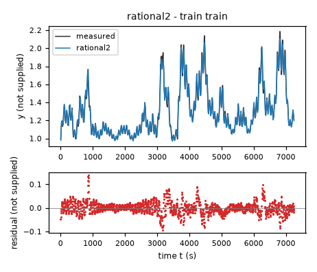
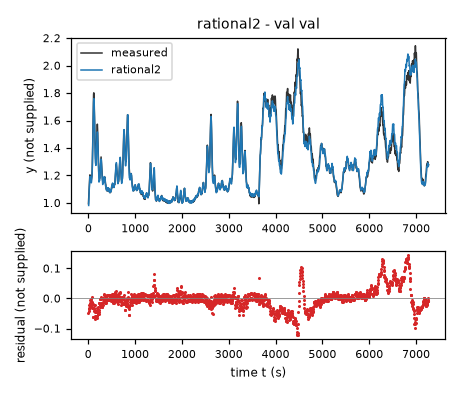
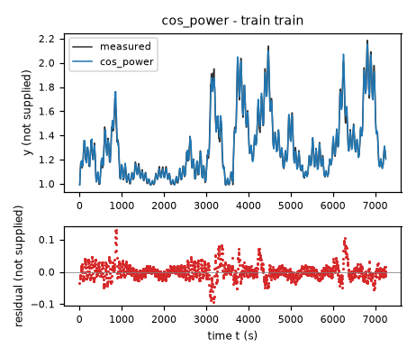
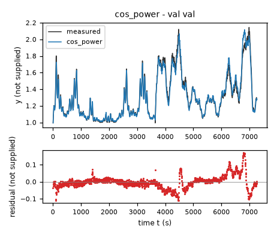
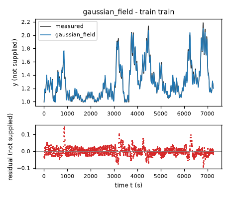
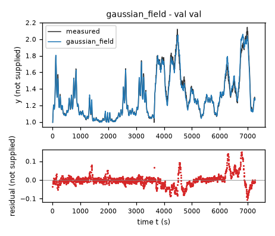

# Evaluation results permitted to the agent: task task-qtqm

Terms. The harness is the software of ASPIRE that checks and evaluates the candidate models; a candidate is one proposed model; the pool is the set of candidates of one round. Sealed data (test data, reference expression) are inaccessible to the agent. This view contains no result derived from sealed data.

Evaluation mode: simulation (initialized once per trajectory from the measured state at sample 0; classical fourth-order Runge-Kutta integration with 1 step(s) per sampling period T_s = 5 s and zero-order hold of the input; the model output is h(x[k], u[k])).
Error measures: for one trajectory with scoring interval I of N samples, measured output y[k] (y, not supplied) and model output ŷ[k], SSE = Σ_(k∈I) (ŷ[k] − y[k])²; RMSE = sqrt(SSE/N), in not supplied; NRMSE = RMSE/σ, with μ and σ the mean and the population standard deviation of y on I; R² = 1 − SSE / Σ_(k∈I) (y[k] − μ)²; NRMSE and R² are not applicable when σ = 0. The pooled RMSE over several trajectories is S = sqrt(ΣSSE / ΣN); on the test data it is the ranking score.
Numerical failure limits: y in [-100, 100] not supplied; evaluation time limit 60 s per candidate and data group; symbolic time limit 10 s per verification.
Discontinuous expressions: expressions with jumps (Piecewise, sign) are evaluated pointwise at the sample instants and Runge-Kutta stages; no event detection or step refinement is applied at a jump.
Harness version 0.1.0.dev0; NumPy 2.5.1; SymPy 1.14.0.

## Pool

| category | count |
|---|---|
| candidates proposed | 4 |
| accepted by the file and expression checks | 4 |
| outside the pool limit of 10 (not evaluated) | 0 |
| evaluated | 4 |
| excluded by physical requirements | 0 |
| failed numerically on training or validation data | 0 |

Note: the categories overlap; the counts need not sum to the pool size.

Distinct structures: 4 among 4 evaluated candidates; groups: poly3; rational2; cos_power; gaussian_field. Convention: ties resolved, fixed values kept, given constants kept, fitted parameters renamed P1..Pn in order of first occurrence; equal when a one-to-one renaming of the fitted parameters makes every expression identical in SymPy's canonical form.

### Recommendation of the agent

Recommended candidate: poly3. The agent's reason: Recommend `poly3`: it is a transparent degree-three polynomial field with fewer fitted values than the Gaussian network and the lowest combined-data uninterrupted RK4 state RMSE in this pool. Its final errors are about `0.023325` U_y on `data/train.csv` and `0.033375` U_y on `data/val.csv`; U_y denotes the unspecified state unit. Validation was included in final calibration, so these are not untouched holdout scores. Before final pooling, its training-derivative fit gave validation rollout RMSE about `0.036525` U_y and compared favorably with most compact nonlinear alternatives. The Gaussian model had a slightly lower screened holdout error but higher complexity and no final pooled advantage. The rational and smoothed power-law candidates hedge structural uncertainty, not coefficient uncertainty. No claim is made about unavailable test data.

## Candidates

### Candidate poly3

Position in the agent's order: 1. Status: evaluated.
File and expression checks: passed.
- `dy = c0*1 + c1*((y-y0)/s0) + c2*(x1/u0) + c3*(x2/v0) + c4*((y-y0)/s0)**2 + c5*((y-y0)/s0)*(x1/u0) + c6*((y-y0)/s0)*(x2/v0) + c7*(x1/u0)**2 + c8*(x1/u0)*(x2/v0) + c9*(x2/v0)**2 + c10*((y-y0)/s0)**3 + c11*((y-y0)/s0)**2*(x1/u0) + c12*((y-y0)/s0)**2*(x2/v0) + c13*((y-y0)/s0)*(x1/u0)**2 + c14*((y-y0)/s0)*(x1/u0)*(x2/v0) + c15*((y-y0)/s0)*(x2/v0)**2 + c16*(x1/u0)**3 + c17*(x1/u0)**2*(x2/v0) + c18*(x1/u0)*(x2/v0)**2 + c19*(x2/v0)**3`
Complexity: 20 fitted, 4 fixed and 0 tied parameters; 0 non-integer numeric literals; 224 expression-tree nodes (SymPy tree, every operator, function, symbol and number counted once).
Structure group 1: `dy = P1 + 0.05*P10*x2 + 0.00083333333333333333*P11*x1*x2 + 0.016666666666666667*P12*x1*(y - 1.0)**2 + 0.016666666666666667*P13*x1*(y - 1.0) + 0.00027777777777777778*P14*x1**2*(y - 1.0) + 0.0025*P15*x2**2*(y - 1.0) + 4.1666666666666667e-5*P16*x1*x2**2 + 0.05*P17*x2*(y - 1.0)**2 + 0.05*P18*x2*(y - 1.0) + 1.3888888888888889e-5*P19*x1**2*x2 + 1.0*P2*(y - 1.0) + 0.00083333333333333333*P20*x1*x2*(y - 1.0) + 1.0*P3*(y - 1.0)**3 + 1.0*P4*(y - 1.0)**2 + 0.000125*P5*x2**3 + 0.016666666666666667*P6*x1 + 0.00027777777777777778*P7*x1**2 + 4.6296296296296296e-6*P8*x1**3 + 0.0025*P9*x2**2`

Requirements:

| id | type | outcome | status | method | detail |
|---|---|---|---|---|---|

Output errors on the training data (pooled RMSE: 0.023325 not supplied):

| trajectory | scored samples | completed | RMSE (not supplied) | NRMSE | R² | failure |
|---|---|---|---|---|---|---|
| train | 1451 | 1451 | 0.023325 | 0.0894515 | 0.991998 | none |

Output errors on the validation data (pooled RMSE: 0.0333753 not supplied):

| trajectory | scored samples | completed | RMSE (not supplied) | NRMSE | R² | failure |
|---|---|---|---|---|---|---|
| val | 1453 | 1453 | 0.0333753 | 0.127128 | 0.983838 | none |

Sensitivity rank test (diagnostic; never excludes): targets dy on the train, val data (2906 rows, 0 dropped); analytic derivatives (SymPy), ties differentiated through their equations; scaling: rows of each target divided by the standard deviation of its measured column; columns divided by their Euclidean norm; rank threshold s_i / s_1 > 1e-08; singular values 4.11, 1.46, 0.801, 0.464, 0.232, 0.189, 0.151, 0.117, 0.0772, 0.0448, 0.0291, 0.0241, 0.021, 0.0166, 0.0116, 0.00939, 0.00811, 0.00544, 0.00404, 0.00193; rank 20 of 20.

*Candidate poly3, training data, trajectories train. Upper axes: measured output y (not supplied) and model output of poly3; lower axes: residual (model output minus measured output, not supplied). Evaluation mode: simulation (initialized once per trajectory from the measured state at sample 0; classical fourth-order Runge-Kutta integration with 1 step(s) per sampling period T_s = 5 s and zero-order hold of the input; the model output is h(x[k], u[k])). Initialization: the first 1 sample(s) of each trajectory initialize the model and are excluded from the errors. Errors are computed on the samples train: 1 to 1451 (0-based sample indices). No numerical failure occurred.*

*Candidate poly3, validation data, trajectories val. Upper axes: measured output y (not supplied) and model output of poly3; lower axes: residual (model output minus measured output, not supplied). Evaluation mode: simulation (initialized once per trajectory from the measured state at sample 0; classical fourth-order Runge-Kutta integration with 1 step(s) per sampling period T_s = 5 s and zero-order hold of the input; the model output is h(x[k], u[k])). Initialization: the first 1 sample(s) of each trajectory initialize the model and are excluded from the errors. Errors are computed on the samples val: 1 to 1453 (0-based sample indices). No numerical failure occurred.*

### Candidate rational2

Position in the agent's order: 2. Status: evaluated.
File and expression checks: passed.
- `dy = (c0*1 + c1*((y-y0)/s0) + c2*(x1/u0) + c3*(x2/v0) + c4*((y-y0)/s0)**2 + c5*((y-y0)/s0)*(x1/u0) + c6*((y-y0)/s0)*(x2/v0) + c7*(x1/u0)**2 + c8*(x1/u0)*(x2/v0) + c9*(x2/v0)**2)/(1+k*((y-y0)/s0)**2)`
Complexity: 11 fitted, 4 fixed and 0 tied parameters; 0 non-integer numeric literals; 107 expression-tree nodes (SymPy tree, every operator, function, symbol and number counted once).
Structure group 2: `dy = (0.016666666666666667*P10*x1*(y - 1.0) + 0.05*P11*x2*(y - 1.0) + P2 + 1.0*P3*(y - 1.0) + 1.0*P4*(y - 1.0)**2 + 0.016666666666666667*P5*x1 + 0.00027777777777777778*P6*x1**2 + 0.0025*P7*x2**2 + 0.05*P8*x2 + 0.00083333333333333333*P9*x1*x2)/(1.0*P1*(y - 1.0)**2 + 1)`

Requirements:

| id | type | outcome | status | method | detail |
|---|---|---|---|---|---|

Output errors on the training data (pooled RMSE: 0.0254724 not supplied):

| trajectory | scored samples | completed | RMSE (not supplied) | NRMSE | R² | failure |
|---|---|---|---|---|---|---|
| train | 1451 | 1451 | 0.0254724 | 0.0976868 | 0.990457 | none |

Output errors on the validation data (pooled RMSE: 0.0364302 not supplied):

| trajectory | scored samples | completed | RMSE (not supplied) | NRMSE | R² | failure |
|---|---|---|---|---|---|---|
| val | 1453 | 1453 | 0.0364302 | 0.138764 | 0.980744 | none |

Sensitivity rank test (diagnostic; never excludes): targets dy on the train, val data (2906 rows, 0 dropped); analytic derivatives (SymPy), ties differentiated through their equations; scaling: rows of each target divided by the standard deviation of its measured column; columns divided by their Euclidean norm; rank threshold s_i / s_1 > 1e-08; singular values 2.91, 1.04, 0.974, 0.6, 0.311, 0.142, 0.103, 0.0978, 0.0402, 0.0395, 0.0141; rank 11 of 11.

*Candidate rational2, training data, trajectories train. Upper axes: measured output y (not supplied) and model output of rational2; lower axes: residual (model output minus measured output, not supplied). Evaluation mode: simulation (initialized once per trajectory from the measured state at sample 0; classical fourth-order Runge-Kutta integration with 1 step(s) per sampling period T_s = 5 s and zero-order hold of the input; the model output is h(x[k], u[k])). Initialization: the first 1 sample(s) of each trajectory initialize the model and are excluded from the errors. Errors are computed on the samples train: 1 to 1451 (0-based sample indices). No numerical failure occurred.*

*Candidate rational2, validation data, trajectories val. Upper axes: measured output y (not supplied) and model output of rational2; lower axes: residual (model output minus measured output, not supplied). Evaluation mode: simulation (initialized once per trajectory from the measured state at sample 0; classical fourth-order Runge-Kutta integration with 1 step(s) per sampling period T_s = 5 s and zero-order hold of the input; the model output is h(x[k], u[k])). Initialization: the first 1 sample(s) of each trajectory initialize the model and are excluded from the errors. Errors are computed on the samples val: 1 to 1453 (0-based sample indices). No numerical failure occurred.*

### Candidate cos_power

Position in the agent's order: 3. Status: evaluated.
File and expression checks: passed.
- `dy = b0+b1*Max(x2/v0,floor)**q-(d0+d1*Max(cos(pi*x1/a0),floor)**r)*((y-h)/s0)*(((y-h)/s0)**2+eps**2)**((p-1)/2)`
Complexity: 8 fitted, 5 fixed and 0 tied parameters; 0 non-integer numeric literals; 59 expression-tree nodes (SymPy tree, every operator, function, symbol and number counted once).
Structure group 3: `dy = P1 + P2*Max(9.9999999999999998e-13, 0.05*x2)**P3 - 1.0*(-P4 + y)*(P6 + P7*Max(9.9999999999999998e-13, cos(0.0055555555555555556*pi*x1))**P8)*(1.0*(-P4 + y)**2 + 0.0025000000000000003)**(P5/2 - 1/2)`

Requirements:

| id | type | outcome | status | method | detail |
|---|---|---|---|---|---|

Output errors on the training data (pooled RMSE: 0.02404 not supplied):

| trajectory | scored samples | completed | RMSE (not supplied) | NRMSE | R² | failure |
|---|---|---|---|---|---|---|
| train | 1451 | 1451 | 0.02404 | 0.0921938 | 0.9915 | none |

Output errors on the validation data (pooled RMSE: 0.0385504 not supplied):

| trajectory | scored samples | completed | RMSE (not supplied) | NRMSE | R² | failure |
|---|---|---|---|---|---|---|
| val | 1453 | 1453 | 0.0385504 | 0.14684 | 0.978438 | none |

Sensitivity rank test (diagnostic; never excludes): targets dy on the train, val data (2906 rows, 0 dropped); analytic derivatives (SymPy), ties differentiated through their equations; scaling: rows of each target divided by the standard deviation of its measured column; columns divided by their Euclidean norm; rank threshold s_i / s_1 > 1e-08; singular values 2.39, 1.22, 0.708, 0.446, 0.237, 0.132, 0.0614, 0.0472; rank 8 of 8.

*Candidate cos_power, training data, trajectories train. Upper axes: measured output y (not supplied) and model output of cos_power; lower axes: residual (model output minus measured output, not supplied). Evaluation mode: simulation (initialized once per trajectory from the measured state at sample 0; classical fourth-order Runge-Kutta integration with 1 step(s) per sampling period T_s = 5 s and zero-order hold of the input; the model output is h(x[k], u[k])). Initialization: the first 1 sample(s) of each trajectory initialize the model and are excluded from the errors. Errors are computed on the samples train: 1 to 1451 (0-based sample indices). No numerical failure occurred.*

*Candidate cos_power, validation data, trajectories val. Upper axes: measured output y (not supplied) and model output of cos_power; lower axes: residual (model output minus measured output, not supplied). Evaluation mode: simulation (initialized once per trajectory from the measured state at sample 0; classical fourth-order Runge-Kutta integration with 1 step(s) per sampling period T_s = 5 s and zero-order hold of the input; the model output is h(x[k], u[k])). Initialization: the first 1 sample(s) of each trajectory initialize the model and are excluded from the errors. Errors are computed on the samples val: 1 to 1453 (0-based sample indices). No numerical failure occurred.*

### Candidate gaussian_field

Position in the agent's order: 4. Status: evaluated.
File and expression checks: passed.
- `dy = a0*1 + a1*((y-y0)/s0) + a2*(x1/u0) + a3*(x2/v0) + w0*exp(-((((y-y0)/s0)/sy-my0)**2+((x1/u0-1)*three-mu0)**2+((x2/v0-1)*three-mv0)**2)/(2*ell**2)) + w1*exp(-((((y-y0)/s0)/sy-my1)**2+((x1/u0-1)*three-mu1)**2+((x2/v0-1)*three-mv1)**2)/(2*ell**2)) + w2*exp(-((((y-y0)/s0)/sy-my2)**2+((x1/u0-1)*three-mu2)**2+((x2/v0-1)*three-mv2)**2)/(2*ell**2)) + w3*exp(-((((y-y0)/s0)/sy-my3)**2+((x1/u0-1)*three-mu3)**2+((x2/v0-1)*three-mv3)**2)/(2*ell**2)) + w4*exp(-((((y-y0)/s0)/sy-my4)**2+((x1/u0-1)*three-mu4)**2+((x2/v0-1)*three-mv4)**2)/(2*ell**2)) + w5*exp(-((((y-y0)/s0)/sy-my5)**2+((x1/u0-1)*three-mu5)**2+((x2/v0-1)*three-mv5)**2)/(2*ell**2)) + w6*exp(-((((y-y0)/s0)/sy-my6)**2+((x1/u0-1)*three-mu6)**2+((x2/v0-1)*three-mv6)**2)/(2*ell**2)) + w7*exp(-((((y-y0)/s0)/sy-my7)**2+((x1/u0-1)*three-mu7)**2+((x2/v0-1)*three-mv7)**2)/(2*ell**2)) + w8*exp(-((((y-y0)/s0)/sy-my8)**2+((x1/u0-1)*three-mu8)**2+((x2/v0-1)*three-mv8)**2)/(2*ell**2)) + w9*exp(-((((y-y0)/s0)/sy-my9)**2+((x1/u0-1)*three-mu9)**2+((x2/v0-1)*three-mv9)**2)/(2*ell**2)) + w10*exp(-((((y-y0)/s0)/sy-my10)**2+((x1/u0-1)*three-mu10)**2+((x2/v0-1)*three-mv10)**2)/(2*ell**2)) + w11*exp(-((((y-y0)/s0)/sy-my11)**2+((x1/u0-1)*three-mu11)**2+((x2/v0-1)*three-mv11)**2)/(2*ell**2)) + w12*exp(-((((y-y0)/s0)/sy-my12)**2+((x1/u0-1)*three-mu12)**2+((x2/v0-1)*three-mv12)**2)/(2*ell**2)) + w13*exp(-((((y-y0)/s0)/sy-my13)**2+((x1/u0-1)*three-mu13)**2+((x2/v0-1)*three-mv13)**2)/(2*ell**2)) + w14*exp(-((((y-y0)/s0)/sy-my14)**2+((x1/u0-1)*three-mu14)**2+((x2/v0-1)*three-mv14)**2)/(2*ell**2)) + w15*exp(-((((y-y0)/s0)/sy-my15)**2+((x1/u0-1)*three-mu15)**2+((x2/v0-1)*three-mv15)**2)/(2*ell**2)) + w16*exp(-((((y-y0)/s0)/sy-my16)**2+((x1/u0-1)*three-mu16)**2+((x2/v0-1)*three-mv16)**2)/(2*ell**2)) + w17*exp(-((((y-y0)/s0)/sy-my17)**2+((x1/u0-1)*three-mu17)**2+((x2/v0-1)*three-mv17)**2)/(2*ell**2)) + w18*exp(-((((y-y0)/s0)/sy-my18)**2+((x1/u0-1)*three-mu18)**2+((x2/v0-1)*three-mv18)**2)/(2*ell**2)) + w19*exp(-((((y-y0)/s0)/sy-my19)**2+((x1/u0-1)*three-mu19)**2+((x2/v0-1)*three-mv19)**2)/(2*ell**2)) + w20*exp(-((((y-y0)/s0)/sy-my20)**2+((x1/u0-1)*three-mu20)**2+((x2/v0-1)*three-mv20)**2)/(2*ell**2)) + w21*exp(-((((y-y0)/s0)/sy-my21)**2+((x1/u0-1)*three-mu21)**2+((x2/v0-1)*three-mv21)**2)/(2*ell**2)) + w22*exp(-((((y-y0)/s0)/sy-my22)**2+((x1/u0-1)*three-mu22)**2+((x2/v0-1)*three-mv22)**2)/(2*ell**2)) + w23*exp(-((((y-y0)/s0)/sy-my23)**2+((x1/u0-1)*three-mu23)**2+((x2/v0-1)*three-mv23)**2)/(2*ell**2))`
Complexity: 101 fitted, 6 fixed and 0 tied parameters; 0 non-integer numeric literals; 1536 expression-tree nodes (SymPy tree, every operator, function, symbol and number counted once).
Structure group 4: `dy = P1 + 0.016666666666666667*P100*x1 + 0.05*P101*x2 + P11*exp((-(-P12 + 0.05*x1 - 3.0)**2 - (-P13 + 0.15*x2 - 3.0)**2 - (-P14 + 3.3333333333333335*y - 3.3333333333333335)**2)/(2*P3**2)) + P15*exp((-(-P16 + 0.05*x1 - 3.0)**2 - (-P17 + 0.15*x2 - 3.0)**2 - (-P18 + 3.3333333333333335*y - 3.3333333333333335)**2)/(2*P3**2)) + P19*exp((-(-P20 + 0.05*x1 - 3.0)**2 - (-P21 + 0.15*x2 - 3.0)**2 - (-P22 + 3.3333333333333335*y - 3.3333333333333335)**2)/(2*P3**2)) + P2*exp((-(-P4 + 0.05*x1 - 3.0)**2 - (-P5 + 0.15*x2 - 3.0)**2 - (-P6 + 3.3333333333333335*y - 3.3333333333333335)**2)/(2*P3**2)) + P23*exp((-(-P24 + 0.05*x1 - 3.0)**2 - (-P25 + 0.15*x2 - 3.0)**2 - (-P26 + 3.3333333333333335*y - 3.3333333333333335)**2)/(2*P3**2)) + P27*exp((-(-P28 + 0.05*x1 - 3.0)**2 - (-P29 + 0.15*x2 - 3.0)**2 - (-P30 + 3.3333333333333335*y - 3.3333333333333335)**2)/(2*P3**2)) + P31*exp((-(-P32 + 0.05*x1 - 3.0)**2 - (-P33 + 0.15*x2 - 3.0)**2 - (-P34 + 3.3333333333333335*y - 3.3333333333333335)**2)/(2*P3**2)) + P35*exp((-(-P36 + 0.05*x1 - 3.0)**2 - (-P37 + 0.15*x2 - 3.0)**2 - (-P38 + 3.3333333333333335*y - 3.3333333333333335)**2)/(2*P3**2)) + P39*exp((-(-P40 + 0.05*x1 - 3.0)**2 - (-P41 + 0.15*x2 - 3.0)**2 - (-P42 + 3.3333333333333335*y - 3.3333333333333335)**2)/(2*P3**2)) + P43*exp((-(-P44 + 0.05*x1 - 3.0)**2 - (-P45 + 0.15*x2 - 3.0)**2 - (-P46 + 3.3333333333333335*y - 3.3333333333333335)**2)/(2*P3**2)) + P47*exp((-(-P48 + 0.05*x1 - 3.0)**2 - (-P49 + 0.15*x2 - 3.0)**2 - (-P50 + 3.3333333333333335*y - 3.3333333333333335)**2)/(2*P3**2)) + P51*exp((-(-P52 + 0.05*x1 - 3.0)**2 - (-P53 + 0.15*x2 - 3.0)**2 - (-P54 + 3.3333333333333335*y - 3.3333333333333335)**2)/(2*P3**2)) + P55*exp((-(-P56 + 0.05*x1 - 3.0)**2 - (-P57 + 0.15*x2 - 3.0)**2 - (-P58 + 3.3333333333333335*y - 3.3333333333333335)**2)/(2*P3**2)) + P59*exp((-(-P60 + 0.05*x1 - 3.0)**2 - (-P61 + 0.15*x2 - 3.0)**2 - (-P62 + 3.3333333333333335*y - 3.3333333333333335)**2)/(2*P3**2)) + P63*exp((-(-P64 + 0.05*x1 - 3.0)**2 - (-P65 + 0.15*x2 - 3.0)**2 - (-P66 + 3.3333333333333335*y - 3.3333333333333335)**2)/(2*P3**2)) + P67*exp((-(-P68 + 0.05*x1 - 3.0)**2 - (-P69 + 0.15*x2 - 3.0)**2 - (-P70 + 3.3333333333333335*y - 3.3333333333333335)**2)/(2*P3**2)) + P7*exp((-(-P10 + 3.3333333333333335*y - 3.3333333333333335)**2 - (-P8 + 0.05*x1 - 3.0)**2 - (-P9 + 0.15*x2 - 3.0)**2)/(2*P3**2)) + P71*exp((-(-P72 + 0.05*x1 - 3.0)**2 - (-P73 + 0.15*x2 - 3.0)**2 - (-P74 + 3.3333333333333335*y - 3.3333333333333335)**2)/(2*P3**2)) + P75*exp((-(-P76 + 0.05*x1 - 3.0)**2 - (-P77 + 0.15*x2 - 3.0)**2 - (-P78 + 3.3333333333333335*y - 3.3333333333333335)**2)/(2*P3**2)) + P79*exp((-(-P80 + 0.05*x1 - 3.0)**2 - (-P81 + 0.15*x2 - 3.0)**2 - (-P82 + 3.3333333333333335*y - 3.3333333333333335)**2)/(2*P3**2)) + P83*exp((-(-P84 + 0.05*x1 - 3.0)**2 - (-P85 + 0.15*x2 - 3.0)**2 - (-P86 + 3.3333333333333335*y - 3.3333333333333335)**2)/(2*P3**2)) + P87*exp((-(-P88 + 0.05*x1 - 3.0)**2 - (-P89 + 0.15*x2 - 3.0)**2 - (-P90 + 3.3333333333333335*y - 3.3333333333333335)**2)/(2*P3**2)) + P91*exp((-(-P92 + 0.05*x1 - 3.0)**2 - (-P93 + 0.15*x2 - 3.0)**2 - (-P94 + 3.3333333333333335*y - 3.3333333333333335)**2)/(2*P3**2)) + P95*exp((-(-P96 + 0.05*x1 - 3.0)**2 - (-P97 + 0.15*x2 - 3.0)**2 - (-P98 + 3.3333333333333335*y - 3.3333333333333335)**2)/(2*P3**2)) + 1.0*P99*(y - 1.0)`

Requirements:

| id | type | outcome | status | method | detail |
|---|---|---|---|---|---|

Output errors on the training data (pooled RMSE: 0.024946 not supplied):

| trajectory | scored samples | completed | RMSE (not supplied) | NRMSE | R² | failure |
|---|---|---|---|---|---|---|
| train | 1451 | 1451 | 0.024946 | 0.0956681 | 0.990848 | none |

Output errors on the validation data (pooled RMSE: 0.0335561 not supplied):

| trajectory | scored samples | completed | RMSE (not supplied) | NRMSE | R² | failure |
|---|---|---|---|---|---|---|
| val | 1453 | 1453 | 0.0335561 | 0.127817 | 0.983663 | none |

Sensitivity rank test (diagnostic; never excludes): targets dy on the train, val data (2906 rows, 0 dropped); analytic derivatives (SymPy), ties differentiated through their equations; scaling: rows of each target divided by the standard deviation of its measured column; columns divided by their Euclidean norm; rank threshold s_i / s_1 > 1e-08; singular values 7.51, 4.74, 3.61, 2.2, 1.32, 1.06, 0.791, 0.587, 0.394, 0.315, 0.249, 0.169, 0.149, 0.133, 0.104, 0.0842, 0.0492, 0.0416, 0.0371, 0.0291, 0.0257, 0.02, 0.0172, 0.0156, 0.0122, 0.00949, 0.00875, 0.00671, 0.00509, 0.00455, 0.00371, 0.00284, 0.0024, 0.0022, 0.00191, 0.00145, 0.0013, 0.00107, 0.00088, 0.000662, 0.000597, 0.000462, 0.000429, 0.000367, 0.000295, 0.000244, 0.000178, 0.000166, 0.000131, 0.000114, 0.000111, 8.93e-05, 6.52e-05, 5.23e-05, 4.82e-05, 4.09e-05, 3.4e-05, 2.6e-05, 2.4e-05, 1.69e-05, 1.63e-05, 1.19e-05, 1.02e-05, 7.78e-06, 7.51e-06, 5.31e-06, 3.71e-06, 3.47e-06, 2.67e-06, 2.23e-06, 2e-06, 1.36e-06, 1.1e-06, 1.01e-06, 7.34e-07, 7.14e-07, 5.29e-07, 4.79e-07, 4.13e-07, 3.06e-07, 2.17e-07, 1.94e-07, 1.35e-07, 1.08e-07, 8.73e-08, 8.14e-08, 5.6e-08, 3.59e-08, 2.79e-08, 2.53e-08, 2.05e-08, 1.85e-08, 1.25e-08, 9.62e-09, 7.87e-09, 5.46e-09, 4.29e-09, 2.35e-09, 1.1e-09, 5.67e-10, 1.7e-10; rank 86 of 101.
- Locally indistinguishable combination: mv0 (+0.117), w0 (+0.394), mv2 (+0.116), w3 (-0.295), mv4 (+0.153), w4 (-0.486), w5 (-0.158), w7 (+0.262), mu8 (+0.112), w9 (-0.119), w11 (+0.223), my12 (-0.118), my14 (+0.152), mv14 (+0.110), w17 (+0.114), w19 (+0.318), w22 (-0.159); relative singular value 7.46e-09.
- Locally indistinguishable combination: w2 (+0.185), w3 (-0.570), w4 (+0.150), w6 (-0.280), w7 (-0.138), w10 (+0.176), w12 (-0.108), mu13 (-0.136), mv13 (-0.143), w13 (+0.124), w15 (+0.427), mu16 (+0.100), mv16 (+0.137), w18 (-0.201), mu21 (-0.181), w22 (+0.161); relative singular value 4.78e-09.
- Locally indistinguishable combination: mv1 (+0.191), w1 (-0.188), w3 (-0.210), w4 (+0.320), w6 (+0.249), w11 (+0.145), w12 (+0.243), w13 (-0.362), w15 (-0.208), w16 (+0.209), w17 (-0.403), w19 (+0.213), w21 (-0.330); relative singular value 3.72e-09.
- Locally indistinguishable combination: w0 (+0.483), mv2 (-0.157), w6 (-0.295), mu8 (-0.123), w8 (-0.102), w11 (-0.327), w12 (+0.574), mu13 (-0.128), w16 (-0.180), mv21 (+0.134), w21 (-0.105), w22 (-0.102), w23 (+0.132); relative singular value 3.37e-09.
- Locally indistinguishable combination: mu0 (+0.128), w0 (+0.313), mv1 (-0.139), w2 (+0.189), w3 (+0.265), w5 (-0.258), mv8 (-0.178), w8 (+0.150), w10 (+0.190), w11 (-0.103), w12 (-0.316), mu13 (+0.173), w14 (+0.291), w15 (+0.178), w17 (-0.414), w18 (-0.229), mu21 (+0.154), mv21 (-0.110); relative singular value 2.73e-09.
- Locally indistinguishable combination: mv2 (+0.198), w2 (-0.136), w3 (+0.208), w4 (+0.127), w5 (-0.258), w6 (-0.310), mv8 (-0.118), w11 (+0.492), w12 (+0.258), w14 (-0.397), w15 (+0.184), w17 (-0.150), mv21 (-0.150), w21 (+0.203), w23 (-0.180); relative singular value 2.46e-09.
- Locally indistinguishable combination: w0 (+0.270), w2 (-0.235), w6 (+0.535), w8 (-0.184), w10 (-0.247), w12 (-0.156), w14 (-0.220), w15 (+0.274), w16 (-0.125), w17 (-0.335), w18 (+0.134), w21 (+0.347); relative singular value 1.67e-09.
- Locally indistinguishable combination: w0 (+0.116), mv1 (-0.103), w1 (+0.261), w2 (+0.166), w4 (+0.181), w6 (-0.217), w8 (+0.144), w10 (+0.109), w11 (-0.135), w12 (-0.249), mu13 (-0.104), w13 (+0.176), w14 (-0.433), w15 (-0.465), w17 (-0.241), w18 (+0.374); relative singular value 1.28e-09.
- Locally indistinguishable combination: w1 (+0.219), w2 (+0.126), w3 (+0.172), w4 (-0.109), w5 (-0.190), w6 (+0.174), w10 (+0.111), w11 (-0.175), w13 (-0.207), w14 (-0.438), w15 (+0.423), w16 (+0.279), w17 (+0.170), w21 (-0.465); relative singular value 1.05e-09.
- Locally indistinguishable combination: w2 (+0.224), w6 (+0.395), w10 (+0.283), w11 (+0.140), w13 (+0.222), w14 (-0.324), w15 (-0.235), w16 (-0.367), w18 (-0.532), w21 (-0.101); relative singular value 7.27e-10.
- Locally indistinguishable combination: w1 (+0.364), w8 (-0.132), w11 (+0.185), w14 (+0.218), w15 (+0.140), w16 (-0.613), w18 (+0.397), w21 (-0.375); relative singular value 5.72e-10.
- Locally indistinguishable combination: w1 (+0.524), w2 (-0.334), w8 (-0.252), mv10 (+0.111), w10 (-0.229), w12 (+0.104), w13 (+0.385), w14 (+0.107), w16 (+0.349), w17 (-0.134), w18 (-0.289), w21 (-0.214); relative singular value 3.13e-10.
- Locally indistinguishable combination: w1 (+0.562), w8 (+0.171), w13 (-0.645), w15 (-0.101), w18 (-0.283), w21 (+0.333); relative singular value 1.46e-10.
- Locally indistinguishable combination: w8 (+0.777), w10 (-0.512), w13 (+0.173), w16 (-0.194), w21 (-0.172); relative singular value 7.55e-11.
- Locally indistinguishable combination: w2 (+0.701), mv8 (-0.136), w8 (-0.326), w10 (-0.600); relative singular value 2.26e-11.

*Candidate gaussian_field, training data, trajectories train. Upper axes: measured output y (not supplied) and model output of gaussian_field; lower axes: residual (model output minus measured output, not supplied). Evaluation mode: simulation (initialized once per trajectory from the measured state at sample 0; classical fourth-order Runge-Kutta integration with 1 step(s) per sampling period T_s = 5 s and zero-order hold of the input; the model output is h(x[k], u[k])). Initialization: the first 1 sample(s) of each trajectory initialize the model and are excluded from the errors. Errors are computed on the samples train: 1 to 1451 (0-based sample indices). No numerical failure occurred.*

*Candidate gaussian_field, validation data, trajectories val. Upper axes: measured output y (not supplied) and model output of gaussian_field; lower axes: residual (model output minus measured output, not supplied). Evaluation mode: simulation (initialized once per trajectory from the measured state at sample 0; classical fourth-order Runge-Kutta integration with 1 step(s) per sampling period T_s = 5 s and zero-order hold of the input; the model output is h(x[k], u[k])). Initialization: the first 1 sample(s) of each trajectory initialize the model and are excluded from the errors. Errors are computed on the samples val: 1 to 1453 (0-based sample indices). No numerical failure occurred.*
