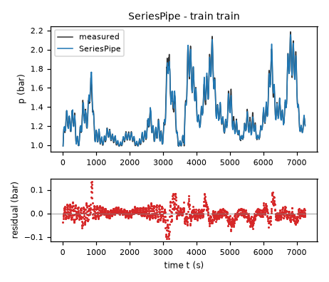
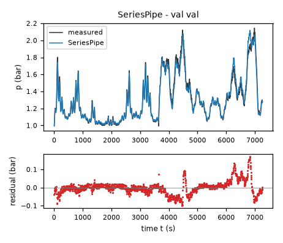
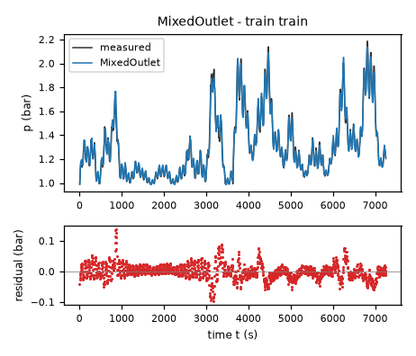
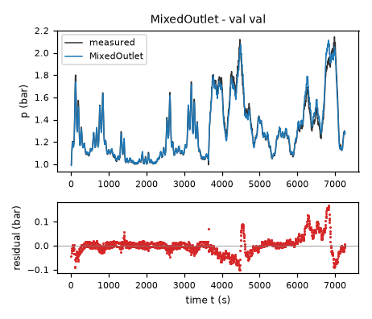
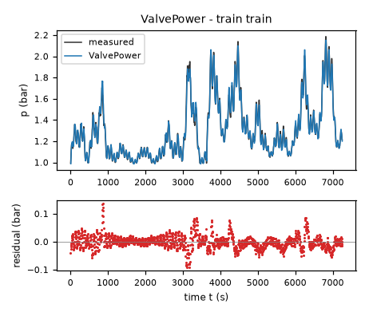
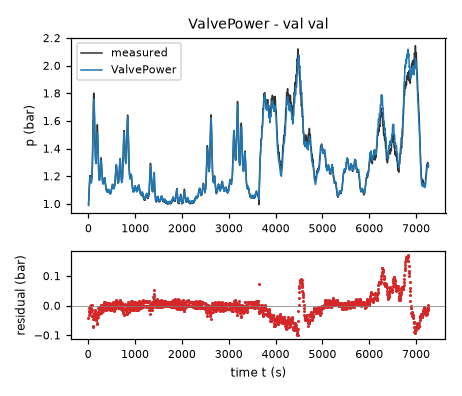

# Evaluation results permitted to the agent: task fermenter-pressure

Terms. The harness is the software of ASPIRE that checks and evaluates the candidate models; a candidate is one proposed model; the pool is the set of candidates of one round. Sealed data (test data, reference expression) are inaccessible to the agent. This view contains no result derived from sealed data.

Evaluation mode: simulation (initialized once per trajectory from the measured state at sample 0; classical fourth-order Runge-Kutta integration with 1 step(s) per sampling period T_s = 5 s and zero-order hold of the input; the model output is h(x[k], u[k])).
Error measures: for one trajectory with scoring interval I of N samples, measured output y[k] (p, bar) and model output ŷ[k], SSE = Σ_(k∈I) (ŷ[k] − y[k])²; RMSE = sqrt(SSE/N), in bar; NRMSE = RMSE/σ, with μ and σ the mean and the population standard deviation of y on I; R² = 1 − SSE / Σ_(k∈I) (y[k] − μ)²; NRMSE and R² are not applicable when σ = 0. The pooled RMSE over several trajectories is S = sqrt(ΣSSE / ΣN); on the test data it is the ranking score.
Numerical failure limits: p in [-100, 100] bar; evaluation time limit 60 s per candidate and data group; symbolic time limit 10 s per verification.
Discontinuous expressions: expressions with jumps (Piecewise, sign) are evaluated pointwise at the sample instants and Runge-Kutta stages; no event detection or step refinement is applied at a jump.
Harness version 0.1.0.dev0; NumPy 2.5.1; SymPy 1.14.0.

## Pool

| category | count |
|---|---|
| candidates proposed | 4 |
| accepted by the file and expression checks | 4 |
| outside the pool limit of 10 (not evaluated) | 0 |
| evaluated | 4 |
| excluded by physical requirements | 0 |
| failed numerically on training or validation data | 0 |

Note: the categories overlap; the counts need not sum to the pool size.

Distinct structures: 4 among 4 evaluated candidates; groups: SeriesPipe; Compressible; MixedOutlet; ValvePower. Convention: ties resolved, fixed values kept, given constants kept, fitted parameters renamed P1..Pn in order of first occurrence; equal when a one-to-one renaming of the fitted parameters makes every expression identical in SymPy's canonical form.

### Recommendation of the agent

Recommended candidate: SeriesPipe. The agent's reason: The five-coefficient series viscous/inertial resistance balance is the most parsimonious physically explicit candidate, with exact sealed-valve behavior and a bounded small-drop relaxation rate that is safe for the required 5 s RK4 integration. Its training-only validation RMSE was 0.0387076 bar and its joint-fit supplied-data RMSE is approximately 0.032312 bar. The slightly more flexible alternatives improve supplied-data RMSE only modestly; all retain substantial correlated residuals and no independent validation remains after the final refit. This recommendation weights interpretability, numerical relaxation stability and restrained extrapolation over a small in-sample fit advantage.
- Harness note: requirement(s) stated in natural language (R1, R2, R3, R4, R5) are assessed by the human.

## Candidates

### Candidate SeriesPipe

Position in the agent's order: 1. Status: evaluated.
File and expression checks: passed.
- `dp = a*flow - 2*(c*(Min(Max(vmax-valve,0),vmax)/vscale)**beta)*(p-patm)/(ell*(c*(Min(Max(vmax-valve,0),vmax)/vscale)**beta)+sqrt((ell*(c*(Min(Max(vmax-valve,0),vmax)/vscale)**beta))**2+4*Abs(p-patm)+epsdrop))`
Complexity: 5 fitted, 3 fixed and 0 tied parameters; 0 non-integer numeric literals; 84 expression-tree nodes (SymPy tree, every operator, function, symbol and number counted once).
Structure group 1: `dp = P1*flow - 2*P2*(0.033333333333333333*Min(100.0, Max(0, 100.0 - valve)))**P3*(-P4 + p)/(P2*P5*(0.033333333333333333*Min(100.0, Max(0, 100.0 - valve)))**P3 + sqrt(P2**2*P5**2*(0.033333333333333333*Min(100.0, Max(0, 100.0 - valve)))**(2*P3) + 4*Abs(P4 - p) + 1.0e-8))`

Requirements:

| id | type | outcome | status | method | detail |
|---|---|---|---|---|---|
| R1 | natural_language | unavailable | unresolved | not applicable | stated in natural language: the harness does not assess it; the human assesses it, and the agent's assertion alone does not count as verification |
| R2 | natural_language | unavailable | unresolved | not applicable | stated in natural language: the harness does not assess it; the human assesses it, and the agent's assertion alone does not count as verification |
| R3 | natural_language | unavailable | unresolved | not applicable | stated in natural language: the harness does not assess it; the human assesses it, and the agent's assertion alone does not count as verification |
| R4 | natural_language | unavailable | unresolved | not applicable | stated in natural language: the harness does not assess it; the human assesses it, and the agent's assertion alone does not count as verification |
| R5 | natural_language | unavailable | unresolved | not applicable | stated in natural language: the harness does not assess it; the human assesses it, and the agent's assertion alone does not count as verification |

Output errors on the training data (pooled RMSE: 0.0261182 bar):

| trajectory | scored samples | completed | RMSE (bar) | NRMSE | R² | failure |
|---|---|---|---|---|---|---|
| train | 1451 | 1451 | 0.0261182 | 0.100164 | 0.989967 | none |

Output errors on the validation data (pooled RMSE: 0.0374926 bar):

| trajectory | scored samples | completed | RMSE (bar) | NRMSE | R² | failure |
|---|---|---|---|---|---|---|
| val | 1453 | 1453 | 0.0374926 | 0.142811 | 0.979605 | none |

Sensitivity rank test (diagnostic; never excludes): targets dp on the train, val data (2906 rows, 0 dropped); analytic derivatives (SymPy), ties differentiated through their equations; scaling: rows of each target divided by the standard deviation of its measured column; columns divided by their Euclidean norm; rank threshold s_i / s_1 > 1e-08; singular values 1.77, 1.16, 0.646, 0.261, 0.149; rank 5 of 5.

*Candidate SeriesPipe, training data, trajectories train. Upper axes: measured output p (bar) and model output of SeriesPipe; lower axes: residual (model output minus measured output, bar). Evaluation mode: simulation (initialized once per trajectory from the measured state at sample 0; classical fourth-order Runge-Kutta integration with 1 step(s) per sampling period T_s = 5 s and zero-order hold of the input; the model output is h(x[k], u[k])). Initialization: the first 1 sample(s) of each trajectory initialize the model and are excluded from the errors. Errors are computed on the samples train: 1 to 1451 (0-based sample indices). No numerical failure occurred.*

*Candidate SeriesPipe, validation data, trajectories val. Upper axes: measured output p (bar) and model output of SeriesPipe; lower axes: residual (model output minus measured output, bar). Evaluation mode: simulation (initialized once per trajectory from the measured state at sample 0; classical fourth-order Runge-Kutta integration with 1 step(s) per sampling period T_s = 5 s and zero-order hold of the input; the model output is h(x[k], u[k])). Initialization: the first 1 sample(s) of each trajectory initialize the model and are excluded from the errors. Errors are computed on the samples val: 1 to 1453 (0-based sample indices). No numerical failure occurred.*

### Candidate Compressible

Position in the agent's order: 2. Status: evaluated.
File and expression checks: passed.
- `dp = a*flow - (c*Max(0,1/(1+exp((Min(Max(valve,0),vmax)-vmid)/vwidth))-sclosed)/(sref-sclosed))*sign(p-patm)*((gamma/(gamma-1))*Max(p,patm)**2*((Max(Max(Min(p,patm),pfloor)/Max(p,patm),rcrit))**(2/gamma)-(Max(Max(Min(p,patm),pfloor)/Max(p,patm),rcrit))**((gamma+1)/gamma)))/sqrt(((gamma/(gamma-1))*Max(p,patm)**2*((Max(Max(Min(p,patm),pfloor)/Max(p,patm),rcrit))**(2/gamma)-(Max(Max(Min(p,patm),pfloor)/Max(p,patm),rcrit))**((gamma+1)/gamma)))+delta*patm)`
Complexity: 6 fitted, 4 fixed and 3 tied parameters; 0 non-integer numeric literals; 159 expression-tree nodes (SymPy tree, every operator, function, symbol and number counted once).
Structure group 2: `dp = P1*flow - 3.5000000000000006*P2*(Max(0.52828178771717412, Max(0.01, Min(P6, p))/Max(P6, p))**1.4285714285714287 - Max(0.52828178771717412, Max(0.01, Min(P6, p))/Max(P6, p))**1.7142857142857143)*sign(-P6 + p)*Max(0, 1/(exp((-P4 + Min(100.0, Max(0, valve)))/P3) + 1) - 1/(exp((100.0 - P4)/P3) + 1))*Max(P6, p)**2/(sqrt(P5*P6 + 3.5000000000000006*(Max(0.52828178771717412, Max(0.01, Min(P6, p))/Max(P6, p))**1.4285714285714287 - Max(0.52828178771717412, Max(0.01, Min(P6, p))/Max(P6, p))**1.7142857142857143)*Max(P6, p)**2)*(-1/(exp((100.0 - P4)/P3) + 1) + 1/(exp((70.0 - P4)/P3) + 1)))`

Requirements:

| id | type | outcome | status | method | detail |
|---|---|---|---|---|---|
| R1 | natural_language | unavailable | unresolved | not applicable | stated in natural language: the harness does not assess it; the human assesses it, and the agent's assertion alone does not count as verification |
| R2 | natural_language | unavailable | unresolved | not applicable | stated in natural language: the harness does not assess it; the human assesses it, and the agent's assertion alone does not count as verification |
| R3 | natural_language | unavailable | unresolved | not applicable | stated in natural language: the harness does not assess it; the human assesses it, and the agent's assertion alone does not count as verification |
| R4 | natural_language | unavailable | unresolved | not applicable | stated in natural language: the harness does not assess it; the human assesses it, and the agent's assertion alone does not count as verification |
| R5 | natural_language | unavailable | unresolved | not applicable | stated in natural language: the harness does not assess it; the human assesses it, and the agent's assertion alone does not count as verification |

Output errors on the training data (pooled RMSE: 0.0250273 bar):

| trajectory | scored samples | completed | RMSE (bar) | NRMSE | R² | failure |
|---|---|---|---|---|---|---|
| train | 1451 | 1451 | 0.0250273 | 0.09598 | 0.990788 | none |

Output errors on the validation data (pooled RMSE: 0.0370645 bar):

| trajectory | scored samples | completed | RMSE (bar) | NRMSE | R² | failure |
|---|---|---|---|---|---|---|
| val | 1453 | 1453 | 0.0370645 | 0.14118 | 0.980068 | none |

- Failed computation (sensitivity rank test): NameError: name 'DiracDelta' is not defined

*Candidate Compressible, training data, trajectories train. Upper axes: measured output p (bar) and model output of Compressible; lower axes: residual (model output minus measured output, bar). Evaluation mode: simulation (initialized once per trajectory from the measured state at sample 0; classical fourth-order Runge-Kutta integration with 1 step(s) per sampling period T_s = 5 s and zero-order hold of the input; the model output is h(x[k], u[k])). Initialization: the first 1 sample(s) of each trajectory initialize the model and are excluded from the errors. Errors are computed on the samples train: 1 to 1451 (0-based sample indices). No numerical failure occurred.*

*Candidate Compressible, validation data, trajectories val. Upper axes: measured output p (bar) and model output of Compressible; lower axes: residual (model output minus measured output, bar). Evaluation mode: simulation (initialized once per trajectory from the measured state at sample 0; classical fourth-order Runge-Kutta integration with 1 step(s) per sampling period T_s = 5 s and zero-order hold of the input; the model output is h(x[k], u[k])). Initialization: the first 1 sample(s) of each trajectory initialize the model and are excluded from the errors. Errors are computed on the samples val: 1 to 1453 (0-based sample indices). No numerical failure occurred.*

### Candidate MixedOutlet

Position in the agent's order: 3. Status: evaluated.
File and expression checks: passed.
- `dp = a*flow - (c*Max(0,1/(1+exp((Min(Max(valve,0),vmax)-vmid)/vwidth))-sclosed)/(sref-sclosed))*2*(p-patm)/(sqrt(delta)+sqrt(delta+4*Abs(p-patm)))`
Complexity: 6 fitted, 2 fixed and 4 tied parameters; 0 non-integer numeric literals; 61 expression-tree nodes (SymPy tree, every operator, function, symbol and number counted once).
Structure group 3: `dp = P1*flow - 2*P2*(-P5 + p)*Max(0, 1/(exp((-P4 + Min(100.0, Max(0, valve)))/P3) + 1) - 1/(exp((100.0 - P4)/P3) + 1))/((sqrt((-1/(exp((100.0 - P4)/P3) + 1) + 1/(1 + exp(-P4/P3)))**2/(P6**2*(-1/(exp((100.0 - P4)/P3) + 1) + 1/(exp((70.0 - P4)/P3) + 1))**2))*Abs(P2) + sqrt(P2**2*(-1/(exp((100.0 - P4)/P3) + 1) + 1/(1 + exp(-P4/P3)))**2/(P6**2*(-1/(exp((100.0 - P4)/P3) + 1) + 1/(exp((70.0 - P4)/P3) + 1))**2) + 4*Abs(P5 - p)))*(-1/(exp((100.0 - P4)/P3) + 1) + 1/(exp((70.0 - P4)/P3) + 1)))`

Requirements:

| id | type | outcome | status | method | detail |
|---|---|---|---|---|---|
| R1 | natural_language | unavailable | unresolved | not applicable | stated in natural language: the harness does not assess it; the human assesses it, and the agent's assertion alone does not count as verification |
| R2 | natural_language | unavailable | unresolved | not applicable | stated in natural language: the harness does not assess it; the human assesses it, and the agent's assertion alone does not count as verification |
| R3 | natural_language | unavailable | unresolved | not applicable | stated in natural language: the harness does not assess it; the human assesses it, and the agent's assertion alone does not count as verification |
| R4 | natural_language | unavailable | unresolved | not applicable | stated in natural language: the harness does not assess it; the human assesses it, and the agent's assertion alone does not count as verification |
| R5 | natural_language | unavailable | unresolved | not applicable | stated in natural language: the harness does not assess it; the human assesses it, and the agent's assertion alone does not count as verification |

Output errors on the training data (pooled RMSE: 0.0255843 bar):

| trajectory | scored samples | completed | RMSE (bar) | NRMSE | R² | failure |
|---|---|---|---|---|---|---|
| train | 1451 | 1451 | 0.0255843 | 0.0981161 | 0.990373 | none |

Output errors on the validation data (pooled RMSE: 0.0370516 bar):

| trajectory | scored samples | completed | RMSE (bar) | NRMSE | R² | failure |
|---|---|---|---|---|---|---|
| val | 1453 | 1453 | 0.0370516 | 0.141131 | 0.980082 | none |

Sensitivity rank test (diagnostic; never excludes): targets dp on the train, val data (2906 rows, 0 dropped); analytic derivatives (SymPy), ties differentiated through their equations; scaling: rows of each target divided by the standard deviation of its measured column; columns divided by their Euclidean norm; rank threshold s_i / s_1 > 1e-08; singular values 1.87, 1.3, 0.673, 0.543, 0.175, 0.118; rank 6 of 6.

*Candidate MixedOutlet, training data, trajectories train. Upper axes: measured output p (bar) and model output of MixedOutlet; lower axes: residual (model output minus measured output, bar). Evaluation mode: simulation (initialized once per trajectory from the measured state at sample 0; classical fourth-order Runge-Kutta integration with 1 step(s) per sampling period T_s = 5 s and zero-order hold of the input; the model output is h(x[k], u[k])). Initialization: the first 1 sample(s) of each trajectory initialize the model and are excluded from the errors. Errors are computed on the samples train: 1 to 1451 (0-based sample indices). No numerical failure occurred.*

*Candidate MixedOutlet, validation data, trajectories val. Upper axes: measured output p (bar) and model output of MixedOutlet; lower axes: residual (model output minus measured output, bar). Evaluation mode: simulation (initialized once per trajectory from the measured state at sample 0; classical fourth-order Runge-Kutta integration with 1 step(s) per sampling period T_s = 5 s and zero-order hold of the input; the model output is h(x[k], u[k])). Initialization: the first 1 sample(s) of each trajectory initialize the model and are excluded from the errors. Errors are computed on the samples val: 1 to 1453 (0-based sample indices). No numerical failure occurred.*

### Candidate ValvePower

Position in the agent's order: 4. Status: evaluated.
File and expression checks: passed.
- `dp = a*flow - (s1*Min(Max(k2-valve,0),k2-k1) + s2*Min(Max(k3-valve,0),k3-k2) + s3*Min(Max(k4-valve,0),k4-k3) + s4*Min(Max(k5-valve,0),k5-k4) + s5*Min(Max(k6-valve,0),k6-k5) + s6*Min(Max(k7-valve,0),k7-k6) + s7*Min(Max(k8-valve,0),k8-k7))*(pscale*((p-patm)/pscale)*(((p-patm)/pscale)**2+(delta/pscale)**2)**((n-1)/2))`
Complexity: 11 fitted, 9 fixed and 0 tied parameters; 0 non-integer numeric literals; 142 expression-tree nodes (SymPy tree, every operator, function, symbol and number counted once).
Structure group 4: `dp = P1*flow - (1.0*P2**2 + 1.0*(-P3 + p)**2)**(P4/2 - 1/2)*(-P3 + p)*(P10*Min(10.0, Max(0, 95.0 - valve)) + P11*Min(5.0, Max(0, 100.0 - valve)) + P5*Min(30.0, Max(0, 30.0 - valve)) + P6*Min(20.0, Max(0, 50.0 - valve)) + P7*Min(15.0, Max(0, 65.0 - valve)) + P8*Min(10.0, Max(0, 75.0 - valve)) + P9*Min(10.0, Max(0, 85.0 - valve)))`

Requirements:

| id | type | outcome | status | method | detail |
|---|---|---|---|---|---|
| R1 | natural_language | unavailable | unresolved | not applicable | stated in natural language: the harness does not assess it; the human assesses it, and the agent's assertion alone does not count as verification |
| R2 | natural_language | unavailable | unresolved | not applicable | stated in natural language: the harness does not assess it; the human assesses it, and the agent's assertion alone does not count as verification |
| R3 | natural_language | unavailable | unresolved | not applicable | stated in natural language: the harness does not assess it; the human assesses it, and the agent's assertion alone does not count as verification |
| R4 | natural_language | unavailable | unresolved | not applicable | stated in natural language: the harness does not assess it; the human assesses it, and the agent's assertion alone does not count as verification |
| R5 | natural_language | unavailable | unresolved | not applicable | stated in natural language: the harness does not assess it; the human assesses it, and the agent's assertion alone does not count as verification |

Output errors on the training data (pooled RMSE: 0.0248046 bar):

| trajectory | scored samples | completed | RMSE (bar) | NRMSE | R² | failure |
|---|---|---|---|---|---|---|
| train | 1451 | 1451 | 0.0248046 | 0.095126 | 0.990951 | none |

Output errors on the validation data (pooled RMSE: 0.037108 bar):

| trajectory | scored samples | completed | RMSE (bar) | NRMSE | R² | failure |
|---|---|---|---|---|---|---|
| val | 1453 | 1453 | 0.037108 | 0.141346 | 0.980021 | none |

Sensitivity rank test (diagnostic; never excludes): targets dp on the train, val data (2906 rows, 0 dropped); analytic derivatives (SymPy), ties differentiated through their equations; scaling: rows of each target divided by the standard deviation of its measured column; columns divided by their Euclidean norm; rank threshold s_i / s_1 > 1e-08; singular values 2.61, 1.47, 0.872, 0.724, 0.589, 0.406, 0.32, 0.289, 0.188, 0.14, 0.0665; rank 11 of 11.

*Candidate ValvePower, training data, trajectories train. Upper axes: measured output p (bar) and model output of ValvePower; lower axes: residual (model output minus measured output, bar). Evaluation mode: simulation (initialized once per trajectory from the measured state at sample 0; classical fourth-order Runge-Kutta integration with 1 step(s) per sampling period T_s = 5 s and zero-order hold of the input; the model output is h(x[k], u[k])). Initialization: the first 1 sample(s) of each trajectory initialize the model and are excluded from the errors. Errors are computed on the samples train: 1 to 1451 (0-based sample indices). No numerical failure occurred.*

*Candidate ValvePower, validation data, trajectories val. Upper axes: measured output p (bar) and model output of ValvePower; lower axes: residual (model output minus measured output, bar). Evaluation mode: simulation (initialized once per trajectory from the measured state at sample 0; classical fourth-order Runge-Kutta integration with 1 step(s) per sampling period T_s = 5 s and zero-order hold of the input; the model output is h(x[k], u[k])). Initialization: the first 1 sample(s) of each trajectory initialize the model and are excluded from the errors. Errors are computed on the samples val: 1 to 1453 (0-based sample indices). No numerical failure occurred.*
