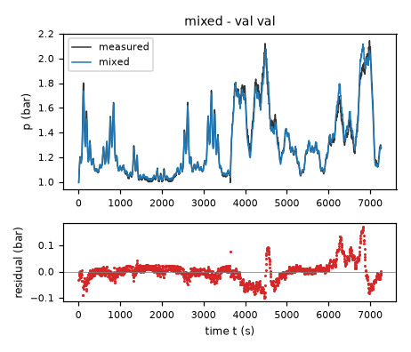
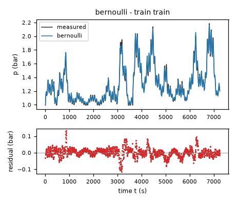
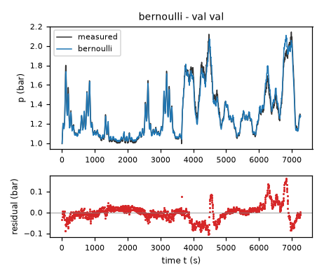
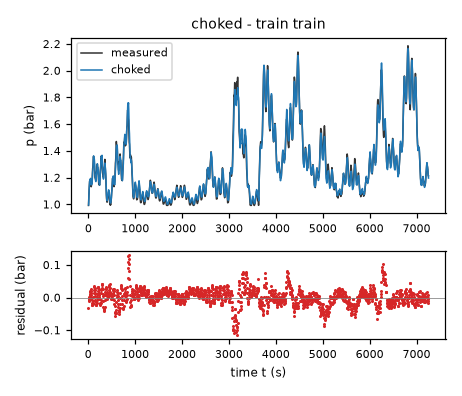
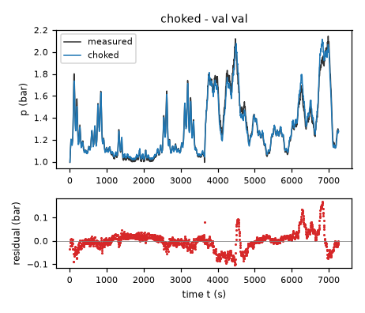

# Evaluation results permitted to the agent: task fermenter-pressure

Terms. The harness is the software of ASPIRE that checks and evaluates the candidate models; a candidate is one proposed model; the pool is the set of candidates of one round. Sealed data (test data, reference expression) are inaccessible to the agent. This view contains no result derived from sealed data.

Evaluation mode: simulation (initialized once per trajectory from the measured state at sample 0; classical fourth-order Runge-Kutta integration with 1 step(s) per sampling period T_s = 5 s and zero-order hold of the input; the model output is h(x[k], u[k])).
Error measures: for one trajectory with scoring interval I of N samples, measured output y[k] (p, bar) and model output ŷ[k], SSE = Σ_(k∈I) (ŷ[k] − y[k])²; RMSE = sqrt(SSE/N), in bar; NRMSE = RMSE/σ, with μ and σ the mean and the population standard deviation of y on I; R² = 1 − SSE / Σ_(k∈I) (y[k] − μ)²; NRMSE and R² are not applicable when σ = 0. The pooled RMSE over several trajectories is S = sqrt(ΣSSE / ΣN); on the test data it is the ranking score.
Numerical failure limits: p in [-100, 100] bar; evaluation time limit 60 s per candidate and data group; symbolic time limit 10 s per verification.
Discontinuous expressions: expressions with jumps (Piecewise, sign) are evaluated pointwise at the sample instants and Runge-Kutta stages; no event detection or step refinement is applied at a jump.
Harness version 0.1.0.dev0; NumPy 2.5.1; SymPy 1.14.0.

## Pool

| category | count |
|---|---|
| candidates proposed | 3 |
| accepted by the file and expression checks | 3 |
| outside the pool limit of 10 (not evaluated) | 0 |
| evaluated | 3 |
| excluded by physical requirements | 0 |
| failed numerically on training or validation data | 0 |

Note: the categories overlap; the counts need not sum to the pool size.

Distinct structures: 3 among 3 evaluated candidates; groups: mixed; bernoulli; choked. Convention: ties resolved, fixed values kept, given constants kept, fitted parameters renamed P1..Pn in order of first occurrence; equal when a one-to-one renaming of the fitted parameters makes every expression identical in SymPy's canonical form.

### Recommendation of the agent

Recommended candidate: mixed. The agent's reason: Recommend mixed: it has the lowest training-only independent validation RMSE among the final fixed-atmosphere families (0.038665 bar) and the lowest pooled fit RMSE on validation (0.037484 bar, not independent). Its series viscous/inertial pressure-loss model gives a finite, bounded atmospheric restoring slope and an exactly sealed seat without a large ad hoc pressure smoothing scale. The fresh-initialized blocked-tail checks show similar rather than decisive differences between nonlinear families and appreciable experiment drift; no test-performance guarantee is claimed. Bernoulli and choked-nozzle candidates are retained as physically distinct discharge assumptions, not coefficient variants. All three explicitly meet R1–R5 over the physical inlet/stroke domain and use current inputs only.
- Harness note: requirement(s) stated in natural language (R1, R2, R3, R4, R5) are assessed by the human.

## Candidates

### Candidate mixed

Position in the agent's order: 1. Status: evaluated.
File and expression checks: passed.
- `dp = ain*flow-(gopen*(weight*(1-(Min(Max(valve,0),vfull)/vfull)**3)+(1-weight)*(1-3*(Min(Max(valve,0),vfull)/vfull)**2+2*(Min(Max(valve,0),vfull)/vfull)**3)))*2*Max(p-patm,0)/(sqrt(4*Max(p-patm,0)+(rvisc*(gopen*(weight*(1-(Min(Max(valve,0),vfull)/vfull)**3)+(1-weight)*(1-3*(Min(Max(valve,0),vfull)/vfull)**2+2*(Min(Max(valve,0),vfull)/vfull)**3))))**2+tiny)+rvisc*(gopen*(weight*(1-(Min(Max(valve,0),vfull)/vfull)**3)+(1-weight)*(1-3*(Min(Max(valve,0),vfull)/vfull)**2+2*(Min(Max(valve,0),vfull)/vfull)**3))))-back*Min(p-patm,0)`
Complexity: 4 fitted, 4 fixed and 0 tied parameters; 0 non-integer numeric literals; 199 expression-tree nodes (SymPy tree, every operator, function, symbol and number counted once).
Structure group 1: `dp = P1*flow - 2*P2*(P4*(1 - 1.0e-6*Min(100.0, Max(0, valve))**3) + (1 - P4)*(2.0e-6*Min(100.0, Max(0, valve))**3 - 0.0003*Min(100.0, Max(0, valve))**2 + 1))*Max(0, p - 1.0)/(P2*P3*(P4*(1 - 1.0e-6*Min(100.0, Max(0, valve))**3) + (1 - P4)*(2.0e-6*Min(100.0, Max(0, valve))**3 - 0.0003*Min(100.0, Max(0, valve))**2 + 1)) + sqrt(P2**2*P3**2*(P4*(1 - 1.0e-6*Min(100.0, Max(0, valve))**3) + (1 - P4)*(2.0e-6*Min(100.0, Max(0, valve))**3 - 0.0003*Min(100.0, Max(0, valve))**2 + 1))**2 + 4*Max(0, p - 1.0) + 9.9999999999999998e-13)) - 0.10000000000000001*Min(0, p - 1.0)`

Requirements:

| id | type | outcome | status | method | detail |
|---|---|---|---|---|---|
| R1 | natural_language | unavailable | unresolved | not applicable | stated in natural language: the harness does not assess it; the human assesses it, and the agent's assertion alone does not count as verification |
| R2 | natural_language | unavailable | unresolved | not applicable | stated in natural language: the harness does not assess it; the human assesses it, and the agent's assertion alone does not count as verification |
| R3 | natural_language | unavailable | unresolved | not applicable | stated in natural language: the harness does not assess it; the human assesses it, and the agent's assertion alone does not count as verification |
| R4 | natural_language | unavailable | unresolved | not applicable | stated in natural language: the harness does not assess it; the human assesses it, and the agent's assertion alone does not count as verification |
| R5 | natural_language | unavailable | unresolved | not applicable | stated in natural language: the harness does not assess it; the human assesses it, and the agent's assertion alone does not count as verification |

Output errors on the training data (pooled RMSE: 0.026168 bar):

| trajectory | scored samples | completed | RMSE (bar) | NRMSE | R² | failure |
|---|---|---|---|---|---|---|
| train | 1451 | 1451 | 0.026168 | 0.100355 | 0.989929 | none |

Output errors on the validation data (pooled RMSE: 0.0374835 bar):

| trajectory | scored samples | completed | RMSE (bar) | NRMSE | R² | failure |
|---|---|---|---|---|---|---|
| val | 1453 | 1453 | 0.0374835 | 0.142776 | 0.979615 | none |

Sensitivity rank test (diagnostic; never excludes): targets dp on the train, val data (2906 rows, 0 dropped); analytic derivatives (SymPy), ties differentiated through their equations; scaling: rows of each target divided by the standard deviation of its measured column; columns divided by their Euclidean norm; rank threshold s_i / s_1 > 1e-08; singular values 1.84, 0.763, 0.185, 0.108; rank 4 of 4.

*Candidate mixed, training data, trajectories train. Upper axes: measured output p (bar) and model output of mixed; lower axes: residual (model output minus measured output, bar). Evaluation mode: simulation (initialized once per trajectory from the measured state at sample 0; classical fourth-order Runge-Kutta integration with 1 step(s) per sampling period T_s = 5 s and zero-order hold of the input; the model output is h(x[k], u[k])). Initialization: the first 1 sample(s) of each trajectory initialize the model and are excluded from the errors. Errors are computed on the samples train: 1 to 1451 (0-based sample indices). No numerical failure occurred.*

*Candidate mixed, validation data, trajectories val. Upper axes: measured output p (bar) and model output of mixed; lower axes: residual (model output minus measured output, bar). Evaluation mode: simulation (initialized once per trajectory from the measured state at sample 0; classical fourth-order Runge-Kutta integration with 1 step(s) per sampling period T_s = 5 s and zero-order hold of the input; the model output is h(x[k], u[k])). Initialization: the first 1 sample(s) of each trajectory initialize the model and are excluded from the errors. Errors are computed on the samples val: 1 to 1453 (0-based sample indices). No numerical failure occurred.*

### Candidate bernoulli

Position in the agent's order: 2. Status: evaluated.
File and expression checks: passed.
- `dp = ain*flow-(gopen*(weight*(1-(Min(Max(valve,0),vfull)/vfull)**3)+(1-weight)*(1-3*(Min(Max(valve,0),vfull)/vfull)**2+2*(Min(Max(valve,0),vfull)/vfull)**3)))*Max(p-patm,0)/(Max(p-patm,0)**2+eps**2)**0.25-back*Min(p-patm,0)`
Complexity: 4 fitted, 3 fixed and 1 tied parameters; 1 non-integer numeric literals; 88 expression-tree nodes (SymPy tree, every operator, function, symbol and number counted once).
Structure group 2: `dp = P1*flow - P2*sqrt(P3)*(P4*(1 - 1.0e-6*Min(100.0, Max(0, valve))**3) + (1 - P4)*(2.0e-6*Min(100.0, Max(0, valve))**3 - 0.0003*Min(100.0, Max(0, valve))**2 + 1))*Max(0, p - 1.0)/(P3**2 + Max(0, p - 1.0)**2)**0.25 - 0.10000000000000001*Min(0, p - 1.0)`

Requirements:

| id | type | outcome | status | method | detail |
|---|---|---|---|---|---|
| R1 | natural_language | unavailable | unresolved | not applicable | stated in natural language: the harness does not assess it; the human assesses it, and the agent's assertion alone does not count as verification |
| R2 | natural_language | unavailable | unresolved | not applicable | stated in natural language: the harness does not assess it; the human assesses it, and the agent's assertion alone does not count as verification |
| R3 | natural_language | unavailable | unresolved | not applicable | stated in natural language: the harness does not assess it; the human assesses it, and the agent's assertion alone does not count as verification |
| R4 | natural_language | unavailable | unresolved | not applicable | stated in natural language: the harness does not assess it; the human assesses it, and the agent's assertion alone does not count as verification |
| R5 | natural_language | unavailable | unresolved | not applicable | stated in natural language: the harness does not assess it; the human assesses it, and the agent's assertion alone does not count as verification |

Output errors on the training data (pooled RMSE: 0.0265099 bar):

| trajectory | scored samples | completed | RMSE (bar) | NRMSE | R² | failure |
|---|---|---|---|---|---|---|
| train | 1451 | 1451 | 0.0265099 | 0.101666 | 0.989664 | none |

Output errors on the validation data (pooled RMSE: 0.0379192 bar):

| trajectory | scored samples | completed | RMSE (bar) | NRMSE | R² | failure |
|---|---|---|---|---|---|---|
| val | 1453 | 1453 | 0.0379192 | 0.144436 | 0.979138 | none |

Sensitivity rank test (diagnostic; never excludes): targets dp on the train, val data (2906 rows, 0 dropped); analytic derivatives (SymPy), ties differentiated through their equations; scaling: rows of each target divided by the standard deviation of its measured column; columns divided by their Euclidean norm; rank threshold s_i / s_1 > 1e-08; singular values 1.96, 0.313, 0.224, 0.0777; rank 4 of 4.

*Candidate bernoulli, training data, trajectories train. Upper axes: measured output p (bar) and model output of bernoulli; lower axes: residual (model output minus measured output, bar). Evaluation mode: simulation (initialized once per trajectory from the measured state at sample 0; classical fourth-order Runge-Kutta integration with 1 step(s) per sampling period T_s = 5 s and zero-order hold of the input; the model output is h(x[k], u[k])). Initialization: the first 1 sample(s) of each trajectory initialize the model and are excluded from the errors. Errors are computed on the samples train: 1 to 1451 (0-based sample indices). No numerical failure occurred.*

*Candidate bernoulli, validation data, trajectories val. Upper axes: measured output p (bar) and model output of bernoulli; lower axes: residual (model output minus measured output, bar). Evaluation mode: simulation (initialized once per trajectory from the measured state at sample 0; classical fourth-order Runge-Kutta integration with 1 step(s) per sampling period T_s = 5 s and zero-order hold of the input; the model output is h(x[k], u[k])). Initialization: the first 1 sample(s) of each trajectory initialize the model and are excluded from the errors. Errors are computed on the samples val: 1 to 1453 (0-based sample indices). No numerical failure occurred.*

### Candidate choked

Position in the agent's order: 3. Status: evaluated.
File and expression checks: passed.
- `dp = ain*flow-(gopen*(weight*(1-(Min(Max(valve,0),vfull)/vfull)**3)+(1-weight)*(1-3*(Min(Max(valve,0),vfull)/vfull)**2+2*(Min(Max(valve,0),vfull)/vfull)**3)))*(Max(p,patm)/patm)*sqrt(Max(2*gamma/(gamma-1)*(Max(patm/Max(p,patm),rcrit)**(2/gamma)-Max(patm/Max(p,patm),rcrit)**((gamma+1)/gamma)),0))*sqrt(Max(p-patm,0)/sqrt(Max(p-patm,0)**2+eps**2))-back*Min(p-patm,0)`
Complexity: 4 fitted, 4 fixed and 2 tied parameters; 0 non-integer numeric literals; 143 expression-tree nodes (SymPy tree, every operator, function, symbol and number counted once).
Structure group 3: `dp = P1*flow - 0.5*sqrt(2)*P2*sqrt(P3)*(P4*(1 - 1.0e-6*Min(100.0, Max(0, valve))**3) + (1 - P4)*(2.0e-6*Min(100.0, Max(0, valve))**3 - 0.0003*Min(100.0, Max(0, valve))**2 + 1))*sqrt(Max(0, p - 1.0))*sqrt(Max(0, 7.0000000000000011*Max(0.52828178771717412, 1.0/Max(1.0, p))**1.4285714285714287 - 7.0000000000000011*Max(0.52828178771717412, 1.0/Max(1.0, p))**1.7142857142857143))*Max(1.0, p)/(P3**2 + Max(0, p - 1.0)**2)**(1/4) - 0.10000000000000001*Min(0, p - 1.0)`

Requirements:

| id | type | outcome | status | method | detail |
|---|---|---|---|---|---|
| R1 | natural_language | unavailable | unresolved | not applicable | stated in natural language: the harness does not assess it; the human assesses it, and the agent's assertion alone does not count as verification |
| R2 | natural_language | unavailable | unresolved | not applicable | stated in natural language: the harness does not assess it; the human assesses it, and the agent's assertion alone does not count as verification |
| R3 | natural_language | unavailable | unresolved | not applicable | stated in natural language: the harness does not assess it; the human assesses it, and the agent's assertion alone does not count as verification |
| R4 | natural_language | unavailable | unresolved | not applicable | stated in natural language: the harness does not assess it; the human assesses it, and the agent's assertion alone does not count as verification |
| R5 | natural_language | unavailable | unresolved | not applicable | stated in natural language: the harness does not assess it; the human assesses it, and the agent's assertion alone does not count as verification |

Output errors on the training data (pooled RMSE: 0.0268595 bar):

| trajectory | scored samples | completed | RMSE (bar) | NRMSE | R² | failure |
|---|---|---|---|---|---|---|
| train | 1451 | 1451 | 0.0268595 | 0.103006 | 0.98939 | none |

Output errors on the validation data (pooled RMSE: 0.0382943 bar):

| trajectory | scored samples | completed | RMSE (bar) | NRMSE | R² | failure |
|---|---|---|---|---|---|---|
| val | 1453 | 1453 | 0.0382943 | 0.145865 | 0.978723 | none |

Sensitivity rank test (diagnostic; never excludes): targets dp on the train, val data (2906 rows, 0 dropped); analytic derivatives (SymPy), ties differentiated through their equations; scaling: rows of each target divided by the standard deviation of its measured column; columns divided by their Euclidean norm; rank threshold s_i / s_1 > 1e-08; singular values 1.96, 0.319, 0.222, 0.0824; rank 4 of 4.

*Candidate choked, training data, trajectories train. Upper axes: measured output p (bar) and model output of choked; lower axes: residual (model output minus measured output, bar). Evaluation mode: simulation (initialized once per trajectory from the measured state at sample 0; classical fourth-order Runge-Kutta integration with 1 step(s) per sampling period T_s = 5 s and zero-order hold of the input; the model output is h(x[k], u[k])). Initialization: the first 1 sample(s) of each trajectory initialize the model and are excluded from the errors. Errors are computed on the samples train: 1 to 1451 (0-based sample indices). No numerical failure occurred.*

*Candidate choked, validation data, trajectories val. Upper axes: measured output p (bar) and model output of choked; lower axes: residual (model output minus measured output, bar). Evaluation mode: simulation (initialized once per trajectory from the measured state at sample 0; classical fourth-order Runge-Kutta integration with 1 step(s) per sampling period T_s = 5 s and zero-order hold of the input; the model output is h(x[k], u[k])). Initialization: the first 1 sample(s) of each trajectory initialize the model and are excluded from the errors. Errors are computed on the samples val: 1 to 1453 (0-based sample indices). No numerical failure occurred.*
