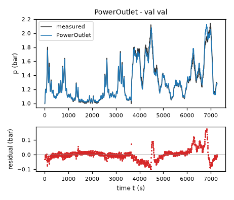
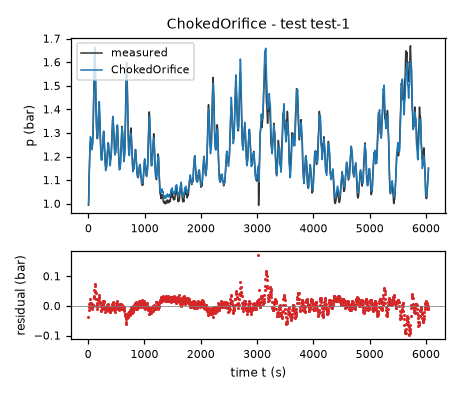
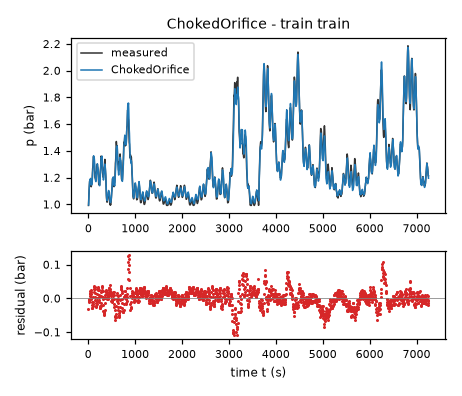
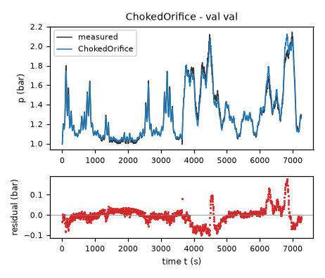
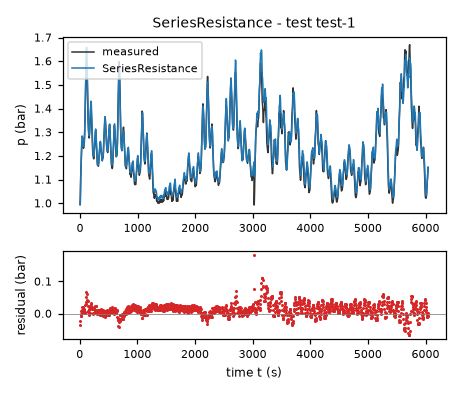
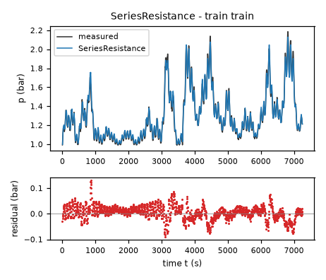
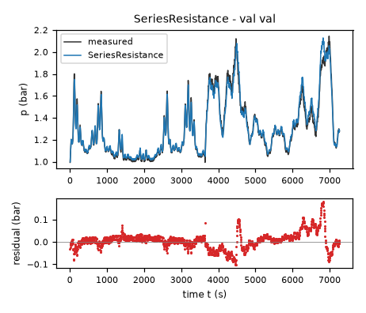
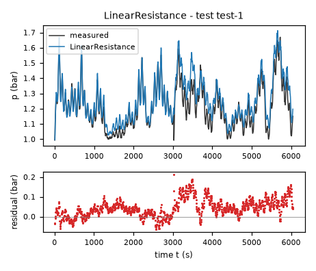
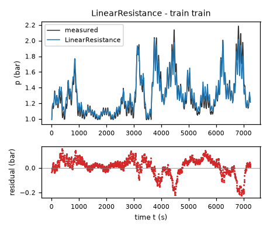
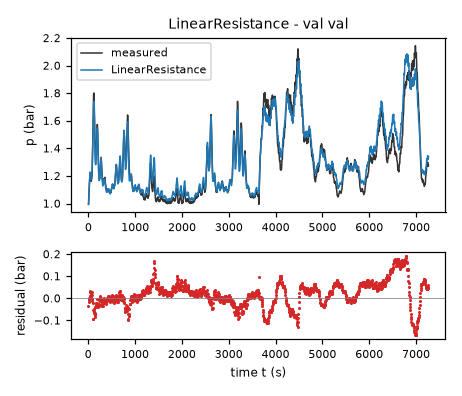

# Evaluation report: task fermenter-pressure

Terms. The harness is the software of ASPIRE that checks and evaluates the candidate models; a candidate is one proposed model; the pool is the set of candidates of one round. Sealed data (test data, reference expression) are inaccessible to the agent. This report contains results on sealed data and is not shown to the agent.

Evaluation mode: simulation (initialized once per trajectory from the measured state at sample 0; classical fourth-order Runge-Kutta integration with 1 step(s) per sampling period T_s = 5 s and zero-order hold of the input; the model output is h(x[k], u[k])).
Error measures: for one trajectory with scoring interval I of N samples, measured output y[k] (p, bar) and model output ŷ[k], SSE = Σ_(k∈I) (ŷ[k] − y[k])²; RMSE = sqrt(SSE/N), in bar; NRMSE = RMSE/σ, with μ and σ the mean and the population standard deviation of y on I; R² = 1 − SSE / Σ_(k∈I) (y[k] − μ)²; NRMSE and R² are not applicable when σ = 0. The pooled RMSE over several trajectories is S = sqrt(ΣSSE / ΣN); on the test data it is the ranking score.
Numerical failure limits: p in [-100, 100] bar; evaluation time limit 60 s per candidate and data group; symbolic time limit 10 s per verification.
Discontinuous expressions: expressions with jumps (Piecewise, sign) are evaluated pointwise at the sample instants and Runge-Kutta stages; no event detection or step refinement is applied at a jump.
Harness version 0.1.0.dev0; NumPy 2.5.1; SymPy 1.14.0.

## Pool

| category | count |
|---|---|
| candidates proposed | 4 |
| accepted by the file and expression checks | 4 |
| outside the pool limit of 10 (not evaluated) | 0 |
| evaluated | 4 |
| excluded by physical requirements | 0 |
| failed numerically on training or validation data | 0 |
| failed numerically on test data | 0 |
| eligible for ranking | 4 |

Note: the categories overlap: the candidates accepted by the checks include those outside the pool limit, and a candidate can be both excluded by requirements and failed numerically; the counts need not sum to the pool size.

Distinct structures: 4 among 4 evaluated candidates; groups: PowerOutlet; ChokedOrifice; SeriesResistance; LinearResistance. Convention: ties resolved, fixed values kept, given constants kept, fitted parameters renamed P1..Pn in order of first occurrence; equal when a one-to-one renaming of the fitted parameters makes every expression identical in SymPy's canonical form.

### Recommendation of the agent

Recommended candidate: PowerOutlet. The agent's reason: `PowerOutlet` combines the lowest final pooled pressure-rollout error among these atmosphere-anchored candidates with a finite near-equilibrium slope and exactly atmospheric zero-flow equilibrium. Its final RMSE is `0.024786824` bar on `data/train.csv` and `0.037505993` bar on `data/val.csv`; these are in-sample after pooled refitting, not test results. The compressible candidate has the better validation-file suffix result but the worse final pooled fit and assumes ideal nozzle behavior not established by the data. The series model is a more directly interpretable alternative with slightly worse pressure accuracy. The linear candidate is retained only as a transparent small-overpressure baseline. Selection also considered physical monotonicity in the pressurized domain and the required five-second RK4 stability, not derivative error alone.
- Harness note: requirement(s) stated in natural language (R1, R2, R3, R4, R5) are assessed by the human.
- Test score S of the recommended candidate (practical selection): 0.0228549 bar; eligible: True; rank in the oracle-based selection: 1.

## Oracle-based selection on test data

Label: oracle-based selection on test data. Candidates considered: 4 eligible of 4 evaluated. Criterion: pooled test RMSE S, increasing, the pooled RMSE over the test trajectories test-1 (1209 scored samples). Tie rule: |S_a - S_b| <= 1e-12 * max(S_a, S_b) for consecutive candidates; tied candidates share a rank. This ranking selects on the test data. It measures whether the pool contains an accurate model, not whether the agent can recognize that model without test data. A rank is not evidence of physical admissibility: each entry carries its unresolved requirements and any violation allowed by the user.

| rank | candidate | S (bar) | unresolved requirements | violations allowed by the user |
|---|---|---|---|---|
| 1 | PowerOutlet | 0.0228549 | R1, R2, R3, R4, R5 | none |
| 2 | ChokedOrifice | 0.0246505 | R1, R2, R3, R4, R5 | none |
| 3 | SeriesResistance | 0.0251277 | R1, R2, R3, R4, R5 | none |
| 4 | LinearResistance | 0.0624824 | R1, R2, R3, R4, R5 | none |

## Candidates

### Candidate PowerOutlet

Position in the agent's order: 1. Status: evaluated.
File and expression checks: passed.
- `dp = a*flow-c*(Max(0, Min(1, 1-valve/vfull))/(Max(0, Min(1, 1-valve/vfull))+k))**m*(p-patm)*(((p-patm)**2+eps**2)/pref**2)**((nu-1)/2)`
Complexity: 6 fitted, 3 fixed and 0 tied parameters; 0 non-integer numeric literals; 64 expression-tree nodes (SymPy tree, every operator, function, symbol and number counted once).
Structure group 1: `dp = P1*flow - P2*(Max(0, Min(1, 1 - 0.01*valve))/(P3 + Max(0, Min(1, 1 - 0.01*valve))))**P4*(1.0*P5**2 + 1.0*(p - 1.0)**2)**(P6/2 - 1/2)*(p - 1.0)`

Requirements:

| id | type | outcome | status | method | detail |
|---|---|---|---|---|---|
| R1 | natural_language | unavailable | unresolved | not applicable | stated in natural language: the harness does not assess it; the human assesses it, and the agent's assertion alone does not count as verification |
| R2 | natural_language | unavailable | unresolved | not applicable | stated in natural language: the harness does not assess it; the human assesses it, and the agent's assertion alone does not count as verification |
| R3 | natural_language | unavailable | unresolved | not applicable | stated in natural language: the harness does not assess it; the human assesses it, and the agent's assertion alone does not count as verification |
| R4 | natural_language | unavailable | unresolved | not applicable | stated in natural language: the harness does not assess it; the human assesses it, and the agent's assertion alone does not count as verification |
| R5 | natural_language | unavailable | unresolved | not applicable | stated in natural language: the harness does not assess it; the human assesses it, and the agent's assertion alone does not count as verification |

Output errors on the test data (sealed) (pooled RMSE: 0.0228549 bar):

| trajectory | scored samples | completed | RMSE (bar) | NRMSE | R² | failure |
|---|---|---|---|---|---|---|
| test-1 | 1209 | 1209 | 0.0228549 | 0.164 | 0.973104 | none |

Output errors on the training data (pooled RMSE: 0.0247868 bar):

| trajectory | scored samples | completed | RMSE (bar) | NRMSE | R² | failure |
|---|---|---|---|---|---|---|
| train | 1451 | 1451 | 0.0247868 | 0.0950577 | 0.990964 | none |

Output errors on the validation data (pooled RMSE: 0.037506 bar):

| trajectory | scored samples | completed | RMSE (bar) | NRMSE | R² | failure |
|---|---|---|---|---|---|---|
| val | 1453 | 1453 | 0.037506 | 0.142862 | 0.97959 | none |

Sensitivity rank test (diagnostic; never excludes): targets dp on the train, val data (2906 rows, 0 dropped); analytic derivatives (SymPy), ties differentiated through their equations; scaling: rows of each target divided by the standard deviation of its measured column; columns divided by their Euclidean norm; rank threshold s_i / s_1 > 1e-08; singular values 2.21, 0.975, 0.372, 0.185, 0.101, 0.0196; rank 6 of 6.
Reference comparison: not applicable (the task has no reference expression).
Eligible for ranking: True.

*Candidate PowerOutlet, test data (sealed), trajectories test-1. Upper axes: measured output p (bar) and model output of PowerOutlet; lower axes: residual (model output minus measured output, bar). Evaluation mode: simulation (initialized once per trajectory from the measured state at sample 0; classical fourth-order Runge-Kutta integration with 1 step(s) per sampling period T_s = 5 s and zero-order hold of the input; the model output is h(x[k], u[k])). Initialization: the first 1 sample(s) of each trajectory initialize the model and are excluded from the errors. Errors are computed on the samples test-1: 1 to 1209 (0-based sample indices). No numerical failure occurred.*

*Candidate PowerOutlet, training data, trajectories train. Upper axes: measured output p (bar) and model output of PowerOutlet; lower axes: residual (model output minus measured output, bar). Evaluation mode: simulation (initialized once per trajectory from the measured state at sample 0; classical fourth-order Runge-Kutta integration with 1 step(s) per sampling period T_s = 5 s and zero-order hold of the input; the model output is h(x[k], u[k])). Initialization: the first 1 sample(s) of each trajectory initialize the model and are excluded from the errors. Errors are computed on the samples train: 1 to 1451 (0-based sample indices). No numerical failure occurred.*

*Candidate PowerOutlet, validation data, trajectories val. Upper axes: measured output p (bar) and model output of PowerOutlet; lower axes: residual (model output minus measured output, bar). Evaluation mode: simulation (initialized once per trajectory from the measured state at sample 0; classical fourth-order Runge-Kutta integration with 1 step(s) per sampling period T_s = 5 s and zero-order hold of the input; the model output is h(x[k], u[k])). Initialization: the first 1 sample(s) of each trajectory initialize the model and are excluded from the errors. Errors are computed on the samples val: 1 to 1453 (0-based sample indices). No numerical failure occurred.*

### Candidate ChokedOrifice

Position in the agent's order: 2. Status: evaluated.
File and expression checks: passed.
- `dp = a*flow-c*(Max(0, Min(1, 1-valve/vfull))/(Max(0, Min(1, 1-valve/vfull))+k))**m*Max(p,patm)*sqrt(2*gamma/(gamma-1)*Max(Max(Max(Min(p,patm),pfloor)/Max(p,patm),rcrit)**(2/gamma)-Max(Max(Min(p,patm),pfloor)/Max(p,patm),rcrit)**((gamma+1)/gamma),0))*(p-patm)/sqrt((p-patm)**2+eps**2)`
Complexity: 5 fitted, 4 fixed and 1 tied parameters; 0 non-integer numeric literals; 118 expression-tree nodes (SymPy tree, every operator, function, symbol and number counted once).
Structure group 2: `dp = P1*flow - 1.8708286933869708*sqrt(2)*P2*(Max(0, Min(1, 1 - 0.01*valve))/(P3 + Max(0, Min(1, 1 - 0.01*valve))))**P4*(p - 1.0)*sqrt(Max(0, Max(0.52828178771717412, Max(0.01, Min(1.0, p))/Max(1.0, p))**1.4285714285714287 - Max(0.52828178771717412, Max(0.01, Min(1.0, p))/Max(1.0, p))**1.7142857142857143))*Max(1.0, p)/sqrt(P5**2 + (p - 1.0)**2)`

Requirements:

| id | type | outcome | status | method | detail |
|---|---|---|---|---|---|
| R1 | natural_language | unavailable | unresolved | not applicable | stated in natural language: the harness does not assess it; the human assesses it, and the agent's assertion alone does not count as verification |
| R2 | natural_language | unavailable | unresolved | not applicable | stated in natural language: the harness does not assess it; the human assesses it, and the agent's assertion alone does not count as verification |
| R3 | natural_language | unavailable | unresolved | not applicable | stated in natural language: the harness does not assess it; the human assesses it, and the agent's assertion alone does not count as verification |
| R4 | natural_language | unavailable | unresolved | not applicable | stated in natural language: the harness does not assess it; the human assesses it, and the agent's assertion alone does not count as verification |
| R5 | natural_language | unavailable | unresolved | not applicable | stated in natural language: the harness does not assess it; the human assesses it, and the agent's assertion alone does not count as verification |

Output errors on the test data (sealed) (pooled RMSE: 0.0246505 bar):

| trajectory | scored samples | completed | RMSE (bar) | NRMSE | R² | failure |
|---|---|---|---|---|---|---|
| test-1 | 1209 | 1209 | 0.0246505 | 0.176885 | 0.968712 | none |

Output errors on the training data (pooled RMSE: 0.027142 bar):

| trajectory | scored samples | completed | RMSE (bar) | NRMSE | R² | failure |
|---|---|---|---|---|---|---|
| train | 1451 | 1451 | 0.027142 | 0.10409 | 0.989165 | none |

Output errors on the validation data (pooled RMSE: 0.038714 bar):

| trajectory | scored samples | completed | RMSE (bar) | NRMSE | R² | failure |
|---|---|---|---|---|---|---|
| val | 1453 | 1453 | 0.038714 | 0.147463 | 0.978255 | none |

Sensitivity rank test (diagnostic; never excludes): targets dp on the train, val data (2906 rows, 0 dropped); analytic derivatives (SymPy), ties differentiated through their equations; scaling: rows of each target divided by the standard deviation of its measured column; columns divided by their Euclidean norm; rank threshold s_i / s_1 > 1e-08; singular values 2.05, 0.853, 0.184, 0.13, 0.0182; rank 5 of 5.
Reference comparison: not applicable (the task has no reference expression).
Eligible for ranking: True.

*Candidate ChokedOrifice, test data (sealed), trajectories test-1. Upper axes: measured output p (bar) and model output of ChokedOrifice; lower axes: residual (model output minus measured output, bar). Evaluation mode: simulation (initialized once per trajectory from the measured state at sample 0; classical fourth-order Runge-Kutta integration with 1 step(s) per sampling period T_s = 5 s and zero-order hold of the input; the model output is h(x[k], u[k])). Initialization: the first 1 sample(s) of each trajectory initialize the model and are excluded from the errors. Errors are computed on the samples test-1: 1 to 1209 (0-based sample indices). No numerical failure occurred.*

*Candidate ChokedOrifice, training data, trajectories train. Upper axes: measured output p (bar) and model output of ChokedOrifice; lower axes: residual (model output minus measured output, bar). Evaluation mode: simulation (initialized once per trajectory from the measured state at sample 0; classical fourth-order Runge-Kutta integration with 1 step(s) per sampling period T_s = 5 s and zero-order hold of the input; the model output is h(x[k], u[k])). Initialization: the first 1 sample(s) of each trajectory initialize the model and are excluded from the errors. Errors are computed on the samples train: 1 to 1451 (0-based sample indices). No numerical failure occurred.*

*Candidate ChokedOrifice, validation data, trajectories val. Upper axes: measured output p (bar) and model output of ChokedOrifice; lower axes: residual (model output minus measured output, bar). Evaluation mode: simulation (initialized once per trajectory from the measured state at sample 0; classical fourth-order Runge-Kutta integration with 1 step(s) per sampling period T_s = 5 s and zero-order hold of the input; the model output is h(x[k], u[k])). Initialization: the first 1 sample(s) of each trajectory initialize the model and are excluded from the errors. Errors are computed on the samples val: 1 to 1453 (0-based sample indices). No numerical failure occurred.*

### Candidate SeriesResistance

Position in the agent's order: 3. Status: evaluated.
File and expression checks: passed.
- `dp = a*flow-c*(Max(0, Min(1, 1-valve/vfull))/(Max(0, Min(1, 1-valve/vfull))+k))**m*2*((p-patm)/pref)/(eps+sqrt(eps**2+4*Abs((p-patm)/pref)))`
Complexity: 5 fitted, 3 fixed and 1 tied parameters; 0 non-integer numeric literals; 68 expression-tree nodes (SymPy tree, every operator, function, symbol and number counted once).
Structure group 3: `dp = P1*flow - 2.0*P2*(Max(0, Min(1, 1 - 0.01*valve))/(P3 + Max(0, Min(1, 1 - 0.01*valve))))**P4*(p - 1.0)/(1.0*P2*(1/(P3 + 1))**P4/P5 + sqrt(1.0*P2**2*(1/(P3 + 1))**(2*P4)/P5**2 + 4*Abs(1.0*p - 1.0)))`

Requirements:

| id | type | outcome | status | method | detail |
|---|---|---|---|---|---|
| R1 | natural_language | unavailable | unresolved | not applicable | stated in natural language: the harness does not assess it; the human assesses it, and the agent's assertion alone does not count as verification |
| R2 | natural_language | unavailable | unresolved | not applicable | stated in natural language: the harness does not assess it; the human assesses it, and the agent's assertion alone does not count as verification |
| R3 | natural_language | unavailable | unresolved | not applicable | stated in natural language: the harness does not assess it; the human assesses it, and the agent's assertion alone does not count as verification |
| R4 | natural_language | unavailable | unresolved | not applicable | stated in natural language: the harness does not assess it; the human assesses it, and the agent's assertion alone does not count as verification |
| R5 | natural_language | unavailable | unresolved | not applicable | stated in natural language: the harness does not assess it; the human assesses it, and the agent's assertion alone does not count as verification |

Output errors on the test data (sealed) (pooled RMSE: 0.0251277 bar):

| trajectory | scored samples | completed | RMSE (bar) | NRMSE | R² | failure |
|---|---|---|---|---|---|---|
| test-1 | 1209 | 1209 | 0.0251277 | 0.180309 | 0.967489 | none |

Output errors on the training data (pooled RMSE: 0.0277861 bar):

| trajectory | scored samples | completed | RMSE (bar) | NRMSE | R² | failure |
|---|---|---|---|---|---|---|
| train | 1451 | 1451 | 0.0277861 | 0.10656 | 0.988645 | none |

Output errors on the validation data (pooled RMSE: 0.0389168 bar):

| trajectory | scored samples | completed | RMSE (bar) | NRMSE | R² | failure |
|---|---|---|---|---|---|---|
| val | 1453 | 1453 | 0.0389168 | 0.148236 | 0.978026 | none |

Sensitivity rank test (diagnostic; never excludes): targets dp on the train, val data (2906 rows, 0 dropped); analytic derivatives (SymPy), ties differentiated through their equations; scaling: rows of each target divided by the standard deviation of its measured column; columns divided by their Euclidean norm; rank threshold s_i / s_1 > 1e-08; singular values 2.16, 0.527, 0.207, 0.113, 0.02; rank 5 of 5.
Reference comparison: not applicable (the task has no reference expression).
Eligible for ranking: True.

*Candidate SeriesResistance, test data (sealed), trajectories test-1. Upper axes: measured output p (bar) and model output of SeriesResistance; lower axes: residual (model output minus measured output, bar). Evaluation mode: simulation (initialized once per trajectory from the measured state at sample 0; classical fourth-order Runge-Kutta integration with 1 step(s) per sampling period T_s = 5 s and zero-order hold of the input; the model output is h(x[k], u[k])). Initialization: the first 1 sample(s) of each trajectory initialize the model and are excluded from the errors. Errors are computed on the samples test-1: 1 to 1209 (0-based sample indices). No numerical failure occurred.*

*Candidate SeriesResistance, training data, trajectories train. Upper axes: measured output p (bar) and model output of SeriesResistance; lower axes: residual (model output minus measured output, bar). Evaluation mode: simulation (initialized once per trajectory from the measured state at sample 0; classical fourth-order Runge-Kutta integration with 1 step(s) per sampling period T_s = 5 s and zero-order hold of the input; the model output is h(x[k], u[k])). Initialization: the first 1 sample(s) of each trajectory initialize the model and are excluded from the errors. Errors are computed on the samples train: 1 to 1451 (0-based sample indices). No numerical failure occurred.*

*Candidate SeriesResistance, validation data, trajectories val. Upper axes: measured output p (bar) and model output of SeriesResistance; lower axes: residual (model output minus measured output, bar). Evaluation mode: simulation (initialized once per trajectory from the measured state at sample 0; classical fourth-order Runge-Kutta integration with 1 step(s) per sampling period T_s = 5 s and zero-order hold of the input; the model output is h(x[k], u[k])). Initialization: the first 1 sample(s) of each trajectory initialize the model and are excluded from the errors. Errors are computed on the samples val: 1 to 1453 (0-based sample indices). No numerical failure occurred.*

### Candidate LinearResistance

Position in the agent's order: 4. Status: evaluated.
File and expression checks: passed.
- `dp = a*flow-c*(Max(0, Min(1, 1-valve/vfull))/(Max(0, Min(1, 1-valve/vfull))+k))**m*(p-patm)`
Complexity: 4 fitted, 2 fixed and 0 tied parameters; 0 non-integer numeric literals; 43 expression-tree nodes (SymPy tree, every operator, function, symbol and number counted once).
Structure group 4: `dp = P1*flow - P2*(Max(0, Min(1, 1 - 0.01*valve))/(P3 + Max(0, Min(1, 1 - 0.01*valve))))**P4*(p - 1.0)`

Requirements:

| id | type | outcome | status | method | detail |
|---|---|---|---|---|---|
| R1 | natural_language | unavailable | unresolved | not applicable | stated in natural language: the harness does not assess it; the human assesses it, and the agent's assertion alone does not count as verification |
| R2 | natural_language | unavailable | unresolved | not applicable | stated in natural language: the harness does not assess it; the human assesses it, and the agent's assertion alone does not count as verification |
| R3 | natural_language | unavailable | unresolved | not applicable | stated in natural language: the harness does not assess it; the human assesses it, and the agent's assertion alone does not count as verification |
| R4 | natural_language | unavailable | unresolved | not applicable | stated in natural language: the harness does not assess it; the human assesses it, and the agent's assertion alone does not count as verification |
| R5 | natural_language | unavailable | unresolved | not applicable | stated in natural language: the harness does not assess it; the human assesses it, and the agent's assertion alone does not count as verification |

Output errors on the test data (sealed) (pooled RMSE: 0.0624824 bar):

| trajectory | scored samples | completed | RMSE (bar) | NRMSE | R² | failure |
|---|---|---|---|---|---|---|
| test-1 | 1209 | 1209 | 0.0624824 | 0.448356 | 0.798977 | none |

Output errors on the training data (pooled RMSE: 0.0694343 bar):

| trajectory | scored samples | completed | RMSE (bar) | NRMSE | R² | failure |
|---|---|---|---|---|---|---|
| train | 1451 | 1451 | 0.0694343 | 0.266281 | 0.929094 | none |

Output errors on the validation data (pooled RMSE: 0.0609249 bar):

| trajectory | scored samples | completed | RMSE (bar) | NRMSE | R² | failure |
|---|---|---|---|---|---|---|
| val | 1453 | 1453 | 0.0609249 | 0.232066 | 0.946145 | none |

Sensitivity rank test (diagnostic; never excludes): targets dp on the train, val data (2906 rows, 0 dropped); analytic derivatives (SymPy), ties differentiated through their equations; scaling: rows of each target divided by the standard deviation of its measured column; columns divided by their Euclidean norm; rank threshold s_i / s_1 > 1e-08; singular values 1.96, 0.363, 0.185, 0.0178; rank 4 of 4.
Reference comparison: not applicable (the task has no reference expression).
Eligible for ranking: True.

*Candidate LinearResistance, test data (sealed), trajectories test-1. Upper axes: measured output p (bar) and model output of LinearResistance; lower axes: residual (model output minus measured output, bar). Evaluation mode: simulation (initialized once per trajectory from the measured state at sample 0; classical fourth-order Runge-Kutta integration with 1 step(s) per sampling period T_s = 5 s and zero-order hold of the input; the model output is h(x[k], u[k])). Initialization: the first 1 sample(s) of each trajectory initialize the model and are excluded from the errors. Errors are computed on the samples test-1: 1 to 1209 (0-based sample indices). No numerical failure occurred.*

*Candidate LinearResistance, training data, trajectories train. Upper axes: measured output p (bar) and model output of LinearResistance; lower axes: residual (model output minus measured output, bar). Evaluation mode: simulation (initialized once per trajectory from the measured state at sample 0; classical fourth-order Runge-Kutta integration with 1 step(s) per sampling period T_s = 5 s and zero-order hold of the input; the model output is h(x[k], u[k])). Initialization: the first 1 sample(s) of each trajectory initialize the model and are excluded from the errors. Errors are computed on the samples train: 1 to 1451 (0-based sample indices). No numerical failure occurred.*

*Candidate LinearResistance, validation data, trajectories val. Upper axes: measured output p (bar) and model output of LinearResistance; lower axes: residual (model output minus measured output, bar). Evaluation mode: simulation (initialized once per trajectory from the measured state at sample 0; classical fourth-order Runge-Kutta integration with 1 step(s) per sampling period T_s = 5 s and zero-order hold of the input; the model output is h(x[k], u[k])). Initialization: the first 1 sample(s) of each trajectory initialize the model and are excluded from the errors. Errors are computed on the samples val: 1 to 1453 (0-based sample indices). No numerical failure occurred.*
