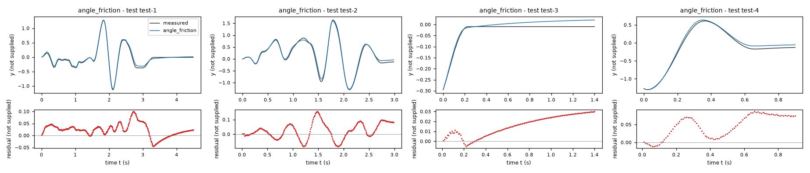
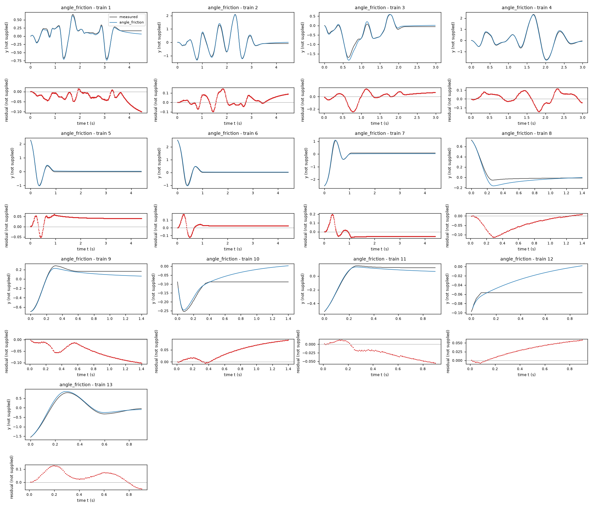
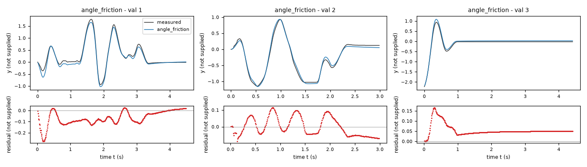
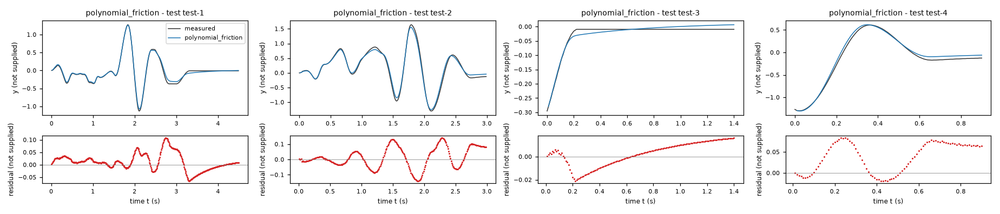
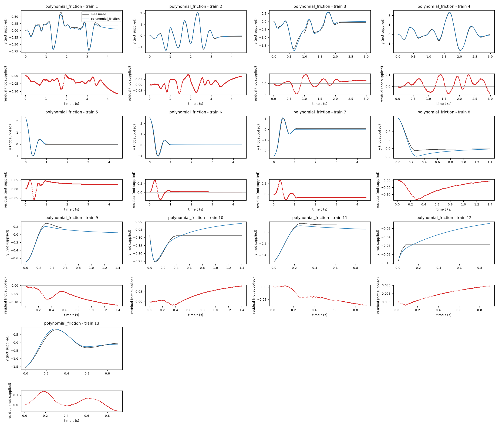
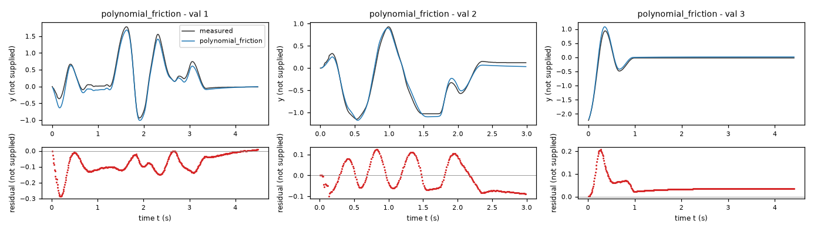
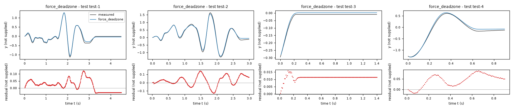
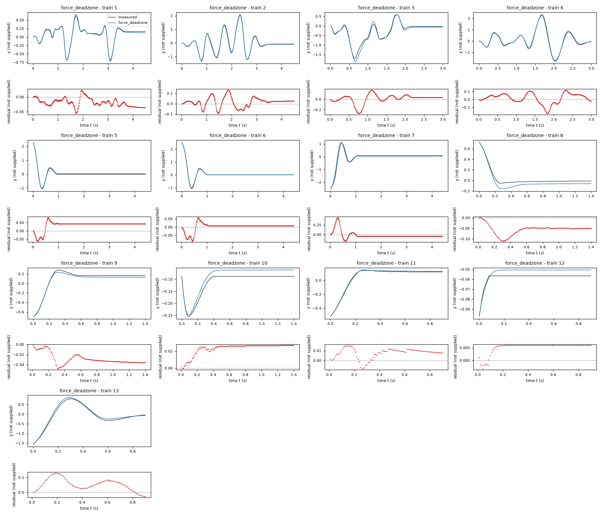
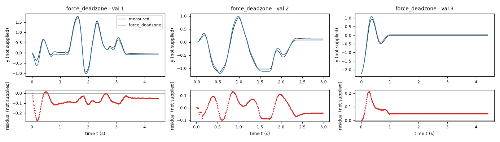

# Evaluation report: task task-jdhj

Terms. The harness is the software of ASPIRE that checks and evaluates the candidate models; a candidate is one proposed model; the pool is the set of candidates of one round. Sealed data (test data, reference expression) are inaccessible to the agent. This report contains results on sealed data and is not shown to the agent.

Evaluation mode: simulation (initialized once per trajectory from the measured state at sample 0; classical fourth-order Runge-Kutta integration with 1 step(s) per sampling period T_s = 0.01 s and zero-order hold of the input; the model output is h(x[k], u[k])).
Error measures: for one trajectory with scoring interval I of N samples, measured output y[k] (y, not supplied) and model output ŷ[k], SSE = Σ_(k∈I) (ŷ[k] − y[k])²; RMSE = sqrt(SSE/N), in not supplied; NRMSE = RMSE/σ, with μ and σ the mean and the population standard deviation of y on I; R² = 1 − SSE / Σ_(k∈I) (y[k] − μ)²; NRMSE and R² are not applicable when σ = 0. The pooled RMSE over several trajectories is S = sqrt(ΣSSE / ΣN); on the test data it is the ranking score.
Numerical failure limits: y in [-1000, 1000] not supplied; x1 in [-1000, 1000] not supplied; evaluation time limit 60 s per candidate and data group; symbolic time limit 10 s per verification.
Discontinuous expressions: expressions with jumps (Piecewise, sign) are evaluated pointwise at the sample instants and Runge-Kutta stages; no event detection or step refinement is applied at a jump.
Harness version 0.1.0.dev0; NumPy 2.5.1; SymPy 1.14.0.

## Pool

| category | count |
|---|---|
| candidates proposed | 3 |
| accepted by the file and expression checks | 3 |
| outside the pool limit of 10 (not evaluated) | 0 |
| evaluated | 3 |
| excluded by physical requirements | 0 |
| failed numerically on training or validation data | 0 |
| failed numerically on test data | 0 |
| eligible for ranking | 3 |

Note: the categories overlap: the candidates accepted by the checks include those outside the pool limit, and a candidate can be both excluded by requirements and failed numerically; the counts need not sum to the pool size.

Distinct structures: 3 among 3 evaluated candidates; groups: angle_friction; polynomial_friction; force_deadzone. Convention: ties resolved, fixed values kept, given constants kept, fitted parameters renamed P1..Pn in order of first occurrence; equal when a one-to-one renaming of the fitted parameters makes every expression identical in SymPy's canonical form.

### Recommendation of the agent

Recommended candidate: angle_friction. The agent's reason: Recommended for the lowest prior training-only validation rollout error: `RMSE = 0.07491741` in the unspecified unit of `y`, over data/val.csv after each initial sample. Position-dependent regularized friction also improved training rollout fit. The transition width `w = 0.3` in the unspecified unit of `x1` avoids the numerically stiff narrow-width optimum. All final models were refitted on combined training and validation data; their final validation errors are calibration results, not independent tests. The polynomial and static-force-deadzone candidates provide alternatives to the assumed periodic restoring and friction structure.
- Test score S of the recommended candidate (practical selection): 0.0449076 not supplied; eligible: True; rank in the oracle-based selection: 1.

## Oracle-based selection on test data

Label: oracle-based selection on test data. Candidates considered: 3 eligible of 3 evaluated. Criterion: pooled test RMSE S, increasing, the pooled RMSE over the test trajectories test-1 (449 scored samples), test-2 (299 scored samples), test-3 (140 scored samples), test-4 (90 scored samples). Tie rule: |S_a - S_b| <= 1e-12 * max(S_a, S_b) for consecutive candidates; tied candidates share a rank. This ranking selects on the test data. It measures whether the pool contains an accurate model, not whether the agent can recognize that model without test data. A rank is not evidence of physical admissibility: each entry carries its unresolved requirements and any violation allowed by the user.

| rank | candidate | S (not supplied) | unresolved requirements | violations allowed by the user |
|---|---|---|---|---|
| 1 | angle_friction | 0.0449076 | none | none |
| 2 | polynomial_friction | 0.0477003 | none | none |
| 3 | force_deadzone | 0.0493319 | none | none |

## Candidates

### Candidate angle_friction

Position in the agent's order: 1. Status: evaluated.
File and expression checks: passed.
- `dy = x1`
- `dx1 = a*sin(y) + h*cos(y) + b*x1 + c*x2 + d + e*tanh(x1/w)*(1 + j*cos(y))`
Complexity: 8 fitted, 0 fixed and 0 tied parameters; 0 non-integer numeric literals; 31 expression-tree nodes (SymPy tree, every operator, function, symbol and number counted once).
Structure group 1: `dy = x1`; `dx1 = P1 + P2*sin(y) + P3*x1 + P4*x2 + P5*cos(y) + P6*(P7*cos(y) + 1)*tanh(x1/P8)`

Requirements:

| id | type | outcome | status | method | detail |
|---|---|---|---|---|---|

Output errors on the test data (sealed) (pooled RMSE: 0.0449076 not supplied):

| trajectory | scored samples | completed | RMSE (not supplied) | NRMSE | R² | failure |
|---|---|---|---|---|---|---|
| test-1 | 449 | 449 | 0.0355644 | 0.0941881 | 0.991129 | none |
| test-2 | 299 | 299 | 0.060061 | 0.0971799 | 0.990556 | none |
| test-3 | 140 | 140 | 0.0187429 | 0.354078 | 0.874629 | none |
| test-4 | 90 | 90 | 0.0554424 | 0.104999 | 0.988975 | none |

Output errors on the training data (pooled RMSE: 0.0536889 not supplied):

| trajectory | scored samples | completed | RMSE (not supplied) | NRMSE | R² | failure |
|---|---|---|---|---|---|---|
| 1 | 449 | 449 | 0.0371373 | 0.144797 | 0.979034 | none |
| 2 | 449 | 449 | 0.0553476 | 0.0830479 | 0.993103 | none |
| 3 | 299 | 299 | 0.0794266 | 0.168179 | 0.971716 | none |
| 4 | 299 | 299 | 0.0601844 | 0.0734373 | 0.994607 | none |
| 5 | 441 | 441 | 0.0432601 | 0.113024 | 0.987226 | none |
| 6 | 441 | 441 | 0.0454953 | 0.0996743 | 0.990065 | none |
| 7 | 441 | 441 | 0.0596951 | 0.115055 | 0.986762 | none |
| 8 | 140 | 140 | 0.0535406 | 0.326026 | 0.893707 | none |
| 9 | 140 | 140 | 0.0590997 | 0.270248 | 0.926966 | none |
| 10 | 140 | 140 | 0.0531897 | 1.08178 | -0.170238 | none |
| 11 | 90 | 90 | 0.0299689 | 0.18209 | 0.966843 | none |
| 12 | 90 | 90 | 0.0361133 | 7.07796 | -49.0975 | none |
| 13 | 90 | 90 | 0.0629375 | 0.115846 | 0.98658 | none |

Output errors on the validation data (pooled RMSE: 0.0722002 not supplied):

| trajectory | scored samples | completed | RMSE (not supplied) | NRMSE | R² | failure |
|---|---|---|---|---|---|---|
| 1 | 449 | 449 | 0.0898939 | 0.164409 | 0.97297 | none |
| 2 | 299 | 299 | 0.0550368 | 0.0984344 | 0.990311 | none |
| 3 | 441 | 441 | 0.0614284 | 0.163435 | 0.973289 | none |

Sensitivity rank test (diagnostic; never excludes): targets dx1 on the train, val data (4714 rows, 0 dropped); analytic derivatives (SymPy), ties differentiated through their equations; scaling: rows of each target divided by the standard deviation of its measured column; columns divided by their Euclidean norm; rank threshold s_i / s_1 > 1e-08; singular values 1.68, 1.4, 1.09, 0.989, 0.795, 0.537, 0.325, 0.2; rank 8 of 8.
Reference comparison: not applicable (the task has no reference expression).
Eligible for ranking: True.

*Candidate angle_friction, test data (sealed), trajectories test-1, test-2, test-3, test-4. Upper axes: measured output y (not supplied) and model output of angle_friction; lower axes: residual (model output minus measured output, not supplied). Evaluation mode: simulation (initialized once per trajectory from the measured state at sample 0; classical fourth-order Runge-Kutta integration with 1 step(s) per sampling period T_s = 0.01 s and zero-order hold of the input; the model output is h(x[k], u[k])). Initialization: the first 1 sample(s) of each trajectory initialize the model and are excluded from the errors. Errors are computed on the samples test-1: 1 to 449; test-2: 1 to 299; test-3: 1 to 140; test-4: 1 to 90 (0-based sample indices). No numerical failure occurred.*

*Candidate angle_friction, training data, trajectories 1, 2, 3, 4, 5, 6, 7, 8, 9, 10, 11, 12, 13. Upper axes: measured output y (not supplied) and model output of angle_friction; lower axes: residual (model output minus measured output, not supplied). Evaluation mode: simulation (initialized once per trajectory from the measured state at sample 0; classical fourth-order Runge-Kutta integration with 1 step(s) per sampling period T_s = 0.01 s and zero-order hold of the input; the model output is h(x[k], u[k])). Initialization: the first 1 sample(s) of each trajectory initialize the model and are excluded from the errors. Errors are computed on the samples 1: 1 to 449; 2: 1 to 449; 3: 1 to 299; 4: 1 to 299; 5: 1 to 441; 6: 1 to 441; 7: 1 to 441; 8: 1 to 140; 9: 1 to 140; 10: 1 to 140; 11: 1 to 90; 12: 1 to 90; 13: 1 to 90 (0-based sample indices). No numerical failure occurred.*

*Candidate angle_friction, validation data, trajectories 1, 2, 3. Upper axes: measured output y (not supplied) and model output of angle_friction; lower axes: residual (model output minus measured output, not supplied). Evaluation mode: simulation (initialized once per trajectory from the measured state at sample 0; classical fourth-order Runge-Kutta integration with 1 step(s) per sampling period T_s = 0.01 s and zero-order hold of the input; the model output is h(x[k], u[k])). Initialization: the first 1 sample(s) of each trajectory initialize the model and are excluded from the errors. Errors are computed on the samples 1: 1 to 449; 2: 1 to 299; 3: 1 to 441 (0-based sample indices). No numerical failure occurred.*

### Candidate polynomial_friction

Position in the agent's order: 2. Status: evaluated.
File and expression checks: passed.
- `dy = x1`
- `dx1 = a*y + h*y**3 + j*y**5 + b*x1 + c*x2 + d + e*tanh(x1/w)`
Complexity: 8 fitted, 0 fixed and 0 tied parameters; 0 non-integer numeric literals; 30 expression-tree nodes (SymPy tree, every operator, function, symbol and number counted once).
Structure group 2: `dy = x1`; `dx1 = P1 + P2*y + P3*x1 + P4*x2 + P5*tanh(x1/P6) + P7*y**3 + P8*y**5`

Requirements:

| id | type | outcome | status | method | detail |
|---|---|---|---|---|---|

Output errors on the test data (sealed) (pooled RMSE: 0.0477003 not supplied):

| trajectory | scored samples | completed | RMSE (not supplied) | NRMSE | R² | failure |
|---|---|---|---|---|---|---|
| test-1 | 449 | 449 | 0.0354397 | 0.0938579 | 0.991191 | none |
| test-2 | 299 | 299 | 0.0685038 | 0.110841 | 0.987714 | none |
| test-3 | 140 | 140 | 0.0104738 | 0.197863 | 0.96085 | none |
| test-4 | 90 | 90 | 0.0519441 | 0.0983737 | 0.990323 | none |

Output errors on the training data (pooled RMSE: 0.0563677 not supplied):

| trajectory | scored samples | completed | RMSE (not supplied) | NRMSE | R² | failure |
|---|---|---|---|---|---|---|
| 1 | 449 | 449 | 0.0500716 | 0.195228 | 0.961886 | none |
| 2 | 449 | 449 | 0.0418509 | 0.0627963 | 0.996057 | none |
| 3 | 299 | 299 | 0.0709212 | 0.15017 | 0.977449 | none |
| 4 | 299 | 299 | 0.048644 | 0.0593556 | 0.996477 | none |
| 5 | 441 | 441 | 0.0313474 | 0.0818999 | 0.993292 | none |
| 6 | 441 | 441 | 0.0616054 | 0.134969 | 0.981783 | none |
| 7 | 441 | 441 | 0.0771818 | 0.148758 | 0.977871 | none |
| 8 | 140 | 140 | 0.0660363 | 0.402116 | 0.838303 | none |
| 9 | 140 | 140 | 0.0750979 | 0.343404 | 0.882074 | none |
| 10 | 140 | 140 | 0.0439369 | 0.893593 | 0.201492 | none |
| 11 | 90 | 90 | 0.0462429 | 0.28097 | 0.921056 | none |
| 12 | 90 | 90 | 0.0293654 | 5.75542 | -32.1249 | none |
| 13 | 90 | 90 | 0.0624623 | 0.114971 | 0.986782 | none |

Output errors on the validation data (pooled RMSE: 0.0766121 not supplied):

| trajectory | scored samples | completed | RMSE (not supplied) | NRMSE | R² | failure |
|---|---|---|---|---|---|---|
| 1 | 449 | 449 | 0.0973297 | 0.178009 | 0.968313 | none |
| 2 | 299 | 299 | 0.0671726 | 0.12014 | 0.985566 | none |
| 3 | 441 | 441 | 0.0558622 | 0.148626 | 0.97791 | none |

Sensitivity rank test (diagnostic; never excludes): targets dx1 on the train, val data (4714 rows, 0 dropped); analytic derivatives (SymPy), ties differentiated through their equations; scaling: rows of each target divided by the standard deviation of its measured column; columns divided by their Euclidean norm; rank threshold s_i / s_1 > 1e-08; singular values 1.64, 1.4, 1.04, 0.981, 0.866, 0.59, 0.436, 0.128; rank 8 of 8.
Reference comparison: not applicable (the task has no reference expression).
Eligible for ranking: True.

*Candidate polynomial_friction, test data (sealed), trajectories test-1, test-2, test-3, test-4. Upper axes: measured output y (not supplied) and model output of polynomial_friction; lower axes: residual (model output minus measured output, not supplied). Evaluation mode: simulation (initialized once per trajectory from the measured state at sample 0; classical fourth-order Runge-Kutta integration with 1 step(s) per sampling period T_s = 0.01 s and zero-order hold of the input; the model output is h(x[k], u[k])). Initialization: the first 1 sample(s) of each trajectory initialize the model and are excluded from the errors. Errors are computed on the samples test-1: 1 to 449; test-2: 1 to 299; test-3: 1 to 140; test-4: 1 to 90 (0-based sample indices). No numerical failure occurred.*

*Candidate polynomial_friction, training data, trajectories 1, 2, 3, 4, 5, 6, 7, 8, 9, 10, 11, 12, 13. Upper axes: measured output y (not supplied) and model output of polynomial_friction; lower axes: residual (model output minus measured output, not supplied). Evaluation mode: simulation (initialized once per trajectory from the measured state at sample 0; classical fourth-order Runge-Kutta integration with 1 step(s) per sampling period T_s = 0.01 s and zero-order hold of the input; the model output is h(x[k], u[k])). Initialization: the first 1 sample(s) of each trajectory initialize the model and are excluded from the errors. Errors are computed on the samples 1: 1 to 449; 2: 1 to 449; 3: 1 to 299; 4: 1 to 299; 5: 1 to 441; 6: 1 to 441; 7: 1 to 441; 8: 1 to 140; 9: 1 to 140; 10: 1 to 140; 11: 1 to 90; 12: 1 to 90; 13: 1 to 90 (0-based sample indices). No numerical failure occurred.*

*Candidate polynomial_friction, validation data, trajectories 1, 2, 3. Upper axes: measured output y (not supplied) and model output of polynomial_friction; lower axes: residual (model output minus measured output, not supplied). Evaluation mode: simulation (initialized once per trajectory from the measured state at sample 0; classical fourth-order Runge-Kutta integration with 1 step(s) per sampling period T_s = 0.01 s and zero-order hold of the input; the model output is h(x[k], u[k])). Initialization: the first 1 sample(s) of each trajectory initialize the model and are excluded from the errors. Errors are computed on the samples 1: 1 to 449; 2: 1 to 299; 3: 1 to 441 (0-based sample indices). No numerical failure occurred.*

### Candidate force_deadzone

Position in the agent's order: 3. Status: evaluated.
File and expression checks: passed.
- `dy = x1`
- `dx1 = a*sin(y) + h*cos(y) + b*x1 + c*x2 + d - e*tanh(x1/w) - Min(Max((a*sin(y) + h*cos(y) + b*x1 + c*x2 + d), -s), s)*exp(-(x1/j)**2)`
Complexity: 9 fitted, 0 fixed and 0 tied parameters; 0 non-integer numeric literals; 59 expression-tree nodes (SymPy tree, every operator, function, symbol and number counted once).
Structure group 3: `dy = x1`; `dx1 = P1 + P2*sin(y) + P3*x1 + P4*x2 + P5*cos(y) - P6*tanh(x1/P7) - exp(-x1**2/P9**2)*Min(P8, Max(-P8, P1 + P2*sin(y) + P3*x1 + P4*x2 + P5*cos(y)))`

Requirements:

| id | type | outcome | status | method | detail |
|---|---|---|---|---|---|

Output errors on the test data (sealed) (pooled RMSE: 0.0493319 not supplied):

| trajectory | scored samples | completed | RMSE (not supplied) | NRMSE | R² | failure |
|---|---|---|---|---|---|---|
| test-1 | 449 | 449 | 0.043933 | 0.116351 | 0.986462 | none |
| test-2 | 299 | 299 | 0.0645367 | 0.104422 | 0.989096 | none |
| test-3 | 140 | 140 | 0.0113868 | 0.215111 | 0.953727 | none |
| test-4 | 90 | 90 | 0.052704 | 0.0998129 | 0.990037 | none |

Output errors on the training data (pooled RMSE: 0.0561158 not supplied):

| trajectory | scored samples | completed | RMSE (not supplied) | NRMSE | R² | failure |
|---|---|---|---|---|---|---|
| 1 | 449 | 449 | 0.0230303 | 0.0897946 | 0.991937 | none |
| 2 | 449 | 449 | 0.0490023 | 0.073527 | 0.994594 | none |
| 3 | 299 | 299 | 0.0858297 | 0.181737 | 0.966971 | none |
| 4 | 299 | 299 | 0.0661304 | 0.0806926 | 0.993489 | none |
| 5 | 441 | 441 | 0.0438741 | 0.114628 | 0.98686 | none |
| 6 | 441 | 441 | 0.0241475 | 0.0529039 | 0.997201 | none |
| 7 | 441 | 441 | 0.0953368 | 0.18375 | 0.966236 | none |
| 8 | 140 | 140 | 0.059588 | 0.36285 | 0.86834 | none |
| 9 | 140 | 140 | 0.0302745 | 0.138438 | 0.980835 | none |
| 10 | 140 | 140 | 0.0242112 | 0.49241 | 0.757533 | none |
| 11 | 90 | 90 | 0.00926355 | 0.056285 | 0.996832 | none |
| 12 | 90 | 90 | 0.00555618 | 1.08897 | -0.185865 | none |
| 13 | 90 | 90 | 0.0659035 | 0.121305 | 0.985285 | none |

Output errors on the validation data (pooled RMSE: 0.0753696 not supplied):

| trajectory | scored samples | completed | RMSE (not supplied) | NRMSE | R² | failure |
|---|---|---|---|---|---|---|
| 1 | 449 | 449 | 0.0879169 | 0.160793 | 0.974146 | none |
| 2 | 299 | 299 | 0.0643104 | 0.115021 | 0.98677 | none |
| 3 | 441 | 441 | 0.0681319 | 0.18127 | 0.967141 | none |

Sensitivity rank test (diagnostic; never excludes): targets dx1 on the train, val data (4714 rows, 0 dropped); analytic derivatives (SymPy), ties differentiated through their equations; scaling: rows of each target divided by the standard deviation of its measured column; columns divided by their Euclidean norm; rank threshold s_i / s_1 > 1e-08; singular values 1.48, 1.39, 1.24, 1.05, 0.968, 0.783, 0.689, 0.402, 0.26; rank 9 of 9.
Reference comparison: not applicable (the task has no reference expression).
Eligible for ranking: True.

*Candidate force_deadzone, test data (sealed), trajectories test-1, test-2, test-3, test-4. Upper axes: measured output y (not supplied) and model output of force_deadzone; lower axes: residual (model output minus measured output, not supplied). Evaluation mode: simulation (initialized once per trajectory from the measured state at sample 0; classical fourth-order Runge-Kutta integration with 1 step(s) per sampling period T_s = 0.01 s and zero-order hold of the input; the model output is h(x[k], u[k])). Initialization: the first 1 sample(s) of each trajectory initialize the model and are excluded from the errors. Errors are computed on the samples test-1: 1 to 449; test-2: 1 to 299; test-3: 1 to 140; test-4: 1 to 90 (0-based sample indices). No numerical failure occurred.*

*Candidate force_deadzone, training data, trajectories 1, 2, 3, 4, 5, 6, 7, 8, 9, 10, 11, 12, 13. Upper axes: measured output y (not supplied) and model output of force_deadzone; lower axes: residual (model output minus measured output, not supplied). Evaluation mode: simulation (initialized once per trajectory from the measured state at sample 0; classical fourth-order Runge-Kutta integration with 1 step(s) per sampling period T_s = 0.01 s and zero-order hold of the input; the model output is h(x[k], u[k])). Initialization: the first 1 sample(s) of each trajectory initialize the model and are excluded from the errors. Errors are computed on the samples 1: 1 to 449; 2: 1 to 449; 3: 1 to 299; 4: 1 to 299; 5: 1 to 441; 6: 1 to 441; 7: 1 to 441; 8: 1 to 140; 9: 1 to 140; 10: 1 to 140; 11: 1 to 90; 12: 1 to 90; 13: 1 to 90 (0-based sample indices). No numerical failure occurred.*

*Candidate force_deadzone, validation data, trajectories 1, 2, 3. Upper axes: measured output y (not supplied) and model output of force_deadzone; lower axes: residual (model output minus measured output, not supplied). Evaluation mode: simulation (initialized once per trajectory from the measured state at sample 0; classical fourth-order Runge-Kutta integration with 1 step(s) per sampling period T_s = 0.01 s and zero-order hold of the input; the model output is h(x[k], u[k])). Initialization: the first 1 sample(s) of each trajectory initialize the model and are excluded from the errors. Errors are computed on the samples 1: 1 to 449; 2: 1 to 299; 3: 1 to 441 (0-based sample indices). No numerical failure occurred.*
