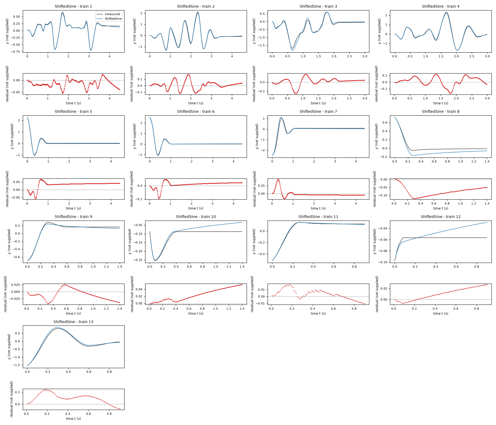
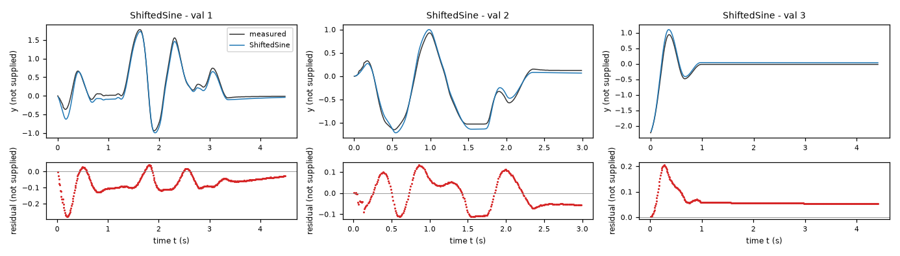
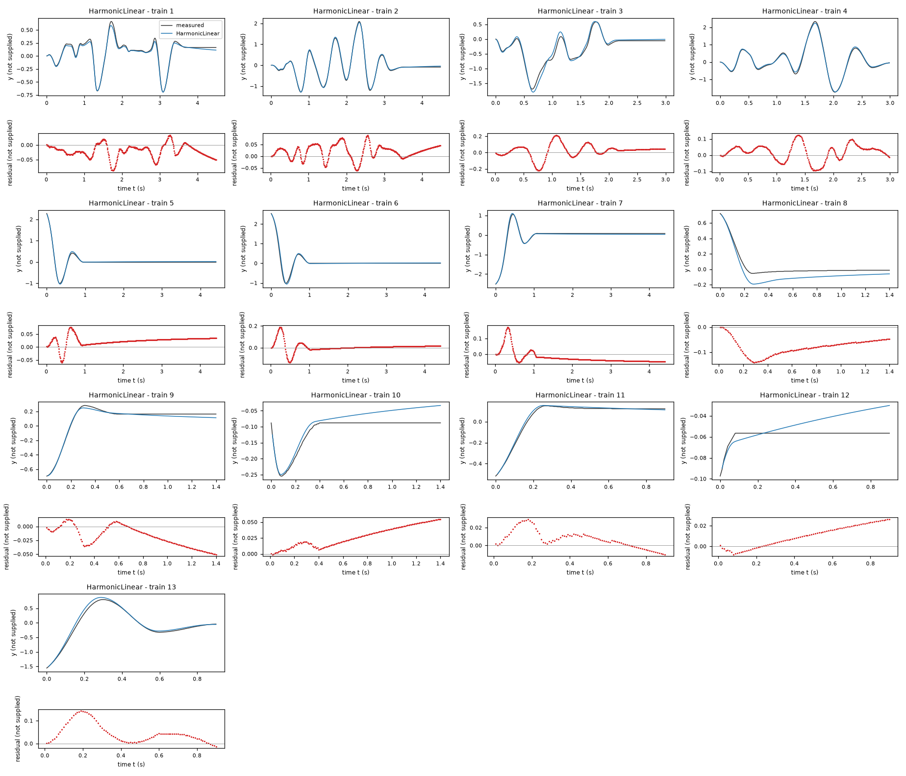
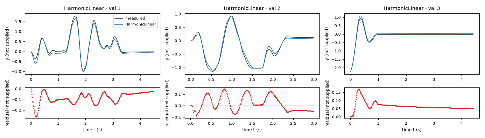
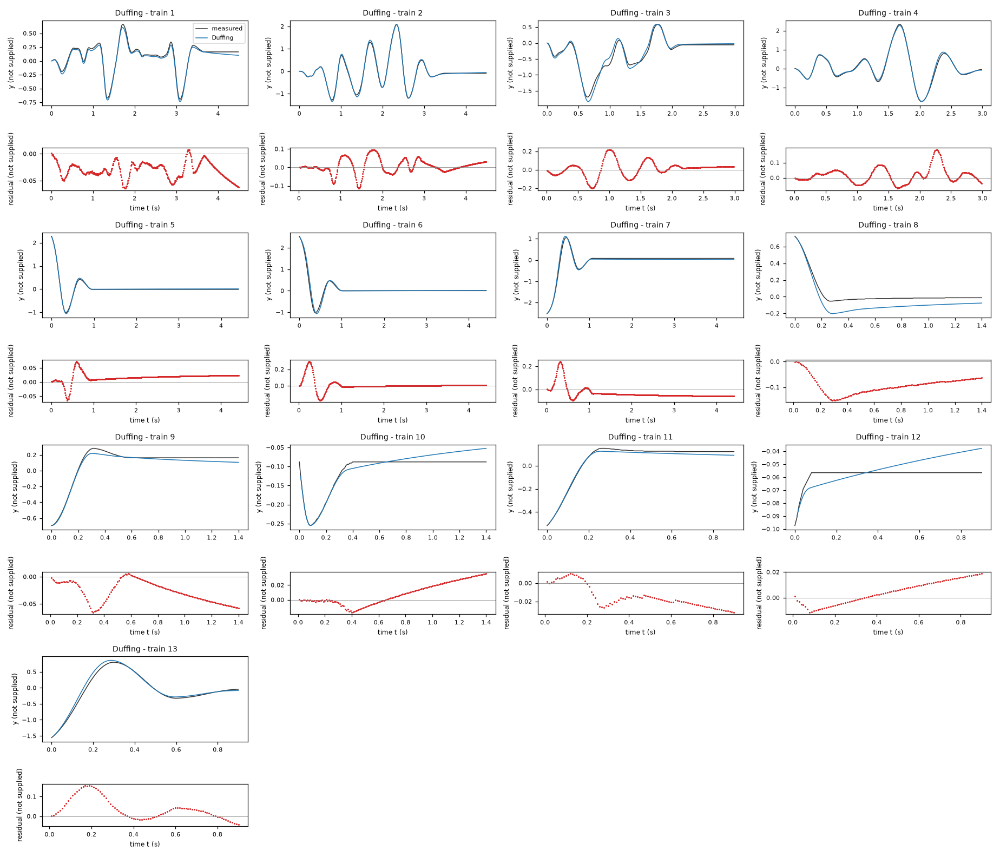
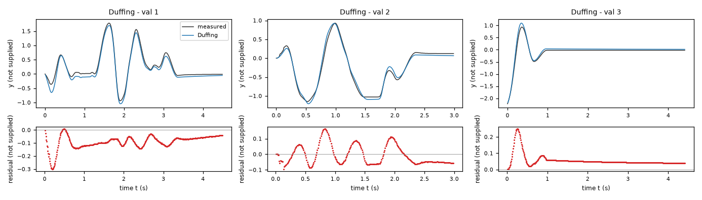
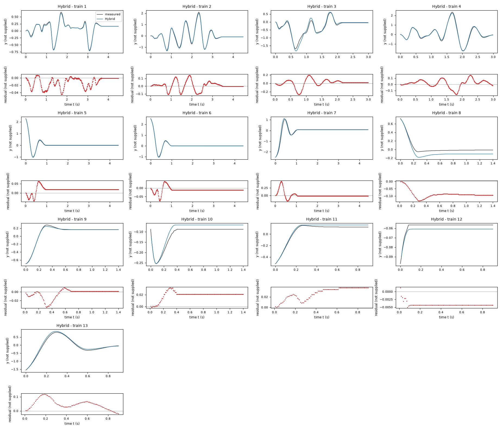
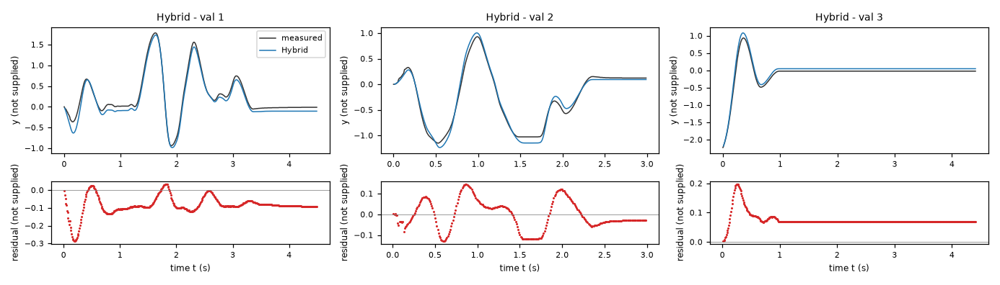

# Evaluation results permitted to the agent: task task-jdhj

Terms. The harness is the software of ASPIRE that checks and evaluates the candidate models; a candidate is one proposed model; the pool is the set of candidates of one round. Sealed data (test data, reference expression) are inaccessible to the agent. This view contains no result derived from sealed data.

Evaluation mode: simulation (initialized once per trajectory from the measured state at sample 0; classical fourth-order Runge-Kutta integration with 1 step(s) per sampling period T_s = 0.01 s and zero-order hold of the input; the model output is h(x[k], u[k])).
Error measures: for one trajectory with scoring interval I of N samples, measured output y[k] (y, not supplied) and model output ŷ[k], SSE = Σ_(k∈I) (ŷ[k] − y[k])²; RMSE = sqrt(SSE/N), in not supplied; NRMSE = RMSE/σ, with μ and σ the mean and the population standard deviation of y on I; R² = 1 − SSE / Σ_(k∈I) (y[k] − μ)²; NRMSE and R² are not applicable when σ = 0. The pooled RMSE over several trajectories is S = sqrt(ΣSSE / ΣN); on the test data it is the ranking score.
Numerical failure limits: y in [-1000, 1000] not supplied; x1 in [-1000, 1000] not supplied; evaluation time limit 60 s per candidate and data group; symbolic time limit 10 s per verification.
Discontinuous expressions: expressions with jumps (Piecewise, sign) are evaluated pointwise at the sample instants and Runge-Kutta stages; no event detection or step refinement is applied at a jump.
Harness version 0.1.0.dev0; NumPy 2.5.1; SymPy 1.14.0.

## Pool

| category | count |
|---|---|
| candidates proposed | 4 |
| accepted by the file and expression checks | 4 |
| outside the pool limit of 10 (not evaluated) | 0 |
| evaluated | 4 |
| excluded by physical requirements | 0 |
| failed numerically on training or validation data | 0 |

Note: the categories overlap; the counts need not sum to the pool size.

Distinct structures: 4 among 4 evaluated candidates; groups: ShiftedSine; HarmonicLinear; Duffing; Hybrid. Convention: ties resolved, fixed values kept, given constants kept, fitted parameters renamed P1..Pn in order of first occurrence; equal when a one-to-one renaming of the fitted parameters makes every expression identical in SymPy's canonical form.

### Recommendation of the agent

Recommended candidate: ShiftedSine. The agent's reason: Among the four structurally distinct retained models, `ShiftedSine` had the lowest held-out uninterrupted RK4 output RMSE: `0.07929740111285531` in recorded `y` units on all three trajectories of data/val.csv, versus `0.08157536011092963` for `HarmonicLinear`, `0.08240743982203075` for `Duffing`, and `0.08586466470760443` for `Hybrid`. It uses fewer fitted coefficients than the harmonic-linear and hybrid alternatives and avoids their positive unbounded coordinate correction or switching sensitivity. Its smooth-friction transition width is bound-limited and trajectory-dependent residual offsets remain; the small validation differences are not statistically established and do not guarantee test ranking. Validation was used for selection, not coefficient fitting.

## Candidates

### Candidate ShiftedSine

Position in the agent's order: 1. Status: evaluated.
File and expression checks: passed.
- `dy = x1`
- `dx1 = -a*sin(y + delta) - b*x1 + c*x2 - f*tanh(x1/s)`
Complexity: 6 fitted, 0 fixed and 0 tied parameters; 0 non-integer numeric literals; 25 expression-tree nodes (SymPy tree, every operator, function, symbol and number counted once).
Structure group 1: `dy = x1`; `dx1 = P1*x2 - P2*sin(P3 + y) - P4*x1 - P5*tanh(x1/P6)`

Requirements:

| id | type | outcome | status | method | detail |
|---|---|---|---|---|---|

Output errors on the training data (pooled RMSE: 0.0578407 not supplied):

| trajectory | scored samples | completed | RMSE (not supplied) | NRMSE | R² | failure |
|---|---|---|---|---|---|---|
| 1 | 449 | 449 | 0.0207045 | 0.0807262 | 0.993483 | none |
| 2 | 449 | 449 | 0.0603176 | 0.0905053 | 0.991809 | none |
| 3 | 299 | 299 | 0.0807752 | 0.171035 | 0.970747 | none |
| 4 | 299 | 299 | 0.0666054 | 0.0812722 | 0.993395 | none |
| 5 | 441 | 441 | 0.03938 | 0.102886 | 0.989414 | none |
| 6 | 441 | 441 | 0.0246563 | 0.0540188 | 0.997082 | none |
| 7 | 441 | 441 | 0.0975212 | 0.18796 | 0.964671 | none |
| 8 | 140 | 140 | 0.0808642 | 0.492408 | 0.757535 | none |
| 9 | 140 | 140 | 0.0213446 | 0.0976036 | 0.990474 | none |
| 10 | 140 | 140 | 0.0294373 | 0.598697 | 0.641561 | none |
| 11 | 90 | 90 | 0.00759638 | 0.0461553 | 0.99787 | none |
| 12 | 90 | 90 | 0.0146594 | 2.87314 | -7.25492 | none |
| 13 | 90 | 90 | 0.0636839 | 0.11722 | 0.98626 | none |

Output errors on the validation data (pooled RMSE: 0.0792974 not supplied):

| trajectory | scored samples | completed | RMSE (not supplied) | NRMSE | R² | failure |
|---|---|---|---|---|---|---|
| 1 | 449 | 449 | 0.0906737 | 0.165835 | 0.972499 | none |
| 2 | 299 | 299 | 0.0701062 | 0.125386 | 0.984278 | none |
| 3 | 441 | 441 | 0.0724595 | 0.192784 | 0.962834 | none |

Sensitivity rank test (diagnostic; never excludes): targets dx1 on the train, val data (4714 rows, 0 dropped); analytic derivatives (SymPy), ties differentiated through their equations; scaling: rows of each target divided by the standard deviation of its measured column; columns divided by their Euclidean norm; rank threshold s_i / s_1 > 1e-08; singular values 1.42, 1.11, 0.997, 0.978, 0.77, 0.471; rank 6 of 6.

*Candidate ShiftedSine, training data, trajectories 1, 2, 3, 4, 5, 6, 7, 8, 9, 10, 11, 12, 13. Upper axes: measured output y (not supplied) and model output of ShiftedSine; lower axes: residual (model output minus measured output, not supplied). Evaluation mode: simulation (initialized once per trajectory from the measured state at sample 0; classical fourth-order Runge-Kutta integration with 1 step(s) per sampling period T_s = 0.01 s and zero-order hold of the input; the model output is h(x[k], u[k])). Initialization: the first 1 sample(s) of each trajectory initialize the model and are excluded from the errors. Errors are computed on the samples 1: 1 to 449; 2: 1 to 449; 3: 1 to 299; 4: 1 to 299; 5: 1 to 441; 6: 1 to 441; 7: 1 to 441; 8: 1 to 140; 9: 1 to 140; 10: 1 to 140; 11: 1 to 90; 12: 1 to 90; 13: 1 to 90 (0-based sample indices). No numerical failure occurred.*

*Candidate ShiftedSine, validation data, trajectories 1, 2, 3. Upper axes: measured output y (not supplied) and model output of ShiftedSine; lower axes: residual (model output minus measured output, not supplied). Evaluation mode: simulation (initialized once per trajectory from the measured state at sample 0; classical fourth-order Runge-Kutta integration with 1 step(s) per sampling period T_s = 0.01 s and zero-order hold of the input; the model output is h(x[k], u[k])). Initialization: the first 1 sample(s) of each trajectory initialize the model and are excluded from the errors. Errors are computed on the samples 1: 1 to 449; 2: 1 to 299; 3: 1 to 441 (0-based sample indices). No numerical failure occurred.*

### Candidate HarmonicLinear

Position in the agent's order: 2. Status: evaluated.
File and expression checks: passed.
- `dy = x1`
- `dx1 = -a*sin(y) + ell*y + harm*cos(y) - b*x1 + c*x2 - f*tanh(x1/s)`
Complexity: 7 fitted, 0 fixed and 0 tied parameters; 0 non-integer numeric literals; 30 expression-tree nodes (SymPy tree, every operator, function, symbol and number counted once).
Structure group 2: `dy = x1`; `dx1 = P1*x2 + P2*y + P3*cos(y) - P4*sin(y) - P5*x1 - P6*tanh(x1/P7)`

Requirements:

| id | type | outcome | status | method | detail |
|---|---|---|---|---|---|

Output errors on the training data (pooled RMSE: 0.0467283 not supplied):

| trajectory | scored samples | completed | RMSE (not supplied) | NRMSE | R² | failure |
|---|---|---|---|---|---|---|
| 1 | 449 | 449 | 0.0301904 | 0.117712 | 0.986144 | none |
| 2 | 449 | 449 | 0.0359535 | 0.0539475 | 0.99709 | none |
| 3 | 299 | 299 | 0.0828043 | 0.175332 | 0.969259 | none |
| 4 | 299 | 299 | 0.0531302 | 0.0648297 | 0.995797 | none |
| 5 | 441 | 441 | 0.0299943 | 0.0783647 | 0.993859 | none |
| 6 | 441 | 441 | 0.0437374 | 0.0958229 | 0.990818 | none |
| 7 | 441 | 441 | 0.0459377 | 0.0885391 | 0.992161 | none |
| 8 | 140 | 140 | 0.084698 | 0.515753 | 0.733999 | none |
| 9 | 140 | 140 | 0.0252577 | 0.115497 | 0.98666 | none |
| 10 | 140 | 140 | 0.0313752 | 0.638112 | 0.592813 | none |
| 11 | 90 | 90 | 0.0120325 | 0.0731091 | 0.994655 | none |
| 12 | 90 | 90 | 0.0141762 | 2.77845 | -6.71976 | none |
| 13 | 90 | 90 | 0.0618856 | 0.11391 | 0.987025 | none |

Output errors on the validation data (pooled RMSE: 0.0815754 not supplied):

| trajectory | scored samples | completed | RMSE (not supplied) | NRMSE | R² | failure |
|---|---|---|---|---|---|---|
| 1 | 449 | 449 | 0.0978159 | 0.178898 | 0.967996 | none |
| 2 | 299 | 299 | 0.0674034 | 0.120552 | 0.985467 | none |
| 3 | 441 | 441 | 0.0715525 | 0.190371 | 0.963759 | none |

Sensitivity rank test (diagnostic; never excludes): targets dx1 on the train, val data (4714 rows, 0 dropped); analytic derivatives (SymPy), ties differentiated through their equations; scaling: rows of each target divided by the standard deviation of its measured column; columns divided by their Euclidean norm; rank threshold s_i / s_1 > 1e-08; singular values 1.48, 1.36, 1.02, 0.989, 0.812, 0.471, 0.223; rank 7 of 7.

*Candidate HarmonicLinear, training data, trajectories 1, 2, 3, 4, 5, 6, 7, 8, 9, 10, 11, 12, 13. Upper axes: measured output y (not supplied) and model output of HarmonicLinear; lower axes: residual (model output minus measured output, not supplied). Evaluation mode: simulation (initialized once per trajectory from the measured state at sample 0; classical fourth-order Runge-Kutta integration with 1 step(s) per sampling period T_s = 0.01 s and zero-order hold of the input; the model output is h(x[k], u[k])). Initialization: the first 1 sample(s) of each trajectory initialize the model and are excluded from the errors. Errors are computed on the samples 1: 1 to 449; 2: 1 to 449; 3: 1 to 299; 4: 1 to 299; 5: 1 to 441; 6: 1 to 441; 7: 1 to 441; 8: 1 to 140; 9: 1 to 140; 10: 1 to 140; 11: 1 to 90; 12: 1 to 90; 13: 1 to 90 (0-based sample indices). No numerical failure occurred.*

*Candidate HarmonicLinear, validation data, trajectories 1, 2, 3. Upper axes: measured output y (not supplied) and model output of HarmonicLinear; lower axes: residual (model output minus measured output, not supplied). Evaluation mode: simulation (initialized once per trajectory from the measured state at sample 0; classical fourth-order Runge-Kutta integration with 1 step(s) per sampling period T_s = 0.01 s and zero-order hold of the input; the model output is h(x[k], u[k])). Initialization: the first 1 sample(s) of each trajectory initialize the model and are excluded from the errors. Errors are computed on the samples 1: 1 to 449; 2: 1 to 299; 3: 1 to 441 (0-based sample indices). No numerical failure occurred.*

### Candidate Duffing

Position in the agent's order: 3. Status: evaluated.
File and expression checks: passed.
- `dy = x1`
- `dx1 = -a*y + q*y**3 - b*x1 + c*x2 - f*tanh(x1/s) + bias`
Complexity: 7 fitted, 0 fixed and 0 tied parameters; 0 non-integer numeric literals; 28 expression-tree nodes (SymPy tree, every operator, function, symbol and number counted once).
Structure group 3: `dy = x1`; `dx1 = P1 + P2*x2 + P3*y**3 - P4*y - P5*x1 - P6*tanh(x1/P7)`

Requirements:

| id | type | outcome | status | method | detail |
|---|---|---|---|---|---|

Output errors on the training data (pooled RMSE: 0.0533454 not supplied):

| trajectory | scored samples | completed | RMSE (not supplied) | NRMSE | R² | failure |
|---|---|---|---|---|---|---|
| 1 | 449 | 449 | 0.0337298 | 0.131512 | 0.982705 | none |
| 2 | 449 | 449 | 0.0400195 | 0.0600485 | 0.996394 | none |
| 3 | 299 | 299 | 0.0816349 | 0.172855 | 0.970121 | none |
| 4 | 299 | 299 | 0.0539258 | 0.0658005 | 0.99567 | none |
| 5 | 441 | 441 | 0.0234528 | 0.0612742 | 0.996245 | none |
| 6 | 441 | 441 | 0.0647337 | 0.141823 | 0.979886 | none |
| 7 | 441 | 441 | 0.0644398 | 0.1242 | 0.984574 | none |
| 8 | 140 | 140 | 0.0980002 | 0.596754 | 0.643884 | none |
| 9 | 140 | 140 | 0.034022 | 0.155574 | 0.975797 | none |
| 10 | 140 | 140 | 0.016925 | 0.344222 | 0.881511 | none |
| 11 | 90 | 90 | 0.0192321 | 0.116854 | 0.986345 | none |
| 12 | 90 | 90 | 0.00978485 | 1.91776 | -2.67782 | none |
| 13 | 90 | 90 | 0.0652538 | 0.120109 | 0.985574 | none |

Output errors on the validation data (pooled RMSE: 0.0824074 not supplied):

| trajectory | scored samples | completed | RMSE (not supplied) | NRMSE | R² | failure |
|---|---|---|---|---|---|---|
| 1 | 449 | 449 | 0.103775 | 0.189796 | 0.963978 | none |
| 2 | 299 | 299 | 0.0631644 | 0.112971 | 0.987238 | none |
| 3 | 441 | 441 | 0.0681169 | 0.181231 | 0.967155 | none |

Sensitivity rank test (diagnostic; never excludes): targets dx1 on the train, val data (4714 rows, 0 dropped); analytic derivatives (SymPy), ties differentiated through their equations; scaling: rows of each target divided by the standard deviation of its measured column; columns divided by their Euclidean norm; rank threshold s_i / s_1 > 1e-08; singular values 1.46, 1.31, 1.03, 0.989, 0.834, 0.476, 0.441; rank 7 of 7.

*Candidate Duffing, training data, trajectories 1, 2, 3, 4, 5, 6, 7, 8, 9, 10, 11, 12, 13. Upper axes: measured output y (not supplied) and model output of Duffing; lower axes: residual (model output minus measured output, not supplied). Evaluation mode: simulation (initialized once per trajectory from the measured state at sample 0; classical fourth-order Runge-Kutta integration with 1 step(s) per sampling period T_s = 0.01 s and zero-order hold of the input; the model output is h(x[k], u[k])). Initialization: the first 1 sample(s) of each trajectory initialize the model and are excluded from the errors. Errors are computed on the samples 1: 1 to 449; 2: 1 to 449; 3: 1 to 299; 4: 1 to 299; 5: 1 to 441; 6: 1 to 441; 7: 1 to 441; 8: 1 to 140; 9: 1 to 140; 10: 1 to 140; 11: 1 to 90; 12: 1 to 90; 13: 1 to 90 (0-based sample indices). No numerical failure occurred.*

*Candidate Duffing, validation data, trajectories 1, 2, 3. Upper axes: measured output y (not supplied) and model output of Duffing; lower axes: residual (model output minus measured output, not supplied). Evaluation mode: simulation (initialized once per trajectory from the measured state at sample 0; classical fourth-order Runge-Kutta integration with 1 step(s) per sampling period T_s = 0.01 s and zero-order hold of the input; the model output is h(x[k], u[k])). Initialization: the first 1 sample(s) of each trajectory initialize the model and are excluded from the errors. Errors are computed on the samples 1: 1 to 449; 2: 1 to 299; 3: 1 to 441 (0-based sample indices). No numerical failure occurred.*

### Candidate Hybrid

Position in the agent's order: 4. Status: evaluated.
File and expression checks: passed.
- `dy = x1`
- `dx1 = Piecewise((-h*x1, (Abs(x1) < s) & (Abs((-a*sin(y + delta) + c*x2)) < fs)), ((-a*sin(y + delta) + c*x2) - b*x1 - f*sign(x1), True))`
Complexity: 7 fitted, 1 fixed and 0 tied parameters; 0 non-integer numeric literals; 46 expression-tree nodes (SymPy tree, every operator, function, symbol and number counted once).
Structure group 4: `dy = x1`; `dx1 = Piecewise((-100.0*x1, (P1 > Abs(x1)) & (P2 > Abs(P3*sin(P4 + y) - P5*x2))), (-P3*sin(P4 + y) + P5*x2 - P6*x1 - P7*sign(x1), True))`

Requirements:

| id | type | outcome | status | method | detail |
|---|---|---|---|---|---|

Output errors on the training data (pooled RMSE: 0.0561247 not supplied):

| trajectory | scored samples | completed | RMSE (not supplied) | NRMSE | R² | failure |
|---|---|---|---|---|---|---|
| 1 | 449 | 449 | 0.0180616 | 0.0704219 | 0.995041 | none |
| 2 | 449 | 449 | 0.0550269 | 0.0825666 | 0.993183 | none |
| 3 | 299 | 299 | 0.0862788 | 0.182688 | 0.966625 | none |
| 4 | 299 | 299 | 0.0642139 | 0.0783541 | 0.993861 | none |
| 5 | 441 | 441 | 0.0229569 | 0.0599783 | 0.996403 | none |
| 6 | 441 | 441 | 0.0189838 | 0.0415909 | 0.99827 | none |
| 7 | 441 | 441 | 0.0961915 | 0.185397 | 0.965628 | none |
| 8 | 140 | 140 | 0.0910351 | 0.554341 | 0.692706 | none |
| 9 | 140 | 140 | 0.0105845 | 0.0484001 | 0.997657 | none |
| 10 | 140 | 140 | 0.0205777 | 0.418511 | 0.824848 | none |
| 11 | 90 | 90 | 0.0290287 | 0.176378 | 0.968891 | none |
| 12 | 90 | 90 | 0.00421532 | 0.826174 | 0.317436 | none |
| 13 | 90 | 90 | 0.0581301 | 0.106997 | 0.988552 | none |

Output errors on the validation data (pooled RMSE: 0.0858647 not supplied):

| trajectory | scored samples | completed | RMSE (not supplied) | NRMSE | R² | failure |
|---|---|---|---|---|---|---|
| 1 | 449 | 449 | 0.0991553 | 0.181348 | 0.967113 | none |
| 2 | 299 | 299 | 0.0707428 | 0.126525 | 0.983991 | none |
| 3 | 441 | 441 | 0.0804658 | 0.214086 | 0.954167 | none |

Sensitivity rank test (diagnostic; never excludes): targets dx1 on the train, val data (4714 rows, 0 dropped); analytic derivatives (SymPy), ties differentiated through their equations; scaling: rows of each target divided by the standard deviation of its measured column; columns divided by their Euclidean norm; rank threshold s_i / s_1 > 1e-08; singular values 1.41, 1.09, 0.975, 0.78, 0.518, 0, 0; rank 5 of 7.
- Locally indistinguishable combination: fs (+1.000); relative singular value 0.
- Locally indistinguishable combination: s (+1.000); relative singular value 0.
- Parameter s has no influence on the targets.
- Parameter fs has no influence on the targets.

*Candidate Hybrid, training data, trajectories 1, 2, 3, 4, 5, 6, 7, 8, 9, 10, 11, 12, 13. Upper axes: measured output y (not supplied) and model output of Hybrid; lower axes: residual (model output minus measured output, not supplied). Evaluation mode: simulation (initialized once per trajectory from the measured state at sample 0; classical fourth-order Runge-Kutta integration with 1 step(s) per sampling period T_s = 0.01 s and zero-order hold of the input; the model output is h(x[k], u[k])). Initialization: the first 1 sample(s) of each trajectory initialize the model and are excluded from the errors. Errors are computed on the samples 1: 1 to 449; 2: 1 to 449; 3: 1 to 299; 4: 1 to 299; 5: 1 to 441; 6: 1 to 441; 7: 1 to 441; 8: 1 to 140; 9: 1 to 140; 10: 1 to 140; 11: 1 to 90; 12: 1 to 90; 13: 1 to 90 (0-based sample indices). No numerical failure occurred.*

*Candidate Hybrid, validation data, trajectories 1, 2, 3. Upper axes: measured output y (not supplied) and model output of Hybrid; lower axes: residual (model output minus measured output, not supplied). Evaluation mode: simulation (initialized once per trajectory from the measured state at sample 0; classical fourth-order Runge-Kutta integration with 1 step(s) per sampling period T_s = 0.01 s and zero-order hold of the input; the model output is h(x[k], u[k])). Initialization: the first 1 sample(s) of each trajectory initialize the model and are excluded from the errors. Errors are computed on the samples 1: 1 to 449; 2: 1 to 299; 3: 1 to 441 (0-based sample indices). No numerical failure occurred.*
