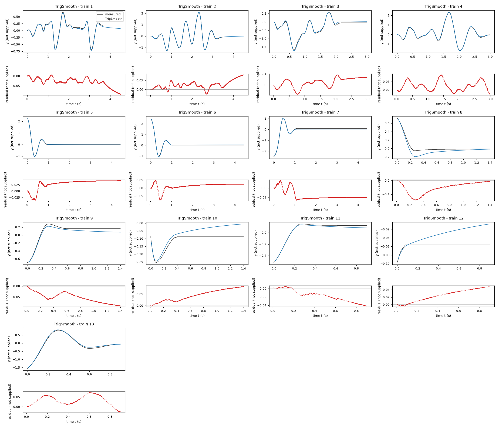
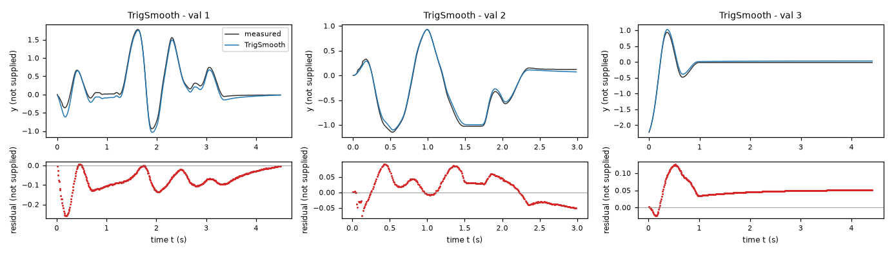
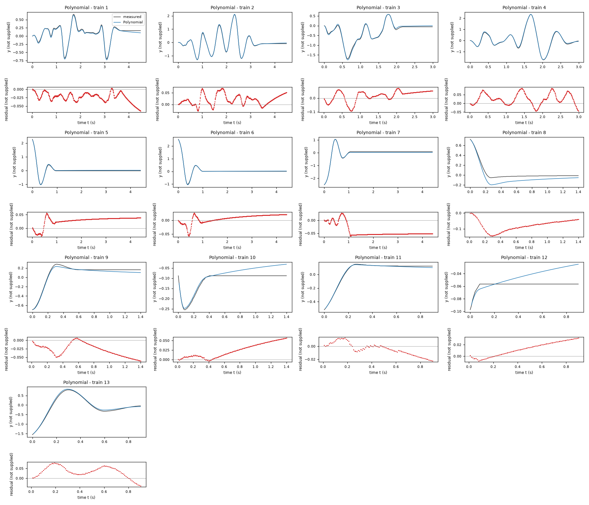
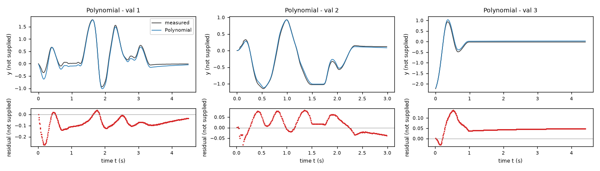
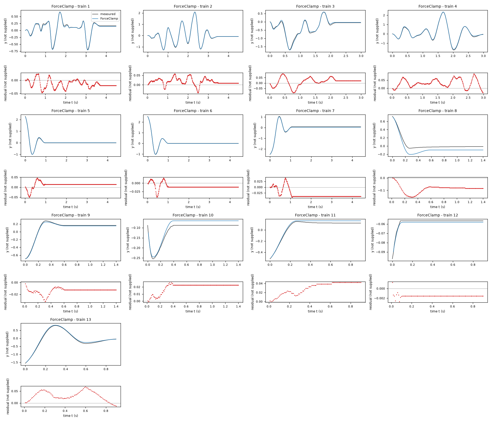
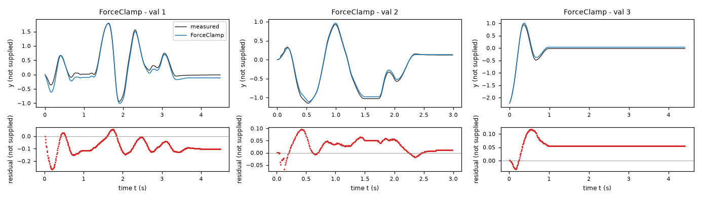

# Evaluation results permitted to the agent: task task-jdhj

Terms. The harness is the software of ASPIRE that checks and evaluates the candidate models; a candidate is one proposed model; the pool is the set of candidates of one round. Sealed data (test data, reference expression) are inaccessible to the agent. This view contains no result derived from sealed data.

Evaluation mode: simulation (initialized once per trajectory from the measured state at sample 0; classical fourth-order Runge-Kutta integration with 1 step(s) per sampling period T_s = 0.01 s and zero-order hold of the input; the model output is h(x[k], u[k])).
Error measures: for one trajectory with scoring interval I of N samples, measured output y[k] (y, not supplied) and model output ŷ[k], SSE = Σ_(k∈I) (ŷ[k] − y[k])²; RMSE = sqrt(SSE/N), in not supplied; NRMSE = RMSE/σ, with μ and σ the mean and the population standard deviation of y on I; R² = 1 − SSE / Σ_(k∈I) (y[k] − μ)²; NRMSE and R² are not applicable when σ = 0. The pooled RMSE over several trajectories is S = sqrt(ΣSSE / ΣN); on the test data it is the ranking score.
Numerical failure limits: y in [-1000, 1000] not supplied; x1 in [-1000, 1000] not supplied; evaluation time limit 60 s per candidate and data group; symbolic time limit 10 s per verification.
Discontinuous expressions: expressions with jumps (Piecewise, sign) are evaluated pointwise at the sample instants and Runge-Kutta stages; no event detection or step refinement is applied at a jump.
Harness version 0.1.0.dev0; NumPy 2.5.1; SymPy 1.14.0.

## Pool

| category | count |
|---|---|
| candidates proposed | 3 |
| accepted by the file and expression checks | 3 |
| outside the pool limit of 10 (not evaluated) | 0 |
| evaluated | 3 |
| excluded by physical requirements | 0 |
| failed numerically on training or validation data | 0 |

Note: the categories overlap; the counts need not sum to the pool size.

Distinct structures: 3 among 3 evaluated candidates; groups: TrigSmooth; Polynomial; ForceClamp. Convention: ties resolved, fixed values kept, given constants kept, fitted parameters renamed P1..Pn in order of first occurrence; equal when a one-to-one renaming of the fitted parameters makes every expression identical in SymPy's canonical form.

### Recommendation of the agent

Recommended candidate: TrigSmooth. The agent's reason: Recommend the bounded trigonometric oscillator with arctangent resistance: its training-only fit had the lowest pre-refit validation output RMSE among the delivered families (`0.07191246` in unspecified `y` units, on all validation trajectories excluding their initial rows), with fewer fitted coefficients than Polynomial and less validation error than ForceClamp. Validation contains overlapping suffixes with training, so this is a comparative diagnostic rather than an independent test claim. All delivered candidates were subsequently refitted on both supplied files. The final TrigSmooth RMSE is `0.04056977` on training and `0.06814319` on validation, both in-sample and in unspecified `y` units. Polynomial provides a nonperiodic restoring alternative; ForceClamp provides a sticking-capable alternative. Near-rest drift and validation-trajectory-specific errors remain; no test result is claimed.

## Candidates

### Candidate TrigSmooth

Position in the agent's order: 1. Status: evaluated.
File and expression checks: passed.
- `dy = x1`
- `dx1 = bias+gain*x2-stiff*sin(y)+asym*(cos(y)-1)-damp*x1-(fric+fricSin*sin(y)+fricCos*(cos(y)-1))*(2/pi)*atan(x1/width)`
Complexity: 9 fitted, 0 fixed and 0 tied parameters; 0 non-integer numeric literals; 44 expression-tree nodes (SymPy tree, every operator, function, symbol and number counted once).
Structure group 1: `dy = x1`; `dx1 = P1 + P2*(cos(y) - 1) + P3*x2 - P4*x1 - P5*sin(y) - 2*(P6 + P7*(cos(y) - 1) + P8*sin(y))*atan(x1/P9)/pi`

Requirements:

| id | type | outcome | status | method | detail |
|---|---|---|---|---|---|

Output errors on the training data (pooled RMSE: 0.0405698 not supplied):

| trajectory | scored samples | completed | RMSE (not supplied) | NRMSE | R² | failure |
|---|---|---|---|---|---|---|
| 1 | 449 | 449 | 0.0370156 | 0.144323 | 0.979171 | none |
| 2 | 449 | 449 | 0.0340074 | 0.0510273 | 0.997396 | none |
| 3 | 299 | 299 | 0.0479866 | 0.101608 | 0.989676 | none |
| 4 | 299 | 299 | 0.0383652 | 0.0468134 | 0.997809 | none |
| 5 | 441 | 441 | 0.0357322 | 0.093356 | 0.991285 | none |
| 6 | 441 | 441 | 0.0238897 | 0.0523391 | 0.997261 | none |
| 7 | 441 | 441 | 0.0471184 | 0.0908147 | 0.991753 | none |
| 8 | 140 | 140 | 0.0654773 | 0.398712 | 0.841029 | none |
| 9 | 140 | 140 | 0.0575127 | 0.262991 | 0.930836 | none |
| 10 | 140 | 140 | 0.0518146 | 1.05381 | -0.110514 | none |
| 11 | 90 | 90 | 0.0216608 | 0.13161 | 0.982679 | none |
| 12 | 90 | 90 | 0.030052 | 5.88999 | -33.692 | none |
| 13 | 90 | 90 | 0.0416208 | 0.0766092 | 0.994131 | none |

Output errors on the validation data (pooled RMSE: 0.0681432 not supplied):

| trajectory | scored samples | completed | RMSE (not supplied) | NRMSE | R² | failure |
|---|---|---|---|---|---|---|
| 1 | 449 | 449 | 0.0897487 | 0.164143 | 0.973057 | none |
| 2 | 299 | 299 | 0.0429807 | 0.076872 | 0.994091 | none |
| 3 | 441 | 441 | 0.0553722 | 0.147322 | 0.978296 | none |

Sensitivity rank test (diagnostic; never excludes): targets dx1 on the train, val data (4714 rows, 0 dropped); analytic derivatives (SymPy), ties differentiated through their equations; scaling: rows of each target divided by the standard deviation of its measured column; columns divided by their Euclidean norm; rank threshold s_i / s_1 > 1e-08; singular values 1.61, 1.24, 1.08, 0.98, 0.94, 0.8, 0.758, 0.713, 0.36; rank 9 of 9.

*Candidate TrigSmooth, training data, trajectories 1, 2, 3, 4, 5, 6, 7, 8, 9, 10, 11, 12, 13. Upper axes: measured output y (not supplied) and model output of TrigSmooth; lower axes: residual (model output minus measured output, not supplied). Evaluation mode: simulation (initialized once per trajectory from the measured state at sample 0; classical fourth-order Runge-Kutta integration with 1 step(s) per sampling period T_s = 0.01 s and zero-order hold of the input; the model output is h(x[k], u[k])). Initialization: the first 1 sample(s) of each trajectory initialize the model and are excluded from the errors. Errors are computed on the samples 1: 1 to 449; 2: 1 to 449; 3: 1 to 299; 4: 1 to 299; 5: 1 to 441; 6: 1 to 441; 7: 1 to 441; 8: 1 to 140; 9: 1 to 140; 10: 1 to 140; 11: 1 to 90; 12: 1 to 90; 13: 1 to 90 (0-based sample indices). No numerical failure occurred.*

*Candidate TrigSmooth, validation data, trajectories 1, 2, 3. Upper axes: measured output y (not supplied) and model output of TrigSmooth; lower axes: residual (model output minus measured output, not supplied). Evaluation mode: simulation (initialized once per trajectory from the measured state at sample 0; classical fourth-order Runge-Kutta integration with 1 step(s) per sampling period T_s = 0.01 s and zero-order hold of the input; the model output is h(x[k], u[k])). Initialization: the first 1 sample(s) of each trajectory initialize the model and are excluded from the errors. Errors are computed on the samples 1: 1 to 449; 2: 1 to 299; 3: 1 to 441 (0-based sample indices). No numerical failure occurred.*

### Candidate Polynomial

Position in the agent's order: 2. Status: evaluated.
File and expression checks: passed.
- `dy = x1`
- `dx1 = bias+gain*x2-damp*x1-stiff*(y+soft*y**3+fifth*y**5)+asym*y**2-(fric+fricLinear*y+fricQuad*y**2)*tanh(x1/width)`
Complexity: 11 fitted, 0 fixed and 1 tied parameters; 0 non-integer numeric literals; 48 expression-tree nodes (SymPy tree, every operator, function, symbol and number counted once).
Structure group 2: `dy = x1`; `dx1 = P1 + P2*y**2 + P3*x2 - P4*x1 - P5*(P6*y**3 + y**5*(P6**2/4 + P7**2) + y) - (P10*y**2 + P8 + P9*y)*tanh(x1/P11)`

Requirements:

| id | type | outcome | status | method | detail |
|---|---|---|---|---|---|

Output errors on the training data (pooled RMSE: 0.0371118 not supplied):

| trajectory | scored samples | completed | RMSE (not supplied) | NRMSE | R² | failure |
|---|---|---|---|---|---|---|
| 1 | 449 | 449 | 0.0269278 | 0.104991 | 0.988977 | none |
| 2 | 449 | 449 | 0.0300082 | 0.0450267 | 0.997973 | none |
| 3 | 299 | 299 | 0.0420017 | 0.0889353 | 0.992091 | none |
| 4 | 299 | 299 | 0.0409772 | 0.0500006 | 0.9975 | none |
| 5 | 441 | 441 | 0.0323502 | 0.0845199 | 0.992856 | none |
| 6 | 441 | 441 | 0.0164353 | 0.0360075 | 0.998703 | none |
| 7 | 441 | 441 | 0.0474191 | 0.0913944 | 0.991647 | none |
| 8 | 140 | 140 | 0.0850236 | 0.517735 | 0.73195 | none |
| 9 | 140 | 140 | 0.0333587 | 0.152541 | 0.976731 | none |
| 10 | 140 | 140 | 0.0301372 | 0.612934 | 0.624312 | none |
| 11 | 90 | 90 | 0.0100778 | 0.0612323 | 0.996251 | none |
| 12 | 90 | 90 | 0.0173071 | 3.39207 | -10.5061 | none |
| 13 | 90 | 90 | 0.0434729 | 0.0800184 | 0.993597 | none |

Output errors on the validation data (pooled RMSE: 0.0697002 not supplied):

| trajectory | scored samples | completed | RMSE (not supplied) | NRMSE | R² | failure |
|---|---|---|---|---|---|---|
| 1 | 449 | 449 | 0.093831 | 0.17161 | 0.97055 | none |
| 2 | 299 | 299 | 0.0406476 | 0.0726991 | 0.994715 | none |
| 3 | 441 | 441 | 0.0548998 | 0.146065 | 0.978665 | none |

Sensitivity rank test (diagnostic; never excludes): targets dx1 on the train, val data (4714 rows, 0 dropped); analytic derivatives (SymPy), ties differentiated through their equations; scaling: rows of each target divided by the standard deviation of its measured column; columns divided by their Euclidean norm; rank threshold s_i / s_1 > 1e-08; singular values 1.71, 1.4, 1.26, 1.03, 0.944, 0.903, 0.829, 0.739, 0.539, 0.462, 0.228; rank 11 of 11.

*Candidate Polynomial, training data, trajectories 1, 2, 3, 4, 5, 6, 7, 8, 9, 10, 11, 12, 13. Upper axes: measured output y (not supplied) and model output of Polynomial; lower axes: residual (model output minus measured output, not supplied). Evaluation mode: simulation (initialized once per trajectory from the measured state at sample 0; classical fourth-order Runge-Kutta integration with 1 step(s) per sampling period T_s = 0.01 s and zero-order hold of the input; the model output is h(x[k], u[k])). Initialization: the first 1 sample(s) of each trajectory initialize the model and are excluded from the errors. Errors are computed on the samples 1: 1 to 449; 2: 1 to 449; 3: 1 to 299; 4: 1 to 299; 5: 1 to 441; 6: 1 to 441; 7: 1 to 441; 8: 1 to 140; 9: 1 to 140; 10: 1 to 140; 11: 1 to 90; 12: 1 to 90; 13: 1 to 90 (0-based sample indices). No numerical failure occurred.*

*Candidate Polynomial, validation data, trajectories 1, 2, 3. Upper axes: measured output y (not supplied) and model output of Polynomial; lower axes: residual (model output minus measured output, not supplied). Evaluation mode: simulation (initialized once per trajectory from the measured state at sample 0; classical fourth-order Runge-Kutta integration with 1 step(s) per sampling period T_s = 0.01 s and zero-order hold of the input; the model output is h(x[k], u[k])). Initialization: the first 1 sample(s) of each trajectory initialize the model and are excluded from the errors. Errors are computed on the samples 1: 1 to 449; 2: 1 to 299; 3: 1 to 441 (0-based sample indices). No numerical failure occurred.*

### Candidate ForceClamp

Position in the agent's order: 3. Status: evaluated.
File and expression checks: passed.
- `dy = x1`
- `dx1 = bias+gain*x2-stiff*sin(y)+asym*(cos(y)-1)-damp*x1-Min(fric+fricSin*sin(y)+fricCos*(cos(y)-1),Max(-(fric+fricSin*sin(y)+fricCos*(cos(y)-1)),bias+gain*x2-stiff*sin(y)+asym*(cos(y)-1)+width*x1))`
Complexity: 9 fitted, 0 fixed and 0 tied parameters; 0 non-integer numeric literals; 72 expression-tree nodes (SymPy tree, every operator, function, symbol and number counted once).
Structure group 3: `dy = x1`; `dx1 = P1 + P5*(cos(y) - 1) + P6*x2 - P8*sin(y) - P9*x1 - Min(P2 + P3*(cos(y) - 1) + P4*sin(y), Max(-P2 - P3*(cos(y) - 1) - P4*sin(y), P1 + P5*(cos(y) - 1) + P6*x2 + P7*x1 - P8*sin(y)))`

Requirements:

| id | type | outcome | status | method | detail |
|---|---|---|---|---|---|

Output errors on the training data (pooled RMSE: 0.0325606 not supplied):

| trajectory | scored samples | completed | RMSE (not supplied) | NRMSE | R² | failure |
|---|---|---|---|---|---|---|
| 1 | 449 | 449 | 0.0199905 | 0.0779426 | 0.993925 | none |
| 2 | 449 | 449 | 0.0242689 | 0.036415 | 0.998674 | none |
| 3 | 299 | 299 | 0.0394883 | 0.0836133 | 0.993009 | none |
| 4 | 299 | 299 | 0.0405663 | 0.0494992 | 0.99755 | none |
| 5 | 441 | 441 | 0.0186111 | 0.0486245 | 0.997636 | none |
| 6 | 441 | 441 | 0.0128835 | 0.028226 | 0.999203 | none |
| 7 | 441 | 441 | 0.0362858 | 0.0699363 | 0.995109 | none |
| 8 | 140 | 140 | 0.0928183 | 0.5652 | 0.680549 | none |
| 9 | 140 | 140 | 0.014423 | 0.0659526 | 0.99565 | none |
| 10 | 140 | 140 | 0.0206984 | 0.420965 | 0.822788 | none |
| 11 | 90 | 90 | 0.0326773 | 0.198546 | 0.960579 | none |
| 12 | 90 | 90 | 0.0015415 | 0.302123 | 0.908722 | none |
| 13 | 90 | 90 | 0.0365009 | 0.0671853 | 0.995486 | none |

Output errors on the validation data (pooled RMSE: 0.0763756 not supplied):

| trajectory | scored samples | completed | RMSE (not supplied) | NRMSE | R² | failure |
|---|---|---|---|---|---|---|
| 1 | 449 | 449 | 0.104129 | 0.190445 | 0.963731 | none |
| 2 | 299 | 299 | 0.0403956 | 0.0722484 | 0.99478 | none |
| 3 | 441 | 441 | 0.0598433 | 0.159218 | 0.97465 | none |

Sensitivity rank test (diagnostic; never excludes): targets dx1 on the train, val data (4714 rows, 0 dropped); analytic derivatives (SymPy), ties differentiated through their equations; scaling: rows of each target divided by the standard deviation of its measured column; columns divided by their Euclidean norm; rank threshold s_i / s_1 > 1e-08; singular values 1.56, 1.3, 1.08, 1, 0.919, 0.761, 0.754, 0.674, 0.511; rank 9 of 9.

*Candidate ForceClamp, training data, trajectories 1, 2, 3, 4, 5, 6, 7, 8, 9, 10, 11, 12, 13. Upper axes: measured output y (not supplied) and model output of ForceClamp; lower axes: residual (model output minus measured output, not supplied). Evaluation mode: simulation (initialized once per trajectory from the measured state at sample 0; classical fourth-order Runge-Kutta integration with 1 step(s) per sampling period T_s = 0.01 s and zero-order hold of the input; the model output is h(x[k], u[k])). Initialization: the first 1 sample(s) of each trajectory initialize the model and are excluded from the errors. Errors are computed on the samples 1: 1 to 449; 2: 1 to 449; 3: 1 to 299; 4: 1 to 299; 5: 1 to 441; 6: 1 to 441; 7: 1 to 441; 8: 1 to 140; 9: 1 to 140; 10: 1 to 140; 11: 1 to 90; 12: 1 to 90; 13: 1 to 90 (0-based sample indices). No numerical failure occurred.*

*Candidate ForceClamp, validation data, trajectories 1, 2, 3. Upper axes: measured output y (not supplied) and model output of ForceClamp; lower axes: residual (model output minus measured output, not supplied). Evaluation mode: simulation (initialized once per trajectory from the measured state at sample 0; classical fourth-order Runge-Kutta integration with 1 step(s) per sampling period T_s = 0.01 s and zero-order hold of the input; the model output is h(x[k], u[k])). Initialization: the first 1 sample(s) of each trajectory initialize the model and are excluded from the errors. Errors are computed on the samples 1: 1 to 449; 2: 1 to 299; 3: 1 to 441 (0-based sample indices). No numerical failure occurred.*
