# Evaluation results permitted to the agent: task friction-driven

Terms. The harness is the software of ASPIRE that checks and evaluates the candidate models; a candidate is one proposed model; the pool is the set of candidates of one round. Sealed data (test data, reference expression) are inaccessible to the agent. This view contains no result derived from sealed data.

Evaluation mode: simulation (initialized once per trajectory from the measured state at sample 0; classical fourth-order Runge-Kutta integration with 1 step(s) per sampling period T_s = 0.01 s and zero-order hold of the input; the model output is h(x[k], u[k])).
Error measures: for one trajectory with scoring interval I of N samples, measured output y[k] (theta, rad) and model output ŷ[k], SSE = Σ_(k∈I) (ŷ[k] − y[k])²; RMSE = sqrt(SSE/N), in rad; NRMSE = RMSE/σ, with μ and σ the mean and the population standard deviation of y on I; R² = 1 − SSE / Σ_(k∈I) (y[k] − μ)²; NRMSE and R² are not applicable when σ = 0. The pooled RMSE over several trajectories is S = sqrt(ΣSSE / ΣN); on the test data it is the ranking score.
Numerical failure limits: theta in [-1000, 1000] rad; omega in [-1000, 1000] rad/s; evaluation time limit 60 s per candidate and data group; symbolic time limit 10 s per verification.
Discontinuous expressions: expressions with jumps (Piecewise, sign) are evaluated pointwise at the sample instants and Runge-Kutta stages; no event detection or step refinement is applied at a jump.
Harness version 0.1.0.dev0; NumPy 2.5.1; SymPy 1.14.0.

## Pool

| category | count |
|---|---|
| candidates proposed | 6 |
| accepted by the file and expression checks | 6 |
| outside the pool limit of 10 (not evaluated) | 0 |
| evaluated | 6 |
| excluded by physical requirements | 0 |
| failed numerically on training or validation data | 0 |

Note: the categories overlap; the counts need not sum to the pool size.

Distinct structures: 6 among 6 evaluated candidates; groups: HarmonicStiction; ProjectedAngleFriction; StribeckStiction; SmoothCoulomb; AngleDamping; MotorSaturation. Convention: ties resolved, fixed values kept, given constants kept, fitted parameters renamed P1..Pn in order of first occurrence; equal when a one-to-one renaming of the fitted parameters makes every expression identical in SymPy's canonical form.

### Recommendation of the agent

Recommended candidate: HarmonicStiction. The agent's reason: Recommend HarmonicStiction: it combines an exactly stationary stick band with a bounded, sign-preserving second-harmonic restoring correction. Its conditional leave-one-trajectory-out angle RMSE was `0.071908` rad over all 4698 predicted samples, lower than the other delivered structures under the same diagnostic. This is not a hidden-test result or nested model-selection validation. The simpler smooth Coulomb comparator had better initial independent validation performance but does not maintain true sticking; the recommendation favors both trajectory robustness and the intended physics. All final coefficients use both supplied files, so final validation-file errors are explicitly labeled reused-data diagnostics. See `identification_report.md`, `crossvalidation_results.json` and each candidate record for qualifications.
- Harness note: the recommendation involves unresolved formal requirement(s) R2, R3, for human assessment.

## Candidates

### Candidate HarmonicStiction

Position in the agent's order: 1. Status: evaluated.
File and expression checks: passed.
- `dtheta = omega`
- `domega = (a*u - g*sin(theta)*(1 + h*cos(theta))) - b*omega - c*tanh(omega/v) - (1 - tanh(omega/v)**2)*Min(Max((a*u - g*sin(theta)*(1 + h*cos(theta))), -(c)), (c))`
Complexity: 6 fitted, 0 fixed and 0 tied parameters; 0 non-integer numeric literals; 64 expression-tree nodes (SymPy tree, every operator, function, symbol and number counted once).
Structure group 1: `dtheta = omega`; `domega = P1*u - P2*omega - P3*tanh(omega/P4) - P5*(P6*cos(theta) + 1)*sin(theta) - (1 - tanh(omega/P4)**2)*Min(P3, Max(-P3, P1*u - P5*(P6*cos(theta) + 1)*sin(theta)))`

Requirements:

| id | type | outcome | status | method | detail |
|---|---|---|---|---|---|
| R1 | equation | proof | satisfied | evaluation of a constant | the quantity is identically zero on the domain |
| R2 | inequality | inconclusive | unresolved | SymPy simplification and extremum then sampling (10000 points, seed 20261009) | no violation found at the 10000 sampled points (largest value of Q -0.0, tolerance 0.0); this is not a proof |
| R3 | monotonicity | inconclusive | unresolved | interval arithmetic and symbolic simplification then sampling (10000 points, seed 20261009) | no violation found at the 10000 sampled points (largest value of Q -1.729037900810198, tolerance 0.0); this is not a proof |

Output errors on the training data (pooled RMSE: 0.0565499 rad):

| trajectory | scored samples | completed | RMSE (rad) | NRMSE | R² | failure |
|---|---|---|---|---|---|---|
| 1 | 449 | 449 | 0.0488132 | 0.190322 | 0.963778 | none |
| 2 | 449 | 449 | 0.0385415 | 0.0578306 | 0.996656 | none |
| 3 | 299 | 299 | 0.0908742 | 0.192419 | 0.962975 | none |
| 4 | 299 | 299 | 0.0492917 | 0.060146 | 0.996382 | none |
| 5 | 441 | 441 | 0.021456 | 0.0560571 | 0.996858 | none |
| 6 | 441 | 441 | 0.0535924 | 0.117414 | 0.986214 | none |
| 7 | 441 | 441 | 0.0771139 | 0.148627 | 0.97791 | none |
| 8 | 140 | 140 | 0.114916 | 0.699759 | 0.510337 | none |
| 9 | 140 | 140 | 0.0310402 | 0.141939 | 0.979853 | none |
| 10 | 140 | 140 | 0.0132571 | 0.269624 | 0.927303 | none |
| 11 | 90 | 90 | 0.0102399 | 0.0622176 | 0.996129 | none |
| 12 | 90 | 90 | 0.0120216 | 2.35615 | -4.55143 | none |
| 13 | 90 | 90 | 0.0429639 | 0.0790814 | 0.993746 | none |

Output errors on the validation data (pooled RMSE: 0.089627 rad):

| trajectory | scored samples | completed | RMSE (rad) | NRMSE | R² | failure |
|---|---|---|---|---|---|---|
| 1 | 449 | 449 | 0.130668 | 0.238982 | 0.942888 | none |
| 2 | 299 | 299 | 0.0581334 | 0.103973 | 0.98919 | none |
| 3 | 441 | 441 | 0.0445305 | 0.118477 | 0.985963 | none |

Sensitivity rank test (diagnostic; never excludes): targets domega on the train, val data (4714 rows, 0 dropped); analytic derivatives (SymPy), ties differentiated through their equations; scaling: rows of each target divided by the standard deviation of its measured column; columns divided by their Euclidean norm; rank threshold s_i / s_1 > 1e-08; singular values 1.43, 1.34, 1, 0.806, 0.527, 0.474; rank 6 of 6.

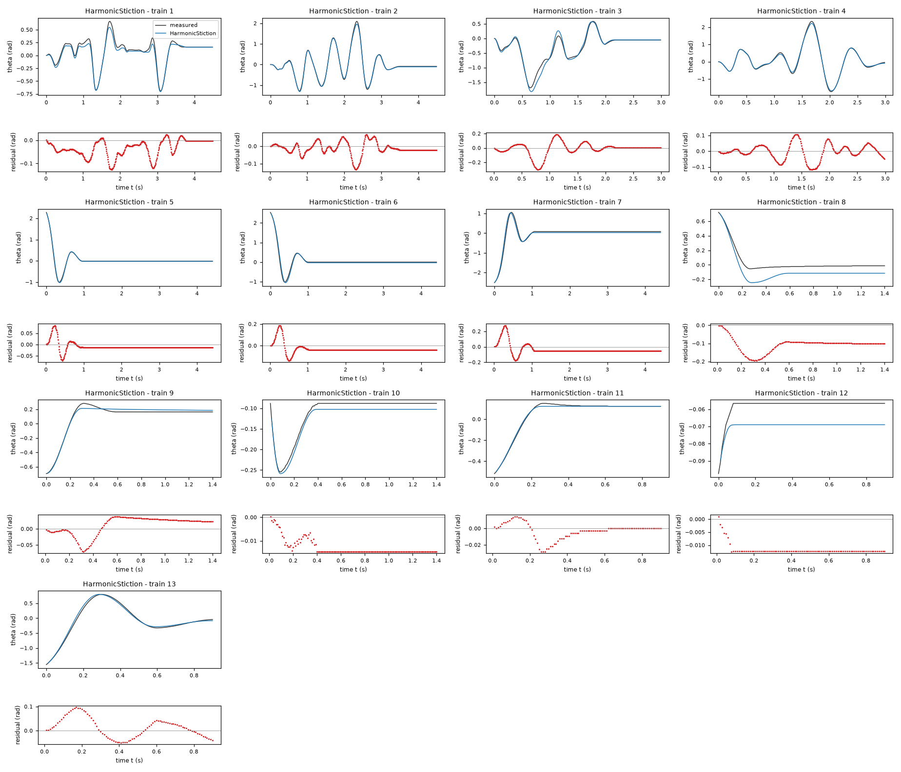

*Candidate HarmonicStiction, training data, trajectories 1, 2, 3, 4, 5, 6, 7, 8, 9, 10, 11, 12, 13. Upper axes: measured output theta (rad) and model output of HarmonicStiction; lower axes: residual (model output minus measured output, rad). Evaluation mode: simulation (initialized once per trajectory from the measured state at sample 0; classical fourth-order Runge-Kutta integration with 1 step(s) per sampling period T_s = 0.01 s and zero-order hold of the input; the model output is h(x[k], u[k])). Initialization: the first 1 sample(s) of each trajectory initialize the model and are excluded from the errors. Errors are computed on the samples 1: 1 to 449; 2: 1 to 449; 3: 1 to 299; 4: 1 to 299; 5: 1 to 441; 6: 1 to 441; 7: 1 to 441; 8: 1 to 140; 9: 1 to 140; 10: 1 to 140; 11: 1 to 90; 12: 1 to 90; 13: 1 to 90 (0-based sample indices). No numerical failure occurred.*

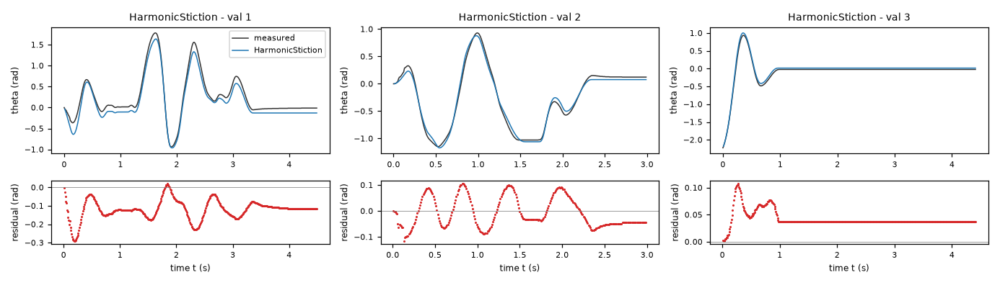

*Candidate HarmonicStiction, validation data, trajectories 1, 2, 3. Upper axes: measured output theta (rad) and model output of HarmonicStiction; lower axes: residual (model output minus measured output, rad). Evaluation mode: simulation (initialized once per trajectory from the measured state at sample 0; classical fourth-order Runge-Kutta integration with 1 step(s) per sampling period T_s = 0.01 s and zero-order hold of the input; the model output is h(x[k], u[k])). Initialization: the first 1 sample(s) of each trajectory initialize the model and are excluded from the errors. Errors are computed on the samples 1: 1 to 449; 2: 1 to 299; 3: 1 to 441 (0-based sample indices). No numerical failure occurred.*

### Candidate ProjectedAngleFriction

Position in the agent's order: 2. Status: evaluated.
File and expression checks: passed.
- `dtheta = omega`
- `domega = (a*u - g*sin(theta)) - b*omega - Min(Max((a*u - g*sin(theta)) + k*omega, -c*exp(h*cos(theta))), c*exp(h*cos(theta)))`
Complexity: 6 fitted, 0 fixed and 0 tied parameters; 0 non-integer numeric literals; 45 expression-tree nodes (SymPy tree, every operator, function, symbol and number counted once).
Structure group 2: `dtheta = omega`; `domega = P3*u - P5*sin(theta) - P6*omega - Min(P1*exp(P2*cos(theta)), Max(-P1*exp(P2*cos(theta)), P3*u + P4*omega - P5*sin(theta)))`

Requirements:

| id | type | outcome | status | method | detail |
|---|---|---|---|---|---|
| R1 | equation | proof | satisfied | evaluation of a constant | the quantity is identically zero on the domain |
| R2 | inequality | inconclusive | unresolved | SymPy simplification and extremum then sampling (10000 points, seed 20261009) | no violation found at the 10000 sampled points (largest value of Q -0.0, tolerance 0.0); this is not a proof |
| R3 | monotonicity | inconclusive | unresolved | interval arithmetic and symbolic simplification then sampling (10000 points, seed 20261009) | no violation found at the 10000 sampled points (largest value of Q 0.0, tolerance 0.0); this is not a proof |

Output errors on the training data (pooled RMSE: 0.0580329 rad):

| trajectory | scored samples | completed | RMSE (rad) | NRMSE | R² | failure |
|---|---|---|---|---|---|---|
| 1 | 449 | 449 | 0.0428415 | 0.167038 | 0.972098 | none |
| 2 | 449 | 449 | 0.0508133 | 0.0762442 | 0.994187 | none |
| 3 | 299 | 299 | 0.0820387 | 0.17371 | 0.969825 | none |
| 4 | 299 | 299 | 0.0561979 | 0.0685729 | 0.995298 | none |
| 5 | 441 | 441 | 0.0195961 | 0.0511978 | 0.997379 | none |
| 6 | 441 | 441 | 0.0570607 | 0.125012 | 0.984372 | none |
| 7 | 441 | 441 | 0.0720552 | 0.138877 | 0.980713 | none |
| 8 | 140 | 140 | 0.131932 | 0.803375 | 0.354589 | none |
| 9 | 140 | 140 | 0.026255 | 0.120058 | 0.985586 | none |
| 10 | 140 | 140 | 0.0363123 | 0.738523 | 0.454584 | none |
| 11 | 90 | 90 | 0.0189666 | 0.11524 | 0.98672 | none |
| 12 | 90 | 90 | 0.0151079 | 2.96104 | -7.76779 | none |
| 13 | 90 | 90 | 0.0485185 | 0.0893054 | 0.992025 | none |

Output errors on the validation data (pooled RMSE: 0.0865773 rad):

| trajectory | scored samples | completed | RMSE (rad) | NRMSE | R² | failure |
|---|---|---|---|---|---|---|
| 1 | 449 | 449 | 0.128359 | 0.234758 | 0.944889 | none |
| 2 | 299 | 299 | 0.0499278 | 0.0892969 | 0.992026 | none |
| 3 | 441 | 441 | 0.0417655 | 0.11112 | 0.987652 | none |

Sensitivity rank test (diagnostic; never excludes): targets domega on the train, val data (4714 rows, 0 dropped); analytic derivatives (SymPy), ties differentiated through their equations; scaling: rows of each target divided by the standard deviation of its measured column; columns divided by their Euclidean norm; rank threshold s_i / s_1 > 1e-08; singular values 1.64, 1.07, 1, 0.801, 0.632, 0.351; rank 6 of 6.

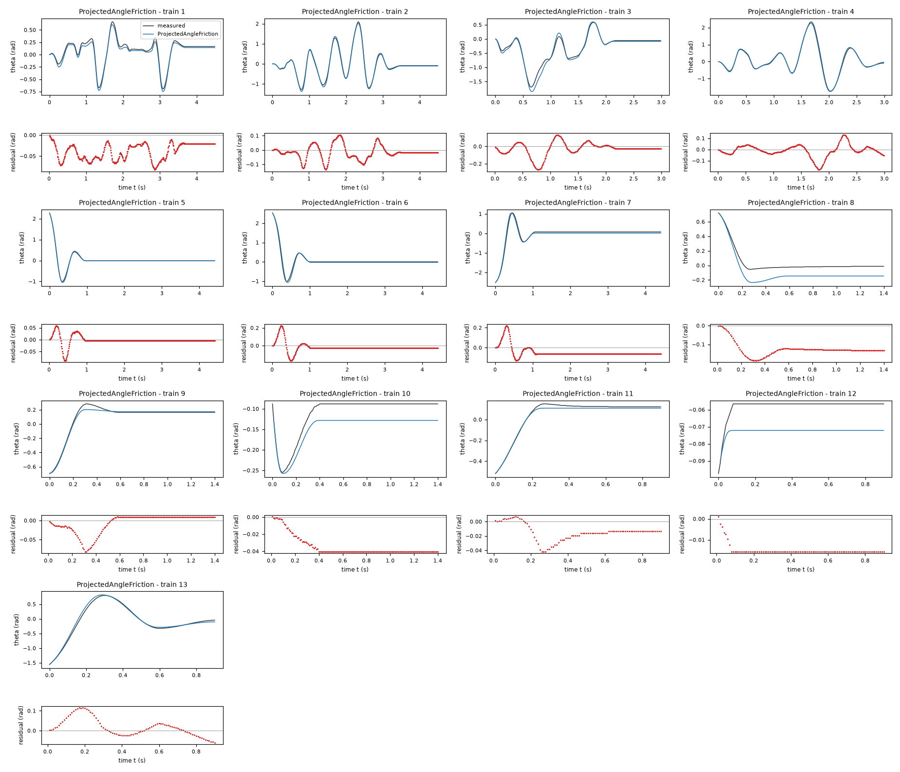

*Candidate ProjectedAngleFriction, training data, trajectories 1, 2, 3, 4, 5, 6, 7, 8, 9, 10, 11, 12, 13. Upper axes: measured output theta (rad) and model output of ProjectedAngleFriction; lower axes: residual (model output minus measured output, rad). Evaluation mode: simulation (initialized once per trajectory from the measured state at sample 0; classical fourth-order Runge-Kutta integration with 1 step(s) per sampling period T_s = 0.01 s and zero-order hold of the input; the model output is h(x[k], u[k])). Initialization: the first 1 sample(s) of each trajectory initialize the model and are excluded from the errors. Errors are computed on the samples 1: 1 to 449; 2: 1 to 449; 3: 1 to 299; 4: 1 to 299; 5: 1 to 441; 6: 1 to 441; 7: 1 to 441; 8: 1 to 140; 9: 1 to 140; 10: 1 to 140; 11: 1 to 90; 12: 1 to 90; 13: 1 to 90 (0-based sample indices). No numerical failure occurred.*

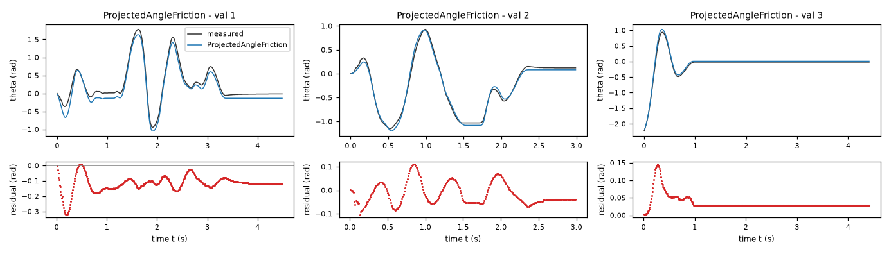

*Candidate ProjectedAngleFriction, validation data, trajectories 1, 2, 3. Upper axes: measured output theta (rad) and model output of ProjectedAngleFriction; lower axes: residual (model output minus measured output, rad). Evaluation mode: simulation (initialized once per trajectory from the measured state at sample 0; classical fourth-order Runge-Kutta integration with 1 step(s) per sampling period T_s = 0.01 s and zero-order hold of the input; the model output is h(x[k], u[k])). Initialization: the first 1 sample(s) of each trajectory initialize the model and are excluded from the errors. Errors are computed on the samples 1: 1 to 449; 2: 1 to 299; 3: 1 to 441 (0-based sample indices). No numerical failure occurred.*

### Candidate StribeckStiction

Position in the agent's order: 3. Status: evaluated.
File and expression checks: passed.
- `dtheta = omega`
- `domega = (a*u - g*sin(theta)) - b*omega - (c + s*exp(-(omega/ws)**2))*tanh(omega/v) - (1 - tanh(omega/v)**2)*Min(Max((a*u - g*sin(theta)), -(c + s)), (c + s))`
Complexity: 7 fitted, 0 fixed and 0 tied parameters; 0 non-integer numeric literals; 70 expression-tree nodes (SymPy tree, every operator, function, symbol and number counted once).
Structure group 3: `dtheta = omega`; `domega = P1*u - P2*omega - P3*sin(theta) - (1 - tanh(omega/P4)**2)*Min(P5 + P6, Max(-P5 - P6, P1*u - P3*sin(theta))) - (P5 + P6*exp(-omega**2/P7**2))*tanh(omega/P4)`

Requirements:

| id | type | outcome | status | method | detail |
|---|---|---|---|---|---|
| R1 | equation | proof | satisfied | evaluation of a constant | the quantity is identically zero on the domain |
| R2 | inequality | inconclusive | unresolved | interval arithmetic and symbolic simplification then sampling (10000 points, seed 20261009) | no violation found at the 10000 sampled points (largest value of Q -0.0, tolerance 0.0); this is not a proof |
| R3 | monotonicity | inconclusive | unresolved | interval arithmetic and symbolic simplification then sampling (10000 points, seed 20261009) | no violation found at the 10000 sampled points (largest value of Q -1.7641831972880162, tolerance 0.0); this is not a proof |

Output errors on the training data (pooled RMSE: 0.0664627 rad):

| trajectory | scored samples | completed | RMSE (rad) | NRMSE | R² | failure |
|---|---|---|---|---|---|---|
| 1 | 449 | 449 | 0.0422767 | 0.164836 | 0.972829 | none |
| 2 | 449 | 449 | 0.04746 | 0.0712127 | 0.994929 | none |
| 3 | 299 | 299 | 0.0839707 | 0.177801 | 0.968387 | none |
| 4 | 299 | 299 | 0.0725463 | 0.0885214 | 0.992164 | none |
| 5 | 441 | 441 | 0.0142141 | 0.0371366 | 0.998621 | none |
| 6 | 441 | 441 | 0.0312314 | 0.0684238 | 0.995318 | none |
| 7 | 441 | 441 | 0.123681 | 0.23838 | 0.943175 | none |
| 8 | 140 | 140 | 0.126098 | 0.767849 | 0.410408 | none |
| 9 | 140 | 140 | 0.0328413 | 0.150175 | 0.977447 | none |
| 10 | 140 | 140 | 0.020935 | 0.425778 | 0.818713 | none |
| 11 | 90 | 90 | 0.0262052 | 0.159222 | 0.974648 | none |
| 12 | 90 | 90 | 0.0119823 | 2.34844 | -4.51519 | none |
| 13 | 90 | 90 | 0.0501204 | 0.0922541 | 0.991489 | none |

Output errors on the validation data (pooled RMSE: 0.0867582 rad):

| trajectory | scored samples | completed | RMSE (rad) | NRMSE | R² | failure |
|---|---|---|---|---|---|---|
| 1 | 449 | 449 | 0.121203 | 0.221671 | 0.950862 | none |
| 2 | 299 | 299 | 0.0657155 | 0.117534 | 0.986186 | none |
| 3 | 441 | 441 | 0.0490837 | 0.130591 | 0.982946 | none |

Sensitivity rank test (diagnostic; never excludes): targets domega on the train, val data (4714 rows, 0 dropped); analytic derivatives (SymPy), ties differentiated through their equations; scaling: rows of each target divided by the standard deviation of its measured column; columns divided by their Euclidean norm; rank threshold s_i / s_1 > 1e-08; singular values 1.82, 1.08, 1.01, 0.849, 0.786, 0.376, 0.0307; rank 7 of 7.

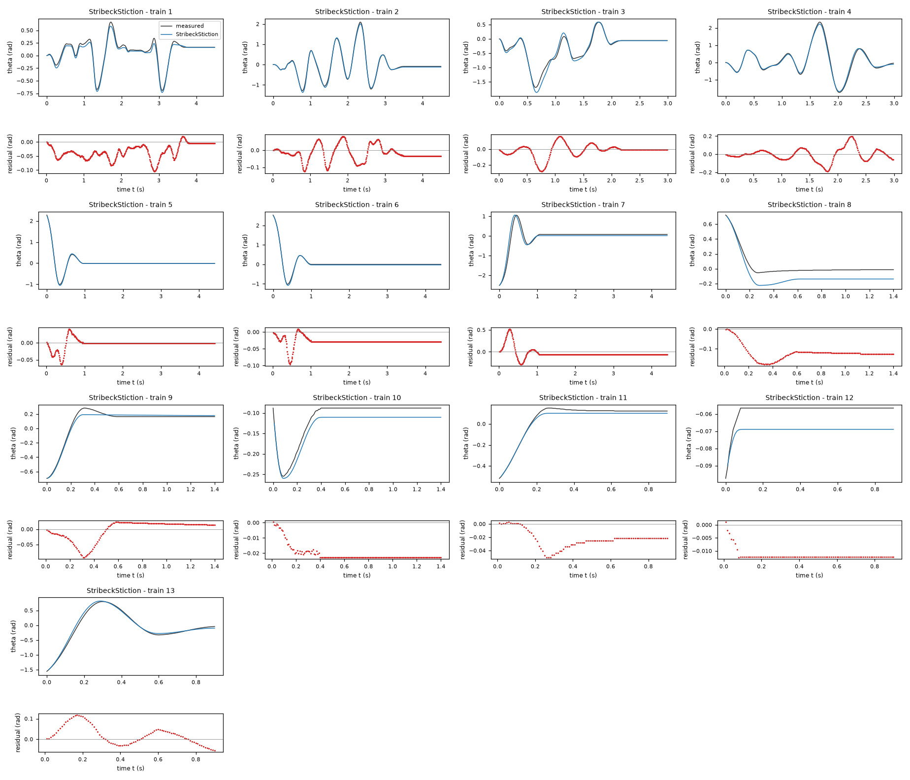

*Candidate StribeckStiction, training data, trajectories 1, 2, 3, 4, 5, 6, 7, 8, 9, 10, 11, 12, 13. Upper axes: measured output theta (rad) and model output of StribeckStiction; lower axes: residual (model output minus measured output, rad). Evaluation mode: simulation (initialized once per trajectory from the measured state at sample 0; classical fourth-order Runge-Kutta integration with 1 step(s) per sampling period T_s = 0.01 s and zero-order hold of the input; the model output is h(x[k], u[k])). Initialization: the first 1 sample(s) of each trajectory initialize the model and are excluded from the errors. Errors are computed on the samples 1: 1 to 449; 2: 1 to 449; 3: 1 to 299; 4: 1 to 299; 5: 1 to 441; 6: 1 to 441; 7: 1 to 441; 8: 1 to 140; 9: 1 to 140; 10: 1 to 140; 11: 1 to 90; 12: 1 to 90; 13: 1 to 90 (0-based sample indices). No numerical failure occurred.*

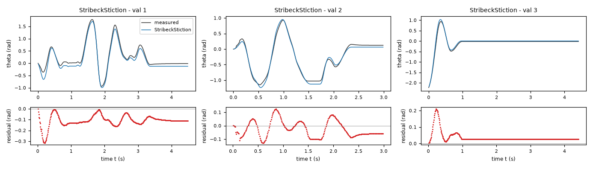

*Candidate StribeckStiction, validation data, trajectories 1, 2, 3. Upper axes: measured output theta (rad) and model output of StribeckStiction; lower axes: residual (model output minus measured output, rad). Evaluation mode: simulation (initialized once per trajectory from the measured state at sample 0; classical fourth-order Runge-Kutta integration with 1 step(s) per sampling period T_s = 0.01 s and zero-order hold of the input; the model output is h(x[k], u[k])). Initialization: the first 1 sample(s) of each trajectory initialize the model and are excluded from the errors. Errors are computed on the samples 1: 1 to 449; 2: 1 to 299; 3: 1 to 441 (0-based sample indices). No numerical failure occurred.*

### Candidate SmoothCoulomb

Position in the agent's order: 4. Status: evaluated.
File and expression checks: passed.
- `dtheta = omega`
- `domega = (a*u - g*sin(theta)) - b*omega - c*tanh(omega/v)`
Complexity: 5 fitted, 0 fixed and 0 tied parameters; 0 non-integer numeric literals; 23 expression-tree nodes (SymPy tree, every operator, function, symbol and number counted once).
Structure group 4: `dtheta = omega`; `domega = P1*u - P2*omega - P3*tanh(omega/P4) - P5*sin(theta)`

Requirements:

| id | type | outcome | status | method | detail |
|---|---|---|---|---|---|
| R1 | equation | proof | satisfied | evaluation of a constant | the quantity is identically zero on the domain |
| R2 | inequality | proof | satisfied | interval arithmetic (branch and bound) | verified enclosures on 3 sub-box(es) covering the domain do not exceed the tolerance 0.0 |
| R3 | monotonicity | proof | satisfied | evaluation of a constant | the quantity reduces to the constant -28.597941270377575, which does not exceed the tolerance 0.0 |

Output errors on the training data (pooled RMSE: 0.0664657 rad):

| trajectory | scored samples | completed | RMSE (rad) | NRMSE | R² | failure |
|---|---|---|---|---|---|---|
| 1 | 449 | 449 | 0.0506252 | 0.197387 | 0.961039 | none |
| 2 | 449 | 449 | 0.0505891 | 0.0759078 | 0.994238 | none |
| 3 | 299 | 299 | 0.0774988 | 0.164097 | 0.973072 | none |
| 4 | 299 | 299 | 0.0611153 | 0.0745732 | 0.994439 | none |
| 5 | 441 | 441 | 0.0215893 | 0.0564055 | 0.996818 | none |
| 6 | 441 | 441 | 0.0239556 | 0.0524834 | 0.997245 | none |
| 7 | 441 | 441 | 0.127226 | 0.245213 | 0.939871 | none |
| 8 | 140 | 140 | 0.104031 | 0.63348 | 0.598704 | none |
| 9 | 140 | 140 | 0.0650469 | 0.297443 | 0.911528 | none |
| 10 | 140 | 140 | 0.0231545 | 0.470919 | 0.778235 | none |
| 11 | 90 | 90 | 0.050998 | 0.309862 | 0.903986 | none |
| 12 | 90 | 90 | 0.0101931 | 1.99778 | -2.99113 | none |
| 13 | 90 | 90 | 0.0543986 | 0.100129 | 0.989974 | none |

Output errors on the validation data (pooled RMSE: 0.0823914 rad):

| trajectory | scored samples | completed | RMSE (rad) | NRMSE | R² | failure |
|---|---|---|---|---|---|---|
| 1 | 449 | 449 | 0.110929 | 0.20288 | 0.95884 | none |
| 2 | 299 | 299 | 0.0731801 | 0.130884 | 0.982869 | none |
| 3 | 441 | 441 | 0.0462932 | 0.123167 | 0.98483 | none |

Sensitivity rank test (diagnostic; never excludes): targets domega on the train, val data (4714 rows, 0 dropped); analytic derivatives (SymPy), ties differentiated through their equations; scaling: rows of each target divided by the standard deviation of its measured column; columns divided by their Euclidean norm; rank threshold s_i / s_1 > 1e-08; singular values 1.42, 1.08, 0.995, 0.772, 0.468; rank 5 of 5.

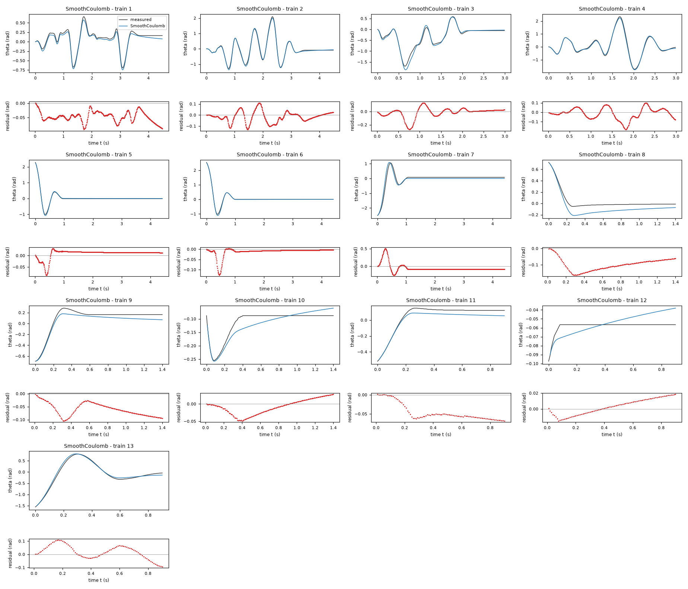

*Candidate SmoothCoulomb, training data, trajectories 1, 2, 3, 4, 5, 6, 7, 8, 9, 10, 11, 12, 13. Upper axes: measured output theta (rad) and model output of SmoothCoulomb; lower axes: residual (model output minus measured output, rad). Evaluation mode: simulation (initialized once per trajectory from the measured state at sample 0; classical fourth-order Runge-Kutta integration with 1 step(s) per sampling period T_s = 0.01 s and zero-order hold of the input; the model output is h(x[k], u[k])). Initialization: the first 1 sample(s) of each trajectory initialize the model and are excluded from the errors. Errors are computed on the samples 1: 1 to 449; 2: 1 to 449; 3: 1 to 299; 4: 1 to 299; 5: 1 to 441; 6: 1 to 441; 7: 1 to 441; 8: 1 to 140; 9: 1 to 140; 10: 1 to 140; 11: 1 to 90; 12: 1 to 90; 13: 1 to 90 (0-based sample indices). No numerical failure occurred.*

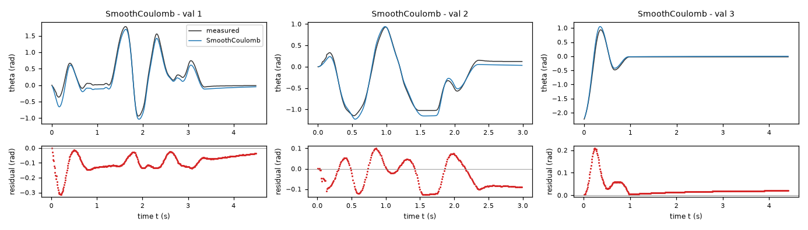

*Candidate SmoothCoulomb, validation data, trajectories 1, 2, 3. Upper axes: measured output theta (rad) and model output of SmoothCoulomb; lower axes: residual (model output minus measured output, rad). Evaluation mode: simulation (initialized once per trajectory from the measured state at sample 0; classical fourth-order Runge-Kutta integration with 1 step(s) per sampling period T_s = 0.01 s and zero-order hold of the input; the model output is h(x[k], u[k])). Initialization: the first 1 sample(s) of each trajectory initialize the model and are excluded from the errors. Errors are computed on the samples 1: 1 to 449; 2: 1 to 299; 3: 1 to 441 (0-based sample indices). No numerical failure occurred.*

### Candidate AngleDamping

Position in the agent's order: 5. Status: evaluated.
File and expression checks: passed.
- `dtheta = omega`
- `domega = (a*u - g*sin(theta)) - b*exp(h*cos(theta))*omega - c*tanh(omega/v) - (1 - tanh(omega/v)**2)*Min(Max((a*u - g*sin(theta)), -(c)), (c))`
Complexity: 6 fitted, 0 fixed and 0 tied parameters; 0 non-integer numeric literals; 57 expression-tree nodes (SymPy tree, every operator, function, symbol and number counted once).
Structure group 5: `dtheta = omega`; `domega = P1*u - P2*tanh(omega/P3) - P4*sin(theta) - P5*omega*exp(P6*cos(theta)) - (1 - tanh(omega/P3)**2)*Min(P2, Max(-P2, P1*u - P4*sin(theta)))`

Requirements:

| id | type | outcome | status | method | detail |
|---|---|---|---|---|---|
| R1 | equation | proof | satisfied | evaluation of a constant | the quantity is identically zero on the domain |
| R2 | inequality | inconclusive | unresolved | interval arithmetic and symbolic simplification then sampling (10000 points, seed 20261009) | no violation found at the 10000 sampled points (largest value of Q -0.0, tolerance 0.0); this is not a proof |
| R3 | monotonicity | inconclusive | unresolved | interval arithmetic and symbolic simplification then sampling (10000 points, seed 20261009) | no violation found at the 10000 sampled points (largest value of Q -1.7993674757097935, tolerance 0.0); this is not a proof |

Output errors on the training data (pooled RMSE: 0.0612953 rad):

| trajectory | scored samples | completed | RMSE (rad) | NRMSE | R² | failure |
|---|---|---|---|---|---|---|
| 1 | 449 | 449 | 0.0457417 | 0.178346 | 0.968193 | none |
| 2 | 449 | 449 | 0.0506029 | 0.0759286 | 0.994235 | none |
| 3 | 299 | 299 | 0.0773124 | 0.163703 | 0.973201 | none |
| 4 | 299 | 299 | 0.0731961 | 0.0893143 | 0.992023 | none |
| 5 | 441 | 441 | 0.0240871 | 0.0629314 | 0.99604 | none |
| 6 | 441 | 441 | 0.056777 | 0.124391 | 0.984527 | none |
| 7 | 441 | 441 | 0.0817169 | 0.157499 | 0.975194 | none |
| 8 | 140 | 140 | 0.135061 | 0.822431 | 0.323607 | none |
| 9 | 140 | 140 | 0.0356083 | 0.162828 | 0.973487 | none |
| 10 | 140 | 140 | 0.0328117 | 0.667327 | 0.554675 | none |
| 11 | 90 | 90 | 0.0146337 | 0.0889138 | 0.992094 | none |
| 12 | 90 | 90 | 0.0141991 | 2.78293 | -6.74471 | none |
| 13 | 90 | 90 | 0.0426358 | 0.0784775 | 0.993841 | none |

Output errors on the validation data (pooled RMSE: 0.0881606 rad):

| trajectory | scored samples | completed | RMSE (rad) | NRMSE | R² | failure |
|---|---|---|---|---|---|---|
| 1 | 449 | 449 | 0.129315 | 0.236506 | 0.944065 | none |
| 2 | 299 | 299 | 0.0588912 | 0.105328 | 0.988906 | none |
| 3 | 441 | 441 | 0.0397266 | 0.105696 | 0.988828 | none |

Sensitivity rank test (diagnostic; never excludes): targets domega on the train, val data (4714 rows, 0 dropped); analytic derivatives (SymPy), ties differentiated through their equations; scaling: rows of each target divided by the standard deviation of its measured column; columns divided by their Euclidean norm; rank threshold s_i / s_1 > 1e-08; singular values 1.6, 1.08, 1.01, 0.815, 0.582, 0.528; rank 6 of 6.

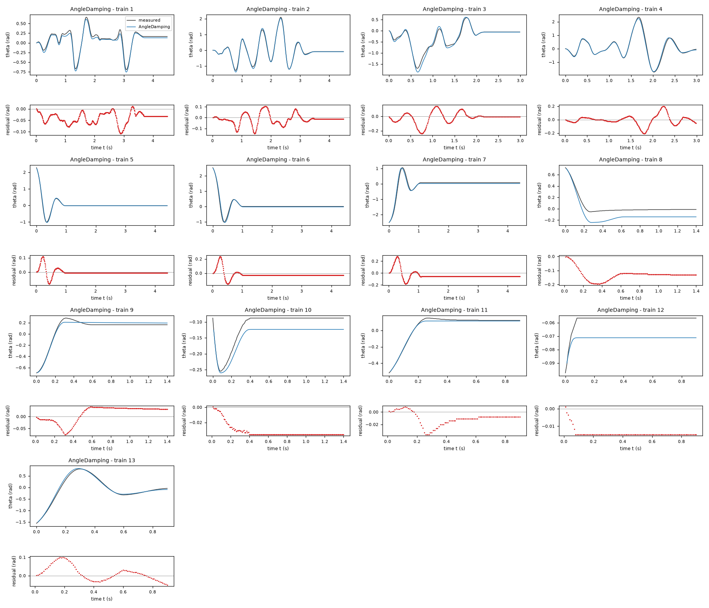

*Candidate AngleDamping, training data, trajectories 1, 2, 3, 4, 5, 6, 7, 8, 9, 10, 11, 12, 13. Upper axes: measured output theta (rad) and model output of AngleDamping; lower axes: residual (model output minus measured output, rad). Evaluation mode: simulation (initialized once per trajectory from the measured state at sample 0; classical fourth-order Runge-Kutta integration with 1 step(s) per sampling period T_s = 0.01 s and zero-order hold of the input; the model output is h(x[k], u[k])). Initialization: the first 1 sample(s) of each trajectory initialize the model and are excluded from the errors. Errors are computed on the samples 1: 1 to 449; 2: 1 to 449; 3: 1 to 299; 4: 1 to 299; 5: 1 to 441; 6: 1 to 441; 7: 1 to 441; 8: 1 to 140; 9: 1 to 140; 10: 1 to 140; 11: 1 to 90; 12: 1 to 90; 13: 1 to 90 (0-based sample indices). No numerical failure occurred.*

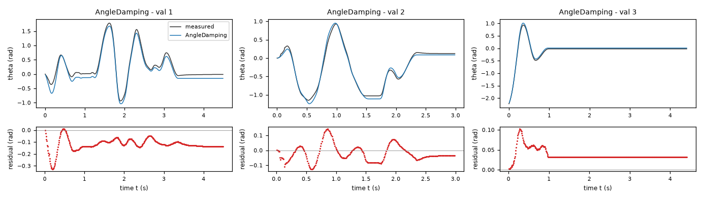

*Candidate AngleDamping, validation data, trajectories 1, 2, 3. Upper axes: measured output theta (rad) and model output of AngleDamping; lower axes: residual (model output minus measured output, rad). Evaluation mode: simulation (initialized once per trajectory from the measured state at sample 0; classical fourth-order Runge-Kutta integration with 1 step(s) per sampling period T_s = 0.01 s and zero-order hold of the input; the model output is h(x[k], u[k])). Initialization: the first 1 sample(s) of each trajectory initialize the model and are excluded from the errors. Errors are computed on the samples 1: 1 to 449; 2: 1 to 299; 3: 1 to 441 (0-based sample indices). No numerical failure occurred.*

### Candidate MotorSaturation

Position in the agent's order: 6. Status: evaluated.
File and expression checks: passed.
- `dtheta = omega`
- `domega = (a*us*tanh(u/us) - g*sin(theta)) - b*omega - c*tanh(omega/v) - (1 - tanh(omega/v)**2)*Min(Max((a*us*tanh(u/us) - g*sin(theta)), -(c)), (c))`
Complexity: 6 fitted, 0 fixed and 0 tied parameters; 0 non-integer numeric literals; 64 expression-tree nodes (SymPy tree, every operator, function, symbol and number counted once).
Structure group 6: `dtheta = omega`; `domega = -P1*omega - P2*tanh(omega/P3) - P4*sin(theta) + P5*P6*tanh(u/P6) - (1 - tanh(omega/P3)**2)*Min(P2, Max(-P2, -P4*sin(theta) + P5*P6*tanh(u/P6)))`

Requirements:

| id | type | outcome | status | method | detail |
|---|---|---|---|---|---|
| R1 | equation | proof | satisfied | evaluation of a constant | the quantity is identically zero on the domain |
| R2 | inequality | inconclusive | unresolved | interval arithmetic and symbolic simplification then sampling (10000 points, seed 20261009) | no violation found at the 10000 sampled points (largest value of Q -0.0, tolerance 0.0); this is not a proof |
| R3 | monotonicity | inconclusive | unresolved | interval arithmetic and symbolic simplification then sampling (10000 points, seed 20261009) | no violation found at the 10000 sampled points (largest value of Q -1.8281065234415372, tolerance 0.0); this is not a proof |

Output errors on the training data (pooled RMSE: 0.0630668 rad):

| trajectory | scored samples | completed | RMSE (rad) | NRMSE | R² | failure |
|---|---|---|---|---|---|---|
| 1 | 449 | 449 | 0.043216 | 0.168498 | 0.971608 | none |
| 2 | 449 | 449 | 0.0578428 | 0.0867919 | 0.992467 | none |
| 3 | 299 | 299 | 0.0490571 | 0.103875 | 0.98921 | none |
| 4 | 299 | 299 | 0.0503565 | 0.0614453 | 0.996224 | none |
| 5 | 441 | 441 | 0.0109986 | 0.0287355 | 0.999174 | none |
| 6 | 441 | 441 | 0.0297591 | 0.0651983 | 0.995749 | none |
| 7 | 441 | 441 | 0.125083 | 0.241083 | 0.941879 | none |
| 8 | 140 | 140 | 0.128601 | 0.783094 | 0.386765 | none |
| 9 | 140 | 140 | 0.0329397 | 0.150625 | 0.977312 | none |
| 10 | 140 | 140 | 0.0211254 | 0.42965 | 0.815401 | none |
| 11 | 90 | 90 | 0.0177922 | 0.108105 | 0.988313 | none |
| 12 | 90 | 90 | 0.0123238 | 2.41538 | -4.83406 | none |
| 13 | 90 | 90 | 0.0497286 | 0.0915329 | 0.991622 | none |

Output errors on the validation data (pooled RMSE: 0.0923499 rad):

| trajectory | scored samples | completed | RMSE (rad) | NRMSE | R² | failure |
|---|---|---|---|---|---|---|
| 1 | 449 | 449 | 0.128023 | 0.234145 | 0.945176 | none |
| 2 | 299 | 299 | 0.0771641 | 0.13801 | 0.980953 | none |
| 3 | 441 | 441 | 0.0476416 | 0.126754 | 0.983933 | none |

Sensitivity rank test (diagnostic; never excludes): targets domega on the train, val data (4714 rows, 0 dropped); analytic derivatives (SymPy), ties differentiated through their equations; scaling: rows of each target divided by the standard deviation of its measured column; columns divided by their Euclidean norm; rank threshold s_i / s_1 > 1e-08; singular values 1.57, 1.18, 1.02, 0.839, 0.521, 0.326; rank 6 of 6.

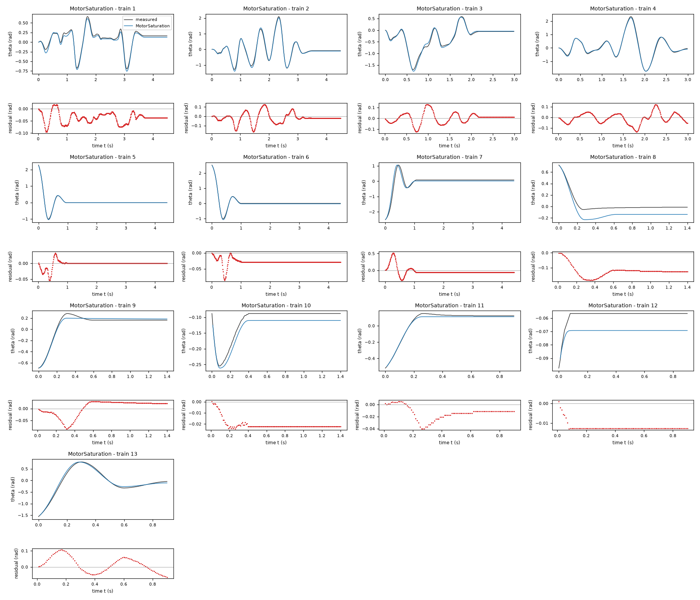

*Candidate MotorSaturation, training data, trajectories 1, 2, 3, 4, 5, 6, 7, 8, 9, 10, 11, 12, 13. Upper axes: measured output theta (rad) and model output of MotorSaturation; lower axes: residual (model output minus measured output, rad). Evaluation mode: simulation (initialized once per trajectory from the measured state at sample 0; classical fourth-order Runge-Kutta integration with 1 step(s) per sampling period T_s = 0.01 s and zero-order hold of the input; the model output is h(x[k], u[k])). Initialization: the first 1 sample(s) of each trajectory initialize the model and are excluded from the errors. Errors are computed on the samples 1: 1 to 449; 2: 1 to 449; 3: 1 to 299; 4: 1 to 299; 5: 1 to 441; 6: 1 to 441; 7: 1 to 441; 8: 1 to 140; 9: 1 to 140; 10: 1 to 140; 11: 1 to 90; 12: 1 to 90; 13: 1 to 90 (0-based sample indices). No numerical failure occurred.*

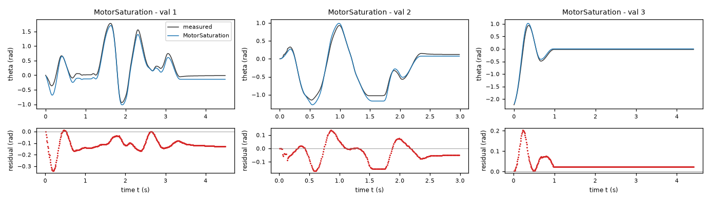

*Candidate MotorSaturation, validation data, trajectories 1, 2, 3. Upper axes: measured output theta (rad) and model output of MotorSaturation; lower axes: residual (model output minus measured output, rad). Evaluation mode: simulation (initialized once per trajectory from the measured state at sample 0; classical fourth-order Runge-Kutta integration with 1 step(s) per sampling period T_s = 0.01 s and zero-order hold of the input; the model output is h(x[k], u[k])). Initialization: the first 1 sample(s) of each trajectory initialize the model and are excluded from the errors. Errors are computed on the samples 1: 1 to 449; 2: 1 to 299; 3: 1 to 441 (0-based sample indices). No numerical failure occurred.*
