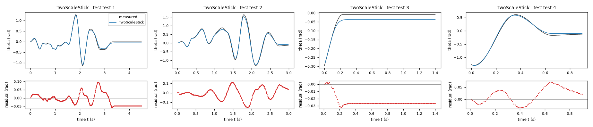
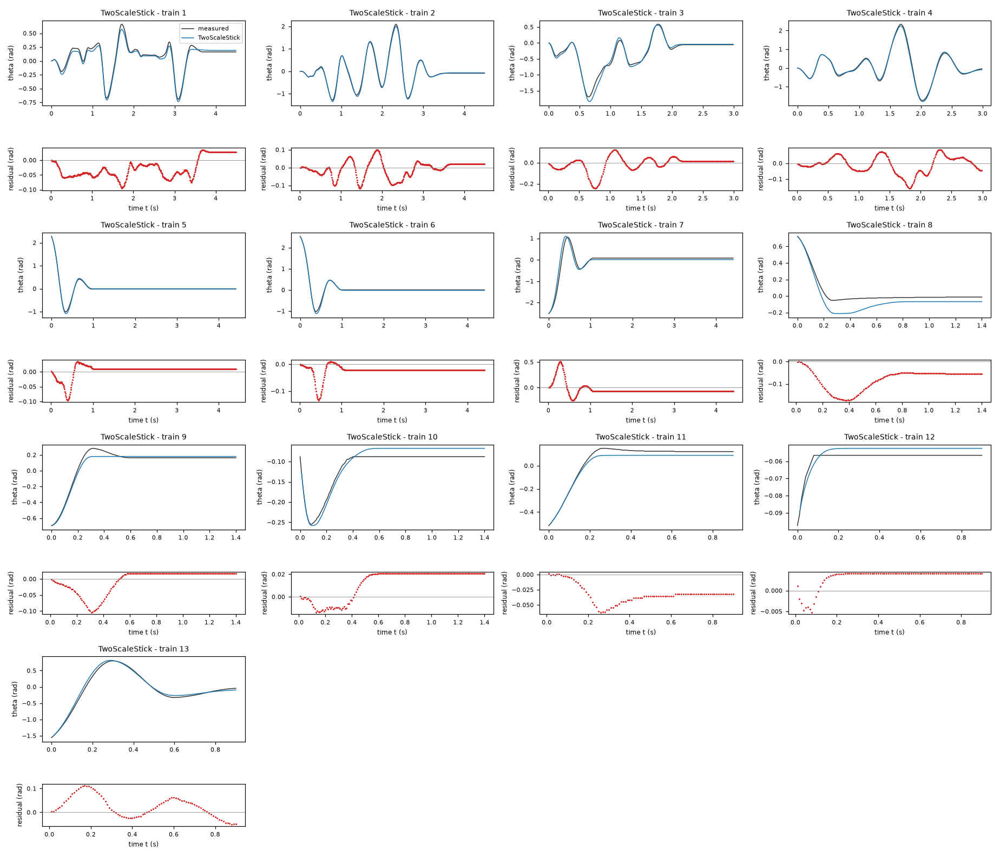
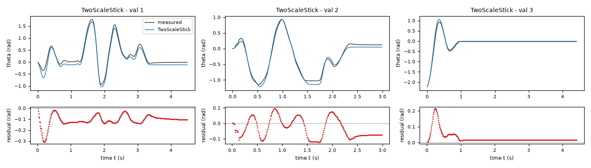
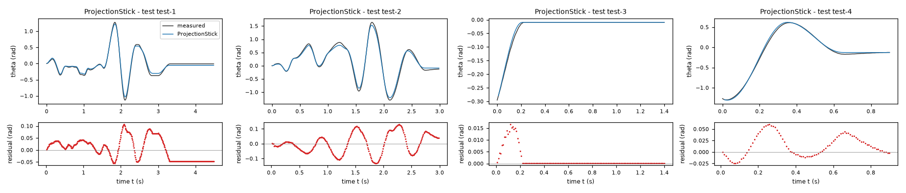
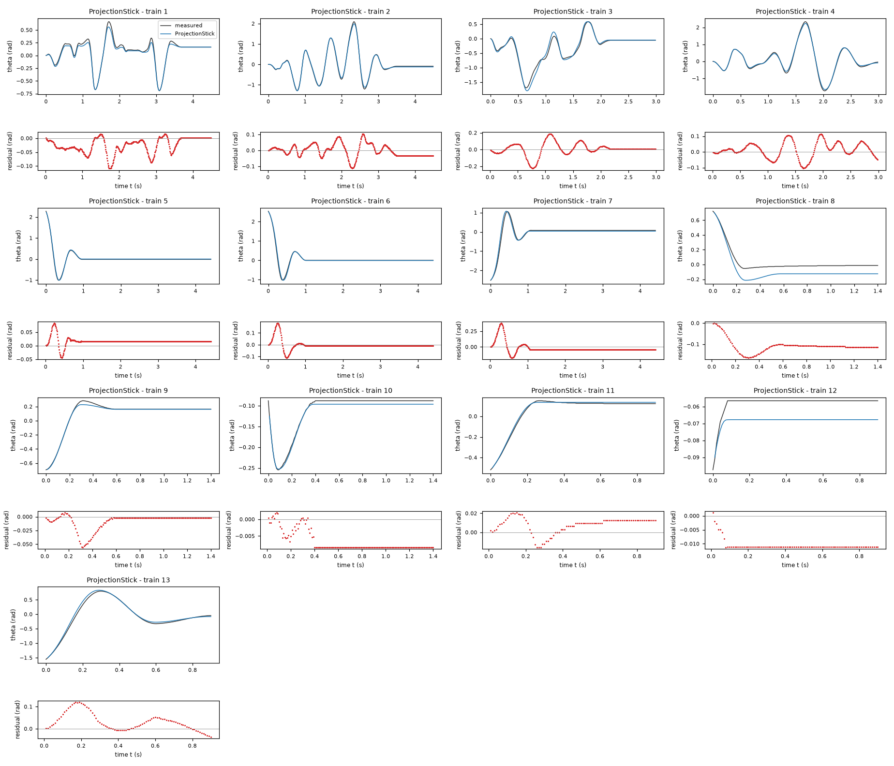
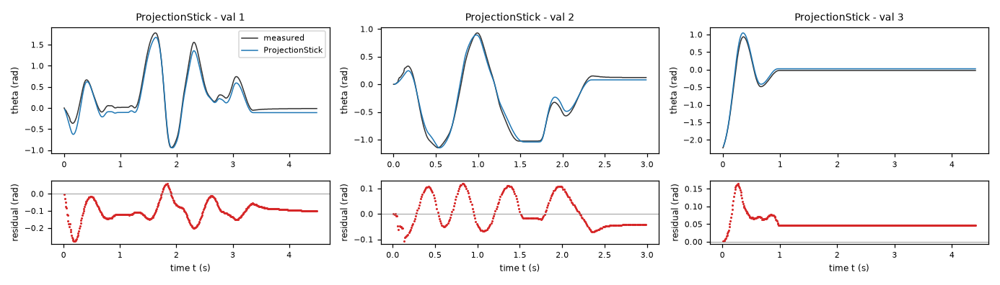
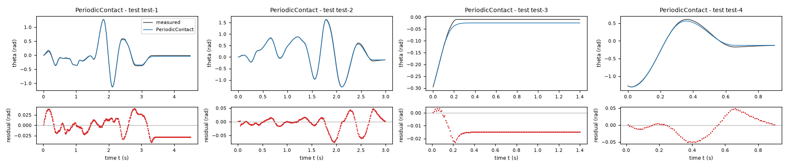
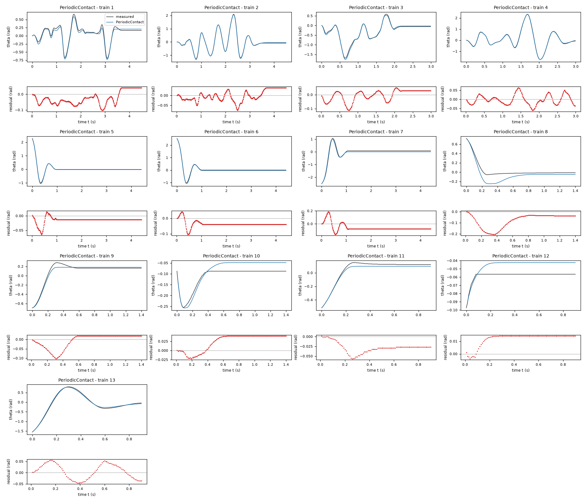
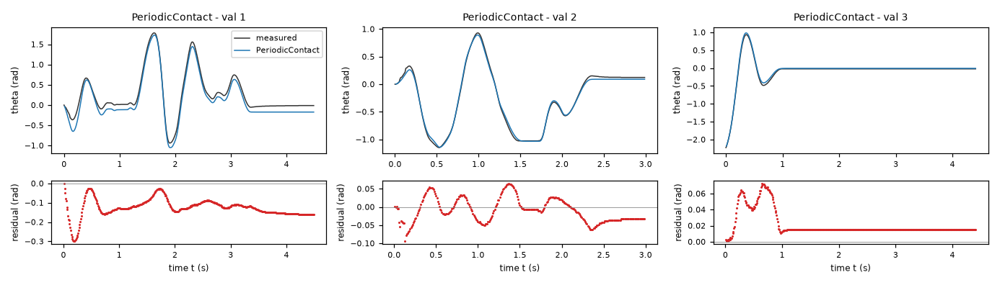

# Evaluation report: task friction-driven

Terms. The harness is the software of ASPIRE that checks and evaluates the candidate models; a candidate is one proposed model; the pool is the set of candidates of one round. Sealed data (test data, reference expression) are inaccessible to the agent. This report contains results on sealed data and is not shown to the agent.

Evaluation mode: simulation (initialized once per trajectory from the measured state at sample 0; classical fourth-order Runge-Kutta integration with 1 step(s) per sampling period T_s = 0.01 s and zero-order hold of the input; the model output is h(x[k], u[k])).
Error measures: for one trajectory with scoring interval I of N samples, measured output y[k] (theta, rad) and model output ŷ[k], SSE = Σ_(k∈I) (ŷ[k] − y[k])²; RMSE = sqrt(SSE/N), in rad; NRMSE = RMSE/σ, with μ and σ the mean and the population standard deviation of y on I; R² = 1 − SSE / Σ_(k∈I) (y[k] − μ)²; NRMSE and R² are not applicable when σ = 0. The pooled RMSE over several trajectories is S = sqrt(ΣSSE / ΣN); on the test data it is the ranking score.
Numerical failure limits: theta in [-1000, 1000] rad; omega in [-1000, 1000] rad/s; evaluation time limit 60 s per candidate and data group; symbolic time limit 10 s per verification.
Discontinuous expressions: expressions with jumps (Piecewise, sign) are evaluated pointwise at the sample instants and Runge-Kutta stages; no event detection or step refinement is applied at a jump.
Harness version 0.1.0.dev0; NumPy 2.5.1; SymPy 1.14.0.

## Pool

| category | count |
|---|---|
| candidates proposed | 3 |
| accepted by the file and expression checks | 3 |
| outside the pool limit of 10 (not evaluated) | 0 |
| evaluated | 3 |
| excluded by physical requirements | 0 |
| failed numerically on training or validation data | 0 |
| failed numerically on test data | 0 |
| eligible for ranking | 3 |

Note: the categories overlap: the candidates accepted by the checks include those outside the pool limit, and a candidate can be both excluded by requirements and failed numerically; the counts need not sum to the pool size.

Distinct structures: 3 among 3 evaluated candidates; groups: TwoScaleStick; ProjectionStick; PeriodicContact. Convention: ties resolved, fixed values kept, given constants kept, fitted parameters renamed P1..Pn in order of first occurrence; equal when a one-to-one renaming of the fitted parameters makes every expression identical in SymPy's canonical form.

### Recommendation of the agent

Recommended candidate: TwoScaleStick. The agent's reason: `TwoScaleStick` is the six-parameter symmetric Coulomb-viscous static model with independent regularization speeds. It had the lowest three-fold trajectory cross-validation angle RMSE among the retained structures: 0.076358 rad across the supplied training and validation files, compared with 0.080005 rad for `ProjectionStick` and 0.080707 rad for `PeriodicContact`. All three preserve the nine observed stationary free-response endpoints in 20 s unforced persistence tests and analytically satisfy the restoring-sign and nondecreasing input constraints. The simpler symmetric model is recommended rather than the most flexible angular-friction structure, whose lower pooled fitting error is not independently predictive. The projection model is a distinct physically defensible sticking alternative. Scores used for selection are not untouched test scores.
- Harness note: the recommendation involves unresolved formal requirement(s) R2, R3, for human assessment.
- Test score S of the recommended candidate (practical selection): 0.0441761 rad; eligible: True; rank in the oracle-based selection: 2.

## Oracle-based selection on test data

Label: oracle-based selection on test data. Candidates considered: 3 eligible of 3 evaluated. Criterion: pooled test RMSE S, increasing, the pooled RMSE over the test trajectories test-1 (449 scored samples), test-2 (299 scored samples), test-3 (140 scored samples), test-4 (90 scored samples). Tie rule: |S_a - S_b| <= 1e-12 * max(S_a, S_b) for consecutive candidates; tied candidates share a rank. This ranking selects on the test data. It measures whether the pool contains an accurate model, not whether the agent can recognize that model without test data. A rank is not evidence of physical admissibility: each entry carries its unresolved requirements and any violation allowed by the user.

| rank | candidate | S (rad) | unresolved requirements | violations allowed by the user |
|---|---|---|---|---|
| 1 | PeriodicContact | 0.0227807 | R2, R3 | none |
| 2 | TwoScaleStick | 0.0441761 | R2, R3 | none |
| 3 | ProjectionStick | 0.0487403 | R2, R3 | none |

## Candidates

### Candidate TwoScaleStick

Position in the agent's order: 1. Status: evaluated.
File and expression checks: passed.
- `dtheta = omega`
- `domega = a*u-g*sin(theta)-b*omega-c*tanh(omega/v)-exp(-(omega/vs)**2)*Min(Max(a*u-g*sin(theta),-c),c)`
Complexity: 6 fitted, 0 fixed and 0 tied parameters; 0 non-integer numeric literals; 49 expression-tree nodes (SymPy tree, every operator, function, symbol and number counted once).
Structure group 1: `dtheta = omega`; `domega = P1*u - P2*omega - P3*tanh(omega/P4) - P5*sin(theta) - exp(-omega**2/P6**2)*Min(P3, Max(-P3, P1*u - P5*sin(theta)))`

Requirements:

| id | type | outcome | status | method | detail |
|---|---|---|---|---|---|
| R1 | equation | proof | satisfied | evaluation of a constant | the quantity is identically zero on the domain |
| R2 | inequality | inconclusive | unresolved | interval arithmetic and symbolic simplification then sampling (10000 points, seed 20261009) | no violation found at the 10000 sampled points (largest value of Q -0.0, tolerance 0.0); this is not a proof |
| R3 | monotonicity | inconclusive | unresolved | interval arithmetic and symbolic simplification then sampling (10000 points, seed 20261009) | no violation found at the 10000 sampled points (largest value of Q -0.9656824266290158, tolerance 0.0); this is not a proof |

Output errors on the test data (sealed) (pooled RMSE: 0.0441761 rad):

| trajectory | scored samples | completed | RMSE (rad) | NRMSE | R² | failure |
|---|---|---|---|---|---|---|
| test-1 | 449 | 449 | 0.0361479 | 0.0957333 | 0.990835 | none |
| test-2 | 299 | 299 | 0.0611848 | 0.0989983 | 0.990199 | none |
| test-3 | 140 | 140 | 0.0254992 | 0.481713 | 0.767953 | none |
| test-4 | 90 | 90 | 0.0352041 | 0.0666709 | 0.995555 | none |

Output errors on the training data (pooled RMSE: 0.0615559 rad):

| trajectory | scored samples | completed | RMSE (rad) | NRMSE | R² | failure |
|---|---|---|---|---|---|---|
| 1 | 449 | 449 | 0.0432851 | 0.168768 | 0.971518 | none |
| 2 | 449 | 449 | 0.0459898 | 0.0690067 | 0.995238 | none |
| 3 | 299 | 299 | 0.0704728 | 0.149221 | 0.977733 | none |
| 4 | 299 | 299 | 0.0550518 | 0.0671744 | 0.995488 | none |
| 5 | 441 | 441 | 0.0211301 | 0.0552056 | 0.996952 | none |
| 6 | 441 | 441 | 0.0310543 | 0.0680358 | 0.995371 | none |
| 7 | 441 | 441 | 0.123708 | 0.238431 | 0.943151 | none |
| 8 | 140 | 140 | 0.0913473 | 0.556242 | 0.690594 | none |
| 9 | 140 | 140 | 0.0366297 | 0.167498 | 0.971944 | none |
| 10 | 140 | 140 | 0.0173122 | 0.352098 | 0.876027 | none |
| 11 | 90 | 90 | 0.035837 | 0.217744 | 0.952587 | none |
| 12 | 90 | 90 | 0.00390114 | 0.764597 | 0.415391 | none |
| 13 | 90 | 90 | 0.0503281 | 0.0926363 | 0.991419 | none |

Output errors on the validation data (pooled RMSE: 0.0855727 rad):

| trajectory | scored samples | completed | RMSE (rad) | NRMSE | R² | failure |
|---|---|---|---|---|---|---|
| 1 | 449 | 449 | 0.11808 | 0.215959 | 0.953362 | none |
| 2 | 299 | 299 | 0.0698049 | 0.124848 | 0.984413 | none |
| 3 | 441 | 441 | 0.0473665 | 0.126022 | 0.984118 | none |

Sensitivity rank test (diagnostic; never excludes): targets domega on the train, val data (4714 rows, 0 dropped); analytic derivatives (SymPy), ties differentiated through their equations; scaling: rows of each target divided by the standard deviation of its measured column; columns divided by their Euclidean norm; rank threshold s_i / s_1 > 1e-08; singular values 1.47, 1.13, 1.03, 0.874, 0.757, 0.398; rank 6 of 6.
Reference comparison: not applicable (the task has no reference expression).
Eligible for ranking: True.

*Candidate TwoScaleStick, test data (sealed), trajectories test-1, test-2, test-3, test-4. Upper axes: measured output theta (rad) and model output of TwoScaleStick; lower axes: residual (model output minus measured output, rad). Evaluation mode: simulation (initialized once per trajectory from the measured state at sample 0; classical fourth-order Runge-Kutta integration with 1 step(s) per sampling period T_s = 0.01 s and zero-order hold of the input; the model output is h(x[k], u[k])). Initialization: the first 1 sample(s) of each trajectory initialize the model and are excluded from the errors. Errors are computed on the samples test-1: 1 to 449; test-2: 1 to 299; test-3: 1 to 140; test-4: 1 to 90 (0-based sample indices). No numerical failure occurred.*

*Candidate TwoScaleStick, training data, trajectories 1, 2, 3, 4, 5, 6, 7, 8, 9, 10, 11, 12, 13. Upper axes: measured output theta (rad) and model output of TwoScaleStick; lower axes: residual (model output minus measured output, rad). Evaluation mode: simulation (initialized once per trajectory from the measured state at sample 0; classical fourth-order Runge-Kutta integration with 1 step(s) per sampling period T_s = 0.01 s and zero-order hold of the input; the model output is h(x[k], u[k])). Initialization: the first 1 sample(s) of each trajectory initialize the model and are excluded from the errors. Errors are computed on the samples 1: 1 to 449; 2: 1 to 449; 3: 1 to 299; 4: 1 to 299; 5: 1 to 441; 6: 1 to 441; 7: 1 to 441; 8: 1 to 140; 9: 1 to 140; 10: 1 to 140; 11: 1 to 90; 12: 1 to 90; 13: 1 to 90 (0-based sample indices). No numerical failure occurred.*

*Candidate TwoScaleStick, validation data, trajectories 1, 2, 3. Upper axes: measured output theta (rad) and model output of TwoScaleStick; lower axes: residual (model output minus measured output, rad). Evaluation mode: simulation (initialized once per trajectory from the measured state at sample 0; classical fourth-order Runge-Kutta integration with 1 step(s) per sampling period T_s = 0.01 s and zero-order hold of the input; the model output is h(x[k], u[k])). Initialization: the first 1 sample(s) of each trajectory initialize the model and are excluded from the errors. Errors are computed on the samples 1: 1 to 449; 2: 1 to 299; 3: 1 to 441 (0-based sample indices). No numerical failure occurred.*

### Candidate ProjectionStick

Position in the agent's order: 2. Status: evaluated.
File and expression checks: passed.
- `dtheta = omega`
- `domega = a*u-g*sin(theta)*(1+h*cos(theta))-b*omega-Min(Max(a*u-g*sin(theta)*(1+h*cos(theta))-b*omega+omega/tau,-c-d),c-d)`
Complexity: 7 fitted, 0 fixed and 0 tied parameters; 0 non-integer numeric literals; 60 expression-tree nodes (SymPy tree, every operator, function, symbol and number counted once).
Structure group 2: `dtheta = omega`; `domega = P3*u - P5*omega - P6*(P7*cos(theta) + 1)*sin(theta) - Min(P1 - P2, Max(-P1 - P2, P3*u - P5*omega - P6*(P7*cos(theta) + 1)*sin(theta) + omega/P4))`

Requirements:

| id | type | outcome | status | method | detail |
|---|---|---|---|---|---|
| R1 | equation | proof | satisfied | evaluation of a constant | the quantity is identically zero on the domain |
| R2 | inequality | inconclusive | unresolved | SymPy simplification and extremum then sampling (10000 points, seed 20261009) | no violation found at the 10000 sampled points (largest value of Q -0.0, tolerance 0.0); this is not a proof |
| R3 | monotonicity | inconclusive | unresolved | interval arithmetic and symbolic simplification then sampling (10000 points, seed 20261009) | no violation found at the 10000 sampled points (largest value of Q 0.0, tolerance 0.0); this is not a proof |

Output errors on the test data (sealed) (pooled RMSE: 0.0487403 rad):

| trajectory | scored samples | completed | RMSE (rad) | NRMSE | R² | failure |
|---|---|---|---|---|---|---|
| test-1 | 449 | 449 | 0.0449425 | 0.119025 | 0.985833 | none |
| test-2 | 299 | 299 | 0.0671644 | 0.108674 | 0.98819 | none |
| test-3 | 140 | 140 | 0.00427351 | 0.0807322 | 0.993482 | none |
| test-4 | 90 | 90 | 0.0268915 | 0.0509282 | 0.997406 | none |

Output errors on the training data (pooled RMSE: 0.0536545 rad):

| trajectory | scored samples | completed | RMSE (rad) | NRMSE | R² | failure |
|---|---|---|---|---|---|---|
| 1 | 449 | 449 | 0.0372629 | 0.145287 | 0.978892 | none |
| 2 | 449 | 449 | 0.0409026 | 0.0613734 | 0.996233 | none |
| 3 | 299 | 299 | 0.075389 | 0.15963 | 0.974518 | none |
| 4 | 299 | 299 | 0.0511751 | 0.0624441 | 0.996101 | none |
| 5 | 441 | 441 | 0.0221996 | 0.0579999 | 0.996636 | none |
| 6 | 441 | 441 | 0.039368 | 0.0862502 | 0.992561 | none |
| 7 | 441 | 441 | 0.0860086 | 0.165771 | 0.97252 | none |
| 8 | 140 | 140 | 0.112853 | 0.687198 | 0.52776 | none |
| 9 | 140 | 140 | 0.0163635 | 0.074826 | 0.994401 | none |
| 10 | 140 | 140 | 0.00730185 | 0.148506 | 0.977946 | none |
| 11 | 90 | 90 | 0.0115203 | 0.069997 | 0.9951 | none |
| 12 | 90 | 90 | 0.0108322 | 2.12305 | -3.50733 | none |
| 13 | 90 | 90 | 0.0506749 | 0.0932746 | 0.9913 | none |

Output errors on the validation data (pooled RMSE: 0.0842979 rad):

| trajectory | scored samples | completed | RMSE (rad) | NRMSE | R² | failure |
|---|---|---|---|---|---|---|
| 1 | 449 | 449 | 0.114225 | 0.208908 | 0.956357 | none |
| 2 | 299 | 299 | 0.0602308 | 0.107724 | 0.988396 | none |
| 3 | 441 | 441 | 0.0584432 | 0.155493 | 0.975822 | none |

Sensitivity rank test (diagnostic; never excludes): targets domega on the train, val data (4714 rows, 0 dropped); analytic derivatives (SymPy), ties differentiated through their equations; scaling: rows of each target divided by the standard deviation of its measured column; columns divided by their Euclidean norm; rank threshold s_i / s_1 > 1e-08; singular values 1.44, 1.33, 1, 1, 0.809, 0.523, 0.48; rank 7 of 7.
Reference comparison: not applicable (the task has no reference expression).
Eligible for ranking: True.

*Candidate ProjectionStick, test data (sealed), trajectories test-1, test-2, test-3, test-4. Upper axes: measured output theta (rad) and model output of ProjectionStick; lower axes: residual (model output minus measured output, rad). Evaluation mode: simulation (initialized once per trajectory from the measured state at sample 0; classical fourth-order Runge-Kutta integration with 1 step(s) per sampling period T_s = 0.01 s and zero-order hold of the input; the model output is h(x[k], u[k])). Initialization: the first 1 sample(s) of each trajectory initialize the model and are excluded from the errors. Errors are computed on the samples test-1: 1 to 449; test-2: 1 to 299; test-3: 1 to 140; test-4: 1 to 90 (0-based sample indices). No numerical failure occurred.*

*Candidate ProjectionStick, training data, trajectories 1, 2, 3, 4, 5, 6, 7, 8, 9, 10, 11, 12, 13. Upper axes: measured output theta (rad) and model output of ProjectionStick; lower axes: residual (model output minus measured output, rad). Evaluation mode: simulation (initialized once per trajectory from the measured state at sample 0; classical fourth-order Runge-Kutta integration with 1 step(s) per sampling period T_s = 0.01 s and zero-order hold of the input; the model output is h(x[k], u[k])). Initialization: the first 1 sample(s) of each trajectory initialize the model and are excluded from the errors. Errors are computed on the samples 1: 1 to 449; 2: 1 to 449; 3: 1 to 299; 4: 1 to 299; 5: 1 to 441; 6: 1 to 441; 7: 1 to 441; 8: 1 to 140; 9: 1 to 140; 10: 1 to 140; 11: 1 to 90; 12: 1 to 90; 13: 1 to 90 (0-based sample indices). No numerical failure occurred.*

*Candidate ProjectionStick, validation data, trajectories 1, 2, 3. Upper axes: measured output theta (rad) and model output of ProjectionStick; lower axes: residual (model output minus measured output, rad). Evaluation mode: simulation (initialized once per trajectory from the measured state at sample 0; classical fourth-order Runge-Kutta integration with 1 step(s) per sampling period T_s = 0.01 s and zero-order hold of the input; the model output is h(x[k], u[k])). Initialization: the first 1 sample(s) of each trajectory initialize the model and are excluded from the errors. Errors are computed on the samples 1: 1 to 449; 2: 1 to 299; 3: 1 to 441 (0-based sample indices). No numerical failure occurred.*

### Candidate PeriodicContact

Position in the agent's order: 3. Status: evaluated.
File and expression checks: passed.
- `dtheta = omega`
- `domega = a*u-g*sin(theta)-b*omega-c*(1+h*sin(theta)+j*cos(theta))*tanh(omega/v)-exp(-(omega/vs)**2)*Min(Max(a*u-g*sin(theta),-(c+delta)),c+delta)`
Complexity: 9 fitted, 0 fixed and 0 tied parameters; 0 non-integer numeric literals; 65 expression-tree nodes (SymPy tree, every operator, function, symbol and number counted once).
Structure group 3: `dtheta = omega`; `domega = P1*u - P2*omega - P3*sin(theta) - P4*(P7*sin(theta) + P8*cos(theta) + 1)*tanh(omega/P9) - exp(-omega**2/P6**2)*Min(P4 + P5, Max(-P4 - P5, P1*u - P3*sin(theta)))`

Requirements:

| id | type | outcome | status | method | detail |
|---|---|---|---|---|---|
| R1 | equation | proof | satisfied | evaluation of a constant | the quantity is identically zero on the domain |
| R2 | inequality | inconclusive | unresolved | interval arithmetic and symbolic simplification then sampling (10000 points, seed 20261009) | no violation found at the 10000 sampled points (largest value of Q -0.0, tolerance 0.0); this is not a proof |
| R3 | monotonicity | inconclusive | unresolved | interval arithmetic and symbolic simplification then sampling (10000 points, seed 20261009) | no violation found at the 10000 sampled points (largest value of Q -0.1515299502518488, tolerance 0.0); this is not a proof |

Output errors on the test data (sealed) (pooled RMSE: 0.0227807 rad):

| trajectory | scored samples | completed | RMSE (rad) | NRMSE | R² | failure |
|---|---|---|---|---|---|---|
| test-1 | 449 | 449 | 0.021863 | 0.0579017 | 0.996647 | none |
| test-2 | 299 | 299 | 0.0256399 | 0.0414858 | 0.998279 | none |
| test-3 | 140 | 140 | 0.014615 | 0.276097 | 0.923771 | none |
| test-4 | 90 | 90 | 0.0271738 | 0.0514627 | 0.997352 | none |

Output errors on the training data (pooled RMSE: 0.0474408 rad):

| trajectory | scored samples | completed | RMSE (rad) | NRMSE | R² | failure |
|---|---|---|---|---|---|---|
| 1 | 449 | 449 | 0.0485081 | 0.189132 | 0.964229 | none |
| 2 | 449 | 449 | 0.0274693 | 0.0412171 | 0.998301 | none |
| 3 | 299 | 299 | 0.0396275 | 0.0839081 | 0.992959 | none |
| 4 | 299 | 299 | 0.0271162 | 0.0330873 | 0.998905 | none |
| 5 | 441 | 441 | 0.0183177 | 0.0478579 | 0.99771 | none |
| 6 | 441 | 441 | 0.0413428 | 0.0905766 | 0.991796 | none |
| 7 | 441 | 441 | 0.082732 | 0.159456 | 0.974574 | none |
| 8 | 140 | 140 | 0.0978742 | 0.595986 | 0.6448 | none |
| 9 | 140 | 140 | 0.0382217 | 0.174778 | 0.969453 | none |
| 10 | 140 | 140 | 0.0323362 | 0.657656 | 0.567488 | none |
| 11 | 90 | 90 | 0.0311483 | 0.189256 | 0.964182 | none |
| 12 | 90 | 90 | 0.0129027 | 2.52884 | -5.39505 | none |
| 13 | 90 | 90 | 0.0330369 | 0.0608094 | 0.996302 | none |

Output errors on the validation data (pooled RMSE: 0.0854506 rad):

| trajectory | scored samples | completed | RMSE (rad) | NRMSE | R² | failure |
|---|---|---|---|---|---|---|
| 1 | 449 | 449 | 0.133726 | 0.244575 | 0.940183 | none |
| 2 | 299 | 299 | 0.0342698 | 0.0612923 | 0.996243 | none |
| 3 | 441 | 441 | 0.0261426 | 0.0695545 | 0.995162 | none |

Sensitivity rank test (diagnostic; never excludes): targets domega on the train, val data (4714 rows, 0 dropped); analytic derivatives (SymPy), ties differentiated through their equations; scaling: rows of each target divided by the standard deviation of its measured column; columns divided by their Euclidean norm; rank threshold s_i / s_1 > 1e-08; singular values 1.7, 1.2, 1.09, 0.987, 0.968, 0.8, 0.77, 0.486, 0.309; rank 9 of 9.
Reference comparison: not applicable (the task has no reference expression).
Eligible for ranking: True.

*Candidate PeriodicContact, test data (sealed), trajectories test-1, test-2, test-3, test-4. Upper axes: measured output theta (rad) and model output of PeriodicContact; lower axes: residual (model output minus measured output, rad). Evaluation mode: simulation (initialized once per trajectory from the measured state at sample 0; classical fourth-order Runge-Kutta integration with 1 step(s) per sampling period T_s = 0.01 s and zero-order hold of the input; the model output is h(x[k], u[k])). Initialization: the first 1 sample(s) of each trajectory initialize the model and are excluded from the errors. Errors are computed on the samples test-1: 1 to 449; test-2: 1 to 299; test-3: 1 to 140; test-4: 1 to 90 (0-based sample indices). No numerical failure occurred.*

*Candidate PeriodicContact, training data, trajectories 1, 2, 3, 4, 5, 6, 7, 8, 9, 10, 11, 12, 13. Upper axes: measured output theta (rad) and model output of PeriodicContact; lower axes: residual (model output minus measured output, rad). Evaluation mode: simulation (initialized once per trajectory from the measured state at sample 0; classical fourth-order Runge-Kutta integration with 1 step(s) per sampling period T_s = 0.01 s and zero-order hold of the input; the model output is h(x[k], u[k])). Initialization: the first 1 sample(s) of each trajectory initialize the model and are excluded from the errors. Errors are computed on the samples 1: 1 to 449; 2: 1 to 449; 3: 1 to 299; 4: 1 to 299; 5: 1 to 441; 6: 1 to 441; 7: 1 to 441; 8: 1 to 140; 9: 1 to 140; 10: 1 to 140; 11: 1 to 90; 12: 1 to 90; 13: 1 to 90 (0-based sample indices). No numerical failure occurred.*

*Candidate PeriodicContact, validation data, trajectories 1, 2, 3. Upper axes: measured output theta (rad) and model output of PeriodicContact; lower axes: residual (model output minus measured output, rad). Evaluation mode: simulation (initialized once per trajectory from the measured state at sample 0; classical fourth-order Runge-Kutta integration with 1 step(s) per sampling period T_s = 0.01 s and zero-order hold of the input; the model output is h(x[k], u[k])). Initialization: the first 1 sample(s) of each trajectory initialize the model and are excluded from the errors. Errors are computed on the samples 1: 1 to 449; 2: 1 to 299; 3: 1 to 441 (0-based sample indices). No numerical failure occurred.*
