# Evaluation results permitted to the agent: task friction-driven

Terms. The harness is the software of ASPIRE that checks and evaluates the candidate models; a candidate is one proposed model; the pool is the set of candidates of one round. Sealed data (test data, reference expression) are inaccessible to the agent. This view contains no result derived from sealed data.

Evaluation mode: simulation (initialized once per trajectory from the measured state at sample 0; classical fourth-order Runge-Kutta integration with 1 step(s) per sampling period T_s = 0.01 s and zero-order hold of the input; the model output is h(x[k], u[k])).
Error measures: for one trajectory with scoring interval I of N samples, measured output y[k] (theta, rad) and model output ŷ[k], SSE = Σ_(k∈I) (ŷ[k] − y[k])²; RMSE = sqrt(SSE/N), in rad; NRMSE = RMSE/σ, with μ and σ the mean and the population standard deviation of y on I; R² = 1 − SSE / Σ_(k∈I) (y[k] − μ)²; NRMSE and R² are not applicable when σ = 0. The pooled RMSE over several trajectories is S = sqrt(ΣSSE / ΣN); on the test data it is the ranking score.
Numerical failure limits: theta in [-1000, 1000] rad; omega in [-1000, 1000] rad/s; evaluation time limit 60 s per candidate and data group; symbolic time limit 10 s per verification.
Discontinuous expressions: expressions with jumps (Piecewise, sign) are evaluated pointwise at the sample instants and Runge-Kutta stages; no event detection or step refinement is applied at a jump.
Harness version 0.1.0.dev0; NumPy 2.5.1; SymPy 1.14.0.

## Pool

| category | count |
|---|---|
| candidates proposed | 6 |
| accepted by the file and expression checks | 6 |
| outside the pool limit of 10 (not evaluated) | 0 |
| evaluated | 6 |
| excluded by physical requirements | 0 |
| failed numerically on training or validation data | 0 |

Note: the categories overlap; the counts need not sum to the pool size.

Distinct structures: 6 among 6 evaluated candidates; groups: HarmonicMotorAsymmetric; HarmonicAsymmetric; AngleFriction; SaturatingDamping; Projected; Compensated. Convention: ties resolved, fixed values kept, given constants kept, fitted parameters renamed P1..Pn in order of first occurrence; equal when a one-to-one renaming of the fitted parameters makes every expression identical in SymPy's canonical form.

### Recommendation of the agent

Recommended candidate: HarmonicMotorAsymmetric. The agent's reason: HarmonicMotorAsymmetric has the lowest pooled leave-one-trajectory-out angle RMSE among the tested families: `0.072298` rad on the supplied training and validation trajectories; its full supplied-data fit has RMSE `0.061758` rad. The slightly simpler HarmonicAsymmetric gives cross-validation RMSE `0.073252` rad and is a close alternative. The recommended model combines exact rest-force cancellation, dissipative damping, restoring harmonic torque, directional friction, and a monotone saturating motor map. Selection used supplied data, not hidden tests; the small advantage of motor saturation should not be read as uniquely identifying hardware saturation. The pool also retains materially different smooth rest-compensation, angle-dependent friction, bounded nonlinear damping, and minimal projected-force families.
- Harness note: the recommendation involves unresolved formal requirement(s) R2, R3, for human assessment.

## Candidates

### Candidate HarmonicMotorAsymmetric

Position in the agent's order: 1. Status: evaluated.
File and expression checks: passed.
- `dtheta = omega`
- `domega = k*u/(1+m*Abs(u))-g*sin(theta)*(1+a*cos(theta))-b*omega-Min(cp,Max(-cn,k*u/(1+m*Abs(u))-g*sin(theta)*(1+a*cos(theta))-b*omega+omega/tau))`
Complexity: 8 fitted, 0 fixed and 0 tied parameters; 0 non-integer numeric literals; 68 expression-tree nodes (SymPy tree, every operator, function, symbol and number counted once).
Structure group 1: `dtheta = omega`; `domega = -P4*omega + P5*u/(P6*Abs(u) + 1) - P7*(P8*cos(theta) + 1)*sin(theta) - Min(P1, Max(-P2, -P4*omega + P5*u/(P6*Abs(u) + 1) - P7*(P8*cos(theta) + 1)*sin(theta) + omega/P3))`

Requirements:

| id | type | outcome | status | method | detail |
|---|---|---|---|---|---|
| R1 | equation | proof | satisfied | evaluation of a constant | the quantity is identically zero on the domain |
| R2 | inequality | inconclusive | unresolved | SymPy simplification and extremum then sampling (10000 points, seed 20261009) | no violation found at the 10000 sampled points (largest value of Q -0.0, tolerance 0.0); this is not a proof |
| R3 | monotonicity | inconclusive | unresolved | SymPy simplification and extremum then sampling (10000 points, seed 20261009) | sampled values above the tolerance were not confirmed at 30 significant digits (rounding) |

Output errors on the training data (pooled RMSE: 0.0520266 rad):

| trajectory | scored samples | completed | RMSE (rad) | NRMSE | R² | failure |
|---|---|---|---|---|---|---|
| 1 | 449 | 449 | 0.0339564 | 0.132395 | 0.982472 | none |
| 2 | 449 | 449 | 0.0455367 | 0.0683268 | 0.995331 | none |
| 3 | 299 | 299 | 0.0583763 | 0.123607 | 0.984721 | none |
| 4 | 299 | 299 | 0.0490952 | 0.0599062 | 0.996411 | none |
| 5 | 441 | 441 | 0.0233351 | 0.0609666 | 0.996283 | none |
| 6 | 441 | 441 | 0.039082 | 0.0856234 | 0.992669 | none |
| 7 | 441 | 441 | 0.0874126 | 0.168477 | 0.971616 | none |
| 8 | 140 | 140 | 0.11127 | 0.677556 | 0.540918 | none |
| 9 | 140 | 140 | 0.0189649 | 0.0867215 | 0.992479 | none |
| 10 | 140 | 140 | 0.00664974 | 0.135243 | 0.981709 | none |
| 11 | 90 | 90 | 0.0104991 | 0.0637922 | 0.995931 | none |
| 12 | 90 | 90 | 0.0108618 | 2.12884 | -3.53196 | none |
| 13 | 90 | 90 | 0.0489742 | 0.0901442 | 0.991874 | none |

Output errors on the validation data (pooled RMSE: 0.0841536 rad):

| trajectory | scored samples | completed | RMSE (rad) | NRMSE | R² | failure |
|---|---|---|---|---|---|---|
| 1 | 449 | 449 | 0.118836 | 0.217343 | 0.952762 | none |
| 2 | 299 | 299 | 0.0553821 | 0.0990521 | 0.990189 | none |
| 3 | 441 | 441 | 0.0513403 | 0.136595 | 0.981342 | none |

Sensitivity rank test (diagnostic; never excludes): targets domega on the train, val data (4714 rows, 0 dropped); analytic derivatives (SymPy), ties differentiated through their equations; scaling: rows of each target divided by the standard deviation of its measured column; columns divided by their Euclidean norm; rank threshold s_i / s_1 > 1e-08; singular values 1.6, 1.4, 1, 1, 0.962, 0.527, 0.48, 0.198; rank 8 of 8.

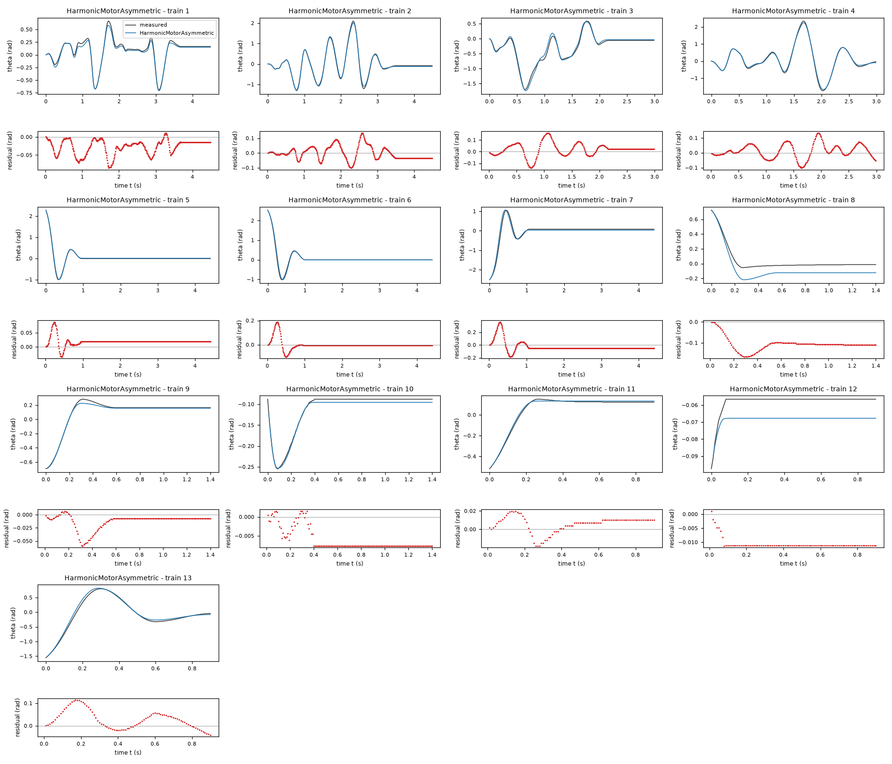

*Candidate HarmonicMotorAsymmetric, training data, trajectories 1, 2, 3, 4, 5, 6, 7, 8, 9, 10, 11, 12, 13. Upper axes: measured output theta (rad) and model output of HarmonicMotorAsymmetric; lower axes: residual (model output minus measured output, rad). Evaluation mode: simulation (initialized once per trajectory from the measured state at sample 0; classical fourth-order Runge-Kutta integration with 1 step(s) per sampling period T_s = 0.01 s and zero-order hold of the input; the model output is h(x[k], u[k])). Initialization: the first 1 sample(s) of each trajectory initialize the model and are excluded from the errors. Errors are computed on the samples 1: 1 to 449; 2: 1 to 449; 3: 1 to 299; 4: 1 to 299; 5: 1 to 441; 6: 1 to 441; 7: 1 to 441; 8: 1 to 140; 9: 1 to 140; 10: 1 to 140; 11: 1 to 90; 12: 1 to 90; 13: 1 to 90 (0-based sample indices). No numerical failure occurred.*

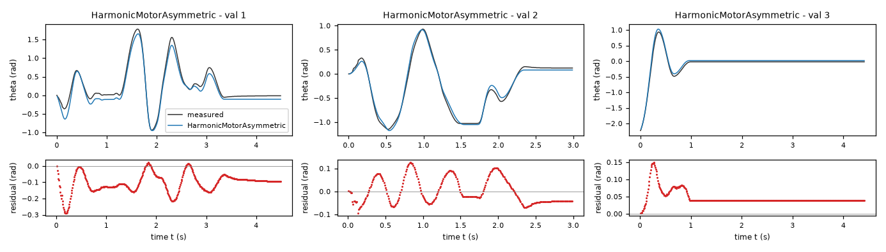

*Candidate HarmonicMotorAsymmetric, validation data, trajectories 1, 2, 3. Upper axes: measured output theta (rad) and model output of HarmonicMotorAsymmetric; lower axes: residual (model output minus measured output, rad). Evaluation mode: simulation (initialized once per trajectory from the measured state at sample 0; classical fourth-order Runge-Kutta integration with 1 step(s) per sampling period T_s = 0.01 s and zero-order hold of the input; the model output is h(x[k], u[k])). Initialization: the first 1 sample(s) of each trajectory initialize the model and are excluded from the errors. Errors are computed on the samples 1: 1 to 449; 2: 1 to 299; 3: 1 to 441 (0-based sample indices). No numerical failure occurred.*

### Candidate HarmonicAsymmetric

Position in the agent's order: 2. Status: evaluated.
File and expression checks: passed.
- `dtheta = omega`
- `domega = k*u-g*sin(theta)*(1+a*cos(theta))-b*omega-Min(cp,Max(-cn,k*u-g*sin(theta)*(1+a*cos(theta))-b*omega+omega/tau))`
Complexity: 7 fitted, 0 fixed and 0 tied parameters; 0 non-integer numeric literals; 52 expression-tree nodes (SymPy tree, every operator, function, symbol and number counted once).
Structure group 2: `dtheta = omega`; `domega = P3*u - P5*omega - P6*(P7*cos(theta) + 1)*sin(theta) - Min(P1, Max(-P2, P3*u - P5*omega - P6*(P7*cos(theta) + 1)*sin(theta) + omega/P4))`

Requirements:

| id | type | outcome | status | method | detail |
|---|---|---|---|---|---|
| R1 | equation | proof | satisfied | evaluation of a constant | the quantity is identically zero on the domain |
| R2 | inequality | inconclusive | unresolved | SymPy simplification and extremum then sampling (10000 points, seed 20261009) | no violation found at the 10000 sampled points (largest value of Q -0.0, tolerance 0.0); this is not a proof |
| R3 | monotonicity | inconclusive | unresolved | interval arithmetic and symbolic simplification then sampling (10000 points, seed 20261009) | no violation found at the 10000 sampled points (largest value of Q 0.0, tolerance 0.0); this is not a proof |

Output errors on the training data (pooled RMSE: 0.0540134 rad):

| trajectory | scored samples | completed | RMSE (rad) | NRMSE | R² | failure |
|---|---|---|---|---|---|---|
| 1 | 449 | 449 | 0.0374197 | 0.145899 | 0.978714 | none |
| 2 | 449 | 449 | 0.0402751 | 0.0604319 | 0.996348 | none |
| 3 | 299 | 299 | 0.0781644 | 0.165507 | 0.972607 | none |
| 4 | 299 | 299 | 0.0503685 | 0.0614598 | 0.996223 | none |
| 5 | 441 | 441 | 0.0235346 | 0.0614877 | 0.996219 | none |
| 6 | 441 | 441 | 0.0407851 | 0.0893546 | 0.992016 | none |
| 7 | 441 | 441 | 0.0854223 | 0.164641 | 0.972893 | none |
| 8 | 140 | 140 | 0.113014 | 0.68818 | 0.526408 | none |
| 9 | 140 | 140 | 0.0154459 | 0.0706304 | 0.995011 | none |
| 10 | 140 | 140 | 0.00695001 | 0.14135 | 0.98002 | none |
| 11 | 90 | 90 | 0.0129247 | 0.07853 | 0.993833 | none |
| 12 | 90 | 90 | 0.0106977 | 2.09668 | -3.39607 | none |
| 13 | 90 | 90 | 0.0522337 | 0.0961438 | 0.990756 | none |

Output errors on the validation data (pooled RMSE: 0.0854291 rad):

| trajectory | scored samples | completed | RMSE (rad) | NRMSE | R² | failure |
|---|---|---|---|---|---|---|
| 1 | 449 | 449 | 0.114696 | 0.20977 | 0.955996 | none |
| 2 | 299 | 299 | 0.065395 | 0.11696 | 0.98632 | none |
| 3 | 441 | 441 | 0.0581681 | 0.154761 | 0.976049 | none |

Sensitivity rank test (diagnostic; never excludes): targets domega on the train, val data (4714 rows, 0 dropped); analytic derivatives (SymPy), ties differentiated through their equations; scaling: rows of each target divided by the standard deviation of its measured column; columns divided by their Euclidean norm; rank threshold s_i / s_1 > 1e-08; singular values 1.45, 1.33, 1, 0.997, 0.803, 0.513, 0.482; rank 7 of 7.

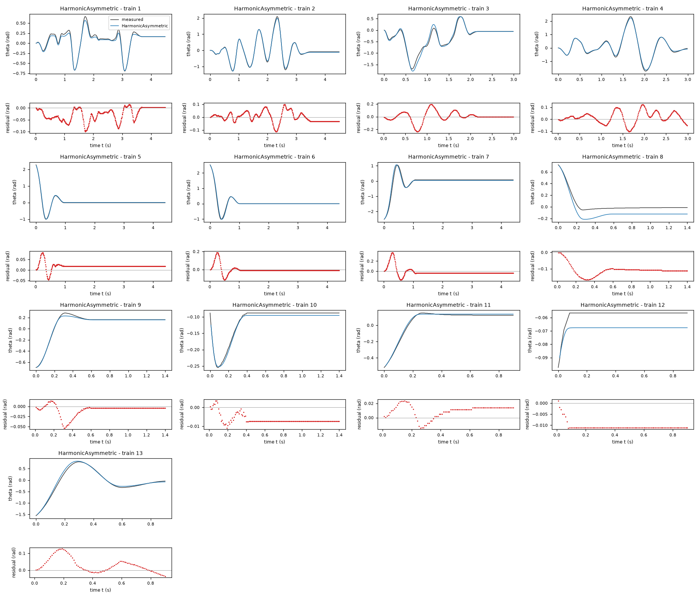

*Candidate HarmonicAsymmetric, training data, trajectories 1, 2, 3, 4, 5, 6, 7, 8, 9, 10, 11, 12, 13. Upper axes: measured output theta (rad) and model output of HarmonicAsymmetric; lower axes: residual (model output minus measured output, rad). Evaluation mode: simulation (initialized once per trajectory from the measured state at sample 0; classical fourth-order Runge-Kutta integration with 1 step(s) per sampling period T_s = 0.01 s and zero-order hold of the input; the model output is h(x[k], u[k])). Initialization: the first 1 sample(s) of each trajectory initialize the model and are excluded from the errors. Errors are computed on the samples 1: 1 to 449; 2: 1 to 449; 3: 1 to 299; 4: 1 to 299; 5: 1 to 441; 6: 1 to 441; 7: 1 to 441; 8: 1 to 140; 9: 1 to 140; 10: 1 to 140; 11: 1 to 90; 12: 1 to 90; 13: 1 to 90 (0-based sample indices). No numerical failure occurred.*

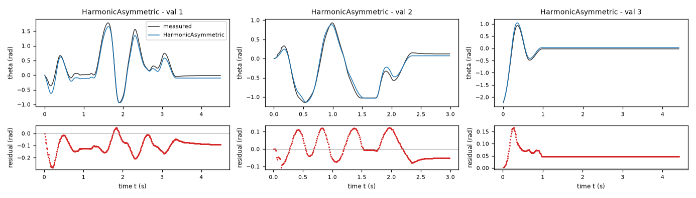

*Candidate HarmonicAsymmetric, validation data, trajectories 1, 2, 3. Upper axes: measured output theta (rad) and model output of HarmonicAsymmetric; lower axes: residual (model output minus measured output, rad). Evaluation mode: simulation (initialized once per trajectory from the measured state at sample 0; classical fourth-order Runge-Kutta integration with 1 step(s) per sampling period T_s = 0.01 s and zero-order hold of the input; the model output is h(x[k], u[k])). Initialization: the first 1 sample(s) of each trajectory initialize the model and are excluded from the errors. Errors are computed on the samples 1: 1 to 449; 2: 1 to 299; 3: 1 to 441 (0-based sample indices). No numerical failure occurred.*

### Candidate AngleFriction

Position in the agent's order: 3. Status: evaluated.
File and expression checks: passed.
- `dtheta = omega`
- `domega = k*u-g*sin(theta)-b*omega-Min(cp*(1+eta*cos(theta)),Max(-cp*(1+eta*cos(theta)),k*u-g*sin(theta)-b*omega+omega/tau))`
Complexity: 6 fitted, 0 fixed and 0 tied parameters; 0 non-integer numeric literals; 53 expression-tree nodes (SymPy tree, every operator, function, symbol and number counted once).
Structure group 3: `dtheta = omega`; `domega = P3*u - P5*omega - P6*sin(theta) - Min(P1*(P2*cos(theta) + 1), Max(-P1*(P2*cos(theta) + 1), P3*u - P5*omega - P6*sin(theta) + omega/P4))`

Requirements:

| id | type | outcome | status | method | detail |
|---|---|---|---|---|---|
| R1 | equation | proof | satisfied | evaluation of a constant | the quantity is identically zero on the domain |
| R2 | inequality | inconclusive | unresolved | SymPy simplification and extremum then sampling (10000 points, seed 20261009) | no violation found at the 10000 sampled points (largest value of Q -0.0, tolerance 0.0); this is not a proof |
| R3 | monotonicity | inconclusive | unresolved | interval arithmetic and symbolic simplification then sampling (10000 points, seed 20261009) | no violation found at the 10000 sampled points (largest value of Q 0.0, tolerance 0.0); this is not a proof |

Output errors on the training data (pooled RMSE: 0.0574883 rad):

| trajectory | scored samples | completed | RMSE (rad) | NRMSE | R² | failure |
|---|---|---|---|---|---|---|
| 1 | 449 | 449 | 0.0433902 | 0.169177 | 0.971379 | none |
| 2 | 449 | 449 | 0.0496173 | 0.0744497 | 0.994457 | none |
| 3 | 299 | 299 | 0.0780802 | 0.165329 | 0.972666 | none |
| 4 | 299 | 299 | 0.0574351 | 0.0700826 | 0.995088 | none |
| 5 | 441 | 441 | 0.0207269 | 0.0541521 | 0.997068 | none |
| 6 | 441 | 441 | 0.0596412 | 0.130666 | 0.982926 | none |
| 7 | 441 | 441 | 0.0691658 | 0.133308 | 0.982229 | none |
| 8 | 140 | 140 | 0.131817 | 0.802674 | 0.355715 | none |
| 9 | 140 | 140 | 0.0256138 | 0.117125 | 0.986282 | none |
| 10 | 140 | 140 | 0.036924 | 0.750963 | 0.436055 | none |
| 11 | 90 | 90 | 0.0178818 | 0.108649 | 0.988195 | none |
| 12 | 90 | 90 | 0.0151863 | 2.97641 | -7.85901 | none |
| 13 | 90 | 90 | 0.0476467 | 0.0877008 | 0.992309 | none |

Output errors on the validation data (pooled RMSE: 0.08697 rad):

| trajectory | scored samples | completed | RMSE (rad) | NRMSE | R² | failure |
|---|---|---|---|---|---|---|
| 1 | 449 | 449 | 0.130045 | 0.237842 | 0.943431 | none |
| 2 | 299 | 299 | 0.046471 | 0.0831144 | 0.993092 | none |
| 3 | 441 | 441 | 0.0413575 | 0.110035 | 0.987892 | none |

Sensitivity rank test (diagnostic; never excludes): targets domega on the train, val data (4714 rows, 0 dropped); analytic derivatives (SymPy), ties differentiated through their equations; scaling: rows of each target divided by the standard deviation of its measured column; columns divided by their Euclidean norm; rank threshold s_i / s_1 > 1e-08; singular values 1.65, 1.07, 1, 0.792, 0.629, 0.337; rank 6 of 6.

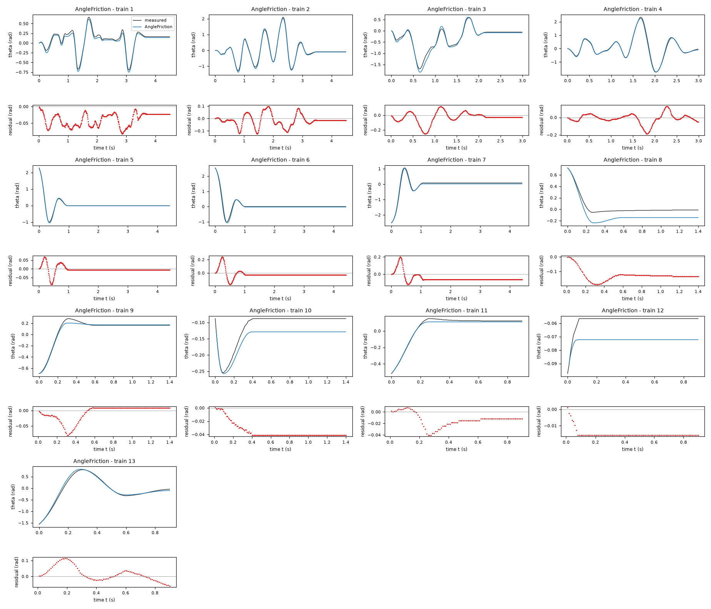

*Candidate AngleFriction, training data, trajectories 1, 2, 3, 4, 5, 6, 7, 8, 9, 10, 11, 12, 13. Upper axes: measured output theta (rad) and model output of AngleFriction; lower axes: residual (model output minus measured output, rad). Evaluation mode: simulation (initialized once per trajectory from the measured state at sample 0; classical fourth-order Runge-Kutta integration with 1 step(s) per sampling period T_s = 0.01 s and zero-order hold of the input; the model output is h(x[k], u[k])). Initialization: the first 1 sample(s) of each trajectory initialize the model and are excluded from the errors. Errors are computed on the samples 1: 1 to 449; 2: 1 to 449; 3: 1 to 299; 4: 1 to 299; 5: 1 to 441; 6: 1 to 441; 7: 1 to 441; 8: 1 to 140; 9: 1 to 140; 10: 1 to 140; 11: 1 to 90; 12: 1 to 90; 13: 1 to 90 (0-based sample indices). No numerical failure occurred.*

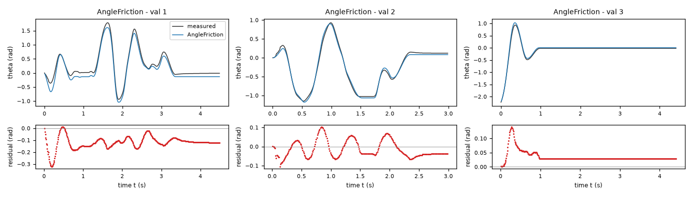

*Candidate AngleFriction, validation data, trajectories 1, 2, 3. Upper axes: measured output theta (rad) and model output of AngleFriction; lower axes: residual (model output minus measured output, rad). Evaluation mode: simulation (initialized once per trajectory from the measured state at sample 0; classical fourth-order Runge-Kutta integration with 1 step(s) per sampling period T_s = 0.01 s and zero-order hold of the input; the model output is h(x[k], u[k])). Initialization: the first 1 sample(s) of each trajectory initialize the model and are excluded from the errors. Errors are computed on the samples 1: 1 to 449; 2: 1 to 299; 3: 1 to 441 (0-based sample indices). No numerical failure occurred.*

### Candidate SaturatingDamping

Position in the agent's order: 4. Status: evaluated.
File and expression checks: passed.
- `dtheta = omega`
- `domega = k*u-g*sin(theta)-b*omega-d*tanh(omega/vd)-Min(cp,Max(-cp,k*u-g*sin(theta)-b*omega-d*tanh(omega/vd)+omega/tau))`
Complexity: 7 fitted, 0 fixed and 0 tied parameters; 0 non-integer numeric literals; 58 expression-tree nodes (SymPy tree, every operator, function, symbol and number counted once).
Structure group 4: `dtheta = omega`; `domega = P2*u - P4*omega - P5*tanh(omega/P6) - P7*sin(theta) - Min(P1, Max(-P1, P2*u - P4*omega - P5*tanh(omega/P6) - P7*sin(theta) + omega/P3))`

Requirements:

| id | type | outcome | status | method | detail |
|---|---|---|---|---|---|
| R1 | equation | proof | satisfied | evaluation of a constant | the quantity is identically zero on the domain |
| R2 | inequality | inconclusive | unresolved | interval arithmetic and symbolic simplification then sampling (10000 points, seed 20261009) | no violation found at the 10000 sampled points (largest value of Q 0.0, tolerance 0.0); this is not a proof |
| R3 | monotonicity | inconclusive | unresolved | interval arithmetic and symbolic simplification then sampling (10000 points, seed 20261009) | no violation found at the 10000 sampled points (largest value of Q 0.0, tolerance 0.0); this is not a proof |

Output errors on the training data (pooled RMSE: 0.0648785 rad):

| trajectory | scored samples | completed | RMSE (rad) | NRMSE | R² | failure |
|---|---|---|---|---|---|---|
| 1 | 449 | 449 | 0.056449 | 0.220093 | 0.951559 | none |
| 2 | 449 | 449 | 0.0510221 | 0.0765576 | 0.994139 | none |
| 3 | 299 | 299 | 0.0764665 | 0.161912 | 0.973785 | none |
| 4 | 299 | 299 | 0.0533814 | 0.0651363 | 0.995757 | none |
| 5 | 441 | 441 | 0.0194066 | 0.0507026 | 0.997429 | none |
| 6 | 441 | 441 | 0.0294783 | 0.064583 | 0.995829 | none |
| 7 | 441 | 441 | 0.124536 | 0.240027 | 0.942387 | none |
| 8 | 140 | 140 | 0.0861809 | 0.524783 | 0.724603 | none |
| 9 | 140 | 140 | 0.074154 | 0.339088 | 0.88502 | none |
| 10 | 140 | 140 | 0.00662918 | 0.134825 | 0.981822 | none |
| 11 | 90 | 90 | 0.0383483 | 0.233003 | 0.94571 | none |
| 12 | 90 | 90 | 0.00393307 | 0.770855 | 0.405782 | none |
| 13 | 90 | 90 | 0.0507554 | 0.0934229 | 0.991272 | none |

Output errors on the validation data (pooled RMSE: 0.083199 rad):

| trajectory | scored samples | completed | RMSE (rad) | NRMSE | R² | failure |
|---|---|---|---|---|---|---|
| 1 | 449 | 449 | 0.113529 | 0.207637 | 0.956887 | none |
| 2 | 299 | 299 | 0.0696392 | 0.124551 | 0.984487 | none |
| 3 | 441 | 441 | 0.0474566 | 0.126262 | 0.984058 | none |

Sensitivity rank test (diagnostic; never excludes): targets domega on the train, val data (4714 rows, 0 dropped); analytic derivatives (SymPy), ties differentiated through their equations; scaling: rows of each target divided by the standard deviation of its measured column; columns divided by their Euclidean norm; rank threshold s_i / s_1 > 1e-08; singular values 1.72, 1.09, 1, 0.964, 0.788, 0.451, 0.308; rank 7 of 7.

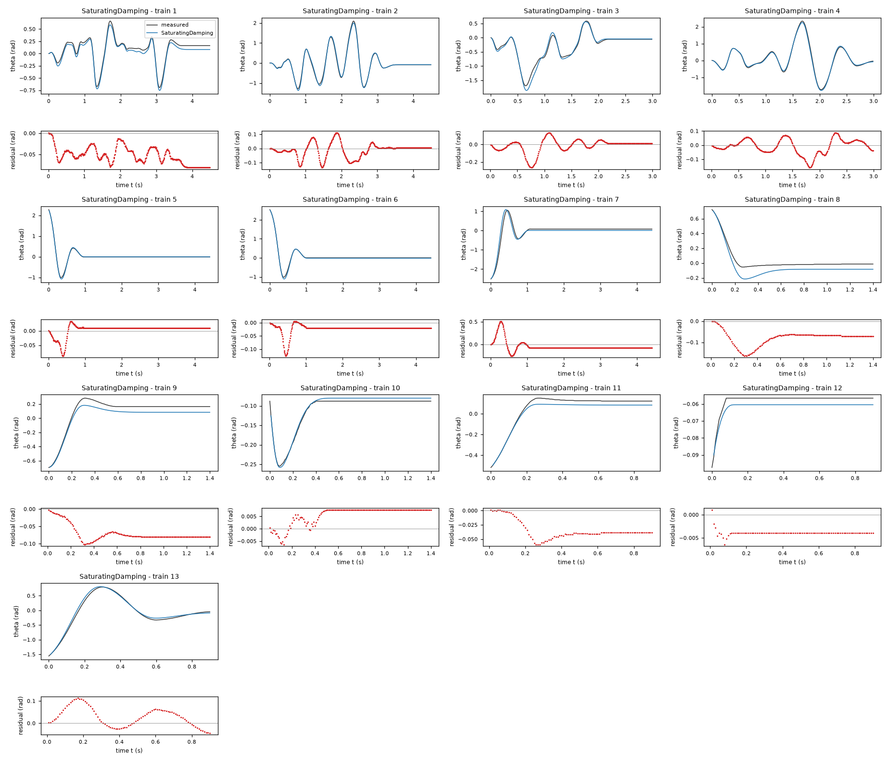

*Candidate SaturatingDamping, training data, trajectories 1, 2, 3, 4, 5, 6, 7, 8, 9, 10, 11, 12, 13. Upper axes: measured output theta (rad) and model output of SaturatingDamping; lower axes: residual (model output minus measured output, rad). Evaluation mode: simulation (initialized once per trajectory from the measured state at sample 0; classical fourth-order Runge-Kutta integration with 1 step(s) per sampling period T_s = 0.01 s and zero-order hold of the input; the model output is h(x[k], u[k])). Initialization: the first 1 sample(s) of each trajectory initialize the model and are excluded from the errors. Errors are computed on the samples 1: 1 to 449; 2: 1 to 449; 3: 1 to 299; 4: 1 to 299; 5: 1 to 441; 6: 1 to 441; 7: 1 to 441; 8: 1 to 140; 9: 1 to 140; 10: 1 to 140; 11: 1 to 90; 12: 1 to 90; 13: 1 to 90 (0-based sample indices). No numerical failure occurred.*

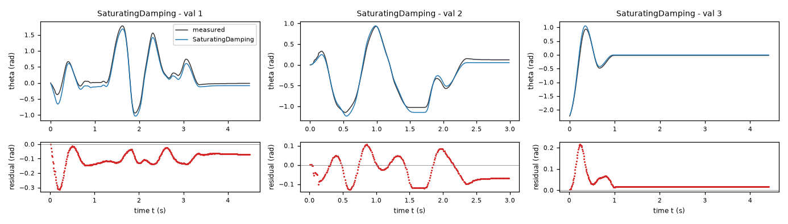

*Candidate SaturatingDamping, validation data, trajectories 1, 2, 3. Upper axes: measured output theta (rad) and model output of SaturatingDamping; lower axes: residual (model output minus measured output, rad). Evaluation mode: simulation (initialized once per trajectory from the measured state at sample 0; classical fourth-order Runge-Kutta integration with 1 step(s) per sampling period T_s = 0.01 s and zero-order hold of the input; the model output is h(x[k], u[k])). Initialization: the first 1 sample(s) of each trajectory initialize the model and are excluded from the errors. Errors are computed on the samples 1: 1 to 449; 2: 1 to 299; 3: 1 to 441 (0-based sample indices). No numerical failure occurred.*

### Candidate Projected

Position in the agent's order: 5. Status: evaluated.
File and expression checks: passed.
- `dtheta = omega`
- `domega = k*u-g*sin(theta)-b*omega-Min(cp,Max(-cp,k*u-g*sin(theta)-b*omega+omega/tau))`
Complexity: 5 fitted, 0 fixed and 0 tied parameters; 0 non-integer numeric literals; 40 expression-tree nodes (SymPy tree, every operator, function, symbol and number counted once).
Structure group 5: `dtheta = omega`; `domega = P2*u - P4*omega - P5*sin(theta) - Min(P1, Max(-P1, P2*u - P4*omega - P5*sin(theta) + omega/P3))`

Requirements:

| id | type | outcome | status | method | detail |
|---|---|---|---|---|---|
| R1 | equation | proof | satisfied | evaluation of a constant | the quantity is identically zero on the domain |
| R2 | inequality | inconclusive | unresolved | interval arithmetic and symbolic simplification then sampling (10000 points, seed 20261009) | no violation found at the 10000 sampled points (largest value of Q -0.0, tolerance 0.0); this is not a proof |
| R3 | monotonicity | inconclusive | unresolved | interval arithmetic and symbolic simplification then sampling (10000 points, seed 20261009) | no violation found at the 10000 sampled points (largest value of Q 0.0, tolerance 0.0); this is not a proof |

Output errors on the training data (pooled RMSE: 0.0666853 rad):

| trajectory | scored samples | completed | RMSE (rad) | NRMSE | R² | failure |
|---|---|---|---|---|---|---|
| 1 | 449 | 449 | 0.0413052 | 0.161048 | 0.974064 | none |
| 2 | 449 | 449 | 0.0565842 | 0.0849033 | 0.992791 | none |
| 3 | 299 | 299 | 0.0823576 | 0.174386 | 0.96959 | none |
| 4 | 299 | 299 | 0.0640279 | 0.0781271 | 0.993896 | none |
| 5 | 441 | 441 | 0.0161435 | 0.0421774 | 0.998221 | none |
| 6 | 441 | 441 | 0.0338866 | 0.074241 | 0.994488 | none |
| 7 | 441 | 441 | 0.122599 | 0.236294 | 0.944165 | none |
| 8 | 140 | 140 | 0.129932 | 0.791195 | 0.374011 | none |
| 9 | 140 | 140 | 0.029753 | 0.136053 | 0.98149 | none |
| 10 | 140 | 140 | 0.0298002 | 0.606079 | 0.632668 | none |
| 11 | 90 | 90 | 0.0226243 | 0.137465 | 0.981103 | none |
| 12 | 90 | 90 | 0.0140554 | 2.75477 | -6.58873 | none |
| 13 | 90 | 90 | 0.0496039 | 0.0913034 | 0.991664 | none |

Output errors on the validation data (pooled RMSE: 0.0905285 rad):

| trajectory | scored samples | completed | RMSE (rad) | NRMSE | R² | failure |
|---|---|---|---|---|---|---|
| 1 | 449 | 449 | 0.125106 | 0.228809 | 0.947646 | none |
| 2 | 299 | 299 | 0.0743086 | 0.132902 | 0.982337 | none |
| 3 | 441 | 441 | 0.0491607 | 0.130796 | 0.982892 | none |

Sensitivity rank test (diagnostic; never excludes): targets domega on the train, val data (4714 rows, 0 dropped); analytic derivatives (SymPy), ties differentiated through their equations; scaling: rows of each target divided by the standard deviation of its measured column; columns divided by their Euclidean norm; rank threshold s_i / s_1 > 1e-08; singular values 1.41, 1.07, 1, 0.772, 0.522; rank 5 of 5.

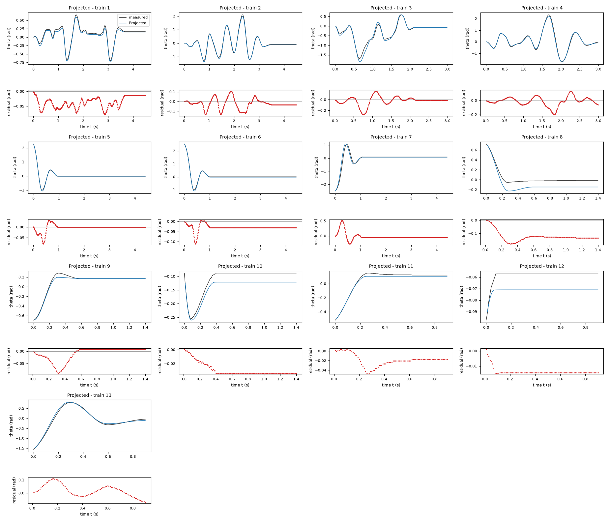

*Candidate Projected, training data, trajectories 1, 2, 3, 4, 5, 6, 7, 8, 9, 10, 11, 12, 13. Upper axes: measured output theta (rad) and model output of Projected; lower axes: residual (model output minus measured output, rad). Evaluation mode: simulation (initialized once per trajectory from the measured state at sample 0; classical fourth-order Runge-Kutta integration with 1 step(s) per sampling period T_s = 0.01 s and zero-order hold of the input; the model output is h(x[k], u[k])). Initialization: the first 1 sample(s) of each trajectory initialize the model and are excluded from the errors. Errors are computed on the samples 1: 1 to 449; 2: 1 to 449; 3: 1 to 299; 4: 1 to 299; 5: 1 to 441; 6: 1 to 441; 7: 1 to 441; 8: 1 to 140; 9: 1 to 140; 10: 1 to 140; 11: 1 to 90; 12: 1 to 90; 13: 1 to 90 (0-based sample indices). No numerical failure occurred.*

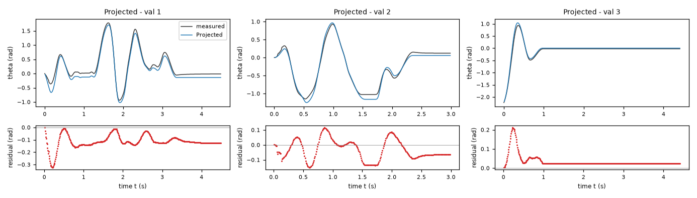

*Candidate Projected, validation data, trajectories 1, 2, 3. Upper axes: measured output theta (rad) and model output of Projected; lower axes: residual (model output minus measured output, rad). Evaluation mode: simulation (initialized once per trajectory from the measured state at sample 0; classical fourth-order Runge-Kutta integration with 1 step(s) per sampling period T_s = 0.01 s and zero-order hold of the input; the model output is h(x[k], u[k])). Initialization: the first 1 sample(s) of each trajectory initialize the model and are excluded from the errors. Errors are computed on the samples 1: 1 to 449; 2: 1 to 299; 3: 1 to 441 (0-based sample indices). No numerical failure occurred.*

### Candidate Compensated

Position in the agent's order: 6. Status: evaluated.
File and expression checks: passed.
- `dtheta = omega`
- `domega = k*u-g*sin(theta)-b*omega-cp*tanh(omega/v)-exp(-(omega/v)**2)*Min(cp,Max(-cp,k*u-g*sin(theta)-b*omega))`
Complexity: 5 fitted, 0 fixed and 0 tied parameters; 0 non-integer numeric literals; 53 expression-tree nodes (SymPy tree, every operator, function, symbol and number counted once).
Structure group 6: `dtheta = omega`; `domega = P1*u - P2*omega - P3*tanh(omega/P4) - P5*sin(theta) - exp(-omega**2/P4**2)*Min(P3, Max(-P3, P1*u - P2*omega - P5*sin(theta)))`

Requirements:

| id | type | outcome | status | method | detail |
|---|---|---|---|---|---|
| R1 | equation | proof | satisfied | evaluation of a constant | the quantity is identically zero on the domain |
| R2 | inequality | inconclusive | unresolved | interval arithmetic and symbolic simplification then sampling (10000 points, seed 20261009) | no violation found at the 10000 sampled points (largest value of Q -0.0, tolerance 0.0); this is not a proof |
| R3 | monotonicity | inconclusive | unresolved | interval arithmetic and symbolic simplification then sampling (10000 points, seed 20261009) | no violation found at the 10000 sampled points (largest value of Q -0.426150955305431, tolerance 0.0); this is not a proof |

Output errors on the training data (pooled RMSE: 0.0706332 rad):

| trajectory | scored samples | completed | RMSE (rad) | NRMSE | R² | failure |
|---|---|---|---|---|---|---|
| 1 | 449 | 449 | 0.0457247 | 0.178279 | 0.968216 | none |
| 2 | 449 | 449 | 0.049013 | 0.073543 | 0.994591 | none |
| 3 | 299 | 299 | 0.0878835 | 0.186086 | 0.965372 | none |
| 4 | 299 | 299 | 0.0625274 | 0.0762962 | 0.994179 | none |
| 5 | 441 | 441 | 0.0145444 | 0.0379995 | 0.998556 | none |
| 6 | 441 | 441 | 0.0306694 | 0.0671926 | 0.995485 | none |
| 7 | 441 | 441 | 0.12563 | 0.242136 | 0.94137 | none |
| 8 | 140 | 140 | 0.167524 | 1.02011 | -0.040615 | none |
| 9 | 140 | 140 | 0.0334556 | 0.152984 | 0.976596 | none |
| 10 | 140 | 140 | 0.0330306 | 0.671779 | 0.548713 | none |
| 11 | 90 | 90 | 0.0218494 | 0.132756 | 0.982376 | none |
| 12 | 90 | 90 | 0.0117073 | 2.29455 | -4.26498 | none |
| 13 | 90 | 90 | 0.052573 | 0.0967684 | 0.990636 | none |

Output errors on the validation data (pooled RMSE: 0.0888568 rad):

| trajectory | scored samples | completed | RMSE (rad) | NRMSE | R² | failure |
|---|---|---|---|---|---|---|
| 1 | 449 | 449 | 0.123705 | 0.226247 | 0.948812 | none |
| 2 | 299 | 299 | 0.0707569 | 0.12655 | 0.983985 | none |
| 3 | 441 | 441 | 0.0480882 | 0.127943 | 0.983631 | none |

Sensitivity rank test (diagnostic; never excludes): targets domega on the train, val data (4714 rows, 0 dropped); analytic derivatives (SymPy), ties differentiated through their equations; scaling: rows of each target divided by the standard deviation of its measured column; columns divided by their Euclidean norm; rank threshold s_i / s_1 > 1e-08; singular values 1.42, 1.07, 1.02, 0.751, 0.506; rank 5 of 5.

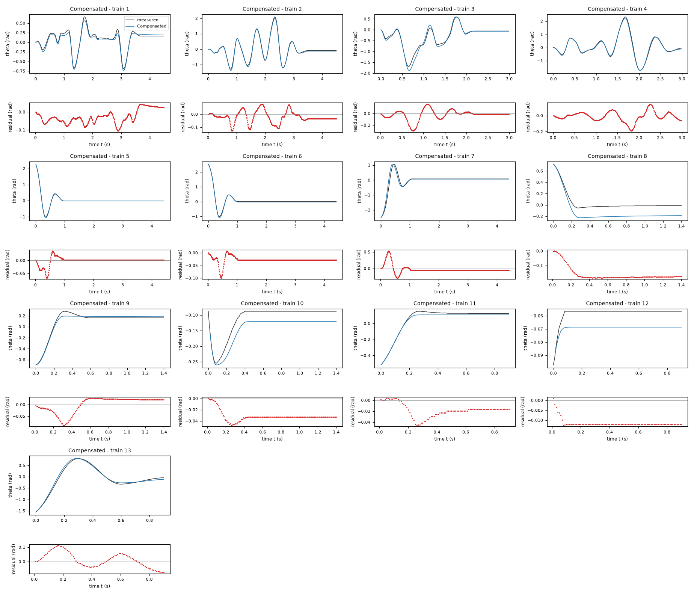

*Candidate Compensated, training data, trajectories 1, 2, 3, 4, 5, 6, 7, 8, 9, 10, 11, 12, 13. Upper axes: measured output theta (rad) and model output of Compensated; lower axes: residual (model output minus measured output, rad). Evaluation mode: simulation (initialized once per trajectory from the measured state at sample 0; classical fourth-order Runge-Kutta integration with 1 step(s) per sampling period T_s = 0.01 s and zero-order hold of the input; the model output is h(x[k], u[k])). Initialization: the first 1 sample(s) of each trajectory initialize the model and are excluded from the errors. Errors are computed on the samples 1: 1 to 449; 2: 1 to 449; 3: 1 to 299; 4: 1 to 299; 5: 1 to 441; 6: 1 to 441; 7: 1 to 441; 8: 1 to 140; 9: 1 to 140; 10: 1 to 140; 11: 1 to 90; 12: 1 to 90; 13: 1 to 90 (0-based sample indices). No numerical failure occurred.*

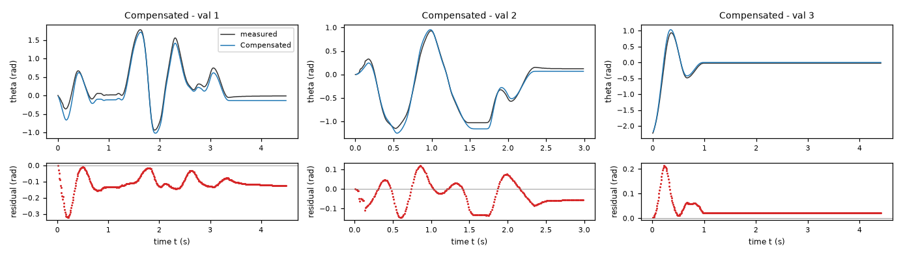

*Candidate Compensated, validation data, trajectories 1, 2, 3. Upper axes: measured output theta (rad) and model output of Compensated; lower axes: residual (model output minus measured output, rad). Evaluation mode: simulation (initialized once per trajectory from the measured state at sample 0; classical fourth-order Runge-Kutta integration with 1 step(s) per sampling period T_s = 0.01 s and zero-order hold of the input; the model output is h(x[k], u[k])). Initialization: the first 1 sample(s) of each trajectory initialize the model and are excluded from the errors. Errors are computed on the samples 1: 1 to 449; 2: 1 to 299; 3: 1 to 441 (0-based sample indices). No numerical failure occurred.*
