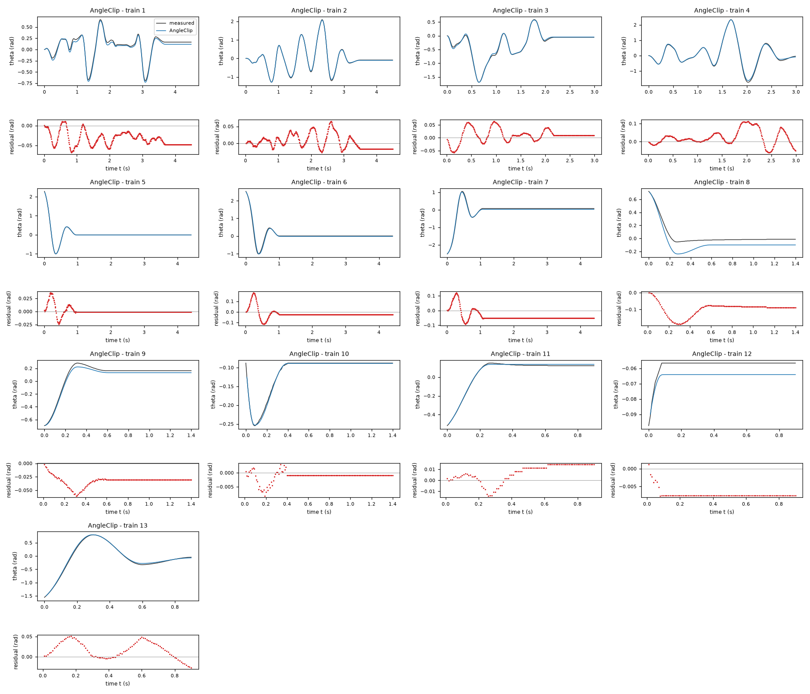
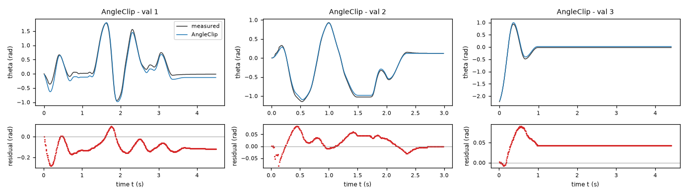
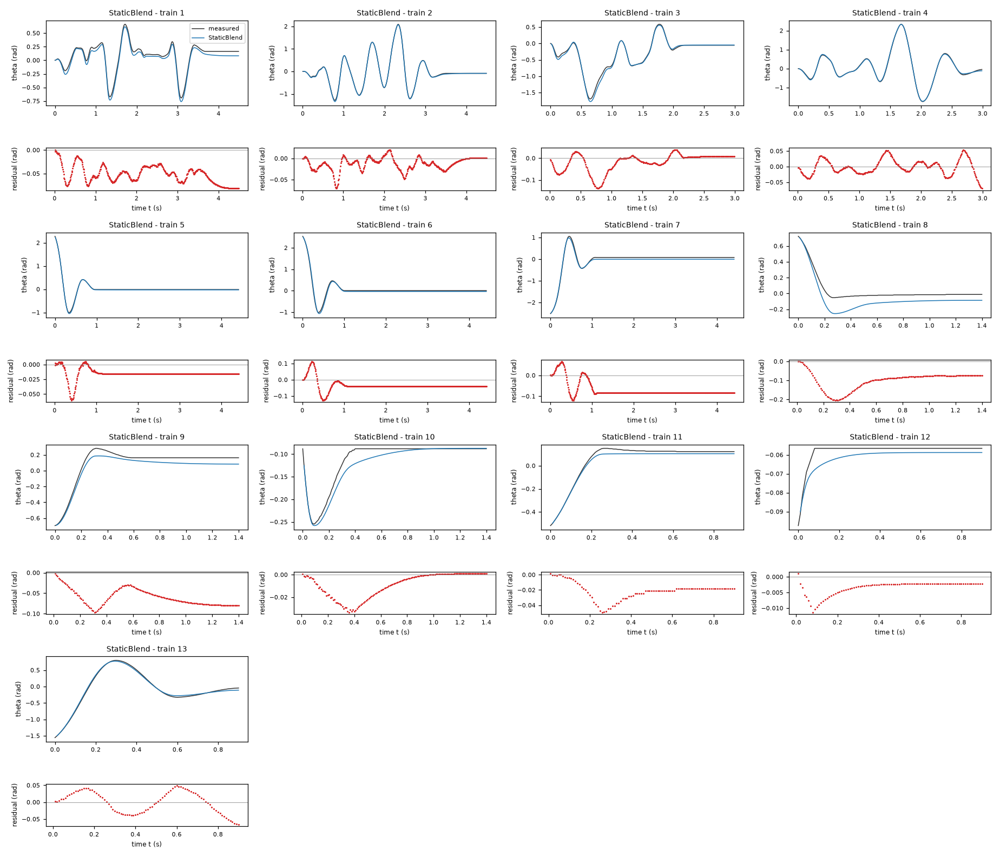
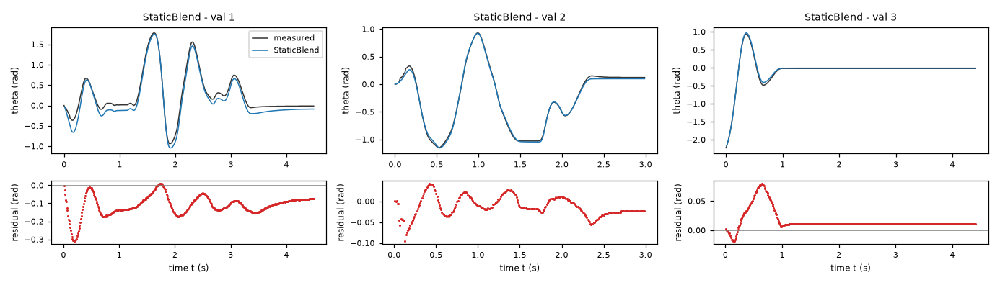
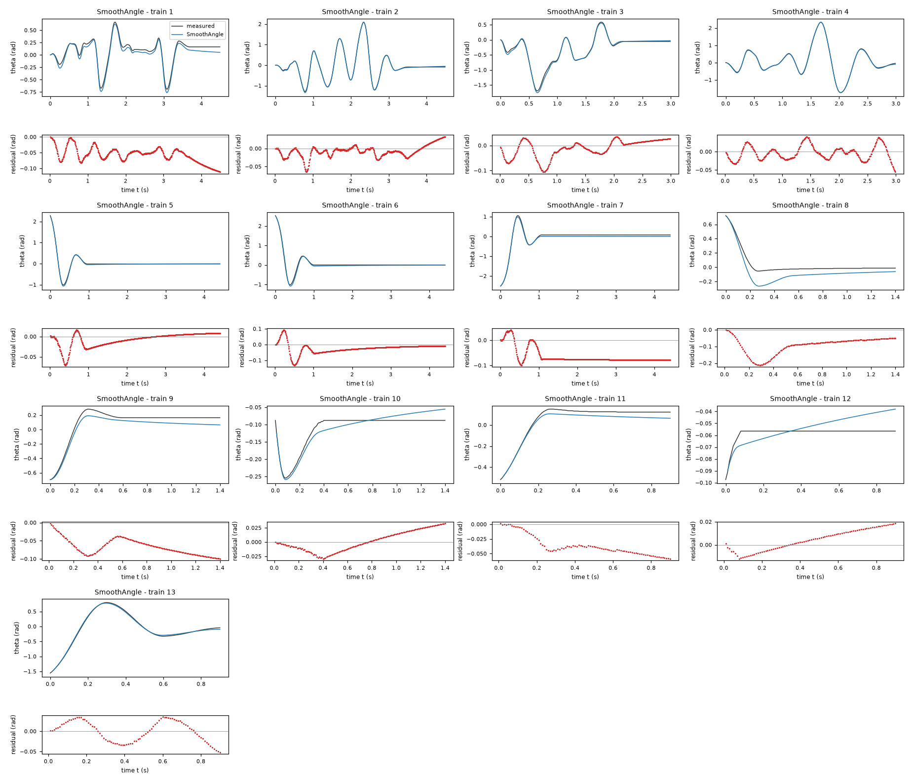
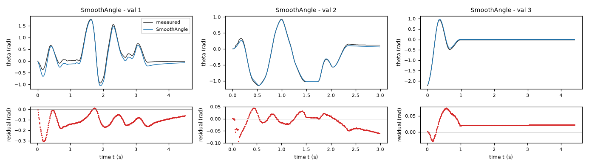
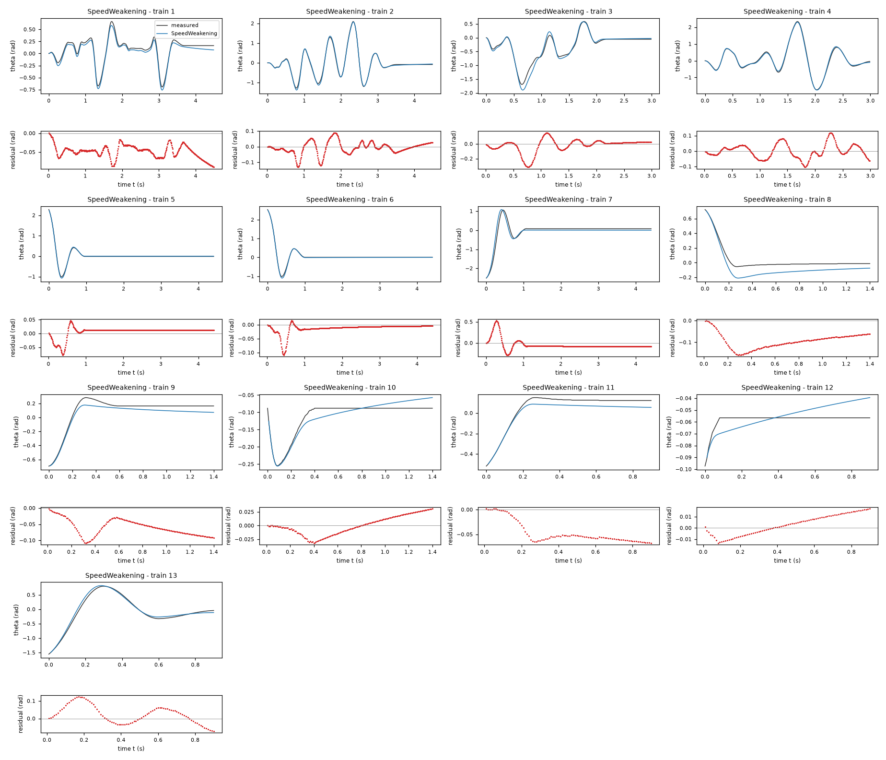
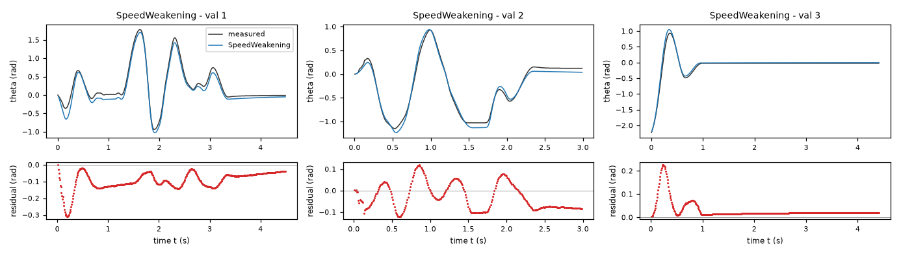

# Evaluation results permitted to the agent: task friction-driven

Terms. The harness is the software of ASPIRE that checks and evaluates the candidate models; a candidate is one proposed model; the pool is the set of candidates of one round. Sealed data (test data, reference expression) are inaccessible to the agent. This view contains no result derived from sealed data.

Evaluation mode: simulation (initialized once per trajectory from the measured state at sample 0; classical fourth-order Runge-Kutta integration with 1 step(s) per sampling period T_s = 0.01 s and zero-order hold of the input; the model output is h(x[k], u[k])).
Error measures: for one trajectory with scoring interval I of N samples, measured output y[k] (theta, rad) and model output ŷ[k], SSE = Σ_(k∈I) (ŷ[k] − y[k])²; RMSE = sqrt(SSE/N), in rad; NRMSE = RMSE/σ, with μ and σ the mean and the population standard deviation of y on I; R² = 1 − SSE / Σ_(k∈I) (y[k] − μ)²; NRMSE and R² are not applicable when σ = 0. The pooled RMSE over several trajectories is S = sqrt(ΣSSE / ΣN); on the test data it is the ranking score.
Numerical failure limits: theta in [-1000, 1000] rad; omega in [-1000, 1000] rad/s; evaluation time limit 60 s per candidate and data group; symbolic time limit 10 s per verification.
Discontinuous expressions: expressions with jumps (Piecewise, sign) are evaluated pointwise at the sample instants and Runge-Kutta stages; no event detection or step refinement is applied at a jump.
Harness version 0.1.0.dev0; NumPy 2.5.1; SymPy 1.14.0.

## Pool

| category | count |
|---|---|
| candidates proposed | 4 |
| accepted by the file and expression checks | 4 |
| outside the pool limit of 10 (not evaluated) | 0 |
| evaluated | 4 |
| excluded by physical requirements | 0 |
| failed numerically on training or validation data | 0 |

Note: the categories overlap; the counts need not sum to the pool size.

Distinct structures: 4 among 4 evaluated candidates; groups: AngleClip; StaticBlend; SmoothAngle; SpeedWeakening. Convention: ties resolved, fixed values kept, given constants kept, fitted parameters renamed P1..Pn in order of first occurrence; equal when a one-to-one renaming of the fitted parameters makes every expression identical in SymPy's canonical form.

### Recommendation of the agent

Recommended candidate: AngleClip. The agent's reason: AngleClip had the smallest aggregate leave-one-trajectory-out angle RMSE (`0.06048971` rad) among the retained final families on the 16 known trajectories, compared with `0.06128174` rad for SmoothAngle, `0.06320398` rad for StaticBlend and `0.07691553` rad for SpeedWeakening. The small gap to SmoothAngle alone is not decisive, but AngleClip also preserves a genuine nonzero static stick band, has positive dissipative friction limits, and uses a stopping rate compatible with the required fixed-step RK4 integration. The remaining free-response stopping-angle and driven residuals mean this is a recommendation under uncertainty, not a claim about unavailable test performance.
- Harness note: the recommendation involves unresolved formal requirement(s) R2, R3, for human assessment.

## Candidates

### Candidate AngleClip

Position in the agent's order: 1. Status: evaluated.
File and expression checks: passed.
- `dtheta = omega`
- `domega = a*u-g*sin(theta)-b*omega-Min(Max(a*u-g*sin(theta)+k*omega,-c*(1+hs*sin(theta)+hc*cos(theta))*(1-eta)),c*(1+hs*sin(theta)+hc*cos(theta))*(1+eta))`
Complexity: 8 fitted, 0 fixed and 0 tied parameters; 0 non-integer numeric literals; 63 expression-tree nodes (SymPy tree, every operator, function, symbol and number counted once).
Structure group 1: `dtheta = omega`; `domega = P5*u - P7*sin(theta) - P8*omega - Min(P1*(P2 + 1)*(P3*cos(theta) + P4*sin(theta) + 1), Max(-P1*(1 - P2)*(P3*cos(theta) + P4*sin(theta) + 1), P5*u + P6*omega - P7*sin(theta)))`

Requirements:

| id | type | outcome | status | method | detail |
|---|---|---|---|---|---|
| R1 | equation | proof | satisfied | evaluation of a constant | the quantity is identically zero on the domain |
| R2 | inequality | inconclusive | unresolved | SymPy simplification and extremum then sampling (10000 points, seed 20261009) | no violation found at the 10000 sampled points (largest value of Q -0.0, tolerance 0.0); this is not a proof |
| R3 | monotonicity | inconclusive | unresolved | interval arithmetic and symbolic simplification then sampling (10000 points, seed 20261009) | no violation found at the 10000 sampled points (largest value of Q 0.0, tolerance 0.0); this is not a proof |

Output errors on the training data (pooled RMSE: 0.0400895 rad):

| trajectory | scored samples | completed | RMSE (rad) | NRMSE | R² | failure |
|---|---|---|---|---|---|---|
| 1 | 449 | 449 | 0.0379418 | 0.147934 | 0.978115 | none |
| 2 | 449 | 449 | 0.0214868 | 0.0322405 | 0.998961 | none |
| 3 | 299 | 299 | 0.0270565 | 0.0572899 | 0.996718 | none |
| 4 | 299 | 299 | 0.0473177 | 0.0577372 | 0.996666 | none |
| 5 | 441 | 441 | 0.00777256 | 0.020307 | 0.999588 | none |
| 6 | 441 | 441 | 0.0456041 | 0.0999126 | 0.990017 | none |
| 7 | 441 | 441 | 0.0521545 | 0.100521 | 0.989895 | none |
| 8 | 140 | 140 | 0.104064 | 0.633676 | 0.598455 | none |
| 9 | 140 | 140 | 0.0338387 | 0.154736 | 0.976057 | none |
| 10 | 140 | 140 | 0.00211991 | 0.043115 | 0.998141 | none |
| 11 | 90 | 90 | 0.0104539 | 0.0635173 | 0.995966 | none |
| 12 | 90 | 90 | 0.00727643 | 1.42613 | -1.03385 | none |
| 13 | 90 | 90 | 0.0263674 | 0.048533 | 0.997645 | none |

Output errors on the validation data (pooled RMSE: 0.0803421 rad):

| trajectory | scored samples | completed | RMSE (rad) | NRMSE | R² | failure |
|---|---|---|---|---|---|---|
| 1 | 449 | 449 | 0.119072 | 0.217774 | 0.952574 | none |
| 2 | 299 | 299 | 0.0337858 | 0.0604266 | 0.996349 | none |
| 3 | 441 | 441 | 0.0468385 | 0.124618 | 0.98447 | none |

Sensitivity rank test (diagnostic; never excludes): targets domega on the train, val data (4714 rows, 0 dropped); analytic derivatives (SymPy), ties differentiated through their equations; scaling: rows of each target divided by the standard deviation of its measured column; columns divided by their Euclidean norm; rank threshold s_i / s_1 > 1e-08; singular values 1.64, 1.16, 1.03, 1, 0.883, 0.783, 0.624, 0.336; rank 8 of 8.

*Candidate AngleClip, training data, trajectories 1, 2, 3, 4, 5, 6, 7, 8, 9, 10, 11, 12, 13. Upper axes: measured output theta (rad) and model output of AngleClip; lower axes: residual (model output minus measured output, rad). Evaluation mode: simulation (initialized once per trajectory from the measured state at sample 0; classical fourth-order Runge-Kutta integration with 1 step(s) per sampling period T_s = 0.01 s and zero-order hold of the input; the model output is h(x[k], u[k])). Initialization: the first 1 sample(s) of each trajectory initialize the model and are excluded from the errors. Errors are computed on the samples 1: 1 to 449; 2: 1 to 449; 3: 1 to 299; 4: 1 to 299; 5: 1 to 441; 6: 1 to 441; 7: 1 to 441; 8: 1 to 140; 9: 1 to 140; 10: 1 to 140; 11: 1 to 90; 12: 1 to 90; 13: 1 to 90 (0-based sample indices). No numerical failure occurred.*

*Candidate AngleClip, validation data, trajectories 1, 2, 3. Upper axes: measured output theta (rad) and model output of AngleClip; lower axes: residual (model output minus measured output, rad). Evaluation mode: simulation (initialized once per trajectory from the measured state at sample 0; classical fourth-order Runge-Kutta integration with 1 step(s) per sampling period T_s = 0.01 s and zero-order hold of the input; the model output is h(x[k], u[k])). Initialization: the first 1 sample(s) of each trajectory initialize the model and are excluded from the errors. Errors are computed on the samples 1: 1 to 449; 2: 1 to 299; 3: 1 to 441 (0-based sample indices). No numerical failure occurred.*

### Candidate StaticBlend

Position in the agent's order: 2. Status: evaluated.
File and expression checks: passed.
- `dtheta = omega`
- `domega = exp(-(omega/v)**2)*(Max(a*u-g*sin(theta)-c*(1+hs*sin(theta)+hc*cos(theta)),0)+Min(a*u-g*sin(theta)+c*(1+hs*sin(theta)+hc*cos(theta)),0))+(1-exp(-(omega/v)**2))*(a*u-g*sin(theta)-c*(1+hs*sin(theta)+hc*cos(theta))*tanh(omega/v))-b*omega-k*exp(-(omega/v)**2)*omega`
Complexity: 8 fitted, 0 fixed and 0 tied parameters; 0 non-integer numeric literals; 119 expression-tree nodes (SymPy tree, every operator, function, symbol and number counted once).
Structure group 2: `dtheta = omega`; `domega = -P7*omega - P8*omega*exp(-omega**2/P1**2) + (1 - exp(-omega**2/P1**2))*(P2*u - P3*sin(theta) - P4*(P5*cos(theta) + P6*sin(theta) + 1)*tanh(omega/P1)) + (Max(0, P2*u - P3*sin(theta) - P4*(P5*cos(theta) + P6*sin(theta) + 1)) + Min(0, P2*u - P3*sin(theta) + P4*(P5*cos(theta) + P6*sin(theta) + 1)))*exp(-omega**2/P1**2)`

Requirements:

| id | type | outcome | status | method | detail |
|---|---|---|---|---|---|
| R1 | equation | proof | satisfied | evaluation of a constant | the quantity is identically zero on the domain |
| R2 | inequality | proof | satisfied | interval arithmetic (branch and bound) | verified enclosures on 3 sub-box(es) covering the domain do not exceed the tolerance 0.0 |
| R3 | monotonicity | inconclusive | unresolved | interval arithmetic and symbolic simplification then sampling (10000 points, seed 20261009) | no violation found at the 10000 sampled points (largest value of Q -0.9368881909528, tolerance 0.0); this is not a proof |

Output errors on the training data (pooled RMSE: 0.0493106 rad):

| trajectory | scored samples | completed | RMSE (rad) | NRMSE | R² | failure |
|---|---|---|---|---|---|---|
| 1 | 449 | 449 | 0.055127 | 0.214939 | 0.953801 | none |
| 2 | 449 | 449 | 0.0197044 | 0.029566 | 0.999126 | none |
| 3 | 299 | 299 | 0.0438381 | 0.0928237 | 0.991384 | none |
| 4 | 299 | 299 | 0.024591 | 0.030006 | 0.9991 | none |
| 5 | 441 | 441 | 0.0179308 | 0.0468469 | 0.997805 | none |
| 6 | 441 | 441 | 0.0484638 | 0.106178 | 0.988726 | none |
| 7 | 441 | 441 | 0.0771127 | 0.148625 | 0.977911 | none |
| 8 | 140 | 140 | 0.109954 | 0.669547 | 0.551706 | none |
| 9 | 140 | 140 | 0.0638413 | 0.29193 | 0.914777 | none |
| 10 | 140 | 140 | 0.0143401 | 0.291649 | 0.914941 | none |
| 11 | 90 | 90 | 0.0243785 | 0.148123 | 0.97806 | none |
| 12 | 90 | 90 | 0.00410684 | 0.804914 | 0.352114 | none |
| 13 | 90 | 90 | 0.0318097 | 0.0585505 | 0.996572 | none |

Output errors on the validation data (pooled RMSE: 0.0785242 rad):

| trajectory | scored samples | completed | RMSE (rad) | NRMSE | R² | failure |
|---|---|---|---|---|---|---|
| 1 | 449 | 449 | 0.123807 | 0.226433 | 0.948728 | none |
| 2 | 299 | 299 | 0.0265412 | 0.0474694 | 0.997747 | none |
| 3 | 441 | 441 | 0.0232553 | 0.0618727 | 0.996172 | none |

Sensitivity rank test (diagnostic; never excludes): targets domega on the train, val data (4714 rows, 0 dropped); analytic derivatives (SymPy), ties differentiated through their equations; scaling: rows of each target divided by the standard deviation of its measured column; columns divided by their Euclidean norm; rank threshold s_i / s_1 > 1e-08; singular values 1.66, 1.28, 1.1, 0.975, 0.804, 0.616, 0.556, 0.336; rank 8 of 8.

*Candidate StaticBlend, training data, trajectories 1, 2, 3, 4, 5, 6, 7, 8, 9, 10, 11, 12, 13. Upper axes: measured output theta (rad) and model output of StaticBlend; lower axes: residual (model output minus measured output, rad). Evaluation mode: simulation (initialized once per trajectory from the measured state at sample 0; classical fourth-order Runge-Kutta integration with 1 step(s) per sampling period T_s = 0.01 s and zero-order hold of the input; the model output is h(x[k], u[k])). Initialization: the first 1 sample(s) of each trajectory initialize the model and are excluded from the errors. Errors are computed on the samples 1: 1 to 449; 2: 1 to 449; 3: 1 to 299; 4: 1 to 299; 5: 1 to 441; 6: 1 to 441; 7: 1 to 441; 8: 1 to 140; 9: 1 to 140; 10: 1 to 140; 11: 1 to 90; 12: 1 to 90; 13: 1 to 90 (0-based sample indices). No numerical failure occurred.*

*Candidate StaticBlend, validation data, trajectories 1, 2, 3. Upper axes: measured output theta (rad) and model output of StaticBlend; lower axes: residual (model output minus measured output, rad). Evaluation mode: simulation (initialized once per trajectory from the measured state at sample 0; classical fourth-order Runge-Kutta integration with 1 step(s) per sampling period T_s = 0.01 s and zero-order hold of the input; the model output is h(x[k], u[k])). Initialization: the first 1 sample(s) of each trajectory initialize the model and are excluded from the errors. Errors are computed on the samples 1: 1 to 449; 2: 1 to 299; 3: 1 to 441 (0-based sample indices). No numerical failure occurred.*

### Candidate SmoothAngle

Position in the agent's order: 3. Status: evaluated.
File and expression checks: passed.
- `dtheta = omega`
- `domega = a*u-g*sin(theta)-b*omega-c*(1+hs*sin(theta)+hc*cos(theta))*tanh(omega/v)`
Complexity: 7 fitted, 0 fixed and 0 tied parameters; 0 non-integer numeric literals; 33 expression-tree nodes (SymPy tree, every operator, function, symbol and number counted once).
Structure group 3: `dtheta = omega`; `domega = P1*u - P2*omega - P3*sin(theta) - P4*(P5*cos(theta) + P6*sin(theta) + 1)*tanh(omega/P7)`

Requirements:

| id | type | outcome | status | method | detail |
|---|---|---|---|---|---|
| R1 | equation | proof | satisfied | evaluation of a constant | the quantity is identically zero on the domain |
| R2 | inequality | proof | satisfied | interval arithmetic (branch and bound) | verified enclosures on 3 sub-box(es) covering the domain do not exceed the tolerance 0.0 |
| R3 | monotonicity | proof | satisfied | evaluation of a constant | the quantity reduces to the constant -28.79422899933597, which does not exceed the tolerance 0.0 |

Output errors on the training data (pooled RMSE: 0.0473755 rad):

| trajectory | scored samples | completed | RMSE (rad) | NRMSE | R² | failure |
|---|---|---|---|---|---|---|
| 1 | 449 | 449 | 0.0610282 | 0.237948 | 0.943381 | none |
| 2 | 449 | 449 | 0.0180372 | 0.0270645 | 0.999268 | none |
| 3 | 299 | 299 | 0.0357739 | 0.0757483 | 0.994262 | none |
| 4 | 299 | 299 | 0.0198594 | 0.0242326 | 0.999413 | none |
| 5 | 441 | 441 | 0.0180697 | 0.0472099 | 0.997771 | none |
| 6 | 441 | 441 | 0.0399431 | 0.0875101 | 0.992342 | none |
| 7 | 441 | 441 | 0.0706188 | 0.136109 | 0.981474 | none |
| 8 | 140 | 140 | 0.105868 | 0.644665 | 0.584407 | none |
| 9 | 140 | 140 | 0.0700054 | 0.320117 | 0.897525 | none |
| 10 | 140 | 140 | 0.0178227 | 0.36248 | 0.868608 | none |
| 11 | 90 | 90 | 0.0400695 | 0.243461 | 0.940727 | none |
| 12 | 90 | 90 | 0.00982979 | 1.92657 | -2.71168 | none |
| 13 | 90 | 90 | 0.0251719 | 0.0463326 | 0.997853 | none |

Output errors on the validation data (pooled RMSE: 0.0799898 rad):

| trajectory | scored samples | completed | RMSE (rad) | NRMSE | R² | failure |
|---|---|---|---|---|---|---|
| 1 | 449 | 449 | 0.124515 | 0.227729 | 0.94814 | none |
| 2 | 299 | 299 | 0.0306656 | 0.0548461 | 0.996992 | none |
| 3 | 441 | 441 | 0.0287758 | 0.0765603 | 0.994139 | none |

Sensitivity rank test (diagnostic; never excludes): targets domega on the train, val data (4714 rows, 0 dropped); analytic derivatives (SymPy), ties differentiated through their equations; scaling: rows of each target divided by the standard deviation of its measured column; columns divided by their Euclidean norm; rank threshold s_i / s_1 > 1e-08; singular values 1.65, 1.12, 1, 0.978, 0.794, 0.566, 0.334; rank 7 of 7.

*Candidate SmoothAngle, training data, trajectories 1, 2, 3, 4, 5, 6, 7, 8, 9, 10, 11, 12, 13. Upper axes: measured output theta (rad) and model output of SmoothAngle; lower axes: residual (model output minus measured output, rad). Evaluation mode: simulation (initialized once per trajectory from the measured state at sample 0; classical fourth-order Runge-Kutta integration with 1 step(s) per sampling period T_s = 0.01 s and zero-order hold of the input; the model output is h(x[k], u[k])). Initialization: the first 1 sample(s) of each trajectory initialize the model and are excluded from the errors. Errors are computed on the samples 1: 1 to 449; 2: 1 to 449; 3: 1 to 299; 4: 1 to 299; 5: 1 to 441; 6: 1 to 441; 7: 1 to 441; 8: 1 to 140; 9: 1 to 140; 10: 1 to 140; 11: 1 to 90; 12: 1 to 90; 13: 1 to 90 (0-based sample indices). No numerical failure occurred.*

*Candidate SmoothAngle, validation data, trajectories 1, 2, 3. Upper axes: measured output theta (rad) and model output of SmoothAngle; lower axes: residual (model output minus measured output, rad). Evaluation mode: simulation (initialized once per trajectory from the measured state at sample 0; classical fourth-order Runge-Kutta integration with 1 step(s) per sampling period T_s = 0.01 s and zero-order hold of the input; the model output is h(x[k], u[k])). Initialization: the first 1 sample(s) of each trajectory initialize the model and are excluded from the errors. Errors are computed on the samples 1: 1 to 449; 2: 1 to 299; 3: 1 to 441 (0-based sample indices). No numerical failure occurred.*

### Candidate SpeedWeakening

Position in the agent's order: 4. Status: evaluated.
File and expression checks: passed.
- `dtheta = omega`
- `domega = a*u-g*sin(theta)-b*omega-c*exp(-(omega/vs)**2)*tanh(omega/v)`
Complexity: 6 fitted, 0 fixed and 0 tied parameters; 0 non-integer numeric literals; 32 expression-tree nodes (SymPy tree, every operator, function, symbol and number counted once).
Structure group 4: `dtheta = omega`; `domega = P1*u - P2*omega - P3*sin(theta) - P4*exp(-omega**2/P5**2)*tanh(omega/P6)`

Requirements:

| id | type | outcome | status | method | detail |
|---|---|---|---|---|---|
| R1 | equation | proof | satisfied | evaluation of a constant | the quantity is identically zero on the domain |
| R2 | inequality | proof | satisfied | interval arithmetic (branch and bound) | verified enclosures on 3 sub-box(es) covering the domain do not exceed the tolerance 0.0 |
| R3 | monotonicity | proof | satisfied | evaluation of a constant | the quantity reduces to the constant -28.9630245363397, which does not exceed the tolerance 0.0 |

Output errors on the training data (pooled RMSE: 0.0669764 rad):

| trajectory | scored samples | completed | RMSE (rad) | NRMSE | R² | failure |
|---|---|---|---|---|---|---|
| 1 | 449 | 449 | 0.0514852 | 0.200739 | 0.959704 | none |
| 2 | 449 | 449 | 0.040883 | 0.0613441 | 0.996237 | none |
| 3 | 299 | 299 | 0.0922298 | 0.195289 | 0.961862 | none |
| 4 | 299 | 299 | 0.0458679 | 0.0559682 | 0.996868 | none |
| 5 | 441 | 441 | 0.0205944 | 0.0538062 | 0.997105 | none |
| 6 | 441 | 441 | 0.021719 | 0.0475835 | 0.997736 | none |
| 7 | 441 | 441 | 0.131784 | 0.253997 | 0.935485 | none |
| 8 | 140 | 140 | 0.100176 | 0.610004 | 0.627895 | none |
| 9 | 140 | 140 | 0.0650872 | 0.297628 | 0.911418 | none |
| 10 | 140 | 140 | 0.0174108 | 0.354103 | 0.874611 | none |
| 11 | 90 | 90 | 0.0517264 | 0.314288 | 0.901223 | none |
| 12 | 90 | 90 | 0.0092839 | 1.81958 | -2.31088 | none |
| 13 | 90 | 90 | 0.0562474 | 0.103532 | 0.989281 | none |

Output errors on the validation data (pooled RMSE: 0.0809723 rad):

| trajectory | scored samples | completed | RMSE (rad) | NRMSE | R² | failure |
|---|---|---|---|---|---|---|
| 1 | 449 | 449 | 0.109033 | 0.199412 | 0.960235 | none |
| 2 | 299 | 299 | 0.0680137 | 0.121644 | 0.985203 | none |
| 3 | 441 | 441 | 0.0493681 | 0.131348 | 0.982748 | none |

Sensitivity rank test (diagnostic; never excludes): targets domega on the train, val data (4714 rows, 0 dropped); analytic derivatives (SymPy), ties differentiated through their equations; scaling: rows of each target divided by the standard deviation of its measured column; columns divided by their Euclidean norm; rank threshold s_i / s_1 > 1e-08; singular values 1.59, 1.1, 1.04, 0.793, 0.678, 0.291; rank 6 of 6.

*Candidate SpeedWeakening, training data, trajectories 1, 2, 3, 4, 5, 6, 7, 8, 9, 10, 11, 12, 13. Upper axes: measured output theta (rad) and model output of SpeedWeakening; lower axes: residual (model output minus measured output, rad). Evaluation mode: simulation (initialized once per trajectory from the measured state at sample 0; classical fourth-order Runge-Kutta integration with 1 step(s) per sampling period T_s = 0.01 s and zero-order hold of the input; the model output is h(x[k], u[k])). Initialization: the first 1 sample(s) of each trajectory initialize the model and are excluded from the errors. Errors are computed on the samples 1: 1 to 449; 2: 1 to 449; 3: 1 to 299; 4: 1 to 299; 5: 1 to 441; 6: 1 to 441; 7: 1 to 441; 8: 1 to 140; 9: 1 to 140; 10: 1 to 140; 11: 1 to 90; 12: 1 to 90; 13: 1 to 90 (0-based sample indices). No numerical failure occurred.*

*Candidate SpeedWeakening, validation data, trajectories 1, 2, 3. Upper axes: measured output theta (rad) and model output of SpeedWeakening; lower axes: residual (model output minus measured output, rad). Evaluation mode: simulation (initialized once per trajectory from the measured state at sample 0; classical fourth-order Runge-Kutta integration with 1 step(s) per sampling period T_s = 0.01 s and zero-order hold of the input; the model output is h(x[k], u[k])). Initialization: the first 1 sample(s) of each trajectory initialize the model and are excluded from the errors. Errors are computed on the samples 1: 1 to 449; 2: 1 to 299; 3: 1 to 441 (0-based sample indices). No numerical failure occurred.*
