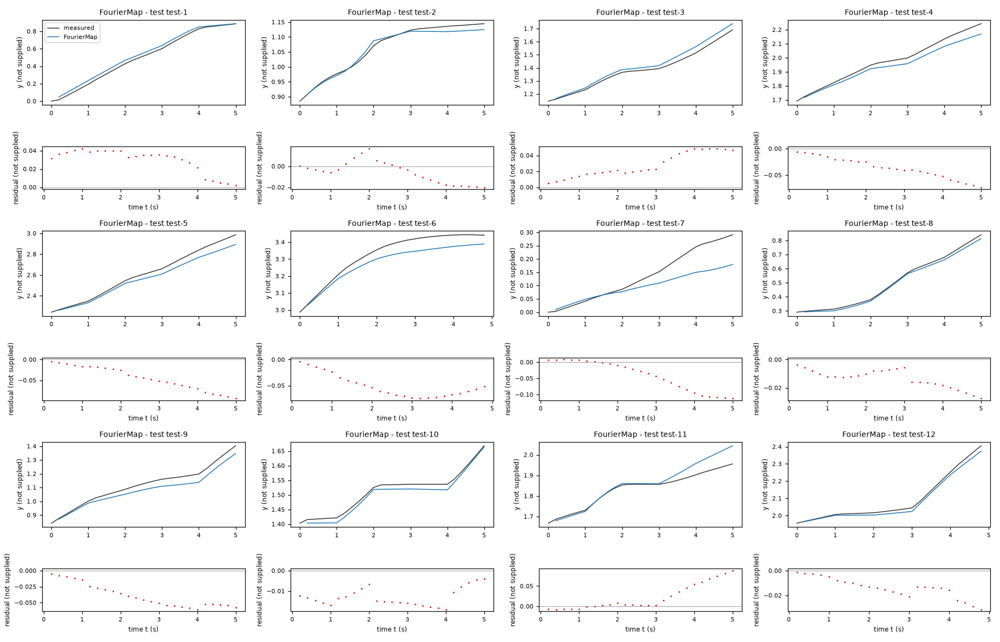
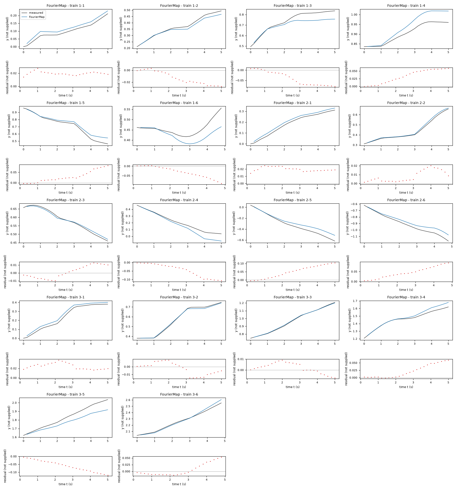
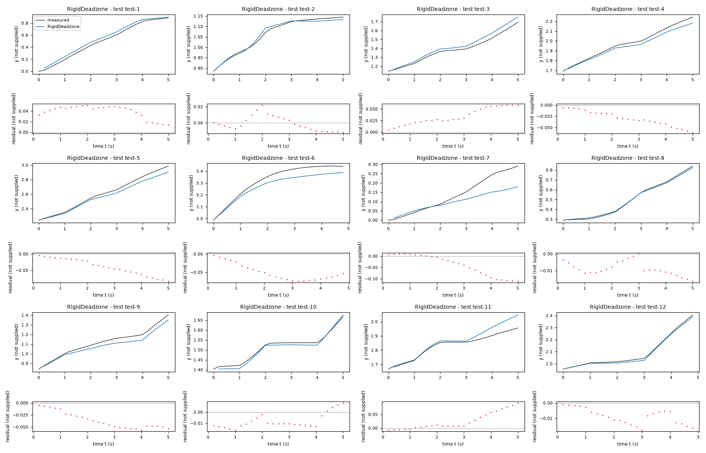
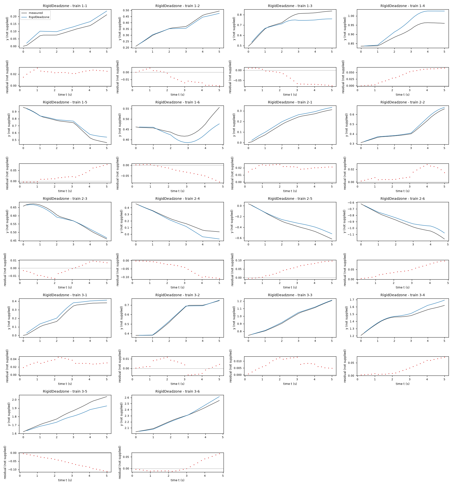
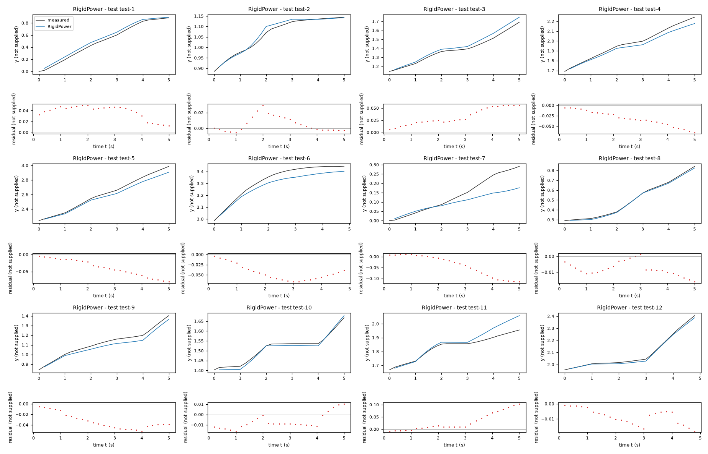
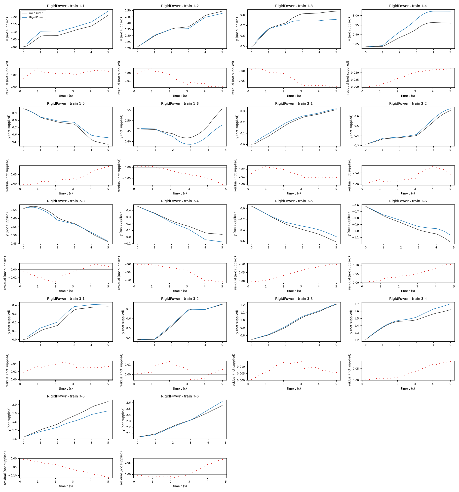

# Evaluation report: task task-kt5o

Terms. The harness is the software of ASPIRE that checks and evaluates the candidate models; a candidate is one proposed model; the pool is the set of candidates of one round. Sealed data (test data, reference expression) are inaccessible to the agent. This report contains results on sealed data and is not shown to the agent.

Evaluation mode: simulation (initialized once per trajectory from the measured state at sample 0; the state-update equation at the sampling period T_s = 0.2 s; the model output is h(x[k], u[k])).
Error measures: for one trajectory with scoring interval I of N samples, measured output y[k] (y, not supplied) and model output ŷ[k], SSE = Σ_(k∈I) (ŷ[k] − y[k])²; RMSE = sqrt(SSE/N), in not supplied; NRMSE = RMSE/σ, with μ and σ the mean and the population standard deviation of y on I; R² = 1 − SSE / Σ_(k∈I) (y[k] − μ)²; NRMSE and R² are not applicable when σ = 0. The pooled RMSE over several trajectories is S = sqrt(ΣSSE / ΣN); on the test data it is the ranking score.
Numerical failure limits: y in [-100, 100] not supplied; x1 in [-100, 100] not supplied; x2 in [-1000, 1000] not supplied; evaluation time limit 60 s per candidate and data group; symbolic time limit 10 s per verification.
Discontinuous expressions: expressions with jumps (Piecewise, sign) are evaluated pointwise at the sample instants and Runge-Kutta stages; no event detection or step refinement is applied at a jump.
Harness version 0.1.0.dev0; NumPy 2.5.1; SymPy 1.14.0.

## Pool

| category | count |
|---|---|
| candidates proposed | 3 |
| accepted by the file and expression checks | 3 |
| outside the pool limit of 10 (not evaluated) | 0 |
| evaluated | 3 |
| excluded by physical requirements | 0 |
| failed numerically on training or validation data | 0 |
| failed numerically on test data | 0 |
| eligible for ranking | 3 |

Note: the categories overlap: the candidates accepted by the checks include those outside the pool limit, and a candidate can be both excluded by requirements and failed numerically; the counts need not sum to the pool size.

Distinct structures: 3 among 3 evaluated candidates; groups: FourierMap; RigidDeadzone; RigidPower. Convention: ties resolved, fixed values kept, given constants kept, fitted parameters renamed P1..Pn in order of first occurrence; equal when a one-to-one renaming of the fitted parameters makes every expression identical in SymPy's canonical form.

### Recommendation of the agent

Recommended candidate: FourierMap. The agent's reason: The independent Fourier state map has the lowest aggregate leave-one-trajectory-out scored `y` RMSE among the retained families: `0.08581916496554522` in logged `y` units on `data/train.csv`, versus `0.08971175638571534` for the five-parameter rigid dead-zone map and `0.10647703014936342` for the signed-power map. It also has lower full-training free-running coordinate error than the other retained maps. This is a small advantage, not proof of test superiority: it uses more coefficients, and prefix-to-tail validation gives `0.1982659017905261` in logged `y` units, worse than the simpler alternatives. The rigid dead-zone map is retained as the parsimonious fallback. All candidates omit input history and leave substantial switch residuals.
- Test score S of the recommended candidate (practical selection): 0.0379388 not supplied; eligible: True; rank in the oracle-based selection: 3.

## Oracle-based selection on test data

Label: oracle-based selection on test data. Candidates considered: 3 eligible of 3 evaluated. Criterion: pooled test RMSE S, increasing, the pooled RMSE over the test trajectories test-1 (25 scored samples), test-2 (25 scored samples), test-3 (25 scored samples), test-4 (25 scored samples), test-5 (25 scored samples), test-6 (24 scored samples), test-7 (25 scored samples), test-8 (25 scored samples), test-9 (25 scored samples), test-10 (25 scored samples), test-11 (25 scored samples), test-12 (24 scored samples). Tie rule: |S_a - S_b| <= 1e-12 * max(S_a, S_b) for consecutive candidates; tied candidates share a rank. This ranking selects on the test data. It measures whether the pool contains an accurate model, not whether the agent can recognize that model without test data. A rank is not evidence of physical admissibility: each entry carries its unresolved requirements and any violation allowed by the user.

| rank | candidate | S (not supplied) | unresolved requirements | violations allowed by the user |
|---|---|---|---|---|
| 1 | RigidPower | 0.0366362 | none | none |
| 2 | RigidDeadzone | 0.0370945 | none | none |
| 3 | FourierMap | 0.0379388 | none | none |

## Candidates

### Candidate FourierMap

Position in the agent's order: 1. Status: evaluated.
File and expression checks: passed.
- `y_next = y + a0 + a1*(x3*cos(x2)) + a2*(x3*sin(x2)) + a3*(cos(x2)) + a4*(sin(x2)) + a5*(x3*x4*cos(x2)) + a6*(x3*x4*sin(x2))`
- `x1_next = x1 + b0 + b1*(x3*cos(x2)) + b2*(x3*sin(x2)) + b3*(cos(x2)) + b4*(sin(x2)) + b5*(x3*x4*cos(x2)) + b6*(x3*x4*sin(x2))`
- `x2_next = atan2(sin(x2 + (hb + hg*sign(x4)*Max(Abs(x4)-hd, 0))), cos(x2 + (hb + hg*sign(x4)*Max(Abs(x4)-hd, 0))))`
Complexity: 17 fitted, 0 fixed and 0 tied parameters; 0 non-integer numeric literals; 99 expression-tree nodes (SymPy tree, every operator, function, symbol and number counted once).
Structure group 1: `y_next = P1 + P2*cos(x2) + P3*sin(x2) + P4*x3*cos(x2) + P5*x3*sin(x2) + P6*x3*x4*cos(x2) + P7*x3*x4*sin(x2) + y`; `x1_next = P10*sin(x2) + P11*x3*cos(x2) + P12*x3*sin(x2) + P13*x3*x4*cos(x2) + P14*x3*x4*sin(x2) + P8 + P9*cos(x2) + x1`; `x2_next = atan2(sin(P15 + P16*sign(x4)*Max(0, -P17 + Abs(x4)) + x2), cos(P15 + P16*sign(x4)*Max(0, -P17 + Abs(x4)) + x2))`

Requirements:

| id | type | outcome | status | method | detail |
|---|---|---|---|---|---|

Output errors on the test data (sealed) (pooled RMSE: 0.0379388 not supplied):

| trajectory | scored samples | completed | RMSE (not supplied) | NRMSE | R² | failure |
|---|---|---|---|---|---|---|
| test-1 | 25 | 25 | 0.0320373 | 0.114433 | 0.986905 | none |
| test-2 | 25 | 25 | 0.0116185 | 0.151711 | 0.976984 | none |
| test-3 | 25 | 25 | 0.031323 | 0.214137 | 0.954145 | none |
| test-4 | 25 | 25 | 0.04134 | 0.275051 | 0.924347 | none |
| test-5 | 25 | 25 | 0.0527153 | 0.236488 | 0.944074 | none |
| test-6 | 24 | 24 | 0.055267 | 0.439456 | 0.806879 | none |
| test-7 | 25 | 25 | 0.0606075 | 0.653821 | 0.572518 | none |
| test-8 | 25 | 25 | 0.0148428 | 0.082407 | 0.993209 | none |
| test-9 | 25 | 25 | 0.0428634 | 0.3239 | 0.895089 | none |
| test-10 | 25 | 25 | 0.0136746 | 0.201345 | 0.95946 | none |
| test-11 | 25 | 25 | 0.0378177 | 0.483564 | 0.766166 | none |
| test-12 | 24 | 24 | 0.0160198 | 0.120369 | 0.985511 | none |

Output errors on the training data (pooled RMSE: 0.0378974 not supplied):

| trajectory | scored samples | completed | RMSE (not supplied) | NRMSE | R² | failure |
|---|---|---|---|---|---|---|
| 1-1 | 25 | 25 | 0.0200345 | 0.393126 | 0.845452 | none |
| 1-2 | 25 | 25 | 0.0166385 | 0.216087 | 0.953306 | none |
| 1-3 | 25 | 25 | 0.0514962 | 0.568269 | 0.677071 | none |
| 1-4 | 25 | 25 | 0.0391508 | 0.786523 | 0.381382 | none |
| 1-5 | 25 | 25 | 0.0392584 | 0.263136 | 0.93076 | none |
| 1-6 | 24 | 24 | 0.0419034 | 1.15492 | -0.333846 | none |
| 2-1 | 25 | 25 | 0.0202478 | 0.214303 | 0.954074 | none |
| 2-2 | 25 | 25 | 0.0102779 | 0.100245 | 0.989951 | none |
| 2-3 | 25 | 25 | 0.0078085 | 0.11373 | 0.987066 | none |
| 2-4 | 25 | 25 | 0.0592443 | 0.459183 | 0.789151 | none |
| 2-5 | 25 | 25 | 0.0621424 | 0.348418 | 0.878605 | none |
| 2-6 | 24 | 24 | 0.0528988 | 0.365744 | 0.866231 | none |
| 3-1 | 25 | 25 | 0.0253708 | 0.195496 | 0.961781 | none |
| 3-2 | 25 | 25 | 0.00814574 | 0.0593783 | 0.996474 | none |
| 3-3 | 25 | 25 | 0.00507388 | 0.0351895 | 0.998762 | none |
| 3-4 | 25 | 25 | 0.0307887 | 0.307887 | 0.905206 | none |
| 3-5 | 25 | 25 | 0.0690496 | 0.556679 | 0.690108 | none |
| 3-6 | 24 | 24 | 0.022905 | 0.147407 | 0.978271 | none |

Sensitivity rank test (diagnostic; never excludes): targets y_next, x1_next, x2_next on the train data (1341 rows, 0 dropped); analytic derivatives (SymPy), ties differentiated through their equations; scaling: rows of each target divided by the standard deviation of its measured column; columns divided by their Euclidean norm; rank threshold s_i / s_1 > 1e-08; singular values 1.49, 1.49, 1.41, 1.41, 1.37, 0.993, 0.993, 0.993, 0.988, 0.988, 0.767, 0.767, 0.375, 0.373, 0.373, 0.347, 0.347; rank 17 of 17.
Reference comparison: not applicable (the task has no reference expression).
Eligible for ranking: True.

*Candidate FourierMap, test data (sealed), trajectories test-1, test-2, test-3, test-4, test-5, test-6, test-7, test-8, test-9, test-10, test-11, test-12. Upper axes: measured output y (not supplied) and model output of FourierMap; lower axes: residual (model output minus measured output, not supplied). Evaluation mode: simulation (initialized once per trajectory from the measured state at sample 0; the state-update equation at the sampling period T_s = 0.2 s; the model output is h(x[k], u[k])). Initialization: the first 1 sample(s) of each trajectory initialize the model and are excluded from the errors. Errors are computed on the samples test-1: 1 to 25; test-2: 1 to 25; test-3: 1 to 25; test-4: 1 to 25; test-5: 1 to 25; test-6: 1 to 24; test-7: 1 to 25; test-8: 1 to 25; test-9: 1 to 25; test-10: 1 to 25; test-11: 1 to 25; test-12: 1 to 24 (0-based sample indices). No numerical failure occurred.*

*Candidate FourierMap, training data, trajectories 1-1, 1-2, 1-3, 1-4, 1-5, 1-6, 2-1, 2-2, 2-3, 2-4, 2-5, 2-6, 3-1, 3-2, 3-3, 3-4, 3-5, 3-6. Upper axes: measured output y (not supplied) and model output of FourierMap; lower axes: residual (model output minus measured output, not supplied). Evaluation mode: simulation (initialized once per trajectory from the measured state at sample 0; the state-update equation at the sampling period T_s = 0.2 s; the model output is h(x[k], u[k])). Initialization: the first 1 sample(s) of each trajectory initialize the model and are excluded from the errors. Errors are computed on the samples 1-1: 1 to 25; 1-2: 1 to 25; 1-3: 1 to 25; 1-4: 1 to 25; 1-5: 1 to 25; 1-6: 1 to 24; 2-1: 1 to 25; 2-2: 1 to 25; 2-3: 1 to 25; 2-4: 1 to 25; 2-5: 1 to 25; 2-6: 1 to 24; 3-1: 1 to 25; 3-2: 1 to 25; 3-3: 1 to 25; 3-4: 1 to 25; 3-5: 1 to 25; 3-6: 1 to 24 (0-based sample indices). No numerical failure occurred.*

### Candidate RigidDeadzone

Position in the agent's order: 2. Status: evaluated.
File and expression checks: passed.
- `y_next = y + (sb + sv*x3)*cos(x2 + 0.5*(hb + hg*sign(x4)*Max(Abs(x4)-hd, 0)))`
- `x1_next = x1 + (sb + sv*x3)*sin(x2 + 0.5*(hb + hg*sign(x4)*Max(Abs(x4)-hd, 0)))`
- `x2_next = atan2(sin(x2 + (hb + hg*sign(x4)*Max(Abs(x4)-hd, 0))), cos(x2 + (hb + hg*sign(x4)*Max(Abs(x4)-hd, 0))))`
Complexity: 5 fitted, 0 fixed and 0 tied parameters; 4 non-integer numeric literals; 87 expression-tree nodes (SymPy tree, every operator, function, symbol and number counted once).
Structure group 2: `y_next = y + (P1 + P2*x3)*cos(0.5*P3 + 0.5*P4*sign(x4)*Max(0, -P5 + Abs(x4)) + x2)`; `x1_next = x1 + (P1 + P2*x3)*sin(0.5*P3 + 0.5*P4*sign(x4)*Max(0, -P5 + Abs(x4)) + x2)`; `x2_next = atan2(sin(P3 + P4*sign(x4)*Max(0, -P5 + Abs(x4)) + x2), cos(P3 + P4*sign(x4)*Max(0, -P5 + Abs(x4)) + x2))`

Requirements:

| id | type | outcome | status | method | detail |
|---|---|---|---|---|---|

Output errors on the test data (sealed) (pooled RMSE: 0.0370945 not supplied):

| trajectory | scored samples | completed | RMSE (not supplied) | NRMSE | R² | failure |
|---|---|---|---|---|---|---|
| test-1 | 25 | 25 | 0.0408885 | 0.146048 | 0.97867 | none |
| test-2 | 25 | 25 | 0.0091728 | 0.119776 | 0.985654 | none |
| test-3 | 25 | 25 | 0.0382542 | 0.261522 | 0.931606 | none |
| test-4 | 25 | 25 | 0.0339655 | 0.225986 | 0.948931 | none |
| test-5 | 25 | 25 | 0.0463692 | 0.208018 | 0.956728 | none |
| test-6 | 24 | 24 | 0.0545187 | 0.433505 | 0.812074 | none |
| test-7 | 25 | 25 | 0.059438 | 0.641205 | 0.588857 | none |
| test-8 | 25 | 25 | 0.0096207 | 0.053414 | 0.997147 | none |
| test-9 | 25 | 25 | 0.039973 | 0.302059 | 0.908761 | none |
| test-10 | 25 | 25 | 0.0104611 | 0.154028 | 0.976275 | none |
| test-11 | 25 | 25 | 0.039925 | 0.510508 | 0.739381 | none |
| test-12 | 24 | 24 | 0.0101399 | 0.0761891 | 0.994195 | none |

Output errors on the training data (pooled RMSE: 0.0379694 not supplied):

| trajectory | scored samples | completed | RMSE (not supplied) | NRMSE | R² | failure |
|---|---|---|---|---|---|---|
| 1-1 | 25 | 25 | 0.0242038 | 0.474937 | 0.774435 | none |
| 1-2 | 25 | 25 | 0.01131 | 0.146885 | 0.978425 | none |
| 1-3 | 25 | 25 | 0.0490591 | 0.541375 | 0.706913 | none |
| 1-4 | 25 | 25 | 0.0447259 | 0.898525 | 0.192652 | none |
| 1-5 | 25 | 25 | 0.0359106 | 0.240696 | 0.942065 | none |
| 1-6 | 24 | 24 | 0.0365003 | 1.006 | -0.0120438 | none |
| 2-1 | 25 | 25 | 0.0212783 | 0.22521 | 0.94928 | none |
| 2-2 | 25 | 25 | 0.014512 | 0.141543 | 0.979966 | none |
| 2-3 | 25 | 25 | 0.00753781 | 0.109787 | 0.987947 | none |
| 2-4 | 25 | 25 | 0.0599286 | 0.464487 | 0.784252 | none |
| 2-5 | 25 | 25 | 0.0594402 | 0.333268 | 0.888933 | none |
| 2-6 | 24 | 24 | 0.0538624 | 0.372407 | 0.861313 | none |
| 3-1 | 25 | 25 | 0.032644 | 0.25154 | 0.936728 | none |
| 3-2 | 25 | 25 | 0.00621259 | 0.0452866 | 0.997949 | none |
| 3-3 | 25 | 25 | 0.00856565 | 0.0594063 | 0.996471 | none |
| 3-4 | 25 | 25 | 0.0380522 | 0.380522 | 0.855203 | none |
| 3-5 | 25 | 25 | 0.0642552 | 0.518026 | 0.731649 | none |
| 3-6 | 24 | 24 | 0.02707 | 0.174211 | 0.969651 | none |

Sensitivity rank test (diagnostic; never excludes): targets y_next, x1_next, x2_next on the train data (1341 rows, 0 dropped); analytic derivatives (SymPy), ties differentiated through their equations; scaling: rows of each target divided by the standard deviation of its measured column; columns divided by their Euclidean norm; rank threshold s_i / s_1 > 1e-08; singular values 1.37, 1.36, 0.993, 0.387, 0.374; rank 5 of 5.
Reference comparison: not applicable (the task has no reference expression).
Eligible for ranking: True.

*Candidate RigidDeadzone, test data (sealed), trajectories test-1, test-2, test-3, test-4, test-5, test-6, test-7, test-8, test-9, test-10, test-11, test-12. Upper axes: measured output y (not supplied) and model output of RigidDeadzone; lower axes: residual (model output minus measured output, not supplied). Evaluation mode: simulation (initialized once per trajectory from the measured state at sample 0; the state-update equation at the sampling period T_s = 0.2 s; the model output is h(x[k], u[k])). Initialization: the first 1 sample(s) of each trajectory initialize the model and are excluded from the errors. Errors are computed on the samples test-1: 1 to 25; test-2: 1 to 25; test-3: 1 to 25; test-4: 1 to 25; test-5: 1 to 25; test-6: 1 to 24; test-7: 1 to 25; test-8: 1 to 25; test-9: 1 to 25; test-10: 1 to 25; test-11: 1 to 25; test-12: 1 to 24 (0-based sample indices). No numerical failure occurred.*

*Candidate RigidDeadzone, training data, trajectories 1-1, 1-2, 1-3, 1-4, 1-5, 1-6, 2-1, 2-2, 2-3, 2-4, 2-5, 2-6, 3-1, 3-2, 3-3, 3-4, 3-5, 3-6. Upper axes: measured output y (not supplied) and model output of RigidDeadzone; lower axes: residual (model output minus measured output, not supplied). Evaluation mode: simulation (initialized once per trajectory from the measured state at sample 0; the state-update equation at the sampling period T_s = 0.2 s; the model output is h(x[k], u[k])). Initialization: the first 1 sample(s) of each trajectory initialize the model and are excluded from the errors. Errors are computed on the samples 1-1: 1 to 25; 1-2: 1 to 25; 1-3: 1 to 25; 1-4: 1 to 25; 1-5: 1 to 25; 1-6: 1 to 24; 2-1: 1 to 25; 2-2: 1 to 25; 2-3: 1 to 25; 2-4: 1 to 25; 2-5: 1 to 25; 2-6: 1 to 24; 3-1: 1 to 25; 3-2: 1 to 25; 3-3: 1 to 25; 3-4: 1 to 25; 3-5: 1 to 25; 3-6: 1 to 24 (0-based sample indices). No numerical failure occurred.*

### Candidate RigidPower

Position in the agent's order: 3. Status: evaluated.
File and expression checks: passed.
- `y_next = y + (sb + sv*x3)*cos(x2 + 0.5*(hb + hg*sign(x4)*Abs(x4)**hp))`
- `x1_next = x1 + (sb + sv*x3)*sin(x2 + 0.5*(hb + hg*sign(x4)*Abs(x4)**hp))`
- `x2_next = atan2(sin(x2 + (hb + hg*sign(x4)*Abs(x4)**hp)), cos(x2 + (hb + hg*sign(x4)*Abs(x4)**hp)))`
Complexity: 5 fitted, 0 fixed and 0 tied parameters; 4 non-integer numeric literals; 71 expression-tree nodes (SymPy tree, every operator, function, symbol and number counted once).
Structure group 3: `y_next = y + (P1 + P2*x3)*cos(0.5*P3 + 0.5*P4*Abs(x4)**P5*sign(x4) + x2)`; `x1_next = x1 + (P1 + P2*x3)*sin(0.5*P3 + 0.5*P4*Abs(x4)**P5*sign(x4) + x2)`; `x2_next = atan2(sin(P3 + P4*Abs(x4)**P5*sign(x4) + x2), cos(P3 + P4*Abs(x4)**P5*sign(x4) + x2))`

Requirements:

| id | type | outcome | status | method | detail |
|---|---|---|---|---|---|

Output errors on the test data (sealed) (pooled RMSE: 0.0366362 not supplied):

| trajectory | scored samples | completed | RMSE (not supplied) | NRMSE | R² | failure |
|---|---|---|---|---|---|---|
| test-1 | 25 | 25 | 0.0395965 | 0.141433 | 0.979997 | none |
| test-2 | 25 | 25 | 0.0109503 | 0.142986 | 0.979555 | none |
| test-3 | 25 | 25 | 0.0360398 | 0.246383 | 0.939295 | none |
| test-4 | 25 | 25 | 0.0360998 | 0.240186 | 0.942311 | none |
| test-5 | 25 | 25 | 0.0455014 | 0.204125 | 0.958333 | none |
| test-6 | 24 | 24 | 0.0482174 | 0.383401 | 0.853004 | none |
| test-7 | 25 | 25 | 0.0611926 | 0.660132 | 0.564225 | none |
| test-8 | 25 | 25 | 0.00899378 | 0.0499333 | 0.997507 | none |
| test-9 | 25 | 25 | 0.0359049 | 0.271318 | 0.926387 | none |
| test-10 | 25 | 25 | 0.00987288 | 0.145368 | 0.978868 | none |
| test-11 | 25 | 25 | 0.045837 | 0.586103 | 0.656483 | none |
| test-12 | 24 | 24 | 0.00989039 | 0.0743142 | 0.994477 | none |

Output errors on the training data (pooled RMSE: 0.0394072 not supplied):

| trajectory | scored samples | completed | RMSE (not supplied) | NRMSE | R² | failure |
|---|---|---|---|---|---|---|
| 1-1 | 25 | 25 | 0.0247649 | 0.485948 | 0.763854 | none |
| 1-2 | 25 | 25 | 0.0108446 | 0.140841 | 0.980164 | none |
| 1-3 | 25 | 25 | 0.0527078 | 0.581639 | 0.661696 | none |
| 1-4 | 25 | 25 | 0.0433088 | 0.870055 | 0.243004 | none |
| 1-5 | 25 | 25 | 0.0441427 | 0.295873 | 0.912459 | none |
| 1-6 | 24 | 24 | 0.0357502 | 0.98533 | 0.0291242 | none |
| 2-1 | 25 | 25 | 0.0156522 | 0.165664 | 0.972556 | none |
| 2-2 | 25 | 25 | 0.0167727 | 0.163592 | 0.973238 | none |
| 2-3 | 25 | 25 | 0.00775555 | 0.112959 | 0.98724 | none |
| 2-4 | 25 | 25 | 0.0627032 | 0.485991 | 0.763812 | none |
| 2-5 | 25 | 25 | 0.059496 | 0.33358 | 0.888724 | none |
| 2-6 | 24 | 24 | 0.0574866 | 0.397464 | 0.842022 | none |
| 3-1 | 25 | 25 | 0.033889 | 0.261133 | 0.931809 | none |
| 3-2 | 25 | 25 | 0.00676648 | 0.0493241 | 0.997567 | none |
| 3-3 | 25 | 25 | 0.00918048 | 0.0636705 | 0.995946 | none |
| 3-4 | 25 | 25 | 0.0442873 | 0.442873 | 0.803863 | none |
| 3-5 | 25 | 25 | 0.0632969 | 0.510301 | 0.739593 | none |
| 3-6 | 24 | 24 | 0.027563 | 0.177384 | 0.968535 | none |

Sensitivity rank test (diagnostic; never excludes): targets y_next, x1_next, x2_next on the train data (1341 rows, 0 dropped); analytic derivatives (SymPy), ties differentiated through their equations; scaling: rows of each target divided by the standard deviation of its measured column; columns divided by their Euclidean norm; rank threshold s_i / s_1 > 1e-08; singular values 1.36, 1.32, 0.996, 0.505, 0.387; rank 5 of 5.
Reference comparison: not applicable (the task has no reference expression).
Eligible for ranking: True.

*Candidate RigidPower, test data (sealed), trajectories test-1, test-2, test-3, test-4, test-5, test-6, test-7, test-8, test-9, test-10, test-11, test-12. Upper axes: measured output y (not supplied) and model output of RigidPower; lower axes: residual (model output minus measured output, not supplied). Evaluation mode: simulation (initialized once per trajectory from the measured state at sample 0; the state-update equation at the sampling period T_s = 0.2 s; the model output is h(x[k], u[k])). Initialization: the first 1 sample(s) of each trajectory initialize the model and are excluded from the errors. Errors are computed on the samples test-1: 1 to 25; test-2: 1 to 25; test-3: 1 to 25; test-4: 1 to 25; test-5: 1 to 25; test-6: 1 to 24; test-7: 1 to 25; test-8: 1 to 25; test-9: 1 to 25; test-10: 1 to 25; test-11: 1 to 25; test-12: 1 to 24 (0-based sample indices). No numerical failure occurred.*

*Candidate RigidPower, training data, trajectories 1-1, 1-2, 1-3, 1-4, 1-5, 1-6, 2-1, 2-2, 2-3, 2-4, 2-5, 2-6, 3-1, 3-2, 3-3, 3-4, 3-5, 3-6. Upper axes: measured output y (not supplied) and model output of RigidPower; lower axes: residual (model output minus measured output, not supplied). Evaluation mode: simulation (initialized once per trajectory from the measured state at sample 0; the state-update equation at the sampling period T_s = 0.2 s; the model output is h(x[k], u[k])). Initialization: the first 1 sample(s) of each trajectory initialize the model and are excluded from the errors. Errors are computed on the samples 1-1: 1 to 25; 1-2: 1 to 25; 1-3: 1 to 25; 1-4: 1 to 25; 1-5: 1 to 25; 1-6: 1 to 24; 2-1: 1 to 25; 2-2: 1 to 25; 2-3: 1 to 25; 2-4: 1 to 25; 2-5: 1 to 25; 2-6: 1 to 24; 3-1: 1 to 25; 3-2: 1 to 25; 3-3: 1 to 25; 3-4: 1 to 25; 3-5: 1 to 25; 3-6: 1 to 24 (0-based sample indices). No numerical failure occurred.*
