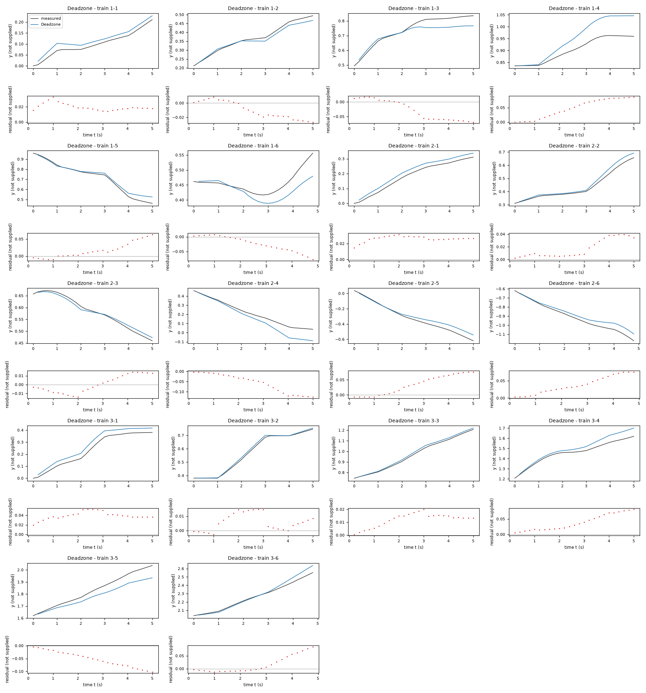
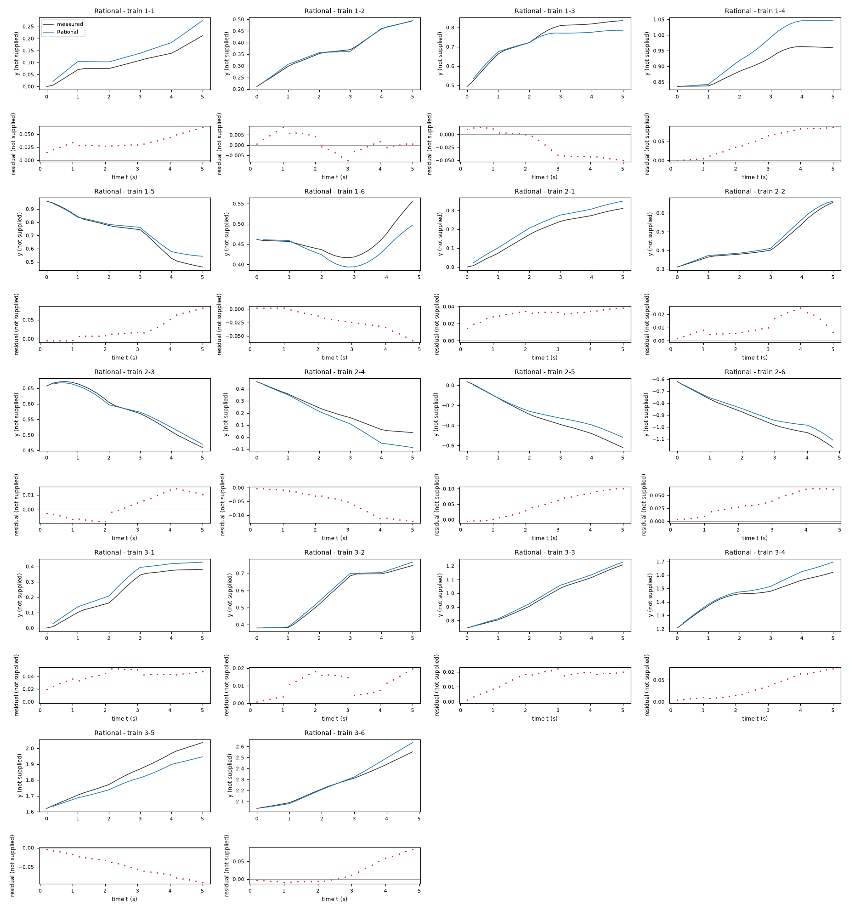
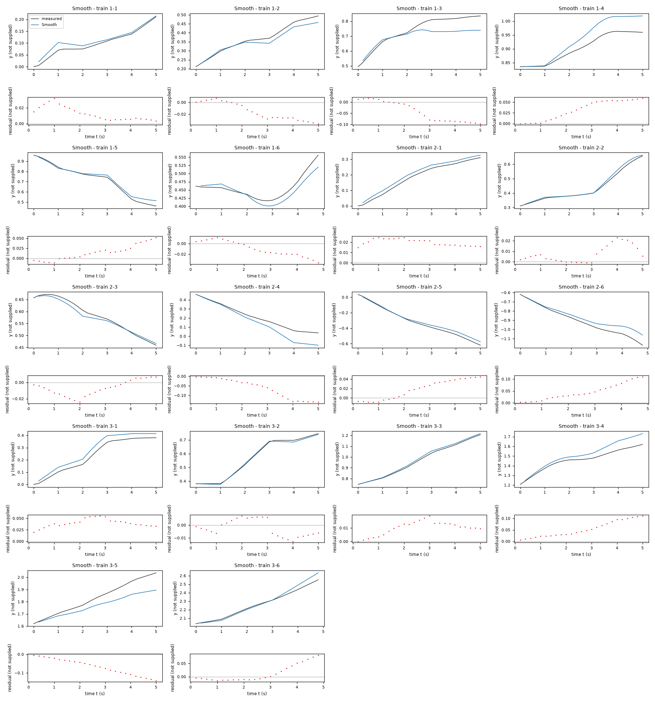
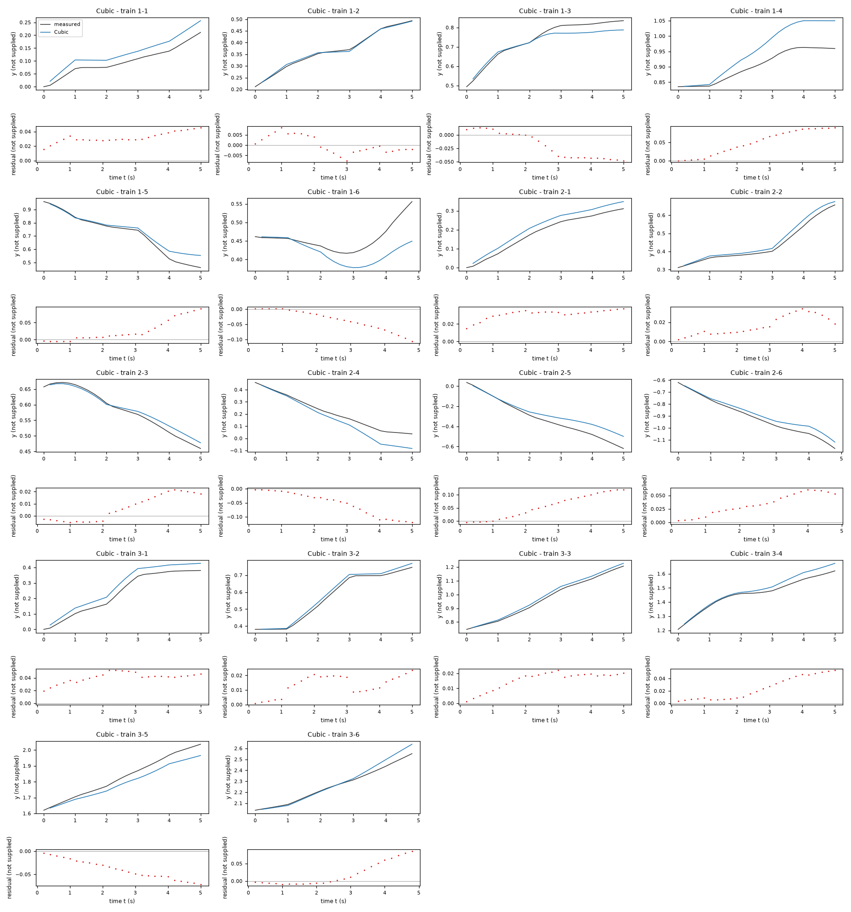
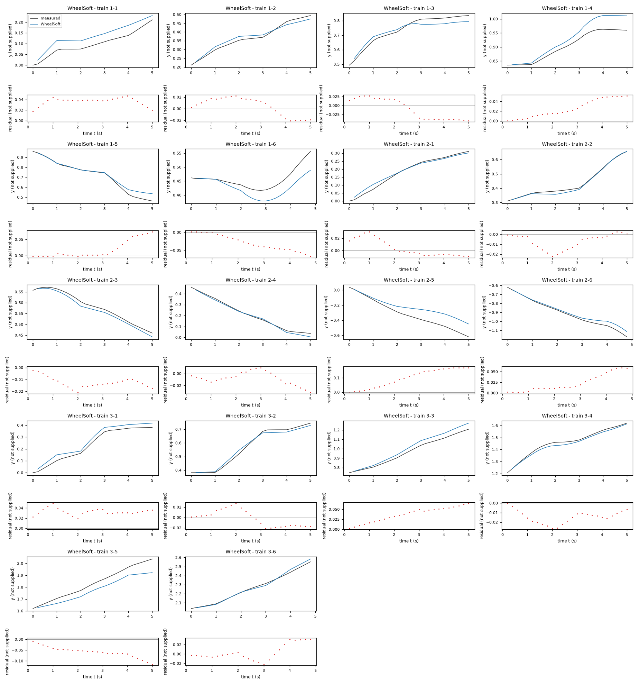
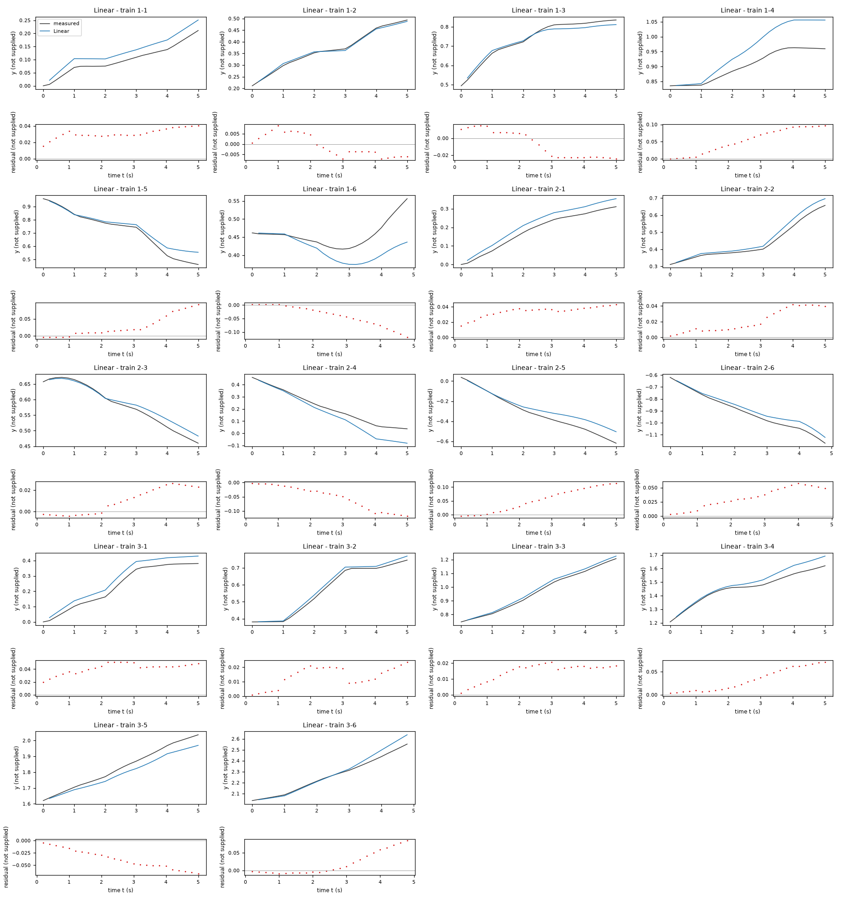

# Evaluation results permitted to the agent: task task-kt5o

Terms. The harness is the software of ASPIRE that checks and evaluates the candidate models; a candidate is one proposed model; the pool is the set of candidates of one round. Sealed data (test data, reference expression) are inaccessible to the agent. This view contains no result derived from sealed data.

Evaluation mode: simulation (initialized once per trajectory from the measured state at sample 0; the state-update equation at the sampling period T_s = 0.2 s; the model output is h(x[k], u[k])).
Error measures: for one trajectory with scoring interval I of N samples, measured output y[k] (y, not supplied) and model output ŷ[k], SSE = Σ_(k∈I) (ŷ[k] − y[k])²; RMSE = sqrt(SSE/N), in not supplied; NRMSE = RMSE/σ, with μ and σ the mean and the population standard deviation of y on I; R² = 1 − SSE / Σ_(k∈I) (y[k] − μ)²; NRMSE and R² are not applicable when σ = 0. The pooled RMSE over several trajectories is S = sqrt(ΣSSE / ΣN); on the test data it is the ranking score.
Numerical failure limits: y in [-100, 100] not supplied; x1 in [-100, 100] not supplied; x2 in [-1000, 1000] not supplied; evaluation time limit 60 s per candidate and data group; symbolic time limit 10 s per verification.
Discontinuous expressions: expressions with jumps (Piecewise, sign) are evaluated pointwise at the sample instants and Runge-Kutta stages; no event detection or step refinement is applied at a jump.
Harness version 0.1.0.dev0; NumPy 2.5.1; SymPy 1.14.0.

## Pool

| category | count |
|---|---|
| candidates proposed | 6 |
| accepted by the file and expression checks | 6 |
| outside the pool limit of 10 (not evaluated) | 0 |
| evaluated | 6 |
| excluded by physical requirements | 0 |
| failed numerically on training or validation data | 0 |

Note: the categories overlap; the counts need not sum to the pool size.

Distinct structures: 6 among 6 evaluated candidates; groups: Deadzone; Rational; Smooth; Cubic; WheelSoft; Linear. Convention: ties resolved, fixed values kept, given constants kept, fitted parameters renamed P1..Pn in order of first occurrence; equal when a one-to-one renaming of the fitted parameters makes every expression identical in SymPy's canonical form.

### Recommendation of the agent

Recommended candidate: Deadzone. The agent's reason: Recommend `Deadzone`: its symmetric dead-zone input map is compact and balances two validation designs. Leave-one-trajectory-out free-run RMSE of `y` is `0.125475` in unspecified output units; first-100-row fitting and final-50-transition validation gives `0.103553` in the same units. `Rational` has lower trajectory-held-out RMSE (`0.111305`) but weaker prefix-tail performance (`0.137843`) and a singularity outside the nonnegative-input domain. `Smooth` fits training much better but has weaker held-out-trajectory performance. All values were computed on `data/train.csv`; no test scores are available. The pool contains distinct static nonlinear map families sharing the data-supported periodic planar kinematics, rather than coefficient perturbations of one model.

## Candidates

### Candidate Deadzone

Position in the agent's order: 1. Status: evaluated.
File and expression checks: passed.
- `y_next = y+(a*x3+b)*cos(x2+(g*sign(x4)*Max(Abs(x4)-d,0)+c)/2)`
- `x1_next = x1+(a*x3+b)*sin(x2+(g*sign(x4)*Max(Abs(x4)-d,0)+c)/2)`
- `x2_next = atan2(sin(x2+(g*sign(x4)*Max(Abs(x4)-d,0)+c)),cos(x2+(g*sign(x4)*Max(Abs(x4)-d,0)+c)))`
Complexity: 5 fitted, 0 fixed and 0 tied parameters; 0 non-integer numeric literals; 87 expression-tree nodes (SymPy tree, every operator, function, symbol and number counted once).
Structure group 1: `y_next = y + (P1 + P2*x3)*cos(P3/2 + P4*sign(x4)*Max(0, -P5 + Abs(x4))/2 + x2)`; `x1_next = x1 + (P1 + P2*x3)*sin(P3/2 + P4*sign(x4)*Max(0, -P5 + Abs(x4))/2 + x2)`; `x2_next = atan2(sin(P3 + P4*sign(x4)*Max(0, -P5 + Abs(x4)) + x2), cos(P3 + P4*sign(x4)*Max(0, -P5 + Abs(x4)) + x2))`

Requirements:

| id | type | outcome | status | method | detail |
|---|---|---|---|---|---|

Output errors on the training data (pooled RMSE: 0.0388248 not supplied):

| trajectory | scored samples | completed | RMSE (not supplied) | NRMSE | R² | failure |
|---|---|---|---|---|---|---|
| 1-1 | 25 | 25 | 0.020346 | 0.399239 | 0.840609 | none |
| 1-2 | 25 | 25 | 0.0151873 | 0.197241 | 0.961096 | none |
| 1-3 | 25 | 25 | 0.0428505 | 0.472862 | 0.776402 | none |
| 1-4 | 25 | 25 | 0.0575059 | 1.15527 | -0.334647 | none |
| 1-5 | 25 | 25 | 0.0276039 | 0.185019 | 0.965768 | none |
| 1-6 | 24 | 24 | 0.034479 | 0.950293 | 0.0969429 | none |
| 2-1 | 25 | 25 | 0.0265964 | 0.281497 | 0.920759 | none |
| 2-2 | 25 | 25 | 0.0220444 | 0.21501 | 0.953771 | none |
| 2-3 | 25 | 25 | 0.00950352 | 0.138418 | 0.980841 | none |
| 2-4 | 25 | 25 | 0.0721871 | 0.559498 | 0.686962 | none |
| 2-5 | 25 | 25 | 0.0455851 | 0.255585 | 0.934676 | none |
| 2-6 | 24 | 24 | 0.04497 | 0.310924 | 0.903326 | none |
| 3-1 | 25 | 25 | 0.0402163 | 0.309889 | 0.903969 | none |
| 3-2 | 25 | 25 | 0.00839403 | 0.0611882 | 0.996256 | none |
| 3-3 | 25 | 25 | 0.0131286 | 0.0910525 | 0.991709 | none |
| 3-4 | 25 | 25 | 0.0460377 | 0.460377 | 0.788053 | none |
| 3-5 | 25 | 25 | 0.0595054 | 0.479734 | 0.769855 | none |
| 3-6 | 24 | 24 | 0.0357396 | 0.230005 | 0.947098 | none |

Sensitivity rank test (diagnostic; never excludes): targets y_next, x1_next, x2_next on the train data (1341 rows, 0 dropped); analytic derivatives (SymPy), ties differentiated through their equations; scaling: rows of each target divided by the standard deviation of its measured column; columns divided by their Euclidean norm; rank threshold s_i / s_1 > 1e-08; singular values 1.37, 1.36, 0.992, 0.387, 0.38; rank 5 of 5.

*Candidate Deadzone, training data, trajectories 1-1, 1-2, 1-3, 1-4, 1-5, 1-6, 2-1, 2-2, 2-3, 2-4, 2-5, 2-6, 3-1, 3-2, 3-3, 3-4, 3-5, 3-6. Upper axes: measured output y (not supplied) and model output of Deadzone; lower axes: residual (model output minus measured output, not supplied). Evaluation mode: simulation (initialized once per trajectory from the measured state at sample 0; the state-update equation at the sampling period T_s = 0.2 s; the model output is h(x[k], u[k])). Initialization: the first 1 sample(s) of each trajectory initialize the model and are excluded from the errors. Errors are computed on the samples 1-1: 1 to 25; 1-2: 1 to 25; 1-3: 1 to 25; 1-4: 1 to 25; 1-5: 1 to 25; 1-6: 1 to 24; 2-1: 1 to 25; 2-2: 1 to 25; 2-3: 1 to 25; 2-4: 1 to 25; 2-5: 1 to 25; 2-6: 1 to 24; 3-1: 1 to 25; 3-2: 1 to 25; 3-3: 1 to 25; 3-4: 1 to 25; 3-5: 1 to 25; 3-6: 1 to 24 (0-based sample indices). No numerical failure occurred.*

### Candidate Rational

Position in the agent's order: 2. Status: evaluated.
File and expression checks: passed.
- `y_next = y+(a*x3+b)*cos(x2+(g*x3/(x3+h)*sign(x4)*Max(Abs(x4)-d,0)+c)/2)`
- `x1_next = x1+(a*x3+b)*sin(x2+(g*x3/(x3+h)*sign(x4)*Max(Abs(x4)-d,0)+c)/2)`
- `x2_next = atan2(sin(x2+(g*x3/(x3+h)*sign(x4)*Max(Abs(x4)-d,0)+c)),cos(x2+(g*x3/(x3+h)*sign(x4)*Max(Abs(x4)-d,0)+c)))`
Complexity: 6 fitted, 0 fixed and 0 tied parameters; 0 non-integer numeric literals; 111 expression-tree nodes (SymPy tree, every operator, function, symbol and number counted once).
Structure group 2: `y_next = y + (P1 + P2*x3)*cos(P3/2 + P4*x3*sign(x4)*Max(0, -P6 + Abs(x4))/(2*(P5 + x3)) + x2)`; `x1_next = x1 + (P1 + P2*x3)*sin(P3/2 + P4*x3*sign(x4)*Max(0, -P6 + Abs(x4))/(2*(P5 + x3)) + x2)`; `x2_next = atan2(sin(P3 + P4*x3*sign(x4)*Max(0, -P6 + Abs(x4))/(P5 + x3) + x2), cos(P3 + P4*x3*sign(x4)*Max(0, -P6 + Abs(x4))/(P5 + x3) + x2))`

Requirements:

| id | type | outcome | status | method | detail |
|---|---|---|---|---|---|

Output errors on the training data (pooled RMSE: 0.0389111 not supplied):

| trajectory | scored samples | completed | RMSE (not supplied) | NRMSE | R² | failure |
|---|---|---|---|---|---|---|
| 1-1 | 25 | 25 | 0.037236 | 0.730662 | 0.466134 | none |
| 1-2 | 25 | 25 | 0.00407607 | 0.0529366 | 0.997198 | none |
| 1-3 | 25 | 25 | 0.0306377 | 0.338092 | 0.885694 | none |
| 1-4 | 25 | 25 | 0.0571922 | 1.14897 | -0.320126 | none |
| 1-5 | 25 | 25 | 0.036425 | 0.244144 | 0.940394 | none |
| 1-6 | 24 | 24 | 0.0266243 | 0.733808 | 0.461526 | none |
| 2-1 | 25 | 25 | 0.0319683 | 0.338354 | 0.885516 | none |
| 2-2 | 25 | 25 | 0.0130301 | 0.127089 | 0.983848 | none |
| 2-3 | 25 | 25 | 0.00818903 | 0.119272 | 0.985774 | none |
| 2-4 | 25 | 25 | 0.0690812 | 0.535426 | 0.713319 | none |
| 2-5 | 25 | 25 | 0.0609676 | 0.341831 | 0.883151 | none |
| 2-6 | 24 | 24 | 0.0404033 | 0.27935 | 0.921964 | none |
| 3-1 | 25 | 25 | 0.0423773 | 0.32654 | 0.893372 | none |
| 3-2 | 25 | 25 | 0.0122971 | 0.0896394 | 0.991965 | none |
| 3-3 | 25 | 25 | 0.016639 | 0.115398 | 0.986683 | none |
| 3-4 | 25 | 25 | 0.0417901 | 0.417901 | 0.825358 | none |
| 3-5 | 25 | 25 | 0.0537226 | 0.433113 | 0.812413 | none |
| 3-6 | 24 | 24 | 0.036514 | 0.234989 | 0.94478 | none |

Sensitivity rank test (diagnostic; never excludes): targets y_next, x1_next, x2_next on the train data (1341 rows, 0 dropped); analytic derivatives (SymPy), ties differentiated through their equations; scaling: rows of each target divided by the standard deviation of its measured column; columns divided by their Euclidean norm; rank threshold s_i / s_1 > 1e-08; singular values 1.6, 1.36, 0.994, 0.576, 0.387, 0.36; rank 6 of 6.

*Candidate Rational, training data, trajectories 1-1, 1-2, 1-3, 1-4, 1-5, 1-6, 2-1, 2-2, 2-3, 2-4, 2-5, 2-6, 3-1, 3-2, 3-3, 3-4, 3-5, 3-6. Upper axes: measured output y (not supplied) and model output of Rational; lower axes: residual (model output minus measured output, not supplied). Evaluation mode: simulation (initialized once per trajectory from the measured state at sample 0; the state-update equation at the sampling period T_s = 0.2 s; the model output is h(x[k], u[k])). Initialization: the first 1 sample(s) of each trajectory initialize the model and are excluded from the errors. Errors are computed on the samples 1-1: 1 to 25; 1-2: 1 to 25; 1-3: 1 to 25; 1-4: 1 to 25; 1-5: 1 to 25; 1-6: 1 to 24; 2-1: 1 to 25; 2-2: 1 to 25; 2-3: 1 to 25; 2-4: 1 to 25; 2-5: 1 to 25; 2-6: 1 to 24; 3-1: 1 to 25; 3-2: 1 to 25; 3-3: 1 to 25; 3-4: 1 to 25; 3-5: 1 to 25; 3-6: 1 to 24 (0-based sample indices). No numerical failure occurred.*

### Candidate Smooth

Position in the agent's order: 3. Status: evaluated.
File and expression checks: passed.
- `y_next = y+(a*x3+b)*cos(x2+(g*x4-f*tanh(x4/h)+c)/2)`
- `x1_next = x1+(a*x3+b)*sin(x2+(g*x4-f*tanh(x4/h)+c)/2)`
- `x2_next = atan2(sin(x2+(g*x4-f*tanh(x4/h)+c)),cos(x2+(g*x4-f*tanh(x4/h)+c)))`
Complexity: 6 fitted, 0 fixed and 0 tied parameters; 0 non-integer numeric literals; 87 expression-tree nodes (SymPy tree, every operator, function, symbol and number counted once).
Structure group 3: `y_next = y + (P1 + P2*x3)*cos(P3/2 + P4*x4/2 - P5*tanh(x4/P6)/2 + x2)`; `x1_next = x1 + (P1 + P2*x3)*sin(P3/2 + P4*x4/2 - P5*tanh(x4/P6)/2 + x2)`; `x2_next = atan2(sin(P3 + P4*x4 - P5*tanh(x4/P6) + x2), cos(P3 + P4*x4 - P5*tanh(x4/P6) + x2))`

Requirements:

| id | type | outcome | status | method | detail |
|---|---|---|---|---|---|

Output errors on the training data (pooled RMSE: 0.0413592 not supplied):

| trajectory | scored samples | completed | RMSE (not supplied) | NRMSE | R² | failure |
|---|---|---|---|---|---|---|
| 1-1 | 25 | 25 | 0.015195 | 0.298163 | 0.911099 | none |
| 1-2 | 25 | 25 | 0.0210196 | 0.272985 | 0.925479 | none |
| 1-3 | 25 | 25 | 0.0606495 | 0.669277 | 0.552068 | none |
| 1-4 | 25 | 25 | 0.0393073 | 0.789667 | 0.376427 | none |
| 1-5 | 25 | 25 | 0.0232064 | 0.155545 | 0.975806 | none |
| 1-6 | 24 | 24 | 0.0169635 | 0.467539 | 0.781407 | none |
| 2-1 | 25 | 25 | 0.0201749 | 0.213532 | 0.954404 | none |
| 2-2 | 25 | 25 | 0.0107791 | 0.105134 | 0.988947 | none |
| 2-3 | 25 | 25 | 0.0114842 | 0.167266 | 0.972022 | none |
| 2-4 | 25 | 25 | 0.0787437 | 0.610317 | 0.627514 | none |
| 2-5 | 25 | 25 | 0.0269371 | 0.15103 | 0.97719 | none |
| 2-6 | 24 | 24 | 0.0568984 | 0.393398 | 0.845238 | none |
| 3-1 | 25 | 25 | 0.0408916 | 0.315093 | 0.900717 | none |
| 3-2 | 25 | 25 | 0.00680742 | 0.0496226 | 0.997538 | none |
| 3-3 | 25 | 25 | 0.0113046 | 0.0784023 | 0.993853 | none |
| 3-4 | 25 | 25 | 0.06309 | 0.6309 | 0.601965 | none |
| 3-5 | 25 | 25 | 0.0792142 | 0.638627 | 0.592156 | none |
| 3-6 | 24 | 24 | 0.0335962 | 0.216211 | 0.953253 | none |

Sensitivity rank test (diagnostic; never excludes): targets y_next, x1_next, x2_next on the train data (1341 rows, 0 dropped); analytic derivatives (SymPy), ties differentiated through their equations; scaling: rows of each target divided by the standard deviation of its measured column; columns divided by their Euclidean norm; rank threshold s_i / s_1 > 1e-08; singular values 1.41, 1.36, 1.01, 0.962, 0.387, 0.25; rank 6 of 6.

*Candidate Smooth, training data, trajectories 1-1, 1-2, 1-3, 1-4, 1-5, 1-6, 2-1, 2-2, 2-3, 2-4, 2-5, 2-6, 3-1, 3-2, 3-3, 3-4, 3-5, 3-6. Upper axes: measured output y (not supplied) and model output of Smooth; lower axes: residual (model output minus measured output, not supplied). Evaluation mode: simulation (initialized once per trajectory from the measured state at sample 0; the state-update equation at the sampling period T_s = 0.2 s; the model output is h(x[k], u[k])). Initialization: the first 1 sample(s) of each trajectory initialize the model and are excluded from the errors. Errors are computed on the samples 1-1: 1 to 25; 1-2: 1 to 25; 1-3: 1 to 25; 1-4: 1 to 25; 1-5: 1 to 25; 1-6: 1 to 24; 2-1: 1 to 25; 2-2: 1 to 25; 2-3: 1 to 25; 2-4: 1 to 25; 2-5: 1 to 25; 2-6: 1 to 24; 3-1: 1 to 25; 3-2: 1 to 25; 3-3: 1 to 25; 3-4: 1 to 25; 3-5: 1 to 25; 3-6: 1 to 24 (0-based sample indices). No numerical failure occurred.*

### Candidate Cubic

Position in the agent's order: 4. Status: evaluated.
File and expression checks: passed.
- `y_next = y+(a*x3+b)*cos(x2+(g*x4+q*x4**3+r*x3*x4+c)/2)`
- `x1_next = x1+(a*x3+b)*sin(x2+(g*x4+q*x4**3+r*x3*x4+c)/2)`
- `x2_next = atan2(sin(x2+(g*x4+q*x4**3+r*x3*x4+c)),cos(x2+(g*x4+q*x4**3+r*x3*x4+c)))`
Complexity: 6 fitted, 0 fixed and 0 tied parameters; 0 non-integer numeric literals; 91 expression-tree nodes (SymPy tree, every operator, function, symbol and number counted once).
Structure group 4: `y_next = y + (P1 + P2*x3)*cos(P3/2 + P4*x4/2 + P5*x4**3/2 + P6*x3*x4/2 + x2)`; `x1_next = x1 + (P1 + P2*x3)*sin(P3/2 + P4*x4/2 + P5*x4**3/2 + P6*x3*x4/2 + x2)`; `x2_next = atan2(sin(P3 + P4*x4 + P5*x4**3 + P6*x3*x4 + x2), cos(P3 + P4*x4 + P5*x4**3 + P6*x3*x4 + x2))`

Requirements:

| id | type | outcome | status | method | detail |
|---|---|---|---|---|---|

Output errors on the training data (pooled RMSE: 0.039919 not supplied):

| trajectory | scored samples | completed | RMSE (not supplied) | NRMSE | R² | failure |
|---|---|---|---|---|---|---|
| 1-1 | 25 | 25 | 0.0327405 | 0.642449 | 0.58726 | none |
| 1-2 | 25 | 25 | 0.00422341 | 0.0548501 | 0.996991 | none |
| 1-3 | 25 | 25 | 0.0302617 | 0.333943 | 0.888482 | none |
| 1-4 | 25 | 25 | 0.0598484 | 1.20233 | -0.445597 | none |
| 1-5 | 25 | 25 | 0.0408429 | 0.273756 | 0.925058 | none |
| 1-6 | 24 | 24 | 0.0483329 | 1.33213 | -0.774568 | none |
| 2-1 | 25 | 25 | 0.0318282 | 0.336871 | 0.886518 | none |
| 2-2 | 25 | 25 | 0.0193059 | 0.188301 | 0.964543 | none |
| 2-3 | 25 | 25 | 0.0122596 | 0.178559 | 0.968117 | none |
| 2-4 | 25 | 25 | 0.067447 | 0.522759 | 0.726723 | none |
| 2-5 | 25 | 25 | 0.0707133 | 0.396473 | 0.842809 | none |
| 2-6 | 24 | 24 | 0.0387371 | 0.267829 | 0.928267 | none |
| 3-1 | 25 | 25 | 0.041699 | 0.321314 | 0.896757 | none |
| 3-2 | 25 | 25 | 0.0150952 | 0.110037 | 0.987892 | none |
| 3-3 | 25 | 25 | 0.0166457 | 0.115445 | 0.986672 | none |
| 3-4 | 25 | 25 | 0.0303252 | 0.303252 | 0.908038 | none |
| 3-5 | 25 | 25 | 0.0442509 | 0.356752 | 0.872728 | none |
| 3-6 | 24 | 24 | 0.037452 | 0.241025 | 0.941907 | none |

Sensitivity rank test (diagnostic; never excludes): targets y_next, x1_next, x2_next on the train data (1341 rows, 0 dropped); analytic derivatives (SymPy), ties differentiated through their equations; scaling: rows of each target divided by the standard deviation of its measured column; columns divided by their Euclidean norm; rank threshold s_i / s_1 > 1e-08; singular values 1.66, 1.36, 1, 0.4, 0.387, 0.279; rank 6 of 6.

*Candidate Cubic, training data, trajectories 1-1, 1-2, 1-3, 1-4, 1-5, 1-6, 2-1, 2-2, 2-3, 2-4, 2-5, 2-6, 3-1, 3-2, 3-3, 3-4, 3-5, 3-6. Upper axes: measured output y (not supplied) and model output of Cubic; lower axes: residual (model output minus measured output, not supplied). Evaluation mode: simulation (initialized once per trajectory from the measured state at sample 0; the state-update equation at the sampling period T_s = 0.2 s; the model output is h(x[k], u[k])). Initialization: the first 1 sample(s) of each trajectory initialize the model and are excluded from the errors. Errors are computed on the samples 1-1: 1 to 25; 1-2: 1 to 25; 1-3: 1 to 25; 1-4: 1 to 25; 1-5: 1 to 25; 1-6: 1 to 24; 2-1: 1 to 25; 2-2: 1 to 25; 2-3: 1 to 25; 2-4: 1 to 25; 2-5: 1 to 25; 2-6: 1 to 24; 3-1: 1 to 25; 3-2: 1 to 25; 3-3: 1 to 25; 3-4: 1 to 25; 3-5: 1 to 25; 3-6: 1 to 24 (0-based sample indices). No numerical failure occurred.*

### Candidate WheelSoft

Position in the agent's order: 5. Status: evaluated.
File and expression checks: passed.
- `y_next = y+((ar*((x3+ell*x4)-d*tanh((x3+ell*x4)/h))+al*((x3-ell*x4)-d*tanh((x3-ell*x4)/h)))/2)*cos(x2+((ar*((x3+ell*x4)-d*tanh((x3+ell*x4)/h))-al*((x3-ell*x4)-d*tanh((x3-ell*x4)/h)))/(2*ell))/2)`
- `x1_next = x1+((ar*((x3+ell*x4)-d*tanh((x3+ell*x4)/h))+al*((x3-ell*x4)-d*tanh((x3-ell*x4)/h)))/2)*sin(x2+((ar*((x3+ell*x4)-d*tanh((x3+ell*x4)/h))-al*((x3-ell*x4)-d*tanh((x3-ell*x4)/h)))/(2*ell))/2)`
- `x2_next = atan2(sin(x2+((ar*((x3+ell*x4)-d*tanh((x3+ell*x4)/h))-al*((x3-ell*x4)-d*tanh((x3-ell*x4)/h)))/(2*ell))),cos(x2+((ar*((x3+ell*x4)-d*tanh((x3+ell*x4)/h))-al*((x3-ell*x4)-d*tanh((x3-ell*x4)/h)))/(2*ell))))`
Complexity: 5 fitted, 0 fixed and 0 tied parameters; 0 non-integer numeric literals; 303 expression-tree nodes (SymPy tree, every operator, function, symbol and number counted once).
Structure group 5: `y_next = y + (P1*(-P2*tanh((-P4*x4 + x3)/P3) - P4*x4 + x3) + P5*(-P2*tanh((P4*x4 + x3)/P3) + P4*x4 + x3))*cos(x2 + (-P1*(-P2*tanh((-P4*x4 + x3)/P3) - P4*x4 + x3) + P5*(-P2*tanh((P4*x4 + x3)/P3) + P4*x4 + x3))/(4*P4))/2`; `x1_next = x1 + (P1*(-P2*tanh((-P4*x4 + x3)/P3) - P4*x4 + x3) + P5*(-P2*tanh((P4*x4 + x3)/P3) + P4*x4 + x3))*sin(x2 + (-P1*(-P2*tanh((-P4*x4 + x3)/P3) - P4*x4 + x3) + P5*(-P2*tanh((P4*x4 + x3)/P3) + P4*x4 + x3))/(4*P4))/2`; `x2_next = atan2(sin(x2 + (-P1*(-P2*tanh((-P4*x4 + x3)/P3) - P4*x4 + x3) + P5*(-P2*tanh((P4*x4 + x3)/P3) + P4*x4 + x3))/(2*P4)), cos(x2 + (-P1*(-P2*tanh((-P4*x4 + x3)/P3) - P4*x4 + x3) + P5*(-P2*tanh((P4*x4 + x3)/P3) + P4*x4 + x3))/(2*P4)))`

Requirements:

| id | type | outcome | status | method | detail |
|---|---|---|---|---|---|

Output errors on the training data (pooled RMSE: 0.0399855 not supplied):

| trajectory | scored samples | completed | RMSE (not supplied) | NRMSE | R² | failure |
|---|---|---|---|---|---|---|
| 1-1 | 25 | 25 | 0.0374662 | 0.735178 | 0.459513 | none |
| 1-2 | 25 | 25 | 0.0160317 | 0.208206 | 0.95665 | none |
| 1-3 | 25 | 25 | 0.0292698 | 0.322997 | 0.895673 | none |
| 1-4 | 25 | 25 | 0.031237 | 0.627538 | 0.606196 | none |
| 1-5 | 25 | 25 | 0.0323866 | 0.217076 | 0.952878 | none |
| 1-6 | 24 | 24 | 0.0361987 | 0.997691 | 0.00461229 | none |
| 2-1 | 25 | 25 | 0.0139527 | 0.147676 | 0.978192 | none |
| 2-2 | 25 | 25 | 0.0102788 | 0.100255 | 0.989949 | none |
| 2-3 | 25 | 25 | 0.0131866 | 0.192061 | 0.963113 | none |
| 2-4 | 25 | 25 | 0.0131705 | 0.10208 | 0.98958 | none |
| 2-5 | 25 | 25 | 0.116606 | 0.653783 | 0.572568 | none |
| 2-6 | 24 | 24 | 0.0305255 | 0.211055 | 0.955456 | none |
| 3-1 | 25 | 25 | 0.0333063 | 0.256643 | 0.934134 | none |
| 3-2 | 25 | 25 | 0.0154711 | 0.112777 | 0.987281 | none |
| 3-3 | 25 | 25 | 0.0414252 | 0.287301 | 0.917458 | none |
| 3-4 | 25 | 25 | 0.0157846 | 0.157846 | 0.975085 | none |
| 3-5 | 25 | 25 | 0.0637614 | 0.514045 | 0.735757 | none |
| 3-6 | 24 | 24 | 0.01673 | 0.107667 | 0.988408 | none |

Sensitivity rank test (diagnostic; never excludes): targets y_next, x1_next, x2_next on the train data (1341 rows, 0 dropped); analytic derivatives (SymPy), ties differentiated through their equations; scaling: rows of each target divided by the standard deviation of its measured column; columns divided by their Euclidean norm; rank threshold s_i / s_1 > 1e-08; singular values 1.52, 1.18, 0.983, 0.504, 0.293; rank 5 of 5.

*Candidate WheelSoft, training data, trajectories 1-1, 1-2, 1-3, 1-4, 1-5, 1-6, 2-1, 2-2, 2-3, 2-4, 2-5, 2-6, 3-1, 3-2, 3-3, 3-4, 3-5, 3-6. Upper axes: measured output y (not supplied) and model output of WheelSoft; lower axes: residual (model output minus measured output, not supplied). Evaluation mode: simulation (initialized once per trajectory from the measured state at sample 0; the state-update equation at the sampling period T_s = 0.2 s; the model output is h(x[k], u[k])). Initialization: the first 1 sample(s) of each trajectory initialize the model and are excluded from the errors. Errors are computed on the samples 1-1: 1 to 25; 1-2: 1 to 25; 1-3: 1 to 25; 1-4: 1 to 25; 1-5: 1 to 25; 1-6: 1 to 24; 2-1: 1 to 25; 2-2: 1 to 25; 2-3: 1 to 25; 2-4: 1 to 25; 2-5: 1 to 25; 2-6: 1 to 24; 3-1: 1 to 25; 3-2: 1 to 25; 3-3: 1 to 25; 3-4: 1 to 25; 3-5: 1 to 25; 3-6: 1 to 24 (0-based sample indices). No numerical failure occurred.*

### Candidate Linear

Position in the agent's order: 6. Status: evaluated.
File and expression checks: passed.
- `y_next = y+(a*x3+b)*cos(x2+(g*x4+c)/2)`
- `x1_next = x1+(a*x3+b)*sin(x2+(g*x4+c)/2)`
- `x2_next = atan2(sin(x2+(g*x4+c)),cos(x2+(g*x4+c)))`
Complexity: 4 fitted, 0 fixed and 0 tied parameters; 0 non-integer numeric literals; 51 expression-tree nodes (SymPy tree, every operator, function, symbol and number counted once).
Structure group 6: `y_next = y + (P1 + P2*x3)*cos(P3/2 + P4*x4/2 + x2)`; `x1_next = x1 + (P1 + P2*x3)*sin(P3/2 + P4*x4/2 + x2)`; `x2_next = atan2(sin(P3 + P4*x4 + x2), cos(P3 + P4*x4 + x2))`

Requirements:

| id | type | outcome | status | method | detail |
|---|---|---|---|---|---|

Output errors on the training data (pooled RMSE: 0.040405 not supplied):

| trajectory | scored samples | completed | RMSE (not supplied) | NRMSE | R² | failure |
|---|---|---|---|---|---|---|
| 1-1 | 25 | 25 | 0.0314867 | 0.617846 | 0.618267 | none |
| 1-2 | 25 | 25 | 0.00522699 | 0.0678838 | 0.995392 | none |
| 1-3 | 25 | 25 | 0.0167548 | 0.184891 | 0.965815 | none |
| 1-4 | 25 | 25 | 0.0637005 | 1.27972 | -0.637674 | none |
| 1-5 | 25 | 25 | 0.0418429 | 0.280458 | 0.921343 | none |
| 1-6 | 24 | 24 | 0.0538561 | 1.48436 | -1.20332 | none |
| 2-1 | 25 | 25 | 0.0347962 | 0.368284 | 0.864367 | none |
| 2-2 | 25 | 25 | 0.0252914 | 0.24668 | 0.939149 | none |
| 2-3 | 25 | 25 | 0.0151797 | 0.22109 | 0.951119 | none |
| 2-4 | 25 | 25 | 0.066114 | 0.512428 | 0.737418 | none |
| 2-5 | 25 | 25 | 0.0674018 | 0.377906 | 0.857187 | none |
| 2-6 | 24 | 24 | 0.0366337 | 0.253286 | 0.935846 | none |
| 3-1 | 25 | 25 | 0.0423961 | 0.326686 | 0.893276 | none |
| 3-2 | 25 | 25 | 0.0153456 | 0.111862 | 0.987487 | none |
| 3-3 | 25 | 25 | 0.0156019 | 0.108205 | 0.988292 | none |
| 3-4 | 25 | 25 | 0.0407214 | 0.407214 | 0.834176 | none |
| 3-5 | 25 | 25 | 0.0421207 | 0.339578 | 0.884687 | none |
| 3-6 | 24 | 24 | 0.036881 | 0.23735 | 0.943665 | none |

Sensitivity rank test (diagnostic; never excludes): targets y_next, x1_next, x2_next on the train data (1341 rows, 0 dropped); analytic derivatives (SymPy), ties differentiated through their equations; scaling: rows of each target divided by the standard deviation of its measured column; columns divided by their Euclidean norm; rank threshold s_i / s_1 > 1e-08; singular values 1.36, 1.05, 0.953, 0.387; rank 4 of 4.

*Candidate Linear, training data, trajectories 1-1, 1-2, 1-3, 1-4, 1-5, 1-6, 2-1, 2-2, 2-3, 2-4, 2-5, 2-6, 3-1, 3-2, 3-3, 3-4, 3-5, 3-6. Upper axes: measured output y (not supplied) and model output of Linear; lower axes: residual (model output minus measured output, not supplied). Evaluation mode: simulation (initialized once per trajectory from the measured state at sample 0; the state-update equation at the sampling period T_s = 0.2 s; the model output is h(x[k], u[k])). Initialization: the first 1 sample(s) of each trajectory initialize the model and are excluded from the errors. Errors are computed on the samples 1-1: 1 to 25; 1-2: 1 to 25; 1-3: 1 to 25; 1-4: 1 to 25; 1-5: 1 to 25; 1-6: 1 to 24; 2-1: 1 to 25; 2-2: 1 to 25; 2-3: 1 to 25; 2-4: 1 to 25; 2-5: 1 to 25; 2-6: 1 to 24; 3-1: 1 to 25; 3-2: 1 to 25; 3-3: 1 to 25; 3-4: 1 to 25; 3-5: 1 to 25; 3-6: 1 to 24 (0-based sample indices). No numerical failure occurred.*
