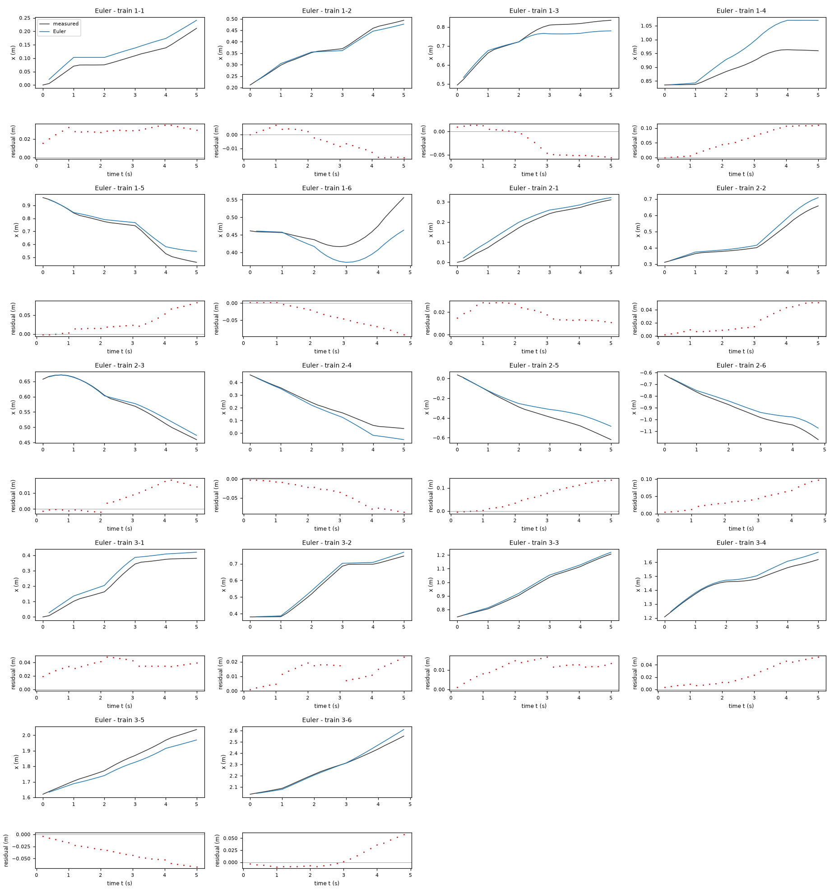
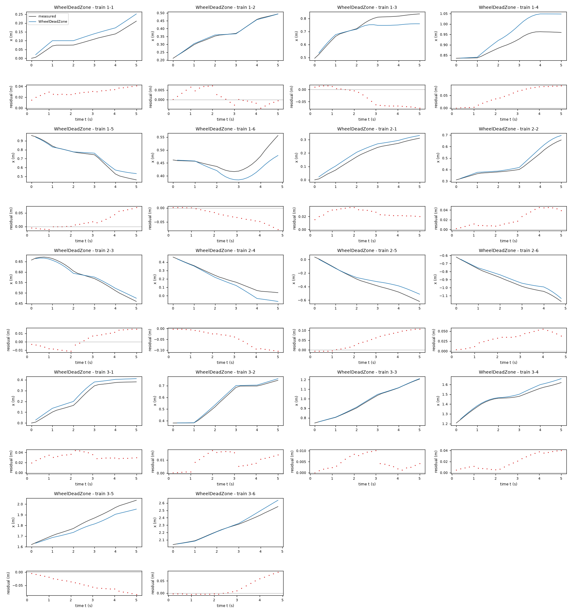
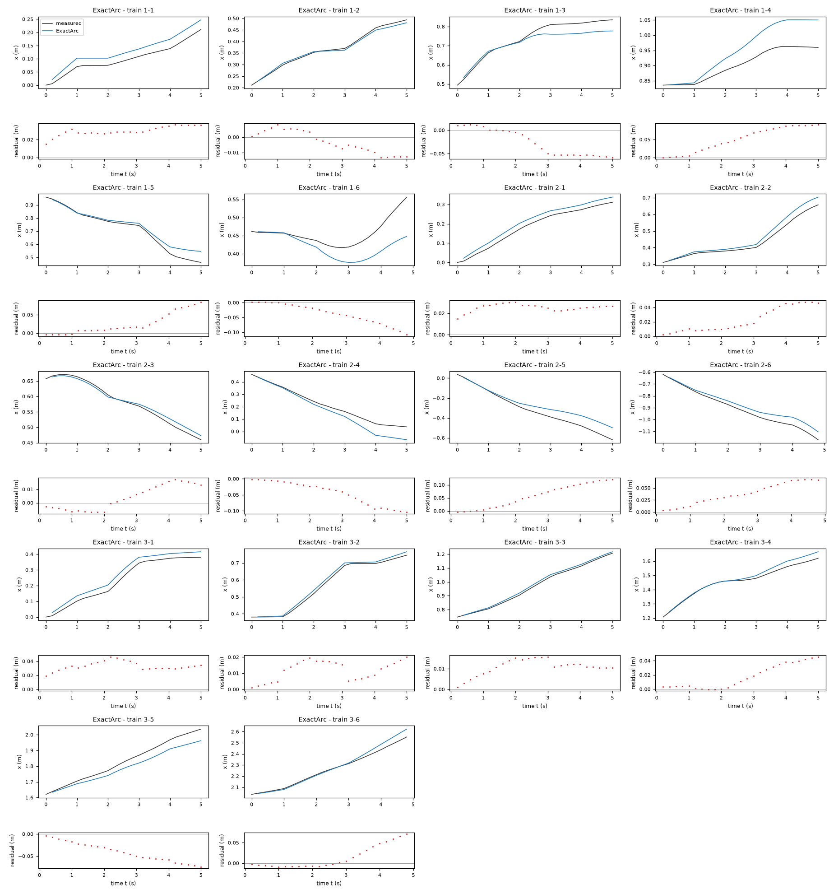
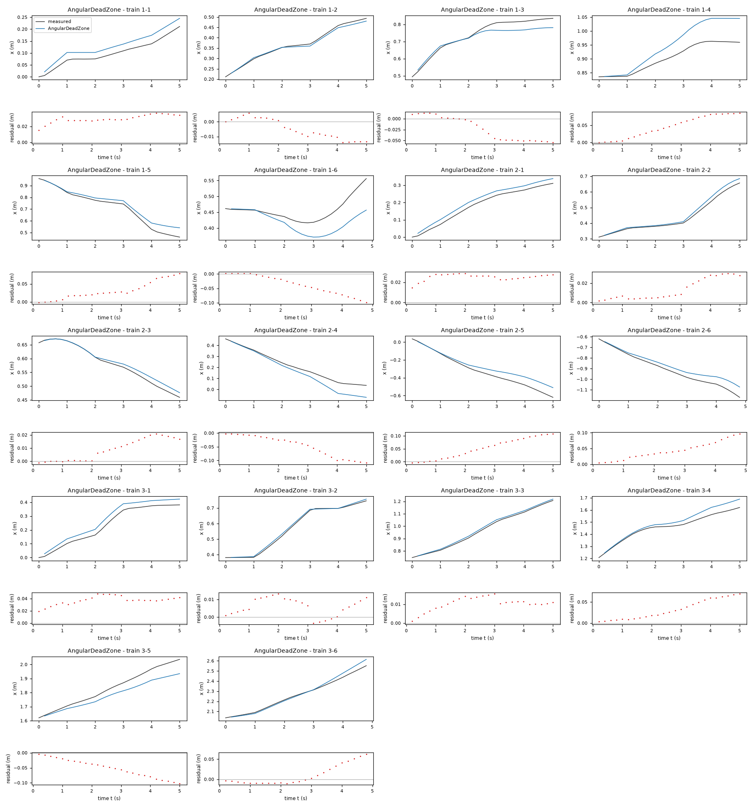

# Evaluation results permitted to the agent: task turtlebot

Terms. The harness is the software of ASPIRE that checks and evaluates the candidate models; a candidate is one proposed model; the pool is the set of candidates of one round. Sealed data (test data, reference expression) are inaccessible to the agent. This view contains no result derived from sealed data.

Evaluation mode: simulation (initialized once per trajectory from the measured state at sample 0; the state-update equation at the sampling period T_s = 0.2 s; the model output is h(x[k], u[k])).
Error measures: for one trajectory with scoring interval I of N samples, measured output y[k] (x, m) and model output ŷ[k], SSE = Σ_(k∈I) (ŷ[k] − y[k])²; RMSE = sqrt(SSE/N), in m; NRMSE = RMSE/σ, with μ and σ the mean and the population standard deviation of y on I; R² = 1 − SSE / Σ_(k∈I) (y[k] − μ)²; NRMSE and R² are not applicable when σ = 0. The pooled RMSE over several trajectories is S = sqrt(ΣSSE / ΣN); on the test data it is the ranking score.
Numerical failure limits: x in [-100, 100] m; y in [-100, 100] m; phi in [-1000, 1000] rad; evaluation time limit 60 s per candidate and data group; symbolic time limit 10 s per verification.
Discontinuous expressions: expressions with jumps (Piecewise, sign) are evaluated pointwise at the sample instants and Runge-Kutta stages; no event detection or step refinement is applied at a jump.
Harness version 0.1.0.dev0; NumPy 2.5.1; SymPy 1.14.0.

## Pool

| category | count |
|---|---|
| candidates proposed | 4 |
| accepted by the file and expression checks | 4 |
| outside the pool limit of 10 (not evaluated) | 0 |
| evaluated | 4 |
| excluded by physical requirements | 0 |
| failed numerically on training or validation data | 0 |

Note: the categories overlap; the counts need not sum to the pool size.

Distinct structures: 4 among 4 evaluated candidates; groups: Euler; WheelDeadZone; ExactArc; AngularDeadZone. Convention: ties resolved, fixed values kept, given constants kept, fitted parameters renamed P1..Pn in order of first occurrence; equal when a one-to-one renaming of the fitted parameters makes every expression identical in SymPy's canonical form.

### Recommendation of the agent

Recommended candidate: Euler. The agent's reason: The two-parameter Euler model had the lowest pooled leave-one-trajectory-out 5 s `x` RMSE among the tested family/criterion combinations (approximately 0.0291 m across all held-out windows in data/train.csv). It is translation invariant, compact and finite. The nonlinear alternatives explain settled-command residuals but do not consistently improve held-out `x` simulation. These validation windows overlap and involve only three trajectories, so the small differences are uncertain; this is not a claim about hidden test performance.

## Candidates

### Candidate Euler

Position in the agent's order: 1. Status: evaluated.
File and expression checks: passed.
- `x_next = x + Ts*gv*v_f*cos(phi)`
- `y_next = y + Ts*gv*v_f*sin(phi)`
- `phi_next = phi + Ts*gw*v_a`
Complexity: 2 fitted, 1 fixed and 0 tied parameters; 0 non-integer numeric literals; 22 expression-tree nodes (SymPy tree, every operator, function, symbol and number counted once).
Structure group 1: `x_next = 0.20000000000000001*P1*v_f*cos(phi) + x`; `y_next = 0.20000000000000001*P1*v_f*sin(phi) + y`; `phi_next = 0.20000000000000001*P2*v_a + phi`

Requirements:

| id | type | outcome | status | method | detail |
|---|---|---|---|---|---|

Output errors on the training data (pooled RMSE: 0.0396506 m):

| trajectory | scored samples | completed | RMSE (m) | NRMSE | R² | failure |
|---|---|---|---|---|---|---|
| 1-1 | 25 | 25 | 0.0295722 | 0.58028 | 0.663276 | none |
| 1-2 | 25 | 25 | 0.0093001 | 0.120782 | 0.985412 | none |
| 1-3 | 25 | 25 | 0.0356773 | 0.393705 | 0.844996 | none |
| 1-4 | 25 | 25 | 0.0711712 | 1.4298 | -1.04433 | none |
| 1-5 | 25 | 25 | 0.0392682 | 0.263201 | 0.930725 | none |
| 1-6 | 24 | 24 | 0.047152 | 1.29958 | -0.688912 | none |
| 2-1 | 25 | 25 | 0.020489 | 0.216857 | 0.952973 | none |
| 2-2 | 25 | 25 | 0.0279081 | 0.272202 | 0.925906 | none |
| 2-3 | 25 | 25 | 0.0100096 | 0.145789 | 0.978746 | none |
| 2-4 | 25 | 25 | 0.0480647 | 0.372533 | 0.861219 | none |
| 2-5 | 25 | 25 | 0.0788734 | 0.442225 | 0.804437 | none |
| 2-6 | 24 | 24 | 0.0502889 | 0.347699 | 0.879105 | none |
| 3-1 | 25 | 25 | 0.0368553 | 0.28399 | 0.91935 | none |
| 3-2 | 25 | 25 | 0.0143267 | 0.104434 | 0.989093 | none |
| 3-3 | 25 | 25 | 0.0119051 | 0.0825666 | 0.993183 | none |
| 3-4 | 25 | 25 | 0.0294147 | 0.294148 | 0.913477 | none |
| 3-5 | 25 | 25 | 0.0421135 | 0.33952 | 0.884726 | none |
| 3-6 | 24 | 24 | 0.02356 | 0.151622 | 0.977011 | none |

Sensitivity rank test (diagnostic; never excludes): targets x_next, y_next, phi_next on the train data (1341 rows, 0 dropped); analytic derivatives (SymPy), ties differentiated through their equations; scaling: rows of each target divided by the standard deviation of its measured column; columns divided by their Euclidean norm; rank threshold s_i / s_1 > 1e-08; singular values 1, 1; rank 2 of 2.

*Candidate Euler, training data, trajectories 1-1, 1-2, 1-3, 1-4, 1-5, 1-6, 2-1, 2-2, 2-3, 2-4, 2-5, 2-6, 3-1, 3-2, 3-3, 3-4, 3-5, 3-6. Upper axes: measured output x (m) and model output of Euler; lower axes: residual (model output minus measured output, m). Evaluation mode: simulation (initialized once per trajectory from the measured state at sample 0; the state-update equation at the sampling period T_s = 0.2 s; the model output is h(x[k], u[k])). Initialization: the first 1 sample(s) of each trajectory initialize the model and are excluded from the errors. Errors are computed on the samples 1-1: 1 to 25; 1-2: 1 to 25; 1-3: 1 to 25; 1-4: 1 to 25; 1-5: 1 to 25; 1-6: 1 to 24; 2-1: 1 to 25; 2-2: 1 to 25; 2-3: 1 to 25; 2-4: 1 to 25; 2-5: 1 to 25; 2-6: 1 to 24; 3-1: 1 to 25; 3-2: 1 to 25; 3-3: 1 to 25; 3-4: 1 to 25; 3-5: 1 to 25; 3-6: 1 to 24 (0-based sample indices). No numerical failure occurred.*

### Candidate WheelDeadZone

Position in the agent's order: 2. Status: evaluated.
File and expression checks: passed.
- `x_next = x + Ts*(gv*(sign(v_f+ell*v_a)*Max(Abs(v_f+ell*v_a)-dz,0)+sign(v_f-ell*v_a)*Max(Abs(v_f-ell*v_a)-dz,0))/2)*Piecewise((1, Abs((Ts*(gw*(sign(v_f+ell*v_a)*Max(Abs(v_f+ell*v_a)-dz,0)-sign(v_f-ell*v_a)*Max(Abs(v_f-ell*v_a)-dz,0))/(2*ell)+bw))) < eps), (sin((Ts*(gw*(sign(v_f+ell*v_a)*Max(Abs(v_f+ell*v_a)-dz,0)-sign(v_f-ell*v_a)*Max(Abs(v_f-ell*v_a)-dz,0))/(2*ell)+bw))/2)/((Ts*(gw*(sign(v_f+ell*v_a)*Max(Abs(v_f+ell*v_a)-dz,0)-sign(v_f-ell*v_a)*Max(Abs(v_f-ell*v_a)-dz,0))/(2*ell)+bw))/2), True))*cos(phi + (Ts*(gw*(sign(v_f+ell*v_a)*Max(Abs(v_f+ell*v_a)-dz,0)-sign(v_f-ell*v_a)*Max(Abs(v_f-ell*v_a)-dz,0))/(2*ell)+bw))/2)`
- `y_next = y + Ts*(gv*(sign(v_f+ell*v_a)*Max(Abs(v_f+ell*v_a)-dz,0)+sign(v_f-ell*v_a)*Max(Abs(v_f-ell*v_a)-dz,0))/2)*Piecewise((1, Abs((Ts*(gw*(sign(v_f+ell*v_a)*Max(Abs(v_f+ell*v_a)-dz,0)-sign(v_f-ell*v_a)*Max(Abs(v_f-ell*v_a)-dz,0))/(2*ell)+bw))) < eps), (sin((Ts*(gw*(sign(v_f+ell*v_a)*Max(Abs(v_f+ell*v_a)-dz,0)-sign(v_f-ell*v_a)*Max(Abs(v_f-ell*v_a)-dz,0))/(2*ell)+bw))/2)/((Ts*(gw*(sign(v_f+ell*v_a)*Max(Abs(v_f+ell*v_a)-dz,0)-sign(v_f-ell*v_a)*Max(Abs(v_f-ell*v_a)-dz,0))/(2*ell)+bw))/2), True))*sin(phi + (Ts*(gw*(sign(v_f+ell*v_a)*Max(Abs(v_f+ell*v_a)-dz,0)-sign(v_f-ell*v_a)*Max(Abs(v_f-ell*v_a)-dz,0))/(2*ell)+bw))/2)`
- `phi_next = phi + (Ts*(gw*(sign(v_f+ell*v_a)*Max(Abs(v_f+ell*v_a)-dz,0)-sign(v_f-ell*v_a)*Max(Abs(v_f-ell*v_a)-dz,0))/(2*ell)+bw))`
Complexity: 5 fitted, 2 fixed and 0 tied parameters; 0 non-integer numeric literals; 621 expression-tree nodes (SymPy tree, every operator, function, symbol and number counted once).
Structure group 2: `x_next = 0.10000000000000001*P1*(sign(-P3*v_a + v_f)*Max(0, -P2 + Abs(P3*v_a - v_f)) + sign(P3*v_a + v_f)*Max(0, -P2 + Abs(P3*v_a + v_f)))*Piecewise((1, Abs(0.20000000000000001*P4 - 0.10000000000000001*P5*(-sign(P3*v_a - v_f)*Max(0, -P2 + Abs(P3*v_a - v_f)) - sign(P3*v_a + v_f)*Max(0, -P2 + Abs(P3*v_a + v_f)))/P3) < 9.9999999999999995e-8), (9.9999999999999994*sin(0.10000000000000001*P4 + 0.050000000000000003*P5*(-sign(-P3*v_a + v_f)*Max(0, -P2 + Abs(P3*v_a - v_f)) + sign(P3*v_a + v_f)*Max(0, -P2 + Abs(P3*v_a + v_f)))/P3)/(P4 + P5*(-sign(-P3*v_a + v_f)*Max(0, -P2 + Abs(P3*v_a - v_f)) + sign(P3*v_a + v_f)*Max(0, -P2 + Abs(P3*v_a + v_f)))/(2*P3)), True))*cos(0.10000000000000001*P4 + phi + 0.050000000000000003*P5*(-sign(-P3*v_a + v_f)*Max(0, -P2 + Abs(P3*v_a - v_f)) + sign(P3*v_a + v_f)*Max(0, -P2 + Abs(P3*v_a + v_f)))/P3) + x`; `y_next = 0.10000000000000001*P1*(sign(-P3*v_a + v_f)*Max(0, -P2 + Abs(P3*v_a - v_f)) + sign(P3*v_a + v_f)*Max(0, -P2 + Abs(P3*v_a + v_f)))*Piecewise((1, Abs(0.20000000000000001*P4 - 0.10000000000000001*P5*(-sign(P3*v_a - v_f)*Max(0, -P2 + Abs(P3*v_a - v_f)) - sign(P3*v_a + v_f)*Max(0, -P2 + Abs(P3*v_a + v_f)))/P3) < 9.9999999999999995e-8), (9.9999999999999994*sin(0.10000000000000001*P4 + 0.050000000000000003*P5*(-sign(-P3*v_a + v_f)*Max(0, -P2 + Abs(P3*v_a - v_f)) + sign(P3*v_a + v_f)*Max(0, -P2 + Abs(P3*v_a + v_f)))/P3)/(P4 + P5*(-sign(-P3*v_a + v_f)*Max(0, -P2 + Abs(P3*v_a - v_f)) + sign(P3*v_a + v_f)*Max(0, -P2 + Abs(P3*v_a + v_f)))/(2*P3)), True))*sin(0.10000000000000001*P4 + phi + 0.050000000000000003*P5*(-sign(-P3*v_a + v_f)*Max(0, -P2 + Abs(P3*v_a - v_f)) + sign(P3*v_a + v_f)*Max(0, -P2 + Abs(P3*v_a + v_f)))/P3) + y`; `phi_next = 0.20000000000000001*P4 + phi + 0.10000000000000001*P5*(-sign(-P3*v_a + v_f)*Max(0, -P2 + Abs(P3*v_a - v_f)) + sign(P3*v_a + v_f)*Max(0, -P2 + Abs(P3*v_a + v_f)))/P3`

Requirements:

| id | type | outcome | status | method | detail |
|---|---|---|---|---|---|

Output errors on the training data (pooled RMSE: 0.0371429 m):

| trajectory | scored samples | completed | RMSE (m) | NRMSE | R² | failure |
|---|---|---|---|---|---|---|
| 1-1 | 25 | 25 | 0.0303215 | 0.594981 | 0.645997 | none |
| 1-2 | 25 | 25 | 0.00374922 | 0.0486918 | 0.997629 | none |
| 1-3 | 25 | 25 | 0.0477193 | 0.52659 | 0.722703 | none |
| 1-4 | 25 | 25 | 0.0591699 | 1.1887 | -0.413003 | none |
| 1-5 | 25 | 25 | 0.0319544 | 0.214179 | 0.954127 | none |
| 1-6 | 24 | 24 | 0.0360881 | 0.994643 | 0.010685 | none |
| 2-1 | 25 | 25 | 0.0261918 | 0.277215 | 0.923152 | none |
| 2-2 | 25 | 25 | 0.0266811 | 0.260234 | 0.932278 | none |
| 2-3 | 25 | 25 | 0.00954767 | 0.139061 | 0.980662 | none |
| 2-4 | 25 | 25 | 0.0570233 | 0.441969 | 0.804664 | none |
| 2-5 | 25 | 25 | 0.0629556 | 0.352977 | 0.875407 | none |
| 2-6 | 24 | 24 | 0.0361902 | 0.25022 | 0.93739 | none |
| 3-1 | 25 | 25 | 0.0325416 | 0.250751 | 0.937124 | none |
| 3-2 | 25 | 25 | 0.011182 | 0.0815113 | 0.993356 | none |
| 3-3 | 25 | 25 | 0.00540595 | 0.0374925 | 0.998594 | none |
| 3-4 | 25 | 25 | 0.0237912 | 0.237912 | 0.943398 | none |
| 3-5 | 25 | 25 | 0.0513874 | 0.414286 | 0.828367 | none |
| 3-6 | 24 | 24 | 0.0368381 | 0.237074 | 0.943796 | none |

- Failed computation (sensitivity rank test): NameError: name 'DiracDelta' is not defined

*Candidate WheelDeadZone, training data, trajectories 1-1, 1-2, 1-3, 1-4, 1-5, 1-6, 2-1, 2-2, 2-3, 2-4, 2-5, 2-6, 3-1, 3-2, 3-3, 3-4, 3-5, 3-6. Upper axes: measured output x (m) and model output of WheelDeadZone; lower axes: residual (model output minus measured output, m). Evaluation mode: simulation (initialized once per trajectory from the measured state at sample 0; the state-update equation at the sampling period T_s = 0.2 s; the model output is h(x[k], u[k])). Initialization: the first 1 sample(s) of each trajectory initialize the model and are excluded from the errors. Errors are computed on the samples 1-1: 1 to 25; 1-2: 1 to 25; 1-3: 1 to 25; 1-4: 1 to 25; 1-5: 1 to 25; 1-6: 1 to 24; 2-1: 1 to 25; 2-2: 1 to 25; 2-3: 1 to 25; 2-4: 1 to 25; 2-5: 1 to 25; 2-6: 1 to 24; 3-1: 1 to 25; 3-2: 1 to 25; 3-3: 1 to 25; 3-4: 1 to 25; 3-5: 1 to 25; 3-6: 1 to 24 (0-based sample indices). No numerical failure occurred.*

### Candidate ExactArc

Position in the agent's order: 3. Status: evaluated.
File and expression checks: passed.
- `x_next = x + Ts*(gv*v_f)*Piecewise((1, Abs((Ts*(gw*v_a+bw))) < eps), (sin((Ts*(gw*v_a+bw))/2)/((Ts*(gw*v_a+bw))/2), True))*cos(phi + (Ts*(gw*v_a+bw))/2)`
- `y_next = y + Ts*(gv*v_f)*Piecewise((1, Abs((Ts*(gw*v_a+bw))) < eps), (sin((Ts*(gw*v_a+bw))/2)/((Ts*(gw*v_a+bw))/2), True))*sin(phi + (Ts*(gw*v_a+bw))/2)`
- `phi_next = phi + (Ts*(gw*v_a+bw))`
Complexity: 3 fitted, 2 fixed and 0 tied parameters; 0 non-integer numeric literals; 111 expression-tree nodes (SymPy tree, every operator, function, symbol and number counted once).
Structure group 3: `x_next = 0.20000000000000001*P1*v_f*Piecewise((1, Abs(0.20000000000000001*P2 + 0.20000000000000001*P3*v_a) < 9.9999999999999995e-8), (9.9999999999999994*sin(0.10000000000000001*P2 + 0.10000000000000001*P3*v_a)/(P2 + P3*v_a), True))*cos(0.10000000000000001*P2 + 0.10000000000000001*P3*v_a + phi) + x`; `y_next = 0.20000000000000001*P1*v_f*Piecewise((1, Abs(0.20000000000000001*P2 + 0.20000000000000001*P3*v_a) < 9.9999999999999995e-8), (9.9999999999999994*sin(0.10000000000000001*P2 + 0.10000000000000001*P3*v_a)/(P2 + P3*v_a), True))*sin(0.10000000000000001*P2 + 0.10000000000000001*P3*v_a + phi) + y`; `phi_next = 0.20000000000000001*P2 + 0.20000000000000001*P3*v_a + phi`

Requirements:

| id | type | outcome | status | method | detail |
|---|---|---|---|---|---|

Output errors on the training data (pooled RMSE: 0.0386424 m):

| trajectory | scored samples | completed | RMSE (m) | NRMSE | R² | failure |
|---|---|---|---|---|---|---|
| 1-1 | 25 | 25 | 0.0302492 | 0.593564 | 0.647682 | none |
| 1-2 | 25 | 25 | 0.00761606 | 0.0989111 | 0.990217 | none |
| 1-3 | 25 | 25 | 0.0374121 | 0.412848 | 0.829556 | none |
| 1-4 | 25 | 25 | 0.0604655 | 1.21473 | -0.475564 | none |
| 1-5 | 25 | 25 | 0.037663 | 0.252442 | 0.936273 | none |
| 1-6 | 24 | 24 | 0.0495813 | 1.36654 | -0.867422 | none |
| 2-1 | 25 | 25 | 0.0255454 | 0.270373 | 0.926898 | none |
| 2-2 | 25 | 25 | 0.027973 | 0.272835 | 0.925561 | none |
| 2-3 | 25 | 25 | 0.00969234 | 0.141168 | 0.980072 | none |
| 2-4 | 25 | 25 | 0.0568735 | 0.440808 | 0.805689 | none |
| 2-5 | 25 | 25 | 0.0725754 | 0.406913 | 0.834421 | none |
| 2-6 | 24 | 24 | 0.0436467 | 0.301775 | 0.908932 | none |
| 3-1 | 25 | 25 | 0.0339239 | 0.261402 | 0.931669 | none |
| 3-2 | 25 | 25 | 0.0132933 | 0.0969013 | 0.99061 | none |
| 3-3 | 25 | 25 | 0.0115055 | 0.0797952 | 0.993633 | none |
| 3-4 | 25 | 25 | 0.0242575 | 0.242575 | 0.941157 | none |
| 3-5 | 25 | 25 | 0.0458974 | 0.370026 | 0.863081 | none |
| 3-6 | 24 | 24 | 0.0302286 | 0.194538 | 0.962155 | none |

Sensitivity rank test (diagnostic; never excludes): targets x_next, y_next, phi_next on the train data (1341 rows, 0 dropped); analytic derivatives (SymPy), ties differentiated through their equations; scaling: rows of each target divided by the standard deviation of its measured column; columns divided by their Euclidean norm; rank threshold s_i / s_1 > 1e-08; singular values 1.05, 1, 0.952; rank 3 of 3.

*Candidate ExactArc, training data, trajectories 1-1, 1-2, 1-3, 1-4, 1-5, 1-6, 2-1, 2-2, 2-3, 2-4, 2-5, 2-6, 3-1, 3-2, 3-3, 3-4, 3-5, 3-6. Upper axes: measured output x (m) and model output of ExactArc; lower axes: residual (model output minus measured output, m). Evaluation mode: simulation (initialized once per trajectory from the measured state at sample 0; the state-update equation at the sampling period T_s = 0.2 s; the model output is h(x[k], u[k])). Initialization: the first 1 sample(s) of each trajectory initialize the model and are excluded from the errors. Errors are computed on the samples 1-1: 1 to 25; 1-2: 1 to 25; 1-3: 1 to 25; 1-4: 1 to 25; 1-5: 1 to 25; 1-6: 1 to 24; 2-1: 1 to 25; 2-2: 1 to 25; 2-3: 1 to 25; 2-4: 1 to 25; 2-5: 1 to 25; 2-6: 1 to 24; 3-1: 1 to 25; 3-2: 1 to 25; 3-3: 1 to 25; 3-4: 1 to 25; 3-5: 1 to 25; 3-6: 1 to 24 (0-based sample indices). No numerical failure occurred.*

### Candidate AngularDeadZone

Position in the agent's order: 4. Status: evaluated.
File and expression checks: passed.
- `x_next = x + Ts*gv*v_f*cos(phi + q*Ts*(gw*sign(v_a)*Max(Abs(v_a)-dz,0)+bw))`
- `y_next = y + Ts*gv*v_f*sin(phi + q*Ts*(gw*sign(v_a)*Max(Abs(v_a)-dz,0)+bw))`
- `phi_next = phi + Ts*(gw*sign(v_a)*Max(Abs(v_a)-dz,0)+bw)`
Complexity: 5 fitted, 1 fixed and 0 tied parameters; 0 non-integer numeric literals; 70 expression-tree nodes (SymPy tree, every operator, function, symbol and number counted once).
Structure group 4: `x_next = 0.20000000000000001*P1*v_f*cos(0.20000000000000001*P2*(P3 + P4*sign(v_a)*Max(0, -P5 + Abs(v_a))) + phi) + x`; `y_next = 0.20000000000000001*P1*v_f*sin(0.20000000000000001*P2*(P3 + P4*sign(v_a)*Max(0, -P5 + Abs(v_a))) + phi) + y`; `phi_next = 0.20000000000000001*P3 + 0.20000000000000001*P4*sign(v_a)*Max(0, -P5 + Abs(v_a)) + phi`

Requirements:

| id | type | outcome | status | method | detail |
|---|---|---|---|---|---|

Output errors on the training data (pooled RMSE: 0.0394399 m):

| trajectory | scored samples | completed | RMSE (m) | NRMSE | R² | failure |
|---|---|---|---|---|---|---|
| 1-1 | 25 | 25 | 0.0300107 | 0.588883 | 0.653216 | none |
| 1-2 | 25 | 25 | 0.00817169 | 0.106127 | 0.988737 | none |
| 1-3 | 25 | 25 | 0.0347213 | 0.383156 | 0.853192 | none |
| 1-4 | 25 | 25 | 0.0554126 | 1.11322 | -0.239252 | none |
| 1-5 | 25 | 25 | 0.0393517 | 0.263761 | 0.93043 | none |
| 1-6 | 24 | 24 | 0.0494449 | 1.36278 | -0.857163 | none |
| 2-1 | 25 | 25 | 0.0253447 | 0.268249 | 0.928042 | none |
| 2-2 | 25 | 25 | 0.0170786 | 0.166576 | 0.972252 | none |
| 2-3 | 25 | 25 | 0.0119522 | 0.174083 | 0.969695 | none |
| 2-4 | 25 | 25 | 0.0601186 | 0.465959 | 0.782882 | none |
| 2-5 | 25 | 25 | 0.0644066 | 0.361113 | 0.869598 | none |
| 2-6 | 24 | 24 | 0.0511339 | 0.353542 | 0.875008 | none |
| 3-1 | 25 | 25 | 0.0378846 | 0.291922 | 0.914782 | none |
| 3-2 | 25 | 25 | 0.00771596 | 0.0562454 | 0.996836 | none |
| 3-3 | 25 | 25 | 0.0109604 | 0.0760152 | 0.994222 | none |
| 3-4 | 25 | 25 | 0.0389704 | 0.389704 | 0.848131 | none |
| 3-5 | 25 | 25 | 0.059404 | 0.478916 | 0.770639 | none |
| 3-6 | 24 | 24 | 0.0262494 | 0.16893 | 0.971463 | none |

Sensitivity rank test (diagnostic; never excludes): targets x_next, y_next, phi_next on the train data (1341 rows, 0 dropped); analytic derivatives (SymPy), ties differentiated through their equations; scaling: rows of each target divided by the standard deviation of its measured column; columns divided by their Euclidean norm; rank threshold s_i / s_1 > 1e-08; singular values 1.37, 1, 0.999, 0.992, 0.378; rank 5 of 5.

*Candidate AngularDeadZone, training data, trajectories 1-1, 1-2, 1-3, 1-4, 1-5, 1-6, 2-1, 2-2, 2-3, 2-4, 2-5, 2-6, 3-1, 3-2, 3-3, 3-4, 3-5, 3-6. Upper axes: measured output x (m) and model output of AngularDeadZone; lower axes: residual (model output minus measured output, m). Evaluation mode: simulation (initialized once per trajectory from the measured state at sample 0; the state-update equation at the sampling period T_s = 0.2 s; the model output is h(x[k], u[k])). Initialization: the first 1 sample(s) of each trajectory initialize the model and are excluded from the errors. Errors are computed on the samples 1-1: 1 to 25; 1-2: 1 to 25; 1-3: 1 to 25; 1-4: 1 to 25; 1-5: 1 to 25; 1-6: 1 to 24; 2-1: 1 to 25; 2-2: 1 to 25; 2-3: 1 to 25; 2-4: 1 to 25; 2-5: 1 to 25; 2-6: 1 to 24; 3-1: 1 to 25; 3-2: 1 to 25; 3-3: 1 to 25; 3-4: 1 to 25; 3-5: 1 to 25; 3-6: 1 to 24 (0-based sample indices). No numerical failure occurred.*
