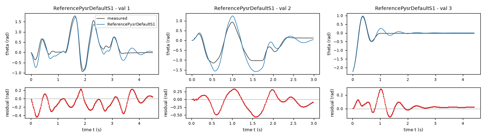
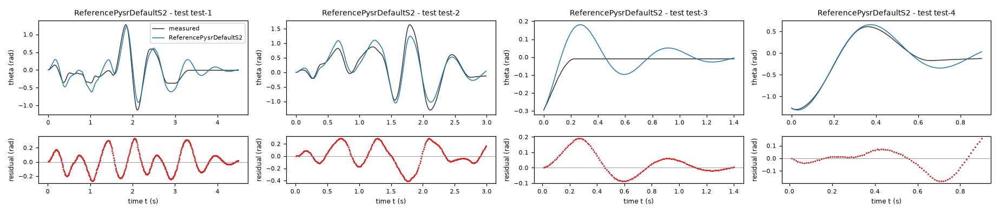
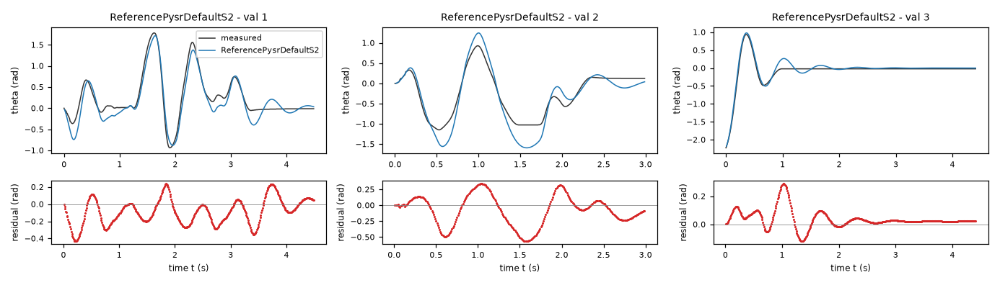
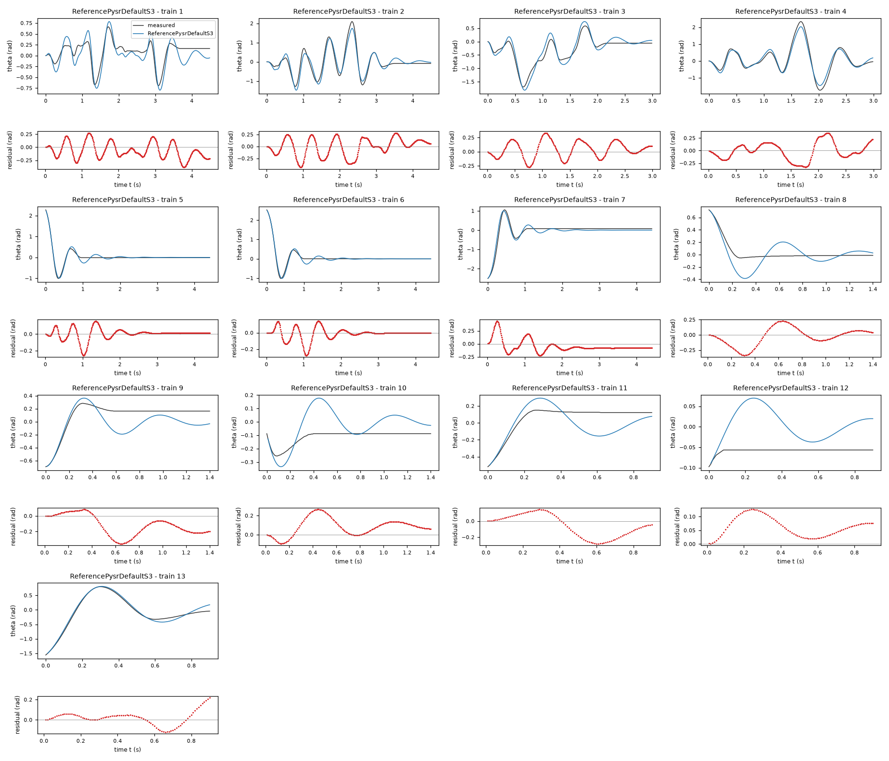
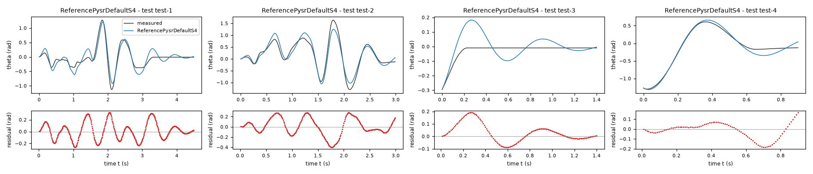
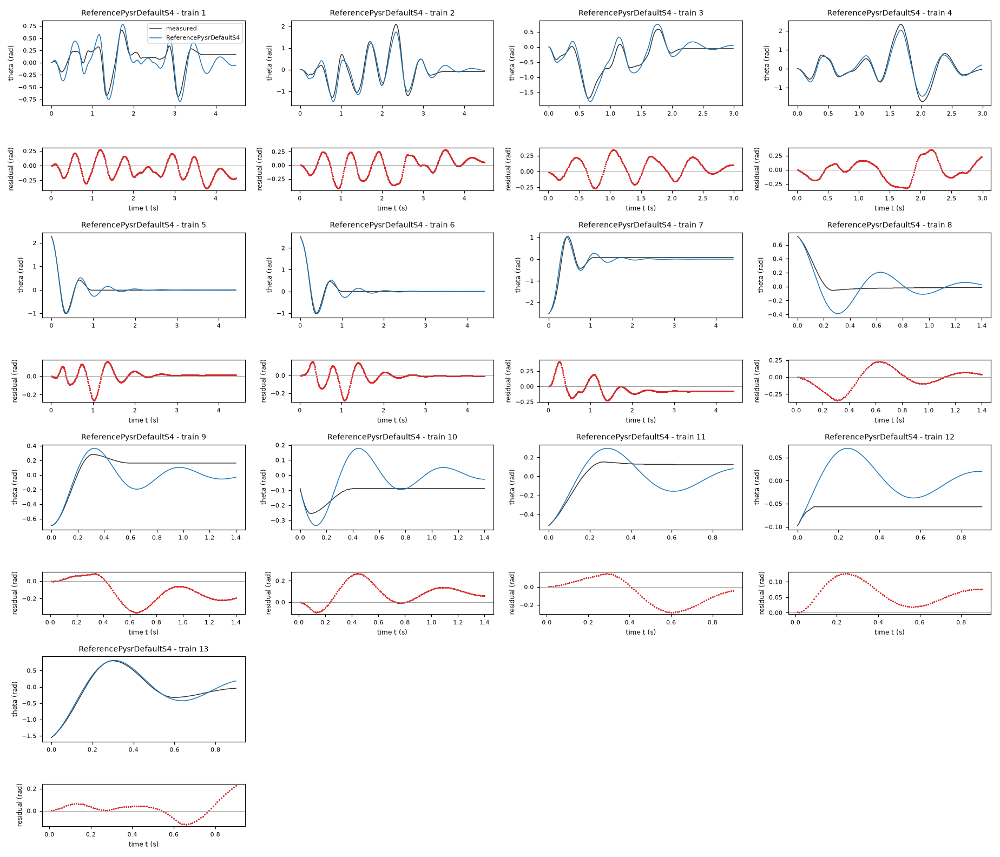
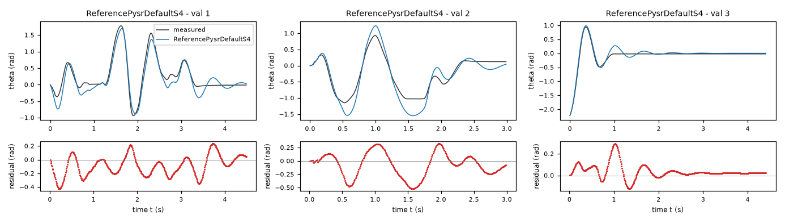
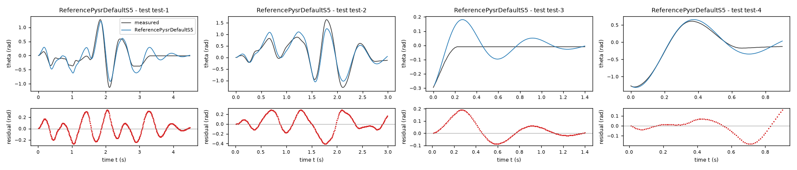
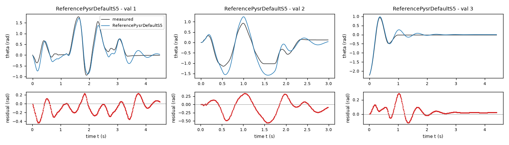

# Evaluation report: task friction-driven

Terms. The harness is the software of ASPIRE that checks and evaluates the candidate models; a candidate is one proposed model; the pool is the set of candidates of one round. Sealed data (test data, reference expression) are inaccessible to the agent. This report contains results on sealed data and is not shown to the agent.

Evaluation mode: simulation (initialized once per trajectory from the measured state at sample 0; classical fourth-order Runge-Kutta integration with 1 step(s) per sampling period T_s = 0.01 s and zero-order hold of the input; the model output is h(x[k], u[k])).
Error measures: for one trajectory with scoring interval I of N samples, measured output y[k] (theta, rad) and model output ŷ[k], SSE = Σ_(k∈I) (ŷ[k] − y[k])²; RMSE = sqrt(SSE/N), in rad; NRMSE = RMSE/σ, with μ and σ the mean and the population standard deviation of y on I; R² = 1 − SSE / Σ_(k∈I) (y[k] − μ)²; NRMSE and R² are not applicable when σ = 0. The pooled RMSE over several trajectories is S = sqrt(ΣSSE / ΣN); on the test data it is the ranking score.
Numerical failure limits: theta in [-1000, 1000] rad; omega in [-1000, 1000] rad/s; evaluation time limit 60 s per candidate and data group; symbolic time limit 10 s per verification.
Discontinuous expressions: expressions with jumps (Piecewise, sign) are evaluated pointwise at the sample instants and Runge-Kutta stages; no event detection or step refinement is applied at a jump.
Harness version 0.1.0.dev0; NumPy 2.5.1; SymPy 1.14.0.

## Pool

| category | count |
|---|---|
| candidates proposed | 5 |
| accepted by the file and expression checks | 5 |
| outside the pool limit of 10 (not evaluated) | 0 |
| evaluated | 5 |
| excluded by physical requirements | 5 |
| failed numerically on training or validation data | 0 |
| failed numerically on test data | 0 |
| eligible for ranking | 0 |

Note: the categories overlap: the candidates accepted by the checks include those outside the pool limit, and a candidate can be both excluded by requirements and failed numerically; the counts need not sum to the pool size.

Distinct structures: 3 among 5 evaluated candidates; groups: ReferencePysrDefaultS1, ReferencePysrDefaultS2; ReferencePysrDefaultS3, ReferencePysrDefaultS5; ReferencePysrDefaultS4. Convention: ties resolved, fixed values kept, given constants kept, fitted parameters renamed P1..Pn in order of first occurrence; equal when a one-to-one renaming of the fitted parameters makes every expression identical in SymPy's canonical form.

### Recommendation of the agent

The agent recommends no candidate. Its reason: Reference models found by PySR without the agent, one per seed; none is recommended.
- Harness note: the agent recommends no candidate.

## Oracle-based selection on test data

Label: oracle-based selection on test data. Candidates considered: 0 eligible of 5 evaluated. Criterion: pooled test RMSE S, increasing, the pooled RMSE over the test trajectories test-1 (449 scored samples), test-2 (299 scored samples), test-3 (140 scored samples), test-4 (90 scored samples). Tie rule: |S_a - S_b| <= 1e-12 * max(S_a, S_b) for consecutive candidates; tied candidates share a rank. This ranking selects on the test data. It measures whether the pool contains an accurate model, not whether the agent can recognize that model without test data. A rank is not evidence of physical admissibility: each entry carries its unresolved requirements and any violation allowed by the user.

No candidate is eligible for ranking.

## Candidates

### Candidate ReferencePysrDefaultS1

Position in the agent's order: 1. Status: evaluated.
File and expression checks: passed.
- `dtheta = omega`
- `domega = cb1*omega + cb4*u + theta*(cb2 + cb3*theta**2)`
Complexity: 4 fitted, 0 fixed and 0 tied parameters; 0 non-integer numeric literals; 17 expression-tree nodes (SymPy tree, every operator, function, symbol and number counted once).
Structure group 1: `dtheta = omega`; `domega = P1*omega + P2*u + theta*(P3 + P4*theta**2)`

Requirements:

| id | type | outcome | status | method | detail |
|---|---|---|---|---|---|
| R1 | equation | proof | satisfied | evaluation of a constant | the quantity is identically zero on the domain |
| R2 | inequality | counterexample | violated | interval arithmetic (branch and bound) | on a sub-box around {'theta': -2.945243112740431} the verified lower bound 83.0537411319697 of the quantity exceeds the tolerance 0.0 Excludes the candidate. |
| R3 | monotonicity | proof | satisfied | evaluation of a constant | the quantity reduces to the constant -25.604227, which does not exceed the tolerance 0.0 |

Output errors on the test data (sealed) (pooled RMSE: 0.144291 rad):

| trajectory | scored samples | completed | RMSE (rad) | NRMSE | R² | failure |
|---|---|---|---|---|---|---|
| test-1 | 449 | 449 | 0.149238 | 0.395239 | 0.843787 | none |
| test-2 | 299 | 299 | 0.173158 | 0.280174 | 0.921503 | none |
| test-3 | 140 | 140 | 0.0777676 | 1.46913 | -1.15835 | none |
| test-4 | 90 | 90 | 0.0781718 | 0.148045 | 0.978083 | none |

Output errors on the training data (pooled RMSE: 0.139107 rad):

| trajectory | scored samples | completed | RMSE (rad) | NRMSE | R² | failure |
|---|---|---|---|---|---|---|
| 1 | 449 | 449 | 0.165394 | 0.644866 | 0.584147 | none |
| 2 | 449 | 449 | 0.187882 | 0.281913 | 0.920525 | none |
| 3 | 299 | 299 | 0.150866 | 0.319448 | 0.897953 | none |
| 4 | 299 | 299 | 0.172851 | 0.210914 | 0.955515 | none |
| 5 | 441 | 441 | 0.0676094 | 0.17664 | 0.968798 | none |
| 6 | 441 | 441 | 0.0731428 | 0.160246 | 0.974321 | none |
| 7 | 441 | 441 | 0.126346 | 0.243517 | 0.9407 | none |
| 8 | 140 | 140 | 0.14839 | 0.903592 | 0.183522 | none |
| 9 | 140 | 140 | 0.176471 | 0.80696 | 0.348816 | none |
| 10 | 140 | 140 | 0.123574 | 2.51326 | -5.31649 | none |
| 11 | 90 | 90 | 0.152658 | 0.927546 | 0.139658 | none |
| 12 | 90 | 90 | 0.0719314 | 14.0981 | -197.755 | none |
| 13 | 90 | 90 | 0.0724448 | 0.133345 | 0.982219 | none |

Output errors on the validation data (pooled RMSE: 0.170583 rad):

| trajectory | scored samples | completed | RMSE (rad) | NRMSE | R² | failure |
|---|---|---|---|---|---|---|
| 1 | 449 | 449 | 0.173156 | 0.316689 | 0.899708 | none |
| 2 | 299 | 299 | 0.249951 | 0.447043 | 0.800153 | none |
| 3 | 441 | 441 | 0.074619 | 0.19853 | 0.960586 | none |

Sensitivity rank test (diagnostic; never excludes): targets domega on the train, val data (4714 rows, 0 dropped); analytic derivatives (SymPy), ties differentiated through their equations; scaling: rows of each target divided by the standard deviation of its measured column; columns divided by their Euclidean norm; rank threshold s_i / s_1 > 1e-08; singular values 1.35, 1.16, 0.789, 0.449; rank 4 of 4.
Reference comparison: not applicable (the task has no reference expression).
Eligible for ranking: False (demonstrated violation of mandatory requirement(s) R2).

*Candidate ReferencePysrDefaultS1, test data (sealed), trajectories test-1, test-2, test-3, test-4. Upper axes: measured output theta (rad) and model output of ReferencePysrDefaultS1; lower axes: residual (model output minus measured output, rad). Evaluation mode: simulation (initialized once per trajectory from the measured state at sample 0; classical fourth-order Runge-Kutta integration with 1 step(s) per sampling period T_s = 0.01 s and zero-order hold of the input; the model output is h(x[k], u[k])). Initialization: the first 1 sample(s) of each trajectory initialize the model and are excluded from the errors. Errors are computed on the samples test-1: 1 to 449; test-2: 1 to 299; test-3: 1 to 140; test-4: 1 to 90 (0-based sample indices). No numerical failure occurred. The candidate is excluded from ranking by the demonstrated violation of R2.*

*Candidate ReferencePysrDefaultS1, training data, trajectories 1, 2, 3, 4, 5, 6, 7, 8, 9, 10, 11, 12, 13. Upper axes: measured output theta (rad) and model output of ReferencePysrDefaultS1; lower axes: residual (model output minus measured output, rad). Evaluation mode: simulation (initialized once per trajectory from the measured state at sample 0; classical fourth-order Runge-Kutta integration with 1 step(s) per sampling period T_s = 0.01 s and zero-order hold of the input; the model output is h(x[k], u[k])). Initialization: the first 1 sample(s) of each trajectory initialize the model and are excluded from the errors. Errors are computed on the samples 1: 1 to 449; 2: 1 to 449; 3: 1 to 299; 4: 1 to 299; 5: 1 to 441; 6: 1 to 441; 7: 1 to 441; 8: 1 to 140; 9: 1 to 140; 10: 1 to 140; 11: 1 to 90; 12: 1 to 90; 13: 1 to 90 (0-based sample indices). No numerical failure occurred. The candidate is excluded from ranking by the demonstrated violation of R2.*

*Candidate ReferencePysrDefaultS1, validation data, trajectories 1, 2, 3. Upper axes: measured output theta (rad) and model output of ReferencePysrDefaultS1; lower axes: residual (model output minus measured output, rad). Evaluation mode: simulation (initialized once per trajectory from the measured state at sample 0; classical fourth-order Runge-Kutta integration with 1 step(s) per sampling period T_s = 0.01 s and zero-order hold of the input; the model output is h(x[k], u[k])). Initialization: the first 1 sample(s) of each trajectory initialize the model and are excluded from the errors. Errors are computed on the samples 1: 1 to 449; 2: 1 to 299; 3: 1 to 441 (0-based sample indices). No numerical failure occurred. The candidate is excluded from ranking by the demonstrated violation of R2.*

### Candidate ReferencePysrDefaultS2

Position in the agent's order: 2. Status: evaluated.
File and expression checks: passed.
- `dtheta = omega`
- `domega = cb1*omega + cb4*u + theta*(cb2 + cb3*theta**2)`
Complexity: 4 fitted, 0 fixed and 0 tied parameters; 0 non-integer numeric literals; 17 expression-tree nodes (SymPy tree, every operator, function, symbol and number counted once).
Structure group 1: `dtheta = omega`; `domega = P1*omega + P2*u + theta*(P3 + P4*theta**2)`

Requirements:

| id | type | outcome | status | method | detail |
|---|---|---|---|---|---|
| R1 | equation | proof | satisfied | evaluation of a constant | the quantity is identically zero on the domain |
| R2 | inequality | counterexample | violated | interval arithmetic (branch and bound) | on a sub-box around {'theta': -2.945243112740431} the verified lower bound 82.65139249064832 of the quantity exceeds the tolerance 0.0 Excludes the candidate. |
| R3 | monotonicity | proof | satisfied | evaluation of a constant | the quantity reduces to the constant -25.59362, which does not exceed the tolerance 0.0 |

Output errors on the test data (sealed) (pooled RMSE: 0.144943 rad):

| trajectory | scored samples | completed | RMSE (rad) | NRMSE | R² | failure |
|---|---|---|---|---|---|---|
| test-1 | 449 | 449 | 0.149966 | 0.397167 | 0.842258 | none |
| test-2 | 299 | 299 | 0.173964 | 0.281477 | 0.920771 | none |
| test-3 | 140 | 140 | 0.0778364 | 1.47043 | -1.16217 | none |
| test-4 | 90 | 90 | 0.0782803 | 0.14825 | 0.978022 | none |

Output errors on the training data (pooled RMSE: 0.139213 rad):

| trajectory | scored samples | completed | RMSE (rad) | NRMSE | R² | failure |
|---|---|---|---|---|---|---|
| 1 | 449 | 449 | 0.165635 | 0.645809 | 0.582931 | none |
| 2 | 449 | 449 | 0.188759 | 0.283229 | 0.919781 | none |
| 3 | 299 | 299 | 0.15083 | 0.31937 | 0.898003 | none |
| 4 | 299 | 299 | 0.171964 | 0.209831 | 0.955971 | none |
| 5 | 441 | 441 | 0.0679162 | 0.177442 | 0.968514 | none |
| 6 | 441 | 441 | 0.0735496 | 0.161138 | 0.974035 | none |
| 7 | 441 | 441 | 0.125983 | 0.242817 | 0.94104 | none |
| 8 | 140 | 140 | 0.148485 | 0.904174 | 0.18247 | none |
| 9 | 140 | 140 | 0.17646 | 0.806906 | 0.348903 | none |
| 10 | 140 | 140 | 0.123688 | 2.51558 | -5.32814 | none |
| 11 | 90 | 90 | 0.152755 | 0.928133 | 0.138569 | none |
| 12 | 90 | 90 | 0.0719474 | 14.1012 | -197.844 | none |
| 13 | 90 | 90 | 0.0724311 | 0.13332 | 0.982226 | none |

Output errors on the validation data (pooled RMSE: 0.172175 rad):

| trajectory | scored samples | completed | RMSE (rad) | NRMSE | R² | failure |
|---|---|---|---|---|---|---|
| 1 | 449 | 449 | 0.173989 | 0.318213 | 0.898741 | none |
| 2 | 299 | 299 | 0.253349 | 0.45312 | 0.794683 | none |
| 3 | 441 | 441 | 0.074738 | 0.198846 | 0.96046 | none |

Sensitivity rank test (diagnostic; never excludes): targets domega on the train, val data (4714 rows, 0 dropped); analytic derivatives (SymPy), ties differentiated through their equations; scaling: rows of each target divided by the standard deviation of its measured column; columns divided by their Euclidean norm; rank threshold s_i / s_1 > 1e-08; singular values 1.35, 1.16, 0.789, 0.449; rank 4 of 4.
Reference comparison: not applicable (the task has no reference expression).
Eligible for ranking: False (demonstrated violation of mandatory requirement(s) R2).

*Candidate ReferencePysrDefaultS2, test data (sealed), trajectories test-1, test-2, test-3, test-4. Upper axes: measured output theta (rad) and model output of ReferencePysrDefaultS2; lower axes: residual (model output minus measured output, rad). Evaluation mode: simulation (initialized once per trajectory from the measured state at sample 0; classical fourth-order Runge-Kutta integration with 1 step(s) per sampling period T_s = 0.01 s and zero-order hold of the input; the model output is h(x[k], u[k])). Initialization: the first 1 sample(s) of each trajectory initialize the model and are excluded from the errors. Errors are computed on the samples test-1: 1 to 449; test-2: 1 to 299; test-3: 1 to 140; test-4: 1 to 90 (0-based sample indices). No numerical failure occurred. The candidate is excluded from ranking by the demonstrated violation of R2.*

*Candidate ReferencePysrDefaultS2, training data, trajectories 1, 2, 3, 4, 5, 6, 7, 8, 9, 10, 11, 12, 13. Upper axes: measured output theta (rad) and model output of ReferencePysrDefaultS2; lower axes: residual (model output minus measured output, rad). Evaluation mode: simulation (initialized once per trajectory from the measured state at sample 0; classical fourth-order Runge-Kutta integration with 1 step(s) per sampling period T_s = 0.01 s and zero-order hold of the input; the model output is h(x[k], u[k])). Initialization: the first 1 sample(s) of each trajectory initialize the model and are excluded from the errors. Errors are computed on the samples 1: 1 to 449; 2: 1 to 449; 3: 1 to 299; 4: 1 to 299; 5: 1 to 441; 6: 1 to 441; 7: 1 to 441; 8: 1 to 140; 9: 1 to 140; 10: 1 to 140; 11: 1 to 90; 12: 1 to 90; 13: 1 to 90 (0-based sample indices). No numerical failure occurred. The candidate is excluded from ranking by the demonstrated violation of R2.*

*Candidate ReferencePysrDefaultS2, validation data, trajectories 1, 2, 3. Upper axes: measured output theta (rad) and model output of ReferencePysrDefaultS2; lower axes: residual (model output minus measured output, rad). Evaluation mode: simulation (initialized once per trajectory from the measured state at sample 0; classical fourth-order Runge-Kutta integration with 1 step(s) per sampling period T_s = 0.01 s and zero-order hold of the input; the model output is h(x[k], u[k])). Initialization: the first 1 sample(s) of each trajectory initialize the model and are excluded from the errors. Errors are computed on the samples 1: 1 to 449; 2: 1 to 299; 3: 1 to 441 (0-based sample indices). No numerical failure occurred. The candidate is excluded from ranking by the demonstrated violation of R2.*

### Candidate ReferencePysrDefaultS3

Position in the agent's order: 3. Status: evaluated.
File and expression checks: passed.
- `dtheta = omega`
- `domega = cb2*omega + cb3*u - theta*(cb1*theta**2 + cb4)`
Complexity: 4 fitted, 0 fixed and 0 tied parameters; 0 non-integer numeric literals; 18 expression-tree nodes (SymPy tree, every operator, function, symbol and number counted once).
Structure group 2: `dtheta = omega`; `domega = P1*omega + P2*u - theta*(P3 + P4*theta**2)`

Requirements:

| id | type | outcome | status | method | detail |
|---|---|---|---|---|---|
| R1 | equation | proof | satisfied | evaluation of a constant | the quantity is identically zero on the domain |
| R2 | inequality | counterexample | violated | interval arithmetic (branch and bound) | on a sub-box around {'theta': -2.945243112740431} the verified lower bound 83.03499815135315 of the quantity exceeds the tolerance 0.0 Excludes the candidate. |
| R3 | monotonicity | proof | satisfied | evaluation of a constant | the quantity reduces to the constant -25.604067, which does not exceed the tolerance 0.0 |

Output errors on the test data (sealed) (pooled RMSE: 0.144293 rad):

| trajectory | scored samples | completed | RMSE (rad) | NRMSE | R² | failure |
|---|---|---|---|---|---|---|
| test-1 | 449 | 449 | 0.14924 | 0.395244 | 0.843782 | none |
| test-2 | 299 | 299 | 0.173159 | 0.280175 | 0.921502 | none |
| test-3 | 140 | 140 | 0.0777684 | 1.46915 | -1.15839 | none |
| test-4 | 90 | 90 | 0.0781746 | 0.14805 | 0.978081 | none |

Output errors on the training data (pooled RMSE: 0.139109 rad):

| trajectory | scored samples | completed | RMSE (rad) | NRMSE | R² | failure |
|---|---|---|---|---|---|---|
| 1 | 449 | 449 | 0.165395 | 0.644872 | 0.584141 | none |
| 2 | 449 | 449 | 0.187884 | 0.281916 | 0.920523 | none |
| 3 | 299 | 299 | 0.150867 | 0.31945 | 0.897952 | none |
| 4 | 299 | 299 | 0.172854 | 0.210917 | 0.955514 | none |
| 5 | 441 | 441 | 0.0676111 | 0.176644 | 0.968797 | none |
| 6 | 441 | 441 | 0.0731418 | 0.160244 | 0.974322 | none |
| 7 | 441 | 441 | 0.126356 | 0.243535 | 0.940691 | none |
| 8 | 140 | 140 | 0.148392 | 0.903603 | 0.183502 | none |
| 9 | 140 | 140 | 0.176472 | 0.806964 | 0.34881 | none |
| 10 | 140 | 140 | 0.123575 | 2.51328 | -5.31657 | none |
| 11 | 90 | 90 | 0.15266 | 0.927554 | 0.139644 | none |
| 12 | 90 | 90 | 0.0719316 | 14.0981 | -197.757 | none |
| 13 | 90 | 90 | 0.0724476 | 0.13335 | 0.982218 | none |

Output errors on the validation data (pooled RMSE: 0.170583 rad):

| trajectory | scored samples | completed | RMSE (rad) | NRMSE | R² | failure |
|---|---|---|---|---|---|---|
| 1 | 449 | 449 | 0.173157 | 0.31669 | 0.899707 | none |
| 2 | 299 | 299 | 0.249949 | 0.447039 | 0.800156 | none |
| 3 | 441 | 441 | 0.074622 | 0.198538 | 0.960583 | none |

Sensitivity rank test (diagnostic; never excludes): targets domega on the train, val data (4714 rows, 0 dropped); analytic derivatives (SymPy), ties differentiated through their equations; scaling: rows of each target divided by the standard deviation of its measured column; columns divided by their Euclidean norm; rank threshold s_i / s_1 > 1e-08; singular values 1.35, 1.16, 0.789, 0.449; rank 4 of 4.
Reference comparison: not applicable (the task has no reference expression).
Eligible for ranking: False (demonstrated violation of mandatory requirement(s) R2).

*Candidate ReferencePysrDefaultS3, test data (sealed), trajectories test-1, test-2, test-3, test-4. Upper axes: measured output theta (rad) and model output of ReferencePysrDefaultS3; lower axes: residual (model output minus measured output, rad). Evaluation mode: simulation (initialized once per trajectory from the measured state at sample 0; classical fourth-order Runge-Kutta integration with 1 step(s) per sampling period T_s = 0.01 s and zero-order hold of the input; the model output is h(x[k], u[k])). Initialization: the first 1 sample(s) of each trajectory initialize the model and are excluded from the errors. Errors are computed on the samples test-1: 1 to 449; test-2: 1 to 299; test-3: 1 to 140; test-4: 1 to 90 (0-based sample indices). No numerical failure occurred. The candidate is excluded from ranking by the demonstrated violation of R2.*

*Candidate ReferencePysrDefaultS3, training data, trajectories 1, 2, 3, 4, 5, 6, 7, 8, 9, 10, 11, 12, 13. Upper axes: measured output theta (rad) and model output of ReferencePysrDefaultS3; lower axes: residual (model output minus measured output, rad). Evaluation mode: simulation (initialized once per trajectory from the measured state at sample 0; classical fourth-order Runge-Kutta integration with 1 step(s) per sampling period T_s = 0.01 s and zero-order hold of the input; the model output is h(x[k], u[k])). Initialization: the first 1 sample(s) of each trajectory initialize the model and are excluded from the errors. Errors are computed on the samples 1: 1 to 449; 2: 1 to 449; 3: 1 to 299; 4: 1 to 299; 5: 1 to 441; 6: 1 to 441; 7: 1 to 441; 8: 1 to 140; 9: 1 to 140; 10: 1 to 140; 11: 1 to 90; 12: 1 to 90; 13: 1 to 90 (0-based sample indices). No numerical failure occurred. The candidate is excluded from ranking by the demonstrated violation of R2.*

*Candidate ReferencePysrDefaultS3, validation data, trajectories 1, 2, 3. Upper axes: measured output theta (rad) and model output of ReferencePysrDefaultS3; lower axes: residual (model output minus measured output, rad). Evaluation mode: simulation (initialized once per trajectory from the measured state at sample 0; classical fourth-order Runge-Kutta integration with 1 step(s) per sampling period T_s = 0.01 s and zero-order hold of the input; the model output is h(x[k], u[k])). Initialization: the first 1 sample(s) of each trajectory initialize the model and are excluded from the errors. Errors are computed on the samples 1: 1 to 449; 2: 1 to 299; 3: 1 to 441 (0-based sample indices). No numerical failure occurred. The candidate is excluded from ranking by the demonstrated violation of R2.*

### Candidate ReferencePysrDefaultS4

Position in the agent's order: 4. Status: evaluated.
File and expression checks: passed.
- `dtheta = omega`
- `domega = cb1*omega + cb3*theta*(cb2 + theta**2) + cb4*u`
Complexity: 4 fitted, 0 fixed and 0 tied parameters; 0 non-integer numeric literals; 16 expression-tree nodes (SymPy tree, every operator, function, symbol and number counted once).
Structure group 3: `dtheta = omega`; `domega = P1*omega + P2*u + P3*theta*(P4 + theta**2)`

Requirements:

| id | type | outcome | status | method | detail |
|---|---|---|---|---|---|
| R1 | equation | proof | satisfied | evaluation of a constant | the quantity is identically zero on the domain |
| R2 | inequality | counterexample | violated | interval arithmetic (branch and bound) | on a sub-box around {'theta': -2.945243112740431} the verified lower bound 99.71529324519749 of the quantity exceeds the tolerance 0.0 Excludes the candidate. |
| R3 | monotonicity | proof | satisfied | evaluation of a constant | the quantity reduces to the constant -25.478579952227932, which does not exceed the tolerance 0.0 |

Output errors on the test data (sealed) (pooled RMSE: 0.142371 rad):

| trajectory | scored samples | completed | RMSE (rad) | NRMSE | R² | failure |
|---|---|---|---|---|---|---|
| test-1 | 449 | 449 | 0.147318 | 0.390153 | 0.847781 | none |
| test-2 | 299 | 299 | 0.170016 | 0.27509 | 0.924326 | none |
| test-3 | 140 | 140 | 0.0781806 | 1.47693 | -1.18133 | none |
| test-4 | 90 | 90 | 0.080319 | 0.152111 | 0.976862 | none |

Output errors on the training data (pooled RMSE: 0.138805 rad):

| trajectory | scored samples | completed | RMSE (rad) | NRMSE | R² | failure |
|---|---|---|---|---|---|---|
| 1 | 449 | 449 | 0.165195 | 0.644092 | 0.585145 | none |
| 2 | 449 | 449 | 0.185593 | 0.278479 | 0.922449 | none |
| 3 | 299 | 299 | 0.152933 | 0.323823 | 0.895139 | none |
| 4 | 299 | 299 | 0.172997 | 0.211092 | 0.95544 | none |
| 5 | 441 | 441 | 0.0685361 | 0.179061 | 0.967937 | none |
| 6 | 441 | 441 | 0.075742 | 0.165941 | 0.972464 | none |
| 7 | 441 | 441 | 0.122028 | 0.235193 | 0.944684 | none |
| 8 | 140 | 140 | 0.149604 | 0.910983 | 0.170109 | none |
| 9 | 140 | 140 | 0.177526 | 0.811782 | 0.34101 | none |
| 10 | 140 | 140 | 0.123712 | 2.51607 | -5.33063 | none |
| 11 | 90 | 90 | 0.153402 | 0.932065 | 0.131256 | none |
| 12 | 90 | 90 | 0.0720485 | 14.121 | -198.403 | none |
| 13 | 90 | 90 | 0.0749102 | 0.137883 | 0.980988 | none |

Output errors on the validation data (pooled RMSE: 0.165886 rad):

| trajectory | scored samples | completed | RMSE (rad) | NRMSE | R² | failure |
|---|---|---|---|---|---|---|
| 1 | 449 | 449 | 0.171901 | 0.314394 | 0.901156 | none |
| 2 | 299 | 299 | 0.238173 | 0.425976 | 0.818544 | none |
| 3 | 441 | 441 | 0.0751414 | 0.19992 | 0.960032 | none |

Sensitivity rank test (diagnostic; never excludes): targets domega on the train, val data (4714 rows, 0 dropped); analytic derivatives (SymPy), ties differentiated through their equations; scaling: rows of each target divided by the standard deviation of its measured column; columns divided by their Euclidean norm; rank threshold s_i / s_1 > 1e-08; singular values 1.42, 1.16, 0.768, 0.222; rank 4 of 4.
Reference comparison: not applicable (the task has no reference expression).
Eligible for ranking: False (demonstrated violation of mandatory requirement(s) R2).

*Candidate ReferencePysrDefaultS4, test data (sealed), trajectories test-1, test-2, test-3, test-4. Upper axes: measured output theta (rad) and model output of ReferencePysrDefaultS4; lower axes: residual (model output minus measured output, rad). Evaluation mode: simulation (initialized once per trajectory from the measured state at sample 0; classical fourth-order Runge-Kutta integration with 1 step(s) per sampling period T_s = 0.01 s and zero-order hold of the input; the model output is h(x[k], u[k])). Initialization: the first 1 sample(s) of each trajectory initialize the model and are excluded from the errors. Errors are computed on the samples test-1: 1 to 449; test-2: 1 to 299; test-3: 1 to 140; test-4: 1 to 90 (0-based sample indices). No numerical failure occurred. The candidate is excluded from ranking by the demonstrated violation of R2.*

*Candidate ReferencePysrDefaultS4, training data, trajectories 1, 2, 3, 4, 5, 6, 7, 8, 9, 10, 11, 12, 13. Upper axes: measured output theta (rad) and model output of ReferencePysrDefaultS4; lower axes: residual (model output minus measured output, rad). Evaluation mode: simulation (initialized once per trajectory from the measured state at sample 0; classical fourth-order Runge-Kutta integration with 1 step(s) per sampling period T_s = 0.01 s and zero-order hold of the input; the model output is h(x[k], u[k])). Initialization: the first 1 sample(s) of each trajectory initialize the model and are excluded from the errors. Errors are computed on the samples 1: 1 to 449; 2: 1 to 449; 3: 1 to 299; 4: 1 to 299; 5: 1 to 441; 6: 1 to 441; 7: 1 to 441; 8: 1 to 140; 9: 1 to 140; 10: 1 to 140; 11: 1 to 90; 12: 1 to 90; 13: 1 to 90 (0-based sample indices). No numerical failure occurred. The candidate is excluded from ranking by the demonstrated violation of R2.*

*Candidate ReferencePysrDefaultS4, validation data, trajectories 1, 2, 3. Upper axes: measured output theta (rad) and model output of ReferencePysrDefaultS4; lower axes: residual (model output minus measured output, rad). Evaluation mode: simulation (initialized once per trajectory from the measured state at sample 0; classical fourth-order Runge-Kutta integration with 1 step(s) per sampling period T_s = 0.01 s and zero-order hold of the input; the model output is h(x[k], u[k])). Initialization: the first 1 sample(s) of each trajectory initialize the model and are excluded from the errors. Errors are computed on the samples 1: 1 to 449; 2: 1 to 299; 3: 1 to 441 (0-based sample indices). No numerical failure occurred. The candidate is excluded from ranking by the demonstrated violation of R2.*

### Candidate ReferencePysrDefaultS5

Position in the agent's order: 5. Status: evaluated.
File and expression checks: passed.
- `dtheta = omega`
- `domega = cb2*omega + cb3*u - theta*(cb1*theta**2 + cb4)`
Complexity: 4 fitted, 0 fixed and 0 tied parameters; 0 non-integer numeric literals; 18 expression-tree nodes (SymPy tree, every operator, function, symbol and number counted once).
Structure group 2: `dtheta = omega`; `domega = P1*omega + P2*u - theta*(P3 + P4*theta**2)`

Requirements:

| id | type | outcome | status | method | detail |
|---|---|---|---|---|---|
| R1 | equation | proof | satisfied | evaluation of a constant | the quantity is identically zero on the domain |
| R2 | inequality | counterexample | violated | interval arithmetic (branch and bound) | on a sub-box around {'theta': -2.945243112740431} the verified lower bound 81.78494825334478 of the quantity exceeds the tolerance 0.0 Excludes the candidate. |
| R3 | monotonicity | proof | satisfied | evaluation of a constant | the quantity reduces to the constant -25.598947535110618, which does not exceed the tolerance 0.0 |

Output errors on the test data (sealed) (pooled RMSE: 0.144321 rad):

| trajectory | scored samples | completed | RMSE (rad) | NRMSE | R² | failure |
|---|---|---|---|---|---|---|
| test-1 | 449 | 449 | 0.149275 | 0.395336 | 0.84371 | none |
| test-2 | 299 | 299 | 0.173183 | 0.280213 | 0.92148 | none |
| test-3 | 140 | 140 | 0.0777813 | 1.46939 | -1.15911 | none |
| test-4 | 90 | 90 | 0.0782181 | 0.148132 | 0.978057 | none |

Output errors on the training data (pooled RMSE: 0.13921 rad):

| trajectory | scored samples | completed | RMSE (rad) | NRMSE | R² | failure |
|---|---|---|---|---|---|---|
| 1 | 449 | 449 | 0.165405 | 0.644909 | 0.584093 | none |
| 2 | 449 | 449 | 0.187925 | 0.281978 | 0.920489 | none |
| 3 | 299 | 299 | 0.150819 | 0.319347 | 0.898017 | none |
| 4 | 299 | 299 | 0.173205 | 0.211346 | 0.955333 | none |
| 5 | 441 | 441 | 0.0676185 | 0.176664 | 0.96879 | none |
| 6 | 441 | 441 | 0.0729802 | 0.15989 | 0.974435 | none |
| 7 | 441 | 441 | 0.126937 | 0.244655 | 0.940144 | none |
| 8 | 140 | 140 | 0.148418 | 0.903761 | 0.183216 | none |
| 9 | 140 | 140 | 0.17648 | 0.806998 | 0.348755 | none |
| 10 | 140 | 140 | 0.123593 | 2.51365 | -5.31842 | none |
| 11 | 90 | 90 | 0.15268 | 0.927677 | 0.139415 | none |
| 12 | 90 | 90 | 0.0719346 | 14.0987 | -197.774 | none |
| 13 | 90 | 90 | 0.0724985 | 0.133444 | 0.982193 | none |

Output errors on the validation data (pooled RMSE: 0.170458 rad):

| trajectory | scored samples | completed | RMSE (rad) | NRMSE | R² | failure |
|---|---|---|---|---|---|---|
| 1 | 449 | 449 | 0.173112 | 0.316609 | 0.899759 | none |
| 2 | 299 | 299 | 0.249614 | 0.446439 | 0.800692 | none |
| 3 | 441 | 441 | 0.0747177 | 0.198792 | 0.960482 | none |

Sensitivity rank test (diagnostic; never excludes): targets domega on the train, val data (4714 rows, 0 dropped); analytic derivatives (SymPy), ties differentiated through their equations; scaling: rows of each target divided by the standard deviation of its measured column; columns divided by their Euclidean norm; rank threshold s_i / s_1 > 1e-08; singular values 1.35, 1.16, 0.789, 0.449; rank 4 of 4.
Reference comparison: not applicable (the task has no reference expression).
Eligible for ranking: False (demonstrated violation of mandatory requirement(s) R2).

*Candidate ReferencePysrDefaultS5, test data (sealed), trajectories test-1, test-2, test-3, test-4. Upper axes: measured output theta (rad) and model output of ReferencePysrDefaultS5; lower axes: residual (model output minus measured output, rad). Evaluation mode: simulation (initialized once per trajectory from the measured state at sample 0; classical fourth-order Runge-Kutta integration with 1 step(s) per sampling period T_s = 0.01 s and zero-order hold of the input; the model output is h(x[k], u[k])). Initialization: the first 1 sample(s) of each trajectory initialize the model and are excluded from the errors. Errors are computed on the samples test-1: 1 to 449; test-2: 1 to 299; test-3: 1 to 140; test-4: 1 to 90 (0-based sample indices). No numerical failure occurred. The candidate is excluded from ranking by the demonstrated violation of R2.*

*Candidate ReferencePysrDefaultS5, training data, trajectories 1, 2, 3, 4, 5, 6, 7, 8, 9, 10, 11, 12, 13. Upper axes: measured output theta (rad) and model output of ReferencePysrDefaultS5; lower axes: residual (model output minus measured output, rad). Evaluation mode: simulation (initialized once per trajectory from the measured state at sample 0; classical fourth-order Runge-Kutta integration with 1 step(s) per sampling period T_s = 0.01 s and zero-order hold of the input; the model output is h(x[k], u[k])). Initialization: the first 1 sample(s) of each trajectory initialize the model and are excluded from the errors. Errors are computed on the samples 1: 1 to 449; 2: 1 to 449; 3: 1 to 299; 4: 1 to 299; 5: 1 to 441; 6: 1 to 441; 7: 1 to 441; 8: 1 to 140; 9: 1 to 140; 10: 1 to 140; 11: 1 to 90; 12: 1 to 90; 13: 1 to 90 (0-based sample indices). No numerical failure occurred. The candidate is excluded from ranking by the demonstrated violation of R2.*

*Candidate ReferencePysrDefaultS5, validation data, trajectories 1, 2, 3. Upper axes: measured output theta (rad) and model output of ReferencePysrDefaultS5; lower axes: residual (model output minus measured output, rad). Evaluation mode: simulation (initialized once per trajectory from the measured state at sample 0; classical fourth-order Runge-Kutta integration with 1 step(s) per sampling period T_s = 0.01 s and zero-order hold of the input; the model output is h(x[k], u[k])). Initialization: the first 1 sample(s) of each trajectory initialize the model and are excluded from the errors. Errors are computed on the samples 1: 1 to 449; 2: 1 to 299; 3: 1 to 441 (0-based sample indices). No numerical failure occurred. The candidate is excluded from ranking by the demonstrated violation of R2.*
