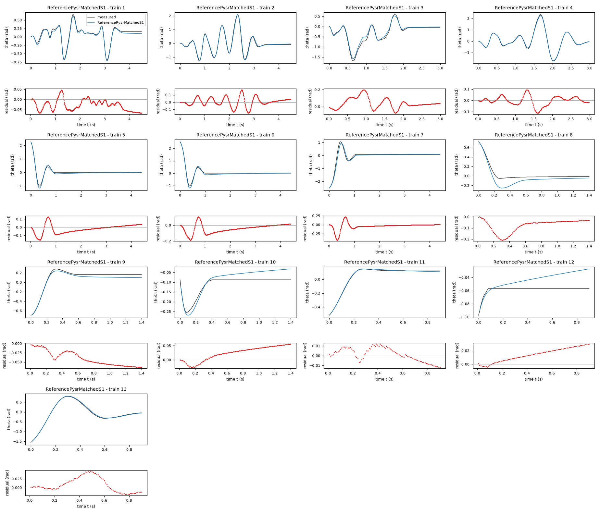
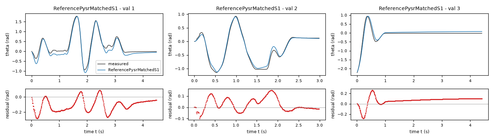
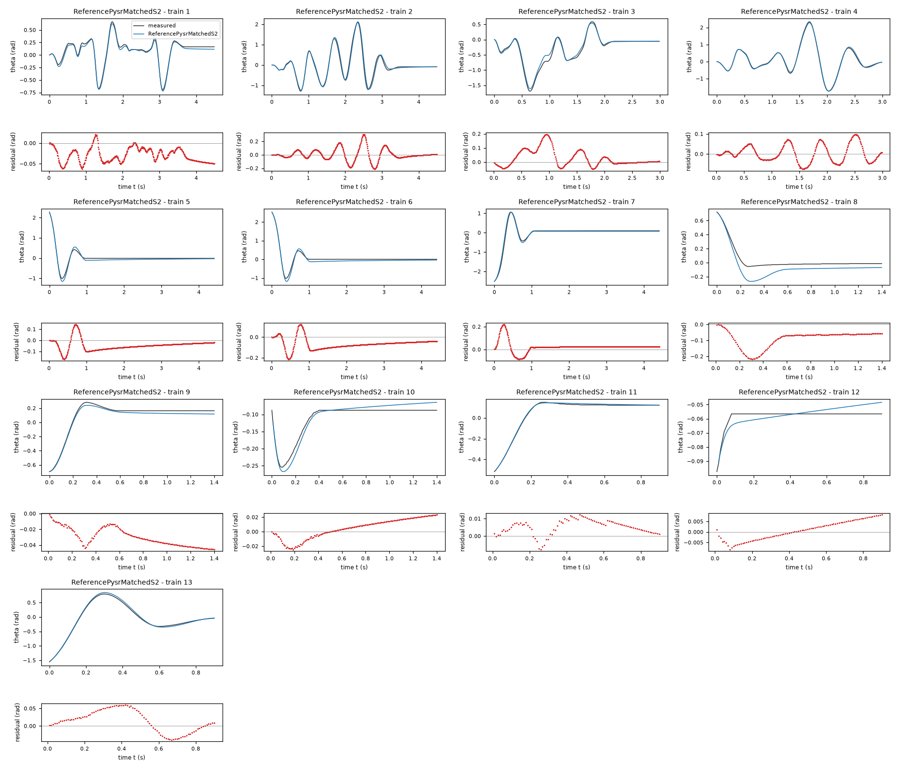
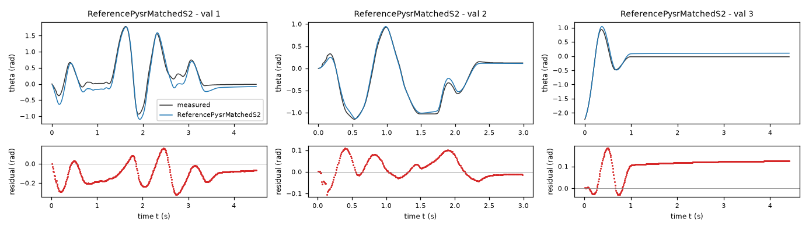
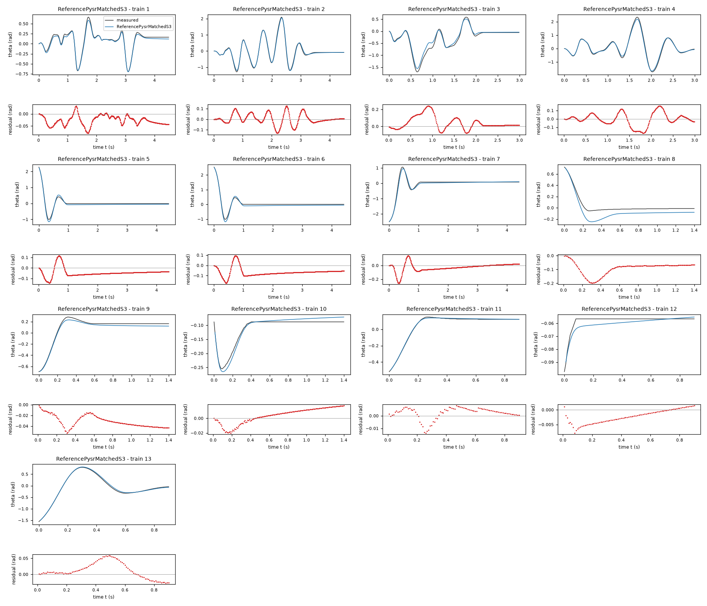
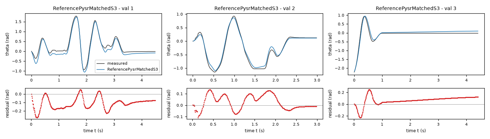
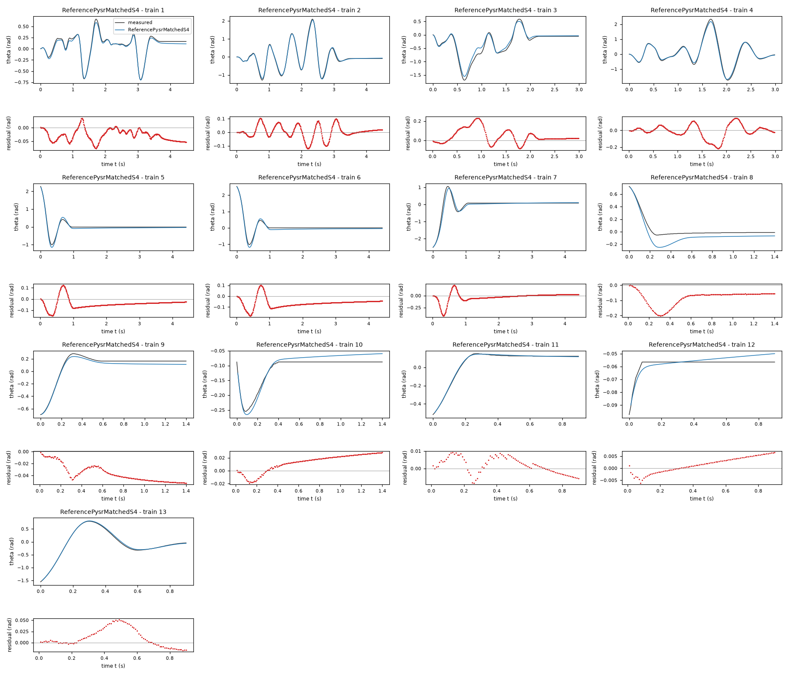
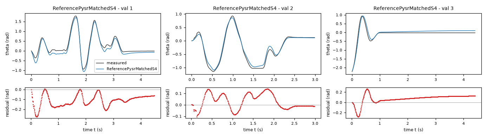
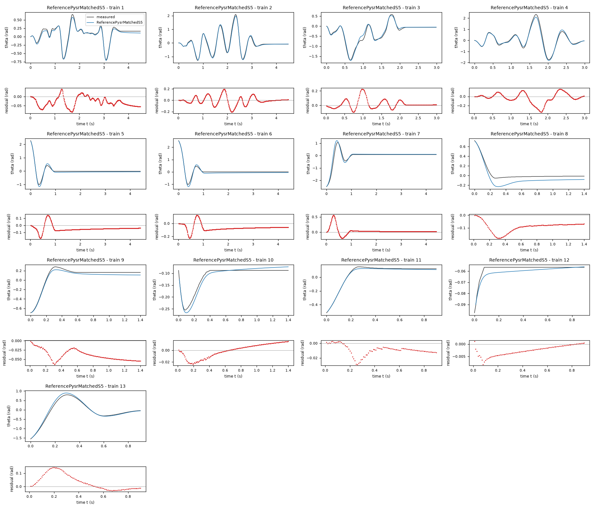
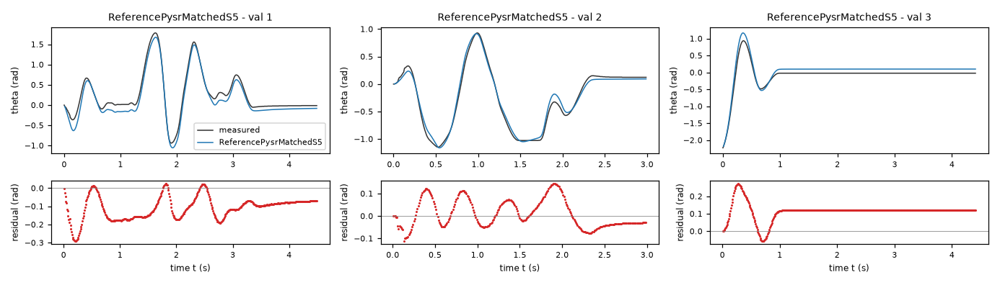

# Evaluation results permitted to the agent: task friction-driven

Terms. The harness is the software of ASPIRE that checks and evaluates the candidate models; a candidate is one proposed model; the pool is the set of candidates of one round. Sealed data (test data, reference expression) are inaccessible to the agent. This view contains no result derived from sealed data.

Evaluation mode: simulation (initialized once per trajectory from the measured state at sample 0; classical fourth-order Runge-Kutta integration with 1 step(s) per sampling period T_s = 0.01 s and zero-order hold of the input; the model output is h(x[k], u[k])).
Error measures: for one trajectory with scoring interval I of N samples, measured output y[k] (theta, rad) and model output ŷ[k], SSE = Σ_(k∈I) (ŷ[k] − y[k])²; RMSE = sqrt(SSE/N), in rad; NRMSE = RMSE/σ, with μ and σ the mean and the population standard deviation of y on I; R² = 1 − SSE / Σ_(k∈I) (y[k] − μ)²; NRMSE and R² are not applicable when σ = 0. The pooled RMSE over several trajectories is S = sqrt(ΣSSE / ΣN); on the test data it is the ranking score.
Numerical failure limits: theta in [-1000, 1000] rad; omega in [-1000, 1000] rad/s; evaluation time limit 60 s per candidate and data group; symbolic time limit 10 s per verification.
Discontinuous expressions: expressions with jumps (Piecewise, sign) are evaluated pointwise at the sample instants and Runge-Kutta stages; no event detection or step refinement is applied at a jump.
Harness version 0.1.0.dev0; NumPy 2.5.1; SymPy 1.14.0.

## Pool

| category | count |
|---|---|
| candidates proposed | 5 |
| accepted by the file and expression checks | 5 |
| outside the pool limit of 10 (not evaluated) | 0 |
| evaluated | 5 |
| excluded by physical requirements | 5 |
| failed numerically on training or validation data | 0 |

Note: the categories overlap; the counts need not sum to the pool size.

Distinct structures: 5 among 5 evaluated candidates; groups: ReferencePysrMatchedS1; ReferencePysrMatchedS2; ReferencePysrMatchedS3; ReferencePysrMatchedS4; ReferencePysrMatchedS5. Convention: ties resolved, fixed values kept, given constants kept, fitted parameters renamed P1..Pn in order of first occurrence; equal when a one-to-one renaming of the fitted parameters makes every expression identical in SymPy's canonical form.

### Recommendation of the agent

The agent recommends no candidate. Its reason: Reference models found by PySR without the agent, one per seed; none is recommended.
- Harness note: the agent recommends no candidate.

## Candidates

### Candidate ReferencePysrMatchedS1

Position in the agent's order: 1. Status: evaluated.
File and expression checks: passed.
- `dtheta = omega`
- `domega = cb1*sin(theta) + cb2*tanh(2*omega - sin(cb5*theta)) + cb3 + cb4*u - omega/tanh(exp(theta))`
Complexity: 5 fitted, 0 fixed and 0 tied parameters; 0 non-integer numeric literals; 31 expression-tree nodes (SymPy tree, every operator, function, symbol and number counted once).
Structure group 1: `dtheta = omega`; `domega = P1 + P2*sin(theta) + P3*tanh(2*omega - sin(P4*theta)) + P5*u - omega/tanh(exp(theta))`

Requirements:

| id | type | outcome | status | method | detail |
|---|---|---|---|---|---|
| R1 | equation | proof | satisfied | evaluation of a constant | the quantity is identically zero on the domain |
| R2 | inequality | counterexample | violated | interval arithmetic (branch and bound) | on a sub-box around {'theta': 0.04908738521234052} the verified lower bound 0.040705354287168795 of the quantity exceeds the tolerance 0.0 Excludes the candidate. |
| R3 | monotonicity | proof | satisfied | evaluation of a constant | the quantity reduces to the constant -26.372500657728, which does not exceed the tolerance 0.0 |

Output errors on the training data (pooled RMSE: 0.0625958 rad):

| trajectory | scored samples | completed | RMSE (rad) | NRMSE | R² | failure |
|---|---|---|---|---|---|---|
| 1 | 449 | 449 | 0.0382378 | 0.149088 | 0.977773 | none |
| 2 | 449 | 449 | 0.0622704 | 0.0934353 | 0.99127 | none |
| 3 | 299 | 299 | 0.0728211 | 0.154193 | 0.976225 | none |
| 4 | 299 | 299 | 0.0407099 | 0.0496744 | 0.997532 | none |
| 5 | 441 | 441 | 0.0562714 | 0.147018 | 0.978386 | none |
| 6 | 441 | 441 | 0.0673443 | 0.147542 | 0.978231 | none |
| 7 | 441 | 441 | 0.0970402 | 0.187033 | 0.965019 | none |
| 8 | 140 | 140 | 0.0929424 | 0.565955 | 0.679694 | none |
| 9 | 140 | 140 | 0.0446502 | 0.204174 | 0.958313 | none |
| 10 | 140 | 140 | 0.0338066 | 0.687561 | 0.52726 | none |
| 11 | 90 | 90 | 0.00688193 | 0.0418144 | 0.998252 | none |
| 12 | 90 | 90 | 0.0171058 | 3.35262 | -10.2401 | none |
| 13 | 90 | 90 | 0.0216265 | 0.0398068 | 0.998415 | none |

Output errors on the validation data (pooled RMSE: 0.108428 rad):

| trajectory | scored samples | completed | RMSE (rad) | NRMSE | R² | failure |
|---|---|---|---|---|---|---|
| 1 | 449 | 449 | 0.134667 | 0.246295 | 0.939339 | none |
| 2 | 299 | 299 | 0.0615277 | 0.110044 | 0.98789 | none |
| 3 | 441 | 441 | 0.10328 | 0.274785 | 0.924493 | none |

Sensitivity rank test (diagnostic; never excludes): targets domega on the train, val data (4714 rows, 0 dropped); analytic derivatives (SymPy), ties differentiated through their equations; scaling: rows of each target divided by the standard deviation of its measured column; columns divided by their Euclidean norm; rank threshold s_i / s_1 > 1e-08; singular values 1.15, 1.11, 0.996, 0.968, 0.715; rank 5 of 5.

*Candidate ReferencePysrMatchedS1, training data, trajectories 1, 2, 3, 4, 5, 6, 7, 8, 9, 10, 11, 12, 13. Upper axes: measured output theta (rad) and model output of ReferencePysrMatchedS1; lower axes: residual (model output minus measured output, rad). Evaluation mode: simulation (initialized once per trajectory from the measured state at sample 0; classical fourth-order Runge-Kutta integration with 1 step(s) per sampling period T_s = 0.01 s and zero-order hold of the input; the model output is h(x[k], u[k])). Initialization: the first 1 sample(s) of each trajectory initialize the model and are excluded from the errors. Errors are computed on the samples 1: 1 to 449; 2: 1 to 449; 3: 1 to 299; 4: 1 to 299; 5: 1 to 441; 6: 1 to 441; 7: 1 to 441; 8: 1 to 140; 9: 1 to 140; 10: 1 to 140; 11: 1 to 90; 12: 1 to 90; 13: 1 to 90 (0-based sample indices). No numerical failure occurred. The candidate is excluded from ranking by the demonstrated violation of R2.*

*Candidate ReferencePysrMatchedS1, validation data, trajectories 1, 2, 3. Upper axes: measured output theta (rad) and model output of ReferencePysrMatchedS1; lower axes: residual (model output minus measured output, rad). Evaluation mode: simulation (initialized once per trajectory from the measured state at sample 0; classical fourth-order Runge-Kutta integration with 1 step(s) per sampling period T_s = 0.01 s and zero-order hold of the input; the model output is h(x[k], u[k])). Initialization: the first 1 sample(s) of each trajectory initialize the model and are excluded from the errors. Errors are computed on the samples 1: 1 to 449; 2: 1 to 299; 3: 1 to 441 (0-based sample indices). No numerical failure occurred. The candidate is excluded from ranking by the demonstrated violation of R2.*

### Candidate ReferencePysrMatchedS2

Position in the agent's order: 2. Status: evaluated.
File and expression checks: passed.
- `dtheta = omega`
- `domega = cb2*tanh(cb4*omega - sin(cb6*theta)) + cb3 + cb5*u - omega + (cb1 - omega*theta + omega)*sin(theta)`
Complexity: 6 fitted, 0 fixed and 0 tied parameters; 0 non-integer numeric literals; 32 expression-tree nodes (SymPy tree, every operator, function, symbol and number counted once).
Structure group 2: `dtheta = omega`; `domega = P1 + P2*tanh(P4*omega - sin(P3*theta)) + P5*u - omega + (P6 - omega*theta + omega)*sin(theta)`

Requirements:

| id | type | outcome | status | method | detail |
|---|---|---|---|---|---|
| R1 | equation | proof | satisfied | evaluation of a constant | the quantity is identically zero on the domain |
| R2 | inequality | counterexample | violated | interval arithmetic (branch and bound) | on a sub-box around {'theta': 0.09817477042468103} the verified lower bound 0.021266853381202263 of the quantity exceeds the tolerance 0.0 Excludes the candidate. |
| R3 | monotonicity | proof | satisfied | evaluation of a constant | the quantity reduces to the constant -26.424824, which does not exceed the tolerance 0.0 |

Output errors on the training data (pooled RMSE: 0.063234 rad):

| trajectory | scored samples | completed | RMSE (rad) | NRMSE | R² | failure |
|---|---|---|---|---|---|---|
| 1 | 449 | 449 | 0.0338493 | 0.131978 | 0.982582 | none |
| 2 | 449 | 449 | 0.0901711 | 0.1353 | 0.981694 | none |
| 3 | 299 | 299 | 0.0639111 | 0.135327 | 0.981687 | none |
| 4 | 299 | 299 | 0.0427837 | 0.0522048 | 0.997275 | none |
| 5 | 441 | 441 | 0.0664223 | 0.173538 | 0.969884 | none |
| 6 | 441 | 441 | 0.0838625 | 0.183732 | 0.966243 | none |
| 7 | 441 | 441 | 0.0543497 | 0.104752 | 0.989027 | none |
| 8 | 140 | 140 | 0.102363 | 0.62332 | 0.611472 | none |
| 9 | 140 | 140 | 0.0320455 | 0.146536 | 0.978527 | none |
| 10 | 140 | 140 | 0.014149 | 0.287763 | 0.917192 | none |
| 11 | 90 | 90 | 0.00669177 | 0.040659 | 0.998347 | none |
| 12 | 90 | 90 | 0.00448716 | 0.879453 | 0.226563 | none |
| 13 | 90 | 90 | 0.0337702 | 0.0621591 | 0.996136 | none |

Output errors on the validation data (pooled RMSE: 0.116368 rad):

| trajectory | scored samples | completed | RMSE (rad) | NRMSE | R² | failure |
|---|---|---|---|---|---|---|
| 1 | 449 | 449 | 0.147928 | 0.270549 | 0.926803 | none |
| 2 | 299 | 299 | 0.047884 | 0.0856415 | 0.992666 | none |
| 3 | 441 | 441 | 0.112587 | 0.299547 | 0.910272 | none |

Sensitivity rank test (diagnostic; never excludes): targets domega on the train, val data (4714 rows, 0 dropped); analytic derivatives (SymPy), ties differentiated through their equations; scaling: rows of each target divided by the standard deviation of its measured column; columns divided by their Euclidean norm; rank threshold s_i / s_1 > 1e-08; singular values 1.19, 1.15, 1.03, 0.958, 0.899, 0.698; rank 6 of 6.

*Candidate ReferencePysrMatchedS2, training data, trajectories 1, 2, 3, 4, 5, 6, 7, 8, 9, 10, 11, 12, 13. Upper axes: measured output theta (rad) and model output of ReferencePysrMatchedS2; lower axes: residual (model output minus measured output, rad). Evaluation mode: simulation (initialized once per trajectory from the measured state at sample 0; classical fourth-order Runge-Kutta integration with 1 step(s) per sampling period T_s = 0.01 s and zero-order hold of the input; the model output is h(x[k], u[k])). Initialization: the first 1 sample(s) of each trajectory initialize the model and are excluded from the errors. Errors are computed on the samples 1: 1 to 449; 2: 1 to 449; 3: 1 to 299; 4: 1 to 299; 5: 1 to 441; 6: 1 to 441; 7: 1 to 441; 8: 1 to 140; 9: 1 to 140; 10: 1 to 140; 11: 1 to 90; 12: 1 to 90; 13: 1 to 90 (0-based sample indices). No numerical failure occurred. The candidate is excluded from ranking by the demonstrated violation of R2.*

*Candidate ReferencePysrMatchedS2, validation data, trajectories 1, 2, 3. Upper axes: measured output theta (rad) and model output of ReferencePysrMatchedS2; lower axes: residual (model output minus measured output, rad). Evaluation mode: simulation (initialized once per trajectory from the measured state at sample 0; classical fourth-order Runge-Kutta integration with 1 step(s) per sampling period T_s = 0.01 s and zero-order hold of the input; the model output is h(x[k], u[k])). Initialization: the first 1 sample(s) of each trajectory initialize the model and are excluded from the errors. Errors are computed on the samples 1: 1 to 449; 2: 1 to 299; 3: 1 to 441 (0-based sample indices). No numerical failure occurred. The candidate is excluded from ranking by the demonstrated violation of R2.*

### Candidate ReferencePysrMatchedS3

Position in the agent's order: 3. Status: evaluated.
File and expression checks: passed.
- `dtheta = omega`
- `domega = cb1*sin(theta) + cb2*tanh(tanh(cb4*omega - tanh(sin(cb6*theta)))) + cb5*u + (cb3 - omega)/tanh(exp(theta))`
Complexity: 6 fitted, 0 fixed and 0 tied parameters; 0 non-integer numeric literals; 35 expression-tree nodes (SymPy tree, every operator, function, symbol and number counted once).
Structure group 3: `dtheta = omega`; `domega = P1*sin(theta) + P2*tanh(tanh(P4*omega - tanh(sin(P3*theta)))) + P5*u + (P6 - omega)/tanh(exp(theta))`

Requirements:

| id | type | outcome | status | method | detail |
|---|---|---|---|---|---|
| R1 | equation | proof | satisfied | evaluation of a constant | the quantity is identically zero on the domain |
| R2 | inequality | counterexample | violated | interval arithmetic (branch and bound) | on a sub-box around {'theta': 0.09817477042468103} the verified lower bound 0.07052264290333708 of the quantity exceeds the tolerance 0.0 Excludes the candidate. |
| R3 | monotonicity | proof | satisfied | evaluation of a constant | the quantity reduces to the constant -26.214922, which does not exceed the tolerance 0.0 |

Output errors on the training data (pooled RMSE: 0.0619488 rad):

| trajectory | scored samples | completed | RMSE (rad) | NRMSE | R² | failure |
|---|---|---|---|---|---|---|
| 1 | 449 | 449 | 0.0333438 | 0.130007 | 0.983098 | none |
| 2 | 449 | 449 | 0.0517535 | 0.077655 | 0.99397 | none |
| 3 | 299 | 299 | 0.0860005 | 0.182099 | 0.96684 | none |
| 4 | 299 | 299 | 0.076314 | 0.0931187 | 0.991329 | none |
| 5 | 441 | 441 | 0.0607382 | 0.158688 | 0.974818 | none |
| 6 | 441 | 441 | 0.0782994 | 0.171543 | 0.970573 | none |
| 7 | 441 | 441 | 0.0645346 | 0.124382 | 0.984529 | none |
| 8 | 140 | 140 | 0.10016 | 0.609907 | 0.628014 | none |
| 9 | 140 | 140 | 0.0329434 | 0.150642 | 0.977307 | none |
| 10 | 140 | 140 | 0.0110438 | 0.22461 | 0.94955 | none |
| 11 | 90 | 90 | 0.00528054 | 0.0320844 | 0.998971 | none |
| 12 | 90 | 90 | 0.00321083 | 0.629301 | 0.60398 | none |
| 13 | 90 | 90 | 0.0274069 | 0.0504465 | 0.997455 | none |

Output errors on the validation data (pooled RMSE: 0.10456 rad):

| trajectory | scored samples | completed | RMSE (rad) | NRMSE | R² | failure |
|---|---|---|---|---|---|---|
| 1 | 449 | 449 | 0.128007 | 0.234115 | 0.94519 | none |
| 2 | 299 | 299 | 0.0668342 | 0.119534 | 0.985712 | none |
| 3 | 441 | 441 | 0.0988168 | 0.26291 | 0.930878 | none |

Sensitivity rank test (diagnostic; never excludes): targets domega on the train, val data (4714 rows, 0 dropped); analytic derivatives (SymPy), ties differentiated through their equations; scaling: rows of each target divided by the standard deviation of its measured column; columns divided by their Euclidean norm; rank threshold s_i / s_1 > 1e-08; singular values 1.21, 1.18, 1.03, 0.938, 0.853, 0.688; rank 6 of 6.

*Candidate ReferencePysrMatchedS3, training data, trajectories 1, 2, 3, 4, 5, 6, 7, 8, 9, 10, 11, 12, 13. Upper axes: measured output theta (rad) and model output of ReferencePysrMatchedS3; lower axes: residual (model output minus measured output, rad). Evaluation mode: simulation (initialized once per trajectory from the measured state at sample 0; classical fourth-order Runge-Kutta integration with 1 step(s) per sampling period T_s = 0.01 s and zero-order hold of the input; the model output is h(x[k], u[k])). Initialization: the first 1 sample(s) of each trajectory initialize the model and are excluded from the errors. Errors are computed on the samples 1: 1 to 449; 2: 1 to 449; 3: 1 to 299; 4: 1 to 299; 5: 1 to 441; 6: 1 to 441; 7: 1 to 441; 8: 1 to 140; 9: 1 to 140; 10: 1 to 140; 11: 1 to 90; 12: 1 to 90; 13: 1 to 90 (0-based sample indices). No numerical failure occurred. The candidate is excluded from ranking by the demonstrated violation of R2.*

*Candidate ReferencePysrMatchedS3, validation data, trajectories 1, 2, 3. Upper axes: measured output theta (rad) and model output of ReferencePysrMatchedS3; lower axes: residual (model output minus measured output, rad). Evaluation mode: simulation (initialized once per trajectory from the measured state at sample 0; classical fourth-order Runge-Kutta integration with 1 step(s) per sampling period T_s = 0.01 s and zero-order hold of the input; the model output is h(x[k], u[k])). Initialization: the first 1 sample(s) of each trajectory initialize the model and are excluded from the errors. Errors are computed on the samples 1: 1 to 449; 2: 1 to 299; 3: 1 to 441 (0-based sample indices). No numerical failure occurred. The candidate is excluded from ranking by the demonstrated violation of R2.*

### Candidate ReferencePysrMatchedS4

Position in the agent's order: 4. Status: evaluated.
File and expression checks: passed.
- `dtheta = omega`
- `domega = cb1*sin(theta) + cb2*tanh(tanh(omega + sin(omega) - tanh(tanh(sin(cb5*theta))))) + cb3 + cb4*u - omega/tanh(exp(theta))`
Complexity: 5 fitted, 0 fixed and 0 tied parameters; 0 non-integer numeric literals; 34 expression-tree nodes (SymPy tree, every operator, function, symbol and number counted once).
Structure group 4: `dtheta = omega`; `domega = P1 + P2*sin(theta) + P3*tanh(tanh(omega + sin(omega) - tanh(tanh(sin(P4*theta))))) + P5*u - omega/tanh(exp(theta))`

Requirements:

| id | type | outcome | status | method | detail |
|---|---|---|---|---|---|
| R1 | equation | proof | satisfied | evaluation of a constant | the quantity is identically zero on the domain |
| R2 | inequality | counterexample | violated | interval arithmetic (branch and bound) | on a sub-box around {'theta': 0.09817477042468103} the verified lower bound 0.04476601059410371 of the quantity exceeds the tolerance 0.0 Excludes the candidate. |
| R3 | monotonicity | proof | satisfied | evaluation of a constant | the quantity reduces to the constant -26.13014579001282, which does not exceed the tolerance 0.0 |

Output errors on the training data (pooled RMSE: 0.0667165 rad):

| trajectory | scored samples | completed | RMSE (rad) | NRMSE | R² | failure |
|---|---|---|---|---|---|---|
| 1 | 449 | 449 | 0.0350095 | 0.136501 | 0.981367 | none |
| 2 | 449 | 449 | 0.0478625 | 0.0718167 | 0.994842 | none |
| 3 | 299 | 299 | 0.0843841 | 0.178677 | 0.968075 | none |
| 4 | 299 | 299 | 0.0810229 | 0.0988645 | 0.990226 | none |
| 5 | 441 | 441 | 0.061295 | 0.160143 | 0.974354 | none |
| 6 | 441 | 441 | 0.0769374 | 0.16856 | 0.971588 | none |
| 7 | 441 | 441 | 0.0964766 | 0.185947 | 0.965424 | none |
| 8 | 140 | 140 | 0.095028 | 0.578655 | 0.665158 | none |
| 9 | 140 | 140 | 0.0391286 | 0.178925 | 0.967986 | none |
| 10 | 140 | 140 | 0.0181546 | 0.369229 | 0.86367 | none |
| 11 | 90 | 90 | 0.00498614 | 0.0302956 | 0.999082 | none |
| 12 | 90 | 90 | 0.00350205 | 0.686378 | 0.528886 | none |
| 13 | 90 | 90 | 0.0230786 | 0.0424795 | 0.998195 | none |

Output errors on the validation data (pooled RMSE: 0.109016 rad):

| trajectory | scored samples | completed | RMSE (rad) | NRMSE | R² | failure |
|---|---|---|---|---|---|---|
| 1 | 449 | 449 | 0.125251 | 0.229075 | 0.947524 | none |
| 2 | 299 | 299 | 0.070916 | 0.126835 | 0.983913 | none |
| 3 | 441 | 441 | 0.112518 | 0.299363 | 0.910382 | none |

Sensitivity rank test (diagnostic; never excludes): targets domega on the train, val data (4714 rows, 0 dropped); analytic derivatives (SymPy), ties differentiated through their equations; scaling: rows of each target divided by the standard deviation of its measured column; columns divided by their Euclidean norm; rank threshold s_i / s_1 > 1e-08; singular values 1.16, 1.09, 1.01, 0.977, 0.717; rank 5 of 5.

*Candidate ReferencePysrMatchedS4, training data, trajectories 1, 2, 3, 4, 5, 6, 7, 8, 9, 10, 11, 12, 13. Upper axes: measured output theta (rad) and model output of ReferencePysrMatchedS4; lower axes: residual (model output minus measured output, rad). Evaluation mode: simulation (initialized once per trajectory from the measured state at sample 0; classical fourth-order Runge-Kutta integration with 1 step(s) per sampling period T_s = 0.01 s and zero-order hold of the input; the model output is h(x[k], u[k])). Initialization: the first 1 sample(s) of each trajectory initialize the model and are excluded from the errors. Errors are computed on the samples 1: 1 to 449; 2: 1 to 449; 3: 1 to 299; 4: 1 to 299; 5: 1 to 441; 6: 1 to 441; 7: 1 to 441; 8: 1 to 140; 9: 1 to 140; 10: 1 to 140; 11: 1 to 90; 12: 1 to 90; 13: 1 to 90 (0-based sample indices). No numerical failure occurred. The candidate is excluded from ranking by the demonstrated violation of R2.*

*Candidate ReferencePysrMatchedS4, validation data, trajectories 1, 2, 3. Upper axes: measured output theta (rad) and model output of ReferencePysrMatchedS4; lower axes: residual (model output minus measured output, rad). Evaluation mode: simulation (initialized once per trajectory from the measured state at sample 0; classical fourth-order Runge-Kutta integration with 1 step(s) per sampling period T_s = 0.01 s and zero-order hold of the input; the model output is h(x[k], u[k])). Initialization: the first 1 sample(s) of each trajectory initialize the model and are excluded from the errors. Errors are computed on the samples 1: 1 to 449; 2: 1 to 299; 3: 1 to 441 (0-based sample indices). No numerical failure occurred. The candidate is excluded from ranking by the demonstrated violation of R2.*

### Candidate ReferencePysrMatchedS5

Position in the agent's order: 5. Status: evaluated.
File and expression checks: passed.
- `dtheta = omega`
- `domega = cb1*omega + cb2*sin(theta) + cb3*sin(tanh(omega + tanh(omega - sin(sin(cb6*theta))))) + cb4 + cb5*u`
Complexity: 6 fitted, 0 fixed and 0 tied parameters; 0 non-integer numeric literals; 29 expression-tree nodes (SymPy tree, every operator, function, symbol and number counted once).
Structure group 5: `dtheta = omega`; `domega = P1 + P2*omega + P3*sin(theta) + P4*sin(tanh(omega + tanh(omega - sin(sin(P5*theta))))) + P6*u`

Requirements:

| id | type | outcome | status | method | detail |
|---|---|---|---|---|---|
| R1 | equation | proof | satisfied | evaluation of a constant | the quantity is identically zero on the domain |
| R2 | inequality | counterexample | violated | interval arithmetic (branch and bound) | on a sub-box around {'theta': 0.09817477042468103} the verified lower bound 0.00813045577241028 of the quantity exceeds the tolerance 0.0 Excludes the candidate. |
| R3 | monotonicity | proof | satisfied | evaluation of a constant | the quantity reduces to the constant -26.28699474687971, which does not exceed the tolerance 0.0 |

Output errors on the training data (pooled RMSE: 0.0786309 rad):

| trajectory | scored samples | completed | RMSE (rad) | NRMSE | R² | failure |
|---|---|---|---|---|---|---|
| 1 | 449 | 449 | 0.0394385 | 0.15377 | 0.976355 | none |
| 2 | 449 | 449 | 0.0757001 | 0.113586 | 0.987098 | none |
| 3 | 299 | 299 | 0.0649614 | 0.137551 | 0.98108 | none |
| 4 | 299 | 299 | 0.114339 | 0.139517 | 0.980535 | none |
| 5 | 441 | 441 | 0.0648213 | 0.169356 | 0.971319 | none |
| 6 | 441 | 441 | 0.0832294 | 0.182345 | 0.96675 | none |
| 7 | 441 | 441 | 0.119749 | 0.230801 | 0.946731 | none |
| 8 | 140 | 140 | 0.0986395 | 0.600647 | 0.639223 | none |
| 9 | 140 | 140 | 0.0415669 | 0.190075 | 0.963872 | none |
| 10 | 140 | 140 | 0.0114928 | 0.233742 | 0.945365 | none |
| 11 | 90 | 90 | 0.0114598 | 0.0696292 | 0.995152 | none |
| 12 | 90 | 90 | 0.00326904 | 0.640709 | 0.589492 | none |
| 13 | 90 | 90 | 0.0655204 | 0.1206 | 0.985456 | none |

Output errors on the validation data (pooled RMSE: 0.11325 rad):

| trajectory | scored samples | completed | RMSE (rad) | NRMSE | R² | failure |
|---|---|---|---|---|---|---|
| 1 | 449 | 449 | 0.125342 | 0.229242 | 0.947448 | none |
| 2 | 299 | 299 | 0.0637597 | 0.114036 | 0.986996 | none |
| 3 | 441 | 441 | 0.125808 | 0.334722 | 0.887961 | none |

Sensitivity rank test (diagnostic; never excludes): targets domega on the train, val data (4714 rows, 0 dropped); analytic derivatives (SymPy), ties differentiated through their equations; scaling: rows of each target divided by the standard deviation of its measured column; columns divided by their Euclidean norm; rank threshold s_i / s_1 > 1e-08; singular values 1.41, 1.08, 1, 0.995, 0.765, 0.51; rank 6 of 6.

*Candidate ReferencePysrMatchedS5, training data, trajectories 1, 2, 3, 4, 5, 6, 7, 8, 9, 10, 11, 12, 13. Upper axes: measured output theta (rad) and model output of ReferencePysrMatchedS5; lower axes: residual (model output minus measured output, rad). Evaluation mode: simulation (initialized once per trajectory from the measured state at sample 0; classical fourth-order Runge-Kutta integration with 1 step(s) per sampling period T_s = 0.01 s and zero-order hold of the input; the model output is h(x[k], u[k])). Initialization: the first 1 sample(s) of each trajectory initialize the model and are excluded from the errors. Errors are computed on the samples 1: 1 to 449; 2: 1 to 449; 3: 1 to 299; 4: 1 to 299; 5: 1 to 441; 6: 1 to 441; 7: 1 to 441; 8: 1 to 140; 9: 1 to 140; 10: 1 to 140; 11: 1 to 90; 12: 1 to 90; 13: 1 to 90 (0-based sample indices). No numerical failure occurred. The candidate is excluded from ranking by the demonstrated violation of R2.*

*Candidate ReferencePysrMatchedS5, validation data, trajectories 1, 2, 3. Upper axes: measured output theta (rad) and model output of ReferencePysrMatchedS5; lower axes: residual (model output minus measured output, rad). Evaluation mode: simulation (initialized once per trajectory from the measured state at sample 0; classical fourth-order Runge-Kutta integration with 1 step(s) per sampling period T_s = 0.01 s and zero-order hold of the input; the model output is h(x[k], u[k])). Initialization: the first 1 sample(s) of each trajectory initialize the model and are excluded from the errors. Errors are computed on the samples 1: 1 to 449; 2: 1 to 299; 3: 1 to 441 (0-based sample indices). No numerical failure occurred. The candidate is excluded from ranking by the demonstrated violation of R2.*
